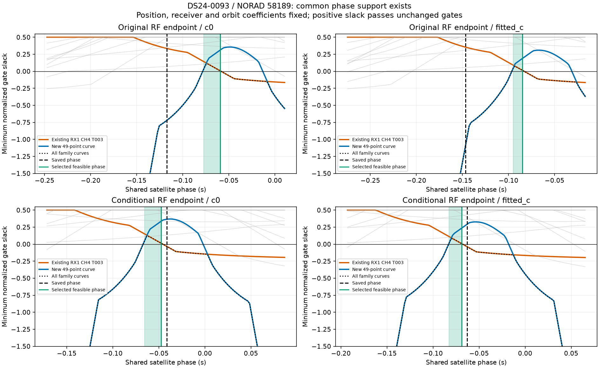
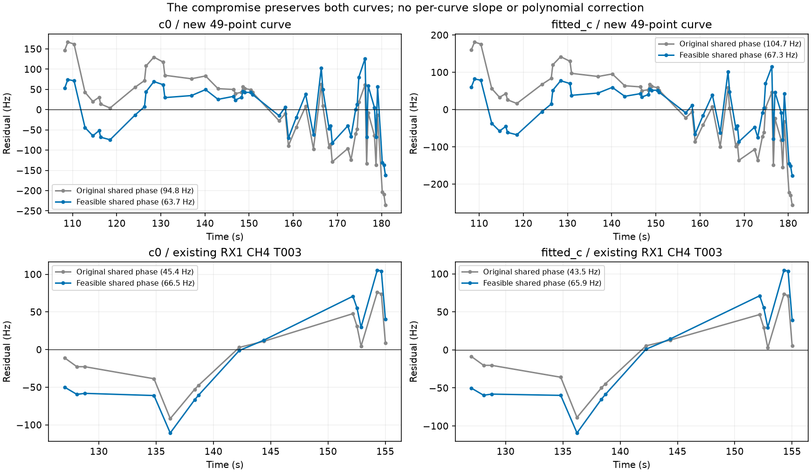
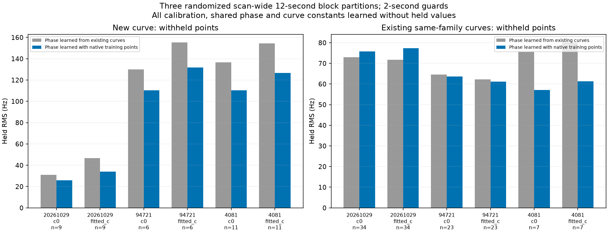
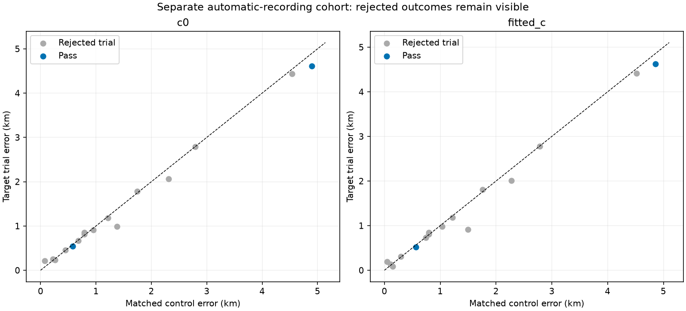

# Shared-phase feasibility: DS24-0093 and the next inventory batch

**Subsequent correction:** The [retrospective exact-orbit audit](../2026_10_30_phase_reference_retrospective/README.md) rejects the provisional 52-point AUTO-bed86935 graph recovery reported below. Phase-reference clipping concealed nonconvergence and a large orbit-approximation error. The historical tables are preserved; the two-candidate/104-point graph total is not a verified recovery total. This correction does not alter the separate DS24-0093 feasibility experiment.

DS24-0093's 49-point RX1 CH4 native curve can coexist with all old associations under the existing residual, alias, elevation and owner gates. At both previously saved RF endpoints, a narrow interval of shared NORAD **58189** phase values satisfies every gate in both c arms. Position, receiver coefficients, orbit coefficients, observations and identities remain fixed. This disproves the narrower hypothesis that the old and new curves necessarily conflict at these endpoints; it does not prove the satellite identity or improve position by itself.

This follows the [parameter consistency report](../2026_10_30_native_parameter_consistency/README.md). No native points from this experiment enter the accepted research-policy totals and production is unchanged. Separately, two of 16 original-model graph trials pass and add 104 points across two automatic recordings, with no old points lost. These are a separate cohort, not additions to DS24's native-recovery percentage.

## Why the previous optimizer rejected a feasible family

The previous position solver varied east/north coordinates while phase and fragment constants were set to posterior means. Its feasible search therefore could not explore every admissible phase realization at a fixed position. The unconstrained satellite/bias update preferred a phase just beyond the old RX1 CH4 T003 slope gate. The original model's phase left a slope and other structure in the new curve. A small compromise in the **same existing phase parameter** satisfies both.

We replay both saved RF-only endpoints and their objectives to 1e-5. The phase diagnostic uses exact causal orbit evaluation, including the existing physical orbit correction at each trial phase, rather than relying on a stale linearization. Receiver and orbit coefficients stay fixed. Existing curved-fragment constants are reconciled analytically with their original 300 Hz prior and frozen hierarchical noise precision. Original profile checks still use their original 1,000 Hz profile constant; native/predictive checks retain their 300 Hz constant. These different conditional/profile operations reproduce the existing gate definitions.

The conditional phase score includes the existing phase prior, weighted old-curve residuals and constant penalties, plus predictive-curve variance **2 × sigma²** and 300 Hz constants. Other coefficients and Gamma precisions are conditioned at their saved values. This conditional MAP score is not the marginalized position ELBO, and its decrease is not evidence of better location accuracy.

The grid covers −15 to +15 seconds at 0.1-second spacing, plus ±1 second around each saved phase at 0.002-second spacing. We record sampled passing runs without interpolating over failing samples. These narrow intervals are about 10–18 milliseconds wide at the sampled endpoints; a coarse grid can miss them. The best sampled phase by conditional score **among passing family phases** is replayed against every original curved/predictive gate in the scan. The complete scan passes at all four selected phases. This is an existence demonstration, not a proof of global optimality or completeness of the coarse search.

| endpoint | arm | original_phase_s | selected_phase_s | target_RMS_before_hz | target_RMS_after_hz | minimum_all_gate_slack | conditional_score_penalty_vs_unconstrained | fixed_position_error_km |
| --- | --- | --- | --- | --- | --- | --- | --- | --- |
| original | c0 | -0.117 | -0.059 | 94.842 | 63.680 | 0.007 | 0.352 | 0.704 |
| original | fitted_c | -0.147 | -0.085 | 104.684 | 67.290 | 0.013 | 0.580 | 0.744 |
| conditional | c0 | -0.041 | -0.047 | 62.053 | 63.050 | 0.013 | 0.356 | 0.570 |
| conditional | fitted_c | -0.063 | -0.069 | 64.403 | 65.868 | 0.007 | 0.357 | 0.601 |

Position errors describe the frozen source-trial endpoints, which were previously rejected as complete fits; they are **not newly accepted localization results**. The phase scan cannot change those errors. All receiver-coordinate changes are exactly zero. No per-track slopes, higher-order polynomials, new orbital modes, expanded priors, relaxed gates or future TLEs are used. GPS appears only in report evaluation.

[Every family residual](family_gallery.md), [phase summary](phase_summary.csv), and [all scan gate slacks](all_gate_slacks.csv) preserve the old-curve costs of the compromise. The highest-likelihood feasible values lie close to a gate boundary; their positive slack should not be mistaken for strong statistical assurance.

## Does a phase learned without the test points help them?

Three previously recorded distinct randomized 12-second block partitions, with two-second guards, are applied across the entire scan. Receiver/position calibration is refitted from the regional center using only old curved training points, fixed 150 Hz noise and unit curve powers. The one-dimensional exact phase search then compares learning from old training curves alone with learning from old plus native training points. Both use the same causal priors, fixed training receiver/orbit coefficients and train-only curve constants. The phase grid is centered using training calibration only. Selection minimizes training conditional cost and never examines held residuals. Old witness curves require at least four training points; omitted curves are not implied to have been validated.

| seed | arm | target_held_points | target_before_RMS_hz | target_after_RMS_hz | existing_held_points | existing_before_RMS_hz | existing_after_RMS_hz |
| --- | --- | --- | --- | --- | --- | --- | --- |
| 20261029 | c0 | 9 | 30.941 | 25.768 | 34 | 72.988 | 75.822 |
| 20261029 | fitted_c | 9 | 46.773 | 34.087 | 34 | 71.698 | 77.283 |
| 94721 | c0 | 6 | 129.836 | 110.413 | 23 | 64.558 | 63.670 |
| 94721 | fitted_c | 6 | 155.208 | 131.645 | 23 | 62.211 | 61.200 |
| 4081 | c0 | 11 | 136.515 | 110.459 | 7 | 75.807 | 57.104 |
| 4081 | fitted_c | 11 | 154.313 | 126.599 | 7 | 80.097 | 61.293 |

The native curve improves in **6/6** comparisons. Existing same-family held RMS improves in **4/6**; the remaining comparisons worsen. The last partition has only seven old-family held points, so its large apparent improvement has limited support. These are overlapping randomized partitions, not independent experiments to pool into significance. The graph and identity hypothesis were previously selected using full observations; this is conditional model validation, not an independent false-association test. Phase/position uncertainty is not integrated in these RMS diagnostics. Other-family predictions are unchanged because receiver, position and their satellite parameters remain fixed.

[Held summary](held_predictions.csv) and [every held witness](held_witnesses.csv) retain the mixed outcomes. This supports explicitly representing shared satellite nuisance variables during constrained optimization. It does not yet authorize promoting this procedure or counting the 49 native points as recovered.

## Bounded inventory and original-model graph inclusions

The original graph ledger advances from 836 to **868/1,630** scientifically assessed entries. This batch's execution/scientific outcomes are `{'prediction_mismatch': 3, 'conditionally_supported_identity': 18, 'ambiguous_identity': 7, 'unstable_identity': 4}`. Timeouts remain explicit unresolved executions, not scientific rejections. Native overlapping proposals are kept separate from these 1,630 graph entries.

All 16 supported identities from the preceding completed batch receive matched original-model control/target position trials. Both c arms use the same observations, candidates, priors and budgets. Two trials pass every qualification and preserve all old points; the other 14 are retained as rejected outcomes with their gate failures. Passing scientific checks does not establish true satellite identity or guarantee better localization.

| scan | arm | norad | added | lost | before_error_km | after_error_km |
| --- | --- | --- | --- | --- | --- | --- |
| AUTO-bed86935 | c0 | 57641 | 52 | 0 | 4.896 | 4.610 |
| AUTO-bed86935 | fitted_c | 57641 | 52 | 0 | 4.860 | 4.626 |
| AUTO-afec5a1f | c0 | 59632 | 52 | 0 | 0.575 | 0.538 |
| AUTO-afec5a1f | fitted_c | 59632 | 52 | 0 | 0.564 | 0.522 |

[All 16 GLRT/orbit/residual plots](graph_gallery.md), [all position trials](graph_trials.csv), [replayed failures](graph_gate_failures.csv), [updated ledger](annotation_ledger.csv), and [batch classifications](annotation_batch.csv).

## Next bounded experiment

Prototype an explicit shared-phase constrained fit with the unchanged priors and full old/new gates, keeping the receiver update policy explicit. Compare its no-addition control and added-target fit in both c arms, including final exact orbit replay and membership retention. Broaden randomized predictive checks before promotion; do not optimize by evaluation error. DS24-0063's proposed receiver explanation remains a different hypothesis: learn a correction from other satellite families first, then test its transfer to the withheld native curve.

Validation covers 13 targeted test cases across the phase/constant helpers, conditional Gaussian update, native position fitting and supported graph selection. Report links, archive readability and ledger/trial row counts were checked; the phase-support and residual figures were inspected. The existing nonstandard constant-prior scaling on a different satellite is preserved; all investigated NORAD 58189 constant columns have the ordinary scale.

[Summary](summary.json), [source hashes](sources.json), [compact numerical evidence](evidence.json.gz). The systematic annotation and inclusion objective remains active.
