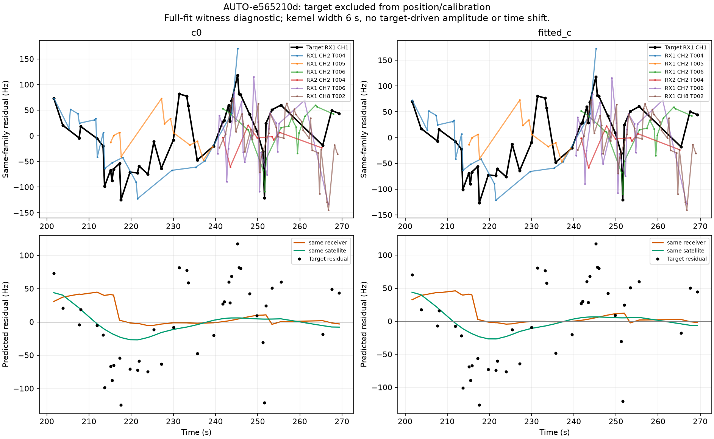
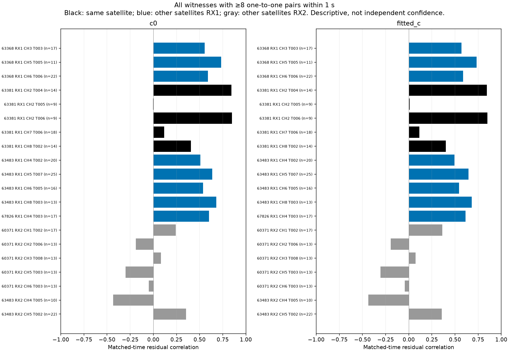
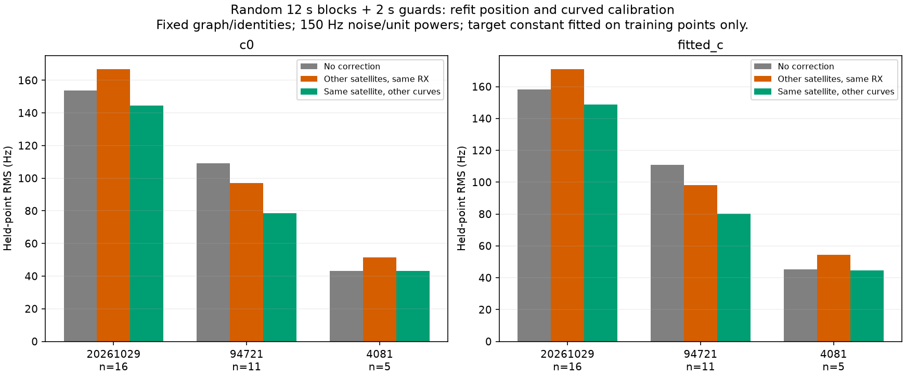
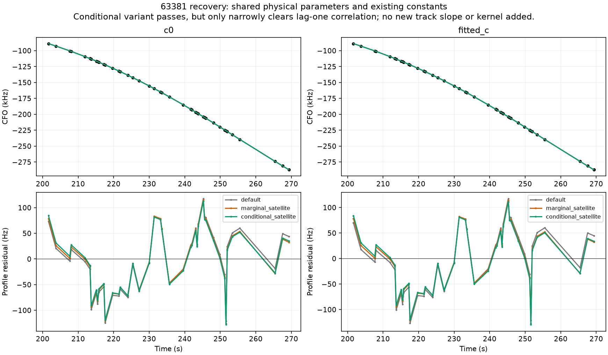
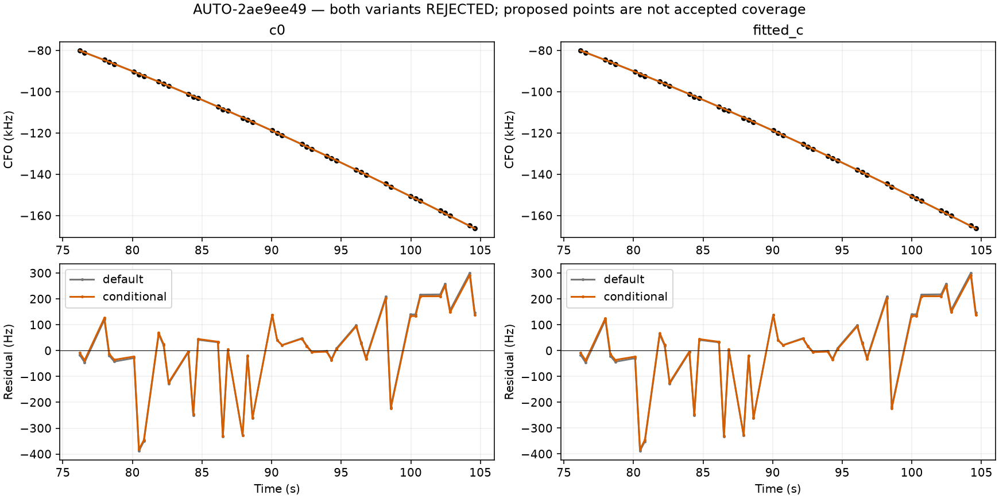
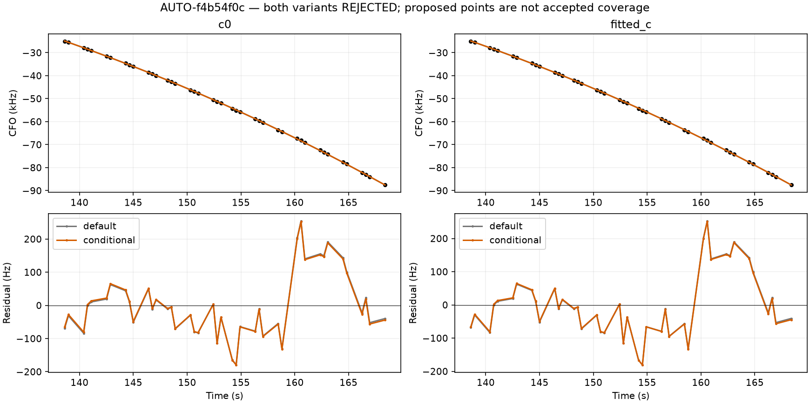

# Shared-family recovery: a valid candidate, a falsified receiver hypothesis, and transfer limits

The AUTO-e565210d **42-point RX1 CH1 curve assigned to NORAD 63381** can pass the unchanged physical/residual gates under the existing **conditional shared satellite/fragment posterior** variant. Exact replay verifies unchanged incumbent owners and zero direct receiver-coordinate update. Fitted-c error is **0.918 km**, versus **0.920 km** for that variant's matched no-addition control. This is a recovery candidate with a very small position benefit, not a new localization breakthrough or production promotion.

The evidence did not support a generic receiver correction. Other-satellite RX1 residual prediction worsened four of six random-block fold/arm comparisons, whereas other curves of 63381 improved all six, two only slightly. The conditional physical update narrowly clears the correlation threshold, so robustness and uncertainty calibration remain necessary.

## Source and residual context

The target remains excluded from the diagnostic control's position likelihood and receiver calibration. We replay the frozen control objective and evaluate exact satellite geometry for its active curved and predictive witnesses. Residual comparison is conditional on the frozen graph and incumbent identities. We do not claim these full-fit residual correlations are independent statistical confidence.

Nearest-time matching uses one-to-one pairs within **1 s**, never reusing observations; every witness with at least eight pairs is displayed below. Two same-satellite RX1 CH2 curves correlate strongly with the target (~0.84–0.85 in the initial endpoint diagnostic). Several different satellites on RX1 also correlate, while RX2 witnesses are generally weaker. Those selective correlations motivated a receiver hypothesis; they did not establish it. Some same-family witnesses have little correlation, and overlaps differ substantially.

The target's sample intervals range from ~0.354 to 9.920 s. Lag-one correlation is therefore an observation-index statistic, not a fixed time-lag measurement. We preserve the existing gate and separately test a time-aware predictor rather than changing its threshold to pass this curve.

## Target-excluded prediction: the receiver hypothesis does not transfer

The diagnostic predictor uses Gaussian time weights of width 6 s, truncated at ±18 s, no fitted amplitude or time shift, and equal votes across satellite families. Receiver variants exclude **every observation from 63381**, not just this curve, and require at least two other families at each query time. The same-family comparison excludes the target curve but uses its other family observations. Insufficient support produces a recorded zero correction. Hz scaling is primary; fractional RF scaling and widths 3/12 s are predeclared sensitivities, not selected according to error.

| arm | relation | baseline_RMS_hz | corrected_RMS_hz | covered_points | noise_screen_pass |
| --- | --- | --- | --- | --- | --- |
| c0 | same_receiver | 61.744 | 68.238 | 42 | False |
| c0 | same_satellite | 61.744 | 54.579 | 42 | True |
| fitted_c | same_receiver | 62.195 | 68.841 | 42 | False |
| fitted_c | same_satellite | 62.195 | 54.848 | 42 | True |

Full-fit same-family residual subtraction passes the target screen, but that is only a diagnostic. To test prediction, we reuse the three original randomized **scan-wide 12 s blocks with 2 s guards**. Every held observation across all receivers/channels is removed before refitting the curved calibration. Fixed 150 Hz noise and unit family powers prevent reuse of full-data noise/weight learning. Old predictive observations are excluded from this particular training model. Witness residuals use training observations only. The target fits only one regularized constant using its training points; held target values never set it. Each c arm receives the same masks and budget.

| seed | arm | relation | held_points | held_supported_points | baseline_held_RMS_hz | held_RMS_hz |
| --- | --- | --- | --- | --- | --- | --- |
| 20261029 | c0 | same_receiver | 16 | 16 | 153.621 | 166.875 |
| 20261029 | c0 | same_satellite | 16 | 16 | 153.621 | 144.624 |
| 20261029 | fitted_c | same_receiver | 16 | 16 | 158.293 | 171.030 |
| 20261029 | fitted_c | same_satellite | 16 | 16 | 158.293 | 148.817 |
| 94721 | c0 | same_receiver | 11 | 11 | 109.236 | 96.928 |
| 94721 | c0 | same_satellite | 11 | 11 | 109.236 | 78.448 |
| 94721 | fitted_c | same_receiver | 11 | 11 | 110.764 | 98.067 |
| 94721 | fitted_c | same_satellite | 11 | 11 | 110.764 | 80.282 |
| 4081 | c0 | same_receiver | 5 | 5 | 43.263 | 51.415 |
| 4081 | c0 | same_satellite | 5 | 5 | 43.263 | 43.095 |
| 4081 | fitted_c | same_receiver | 5 | 5 | 45.114 | 54.257 |
| 4081 | fitted_c | same_satellite | 5 | 5 | 45.114 | 44.524 |

| arm | relation | baseline_RMS_hz | corrected_RMS_hz | fold_observations |
| --- | --- | --- | --- | --- |
| c0 | same_receiver | 127.255 | 132.537 | 32 |
| c0 | same_receiver_band | 127.255 | 145.647 | 32 |
| c0 | other_receiver | 127.255 | 133.094 | 32 |
| c0 | same_satellite | 127.255 | 113.418 | 32 |
| fitted_c | same_receiver | 130.628 | 135.615 | 32 |
| fitted_c | same_receiver_band | 130.628 | 148.836 | 32 |
| fitted_c | other_receiver | 130.628 | 135.949 | 32 |
| fitted_c | same_satellite | 130.628 | 116.613 | 32 |

Pooling here is descriptive: held blocks overlap across seeds, so the 32 fold-observations per arm are not 32 independent new observations. The same-family comparator improves pooled RMS from **127.3 to 113.4 Hz** (c=0) and **130.6 to 116.6 Hz** (fitted c). The primary receiver predictor worsens both. Training models are refit on less data under a different fixed-noise policy, so their held RMS is not directly comparable to the ~62 Hz full-data fit. These tests do not optimize position using the kernel and do not establish a satellite-clock, TLE or hardware origin uniquely.

## Physical inclusion alternatives, with matched controls

No kernel correction is added to the production or position model. We test two existing physical posterior alternatives against the default shared predictor:

- **Marginal satellite projection:** expose posterior means for the requested shared satellite phase/orbital coordinates while preserving the marginal predictive likelihood and receiver-coordinate means in each update.
- **Conditional satellite/fragment update:** condition all unselected coefficient coordinates at their fitted means, then update the satellite phase, supported physical orbital modes and existing fragment constants. This changes the predictive likelihood and uncertainty; it is not merely a display of the same marginal posterior. It adds no per-track slope, polynomial or new satellite identity.

Each variant refits its own no-addition control and addition from the regional center with the same observations, five phase rounds, 48-step budget, priors and c ablation. Individual posterior updates hold receiver coordinates fixed; the repeated position/phase solve can still change them indirectly. A zero receiver-coordinate delta in the audit is not a claim that the entire fitted receiver solution is globally identical across variants.

| mode | arm | control_error_km | error_km | paired_gates | replay_verified | added_points | lost_points | control_percent | target_percent | absolute_lag1 |
| --- | --- | --- | --- | --- | --- | --- | --- | --- | --- | --- |
| default | c0 | 0.917 | 0.925 | False | False | 42 | 0 | 71.589 | 72.461 | 0.646 |
| default | fitted_c | 1.002 | 1.013 | False | False | 42 | 0 | 71.589 | 72.461 | 0.652 |
| marginal_satellite | c0 | 0.917 | 0.925 | False | False | 42 | 0 | 71.589 | 72.461 | 0.624 |
| marginal_satellite | fitted_c | 1.002 | 1.013 | False | False | 42 | 0 | 71.589 | 72.461 | 0.622 |
| conditional_satellite | c0 | 0.887 | 0.883 | True | True | 42 | 0 | 71.589 | 72.461 | 0.613 |
| conditional_satellite | fitted_c | 0.920 | 0.918 | True | True | 42 | 0 | 71.589 | 72.461 | 0.611 |

The unchanged lag-one limit is **4/√42 = 0.61721**. Default prediction fails at ~0.646/0.652; marginal projection gets closer but still fails at ~0.624/0.622. Conditional prediction passes at ~0.613/0.611. These are **narrow margins**, not evidence that all residual structure has been eliminated. Its RMS is ~59.4/59.3 Hz. All prior points retain their owners, phase relinearization converges, and exact per-family replay preserves every gate.

Most of the apparent position change versus the old ~1.002 km fitted-c control comes from changing the predictive model itself: its conditional control is already ~0.920 km. Adding this curve improves that matched control by only **2.4 m** (about **3.5 m** in c=0). Do not attribute the entire cross-model difference to the recovered points. Conditioning away uncertainty needs separate validation; a passing residual threshold alone does not warrant a new ALGO release.

## Four new recordings test the workflow's limits

Selection was frozen to the first four supported attempt-25 annotations in original queue order, one per recording, without GPS ranking or requiring an earlier successful inclusion. Fresh predictive nomination uses the same causal catalogue, distinct grouped holdouts and unchanged identity margin. Both existing-family and absent-family routing are supported, but the two qualifying identities in this cohort use active shared families.

| scan | status | norad | minimum_margin | initial_trial |
| --- | --- | --- | --- | --- |
| AUTO-69e994bf | unstable_identity | None | 0.591 | identity_not_supported |
| AUTO-2ae9ee49 | conditionally_supported_identity | 58639 | 106.507 | inclusion_rejected |
| AUTO-f4b54f0c | conditionally_supported_identity | 59467 | 519.284 | inclusion_rejected |
| AUTO-f08da5cb | unstable_identity | None | 0.163 | identity_not_supported |

AUTO-69e994bf and AUTO-f08da5cb have **unstable identities**, with minimum margins ~0.59 and ~0.16. They receive no position inclusion. The two supported cases fail default shared prediction; applying the same conditional alternative to **both** also fails. No case is selected according to GPS benefit.

| scan | mode | arm | control_error_km | error_km | paired_gates | exact_owner_verified | added_proposed_points | lost_points | owner_map_changes |
| --- | --- | --- | --- | --- | --- | --- | --- | --- | --- |
| AUTO-2ae9ee49 | default | c0 | 1.219 | 1.330 | False | False | 42 | 25 | 169 |
| AUTO-2ae9ee49 | default | fitted_c | 1.299 | 1.404 | False | False | 42 | 0 | 0 |
| AUTO-2ae9ee49 | conditional | c0 | 1.219 | 1.345 | False | False | 42 | 25 | 169 |
| AUTO-2ae9ee49 | conditional | fitted_c | 1.299 | 1.419 | False | False | 42 | 25 | 169 |
| AUTO-f4b54f0c | default | c0 | 0.499 | 0.522 | False | False | 42 | 0 | 0 |
| AUTO-f4b54f0c | default | fitted_c | 0.572 | 0.593 | False | False | 42 | 0 | 0 |
| AUTO-f4b54f0c | conditional | c0 | 0.476 | 0.511 | False | False | 42 | 0 | 0 |
| AUTO-f4b54f0c | conditional | fitted_c | 0.623 | 0.659 | False | False | 42 | 0 | 0 |

AUTO-2ae9ee49 / NORAD 58639 fails the new RX1 CH6 residual slope and, in c=0, an old RX1 CH1 curve's slope. The conditional variant additionally fails that old curve in fitted c. It loses 25 associated points and produces **169 missing owner-map entries**, all previously assigned to 58639. This is not 169 reassignments to another satellite: 144 remain in the calibration mask but no longer receive an owner from the gate-qualified extension map. The inconsistent proposal is rejected.

AUTO-f4b54f0c / NORAD 59467 retains old owners but the RX1 CH2 target fails step and lag-one gates in both variants. Its 42 proposed points are not accepted recovery. The full gate names and normalized failure margins are retained in [transfer_failures.csv](transfer_failures.csv).

## Inventory, limitations and next actions

All 32 annotation jobs in attempt 28 complete, bringing assessed original inventory entries to **1119 / 1630**. New states: `{'ambiguous_identity': 7, 'conditionally_supported_identity': 16, 'unstable_identity': 6, 'prediction_mismatch': 2, 'insufficient_partitions': 1}`. There are still **149** historical phase-audited entries. Assessed count includes unsupported/ambiguous/geometry-limited cases; it is not accepted GLRT coverage. The ledger preserves original annotation sources, alternate predictive outcomes and research-inclusion status without changing retained policy.

The systematic workflow now has evidence for distinct failure classes: identity instability; unsupported new-family certainty; shared-family residual structure; and an addition that destabilizes old observations. No single correction fixes all four. In particular, the orbital-uncertainty result from the prior iteration is not a universal cure for active shared-family residuals.

Next, test the conditional recovery's narrow margin under frozen grouped perturbations before promotion. For the broader failures, inspect same-family cross-band slope witnesses on AUTO-2ae9ee49 and the step structure on AUTO-f4b54f0c, rather than loosening gates or repeatedly optimizing the resolved 63381 example. Any time-dependent shared-family model should carry its predictive uncertainty and be validated against withheld curves/blocks; the diagnostic kernel alone does not authorize one. Continue the remaining inventory in bounded batches.

All position searches start in the **25 × 25 km** box centered at **37.906, −122.545**. The evaluation site **37.849061591561885, −122.48574968092912** is used only for error reporting. All TLE evidence is causal. No RF collection, production deployment or new ALGO promotion occurs in this iteration.

## Reproduction and verification

`diagnose_graph_residual_witnesses.py --shared-family --control` constructs target-excluded exact residual context. `validate_receiver_residual_prediction.py` performs the grouped training-only experiment. `test_predictive_graph_transfer.py` handles the frozen new cohort; `include_predictive_annotations.py` runs the existing marginal/conditional alternatives. `audit_shared_predictive_inclusion.py` reconstructs them and replaces each active family's orbit with exact geometry for gate checks. Report generation: `report_shared_residual_recovery.py`.

**18 targeted tests pass**, covering witness family exclusion/balancing, one-to-one time matching, RF scaling, training-only target constants, phase convergence/domain checks, shared posterior invariants, routing, ownership and conditional Gaussian updates. Full source paths/hashes remain recorded; repetitive owner maps, gate maps, observation IDs and optimizer histories are compacted by counts/hashes while failures and numerical summaries remain visible.

[Summary](summary.json), [ledger](annotation_ledger.csv), [new annotations](annotation_batch.csv), [coherence pairs](coherence_pairs.csv), [full-fit diagnostic](full_fit_prediction.csv), [all held sensitivities](all_held_predictions.csv), [primary held comparisons](primary_held_predictions.csv), [pooled results](pooled_held_predictions.csv), [shared-family trials](shared_family_trials.csv), [gate margins](shared_family_gates.csv), [new cohort](transfer_cohort.csv), [transfer trials](transfer_trials.csv), [failures](transfer_failures.csv), [owner-map changes](owner_map_changes.csv), [executions](executions.csv), [source hashes](sources.json), [compact evidence](evidence.json.gz), [previous iteration](../2026_10_30_predictive_covariance_transfer/README.md).
