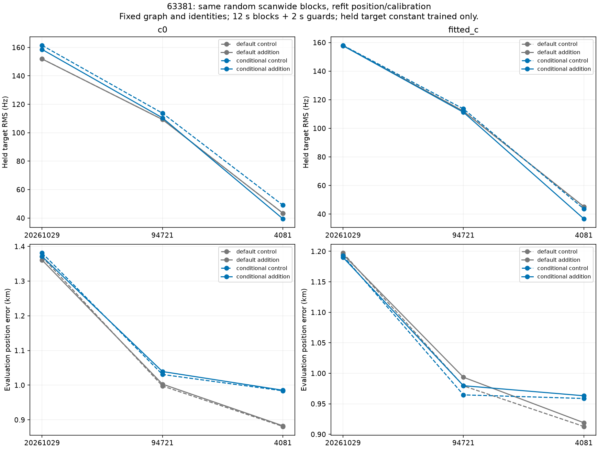
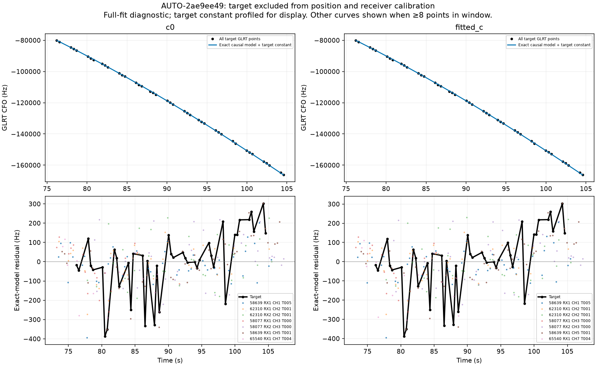
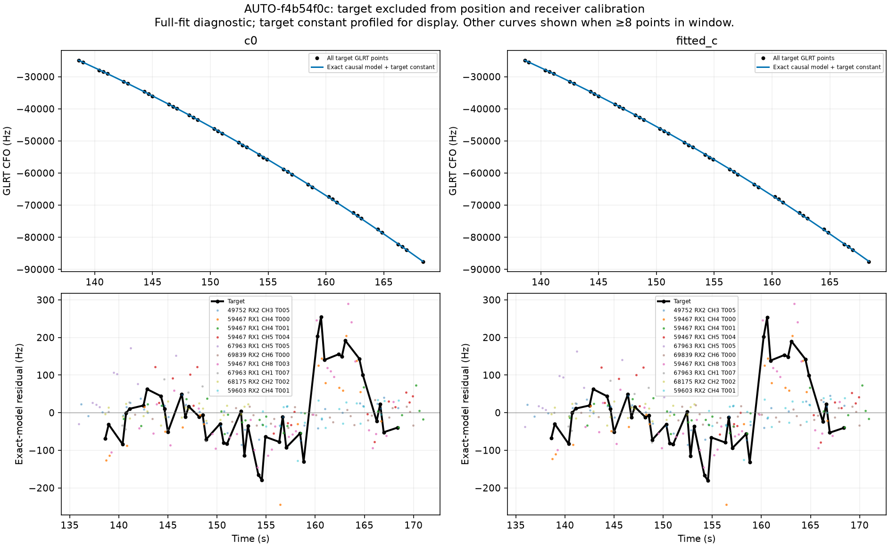
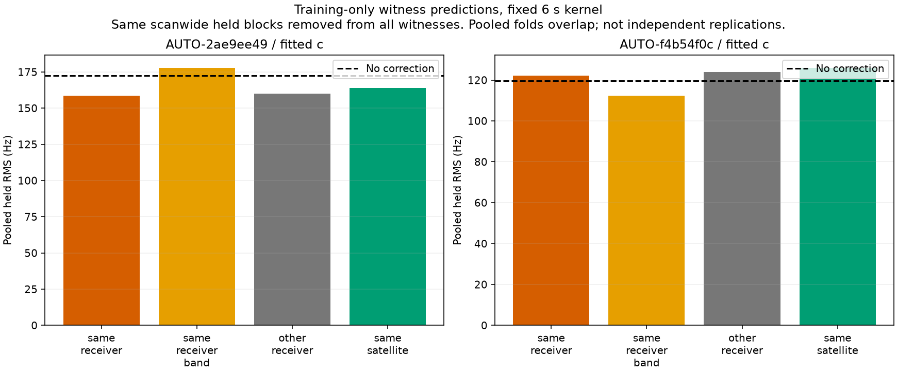
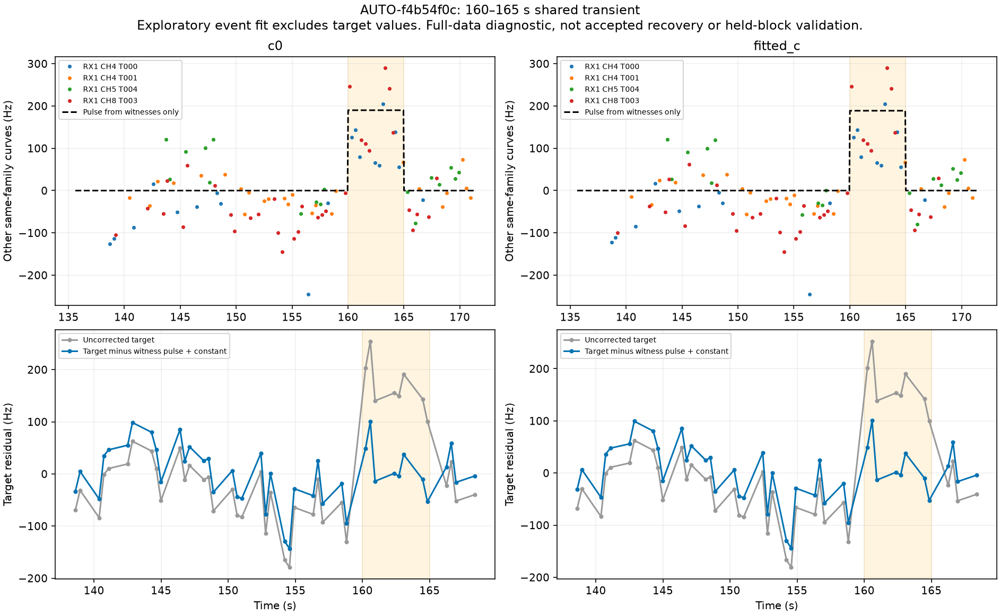

# Shared transient diagnosis and blocked recovery validation

This iteration follows [shared residual recovery](../2026_10_30_shared_residual_recovery/README.md). It identifies a five-second transient shared by several curves in AUTO-f4b54f0c, tests whether receiver/satellite residual predictions generalize on two failed cases, and stress-tests the narrow 63381 conditional recovery. **No additional GLRT points are accepted, no retained policy changes, and no ALGO promotion is made.** The new pulse result is a diagnostic explanation with promising evidence, not a demonstrated position improvement.

## 63381 recovery: helpful in-sample, modest and mixed out of sample

Three saved random scanwide partitions use 12-second blocks and 2-second guards. All held and guarded values are excluded from curved calibration and predictive training views before fitting. Graph membership, incumbent identities, target identity/alias and physical prior choices stay frozen conditioning assumptions. Both models, both control/addition roles and both c arms use the same 150 Hz fixed noise, unit family powers, regional start, five phase rounds and 48 steps per round. This changes the noise policy from the previous full-data candidate but does so identically across variants.

The conditional model also changes its control because incumbent predictive observations can update the requested satellite and its old fragment constants. Each posterior update holds receiver coordinates fixed; repeated position/phase optimization can still move the overall receiver solution. The new target never enters receiver calibration equations. A new-fragment constant with sigma 300 Hz is estimated from target training values only; the held target residual uses exact orbital geometry. The raw phase gaps are below 0.01 s and all held geometry is within the orbit bank. These checks are numerical validity, not an association acceptance test.

| mode | role | arm | target_RMS_hz | fold_observations |
| --- | --- | --- | --- | --- |
| default | control | c0 | 126.247 | 32 |
| default | control | fitted_c | 130.729 | 32 |
| default | addition | c0 | 126.234 | 32 |
| default | addition | fitted_c | 130.713 | 32 |
| conditional | control | c0 | 133.615 | 32 |
| conditional | control | fitted_c | 131.230 | 32 |
| conditional | addition | c0 | 130.427 | 32 |
| conditional | addition | fitted_c | 130.038 | 32 |

Conditional inclusion improves its own control in all six target fold/arm RMS comparisons. However, pooled c=0 RMS remains worse than default inclusion (130.43 versus 126.23 Hz), and fitted-c improvement over default is small (130.04 versus 130.71 Hz). The addition's position error improves only in the first partition and worsens in the other two partitions in both models/arms. The complete 24 results, including incumbent held RMS and evaluation error, are in [shared_block_trials.csv](shared_block_trials.csv). Pooled folds overlap and are not independent replications. This does **not** establish a robust localization gain or justify promotion from the previous narrow lag-one pass.

## Two remaining failures: no universal receiver correction

The target-excluded exact residual diagnostics retain every target point. AUTO-2ae9ee49's CH6 target has a residual slope of about 10.6–10.7 Hz/s, while same-family CH5 is about 11.9 Hz/s. Same-family low-band CH1 is only about 3.3–3.5 Hz/s. This is not a clean single shared satellite slope or a demonstrated band-wide receiver drift. In the target interval there are no qualifying other-family same-band slope witnesses. Some short downward excursions also coincide across CH5/6. Further time-local hardware/transmitter discrimination is needed; adding free per-track slopes would conceal the issue.

AUTO-f4b54f0c's CH2 residual has a brief positive excursion near 160–165 s. CH4 T000 and CH8 T003 assigned to the same satellite, 59467, show the same event. CH4 T001 and CH5 have sparse or absent coverage during the event and cannot serve as contemporaneous negative evidence. RX2 curves from other families do not show a comparably large pulse. This argues against a joining error unique to the target, but simultaneous RX1 receiver and transmitter explanations remain confounded: there is no comparably sampled other-family RX1 witness in that interval.

Training-only witness prediction repeats the three existing distinct random partitions for **both** failed cases. The primary rule remains a 6 s Gaussian kernel using other satellites on the same receiver, requiring two families at each time. Same-band, other-receiver and same-satellite variants, widths 3/6/12 s, and Hz/fractional scaling are all retained in [all_witness_held_predictions.csv](all_witness_held_predictions.csv). No variant is selected for production using these results or GPS. These fits use curved observations only; they are different from the shared-family experiment above, which also trains incumbent predictive observations.

| scan | arm | relation | baseline_RMS_hz | corrected_RMS_hz | fold_observations |
| --- | --- | --- | --- | --- | --- |
| AUTO-2ae9ee49 | c0 | same_receiver | 173.033 | 158.708 | 42 |
| AUTO-2ae9ee49 | c0 | same_receiver_band | 173.033 | 176.776 | 42 |
| AUTO-2ae9ee49 | c0 | other_receiver | 173.033 | 160.099 | 42 |
| AUTO-2ae9ee49 | c0 | same_satellite | 173.033 | 165.273 | 42 |
| AUTO-2ae9ee49 | fitted_c | same_receiver | 172.439 | 158.447 | 42 |
| AUTO-2ae9ee49 | fitted_c | same_receiver_band | 172.439 | 177.919 | 42 |
| AUTO-2ae9ee49 | fitted_c | other_receiver | 172.439 | 160.024 | 42 |
| AUTO-2ae9ee49 | fitted_c | same_satellite | 172.439 | 164.093 | 42 |
| AUTO-f4b54f0c | c0 | same_receiver | 118.813 | 119.935 | 41 |
| AUTO-f4b54f0c | c0 | same_receiver_band | 118.813 | 111.416 | 41 |
| AUTO-f4b54f0c | c0 | other_receiver | 118.813 | 124.479 | 41 |
| AUTO-f4b54f0c | c0 | same_satellite | 118.813 | 125.471 | 41 |
| AUTO-f4b54f0c | fitted_c | same_receiver | 119.596 | 122.171 | 41 |
| AUTO-f4b54f0c | fitted_c | same_receiver_band | 119.596 | 112.398 | 41 |
| AUTO-f4b54f0c | fitted_c | other_receiver | 119.596 | 123.831 | 41 |
| AUTO-f4b54f0c | fitted_c | same_satellite | 119.596 | 126.027 | 41 |

AUTO-2ae9ee49 benefits in pooled RMS from same-RX other-family prediction, but one partition worsens in both c arms. Other-receiver prediction improves all six fold/arms, yet cannot identify a physical origin by itself. AUTO-f4b54f0c becomes worse under the primary same-RX correction and same-satellite 6 s correction. Broad smoothing can miss or blur a short pulse. Same-band sensitivity results improve pooled RMS with limited supported held points; they are not a prevalidated replacement. With no qualified witness at a held time the direct correction is zero, but the training-estimated fragment constant can still change, so zero supported held points need not mean identical held RMS.

## Five-second transient: a target-excluded diagnostic explains the failing gates

After inspecting the residual structure, an **exploratory** pulse model is fitted only to other curves of 59467 in the target time window plus 3 seconds on each side. It has one constant per witness and one shared additive-Hz rectangular pulse. Start/end are searched on a 0.5 s grid, durations 2–12 s; at least two witness curves need at least three points inside and outside, and at least eight points must be inside overall. The fixed amplitude prior is 150 Hz, assumed residual scale 75 Hz, with a three-parameter boundary/amplitude complexity penalty. The search score is not calibrated event confidence; boundary uncertainty and possible correlated channel errors are not integrated.

Both c arms independently select **160.0–165.0 s** from 94 witness observations. CH4 T000 and CH8 T003 provide direct inside/outside support. The target's values do not select boundaries or amplitude. After subtracting that prediction, one constant is profiled on the full target for this descriptive residual check; no target slope or polynomial correction is added.

| arm | start_s | end_s | amplitude_hz | target_RMS_before_hz | target_RMS_after_hz | before_pass | after_pass |
| --- | --- | --- | --- | --- | --- | --- | --- |
| c0 | 160.000 | 165.000 | 190.020 | 97.765 | 55.060 | False | True |
| fitted_c | 160.000 | 165.000 | 188.771 | 97.712 | 55.371 | False | True |

The roughly 189–190 Hz pulse reduces target RMS from about 98 to 55 Hz, and the unchanged mean/slope/quadratic/step/lag residual screen passes in both arms. This shows that a shared abrupt frequency feature can explain why the otherwise plausible track fails the smooth model. It does **not** establish the hardware origin, eliminate an upstream shared measurement artifact, validate all existing points after a joint refit, or add 42 accepted points. The target helped motivate the hypothesis, the witnesses were fitted on the full scan, and a target constant was profiled on all target points. Therefore this is not an independent holdout result. There is no new position estimate from this pulse diagnostic.

## Inventory and next experiment

Attempt 29 states: `{'insufficient_partitions': 6, 'unstable_identity': 7, 'prediction_mismatch': 3, 'ambiguous_identity': 7, 'conditionally_supported_identity': 8, 'execution_timeout': 1}`. Completed assessment coverage is **1150 / 1630** original large-track entries; **149** historical entries have separate phase audits. These counts include rejected/ambiguous/insufficient-partition outcomes and do not represent accepted coverage. [Annotation ledger](annotation_ledger.csv) preserves prior receipts and inclusion states. Execution receipts, including any bounded timeout, are in [executions.csv](executions.csv).

The next useful experiment is a shared transient model that carries event uncertainty, tests both RX-scoped and family-scoped explanations, and preserves all incumbent owners and gates under matched c arms. It should be nominated from witnesses excluding the target and tested on other curves/scans, including no-event controls. Scanwide block withholding can remove the entire event from all witnesses, so it tests temporal prediction, not merely contemporaneous correction. A new validation design must declare that distinction explicitly rather than quietly allowing held-time witness information into the existing test. Smooth causal orbital uncertainty remains appropriate for slow family mismatch; it cannot by itself explain an abrupt five-second pulse. Keep completing the remaining inventory in bounded batches instead of forcing these two cases through looser gates.

All position searches use the **25 × 25 km** region centered at **37.906, −122.545**. GPS **37.849061591561885, −122.48574968092912** is used solely for error reporting. Causal TLEs only; no new RF collection or production changes.

## Reproduction

`validate_shared_family_blocks.py run` consumes the saved 63381 inclusion and its predictive annotation partitions. `validate_receiver_residual_prediction.py run` consumes each failed case's predictive annotation. `diagnose_graph_residual_witnesses.py --shared-family --control` supplies the exact target-excluded context. `shared_pulse_witness.py` supplies the exploratory witness-only pulse fit. `report_shared_transient_validation.py` generates this report, CSVs and figures. Inputs and tool hashes are in [sources.json](sources.json), with compact scientific receipts in [evidence.json.gz](evidence.json.gz). Tests cover withheld-value isolation, disjoint partitions, training-only predictive views, conditional Gaussian updates, and independently offset witness curves recovering a common event.
