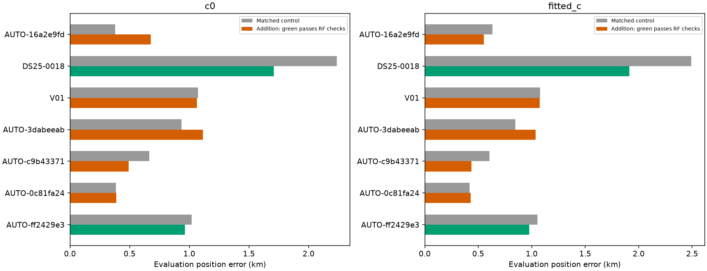
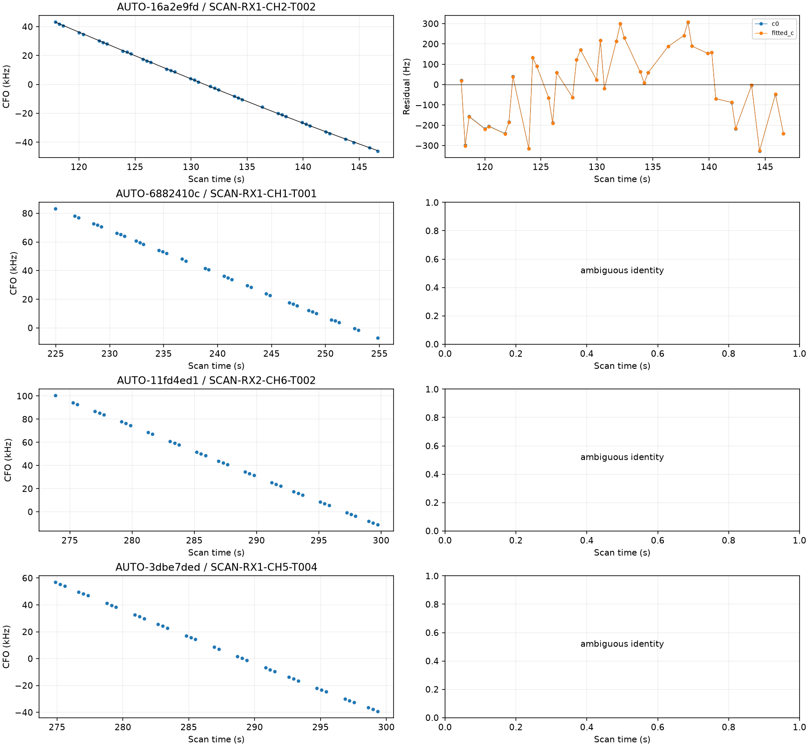
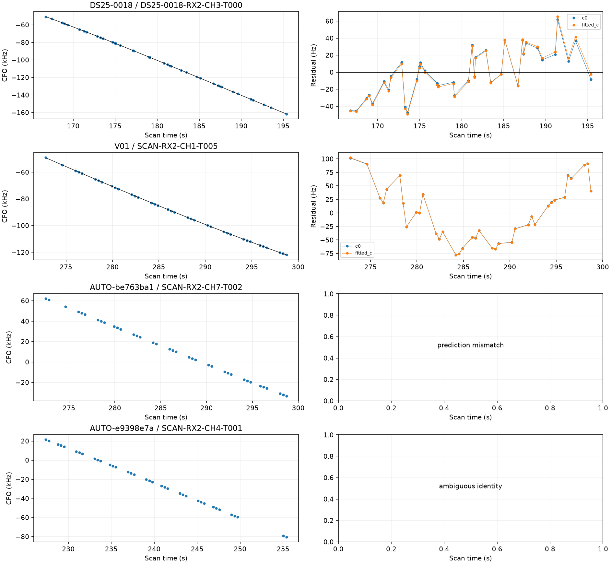
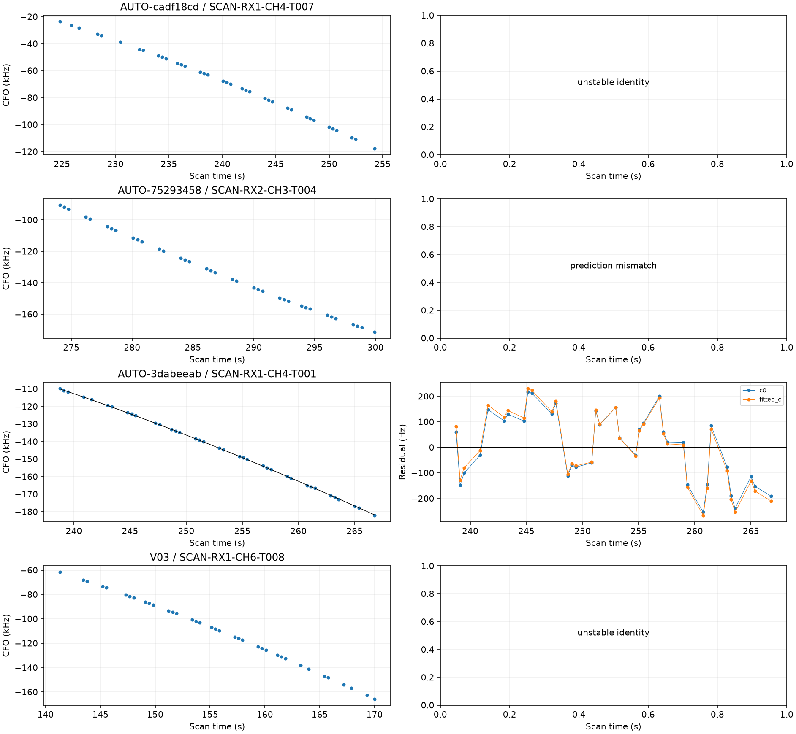
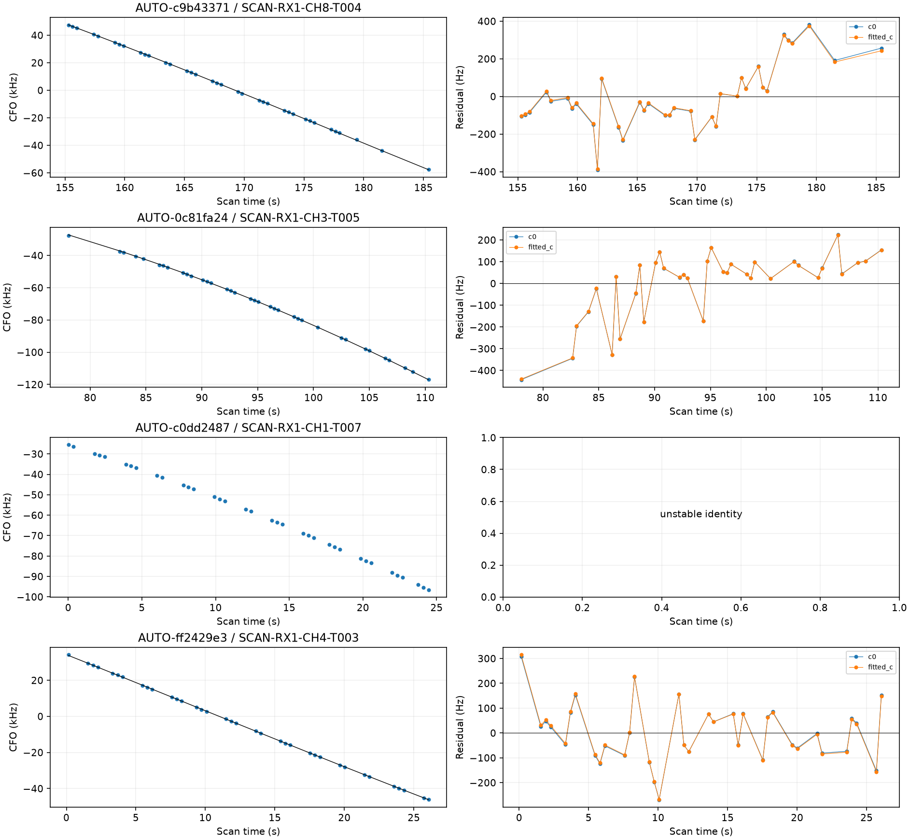
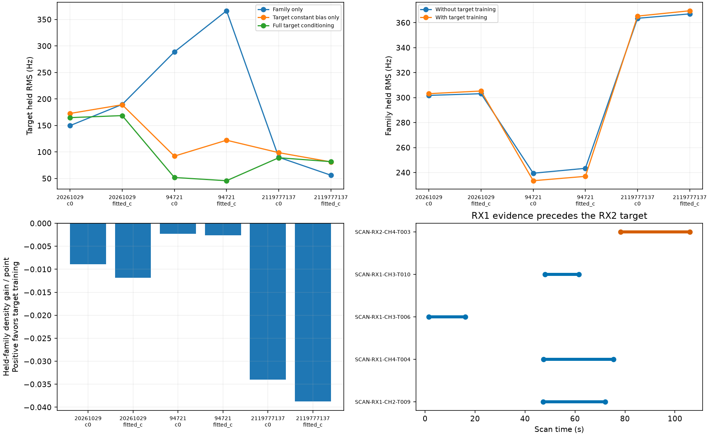

# First shifted-origin recovery batch and 58528 cross-track prediction

The timestamp-only validation change now yields **2 RF-qualified research recoveries / 74 points** in separate position trials. All sixteen curves previously lacked adequate fixed-origin partitions. Seven now have supported identity hypotheses; four remain ambiguous, three unstable and two fail absolute predictive agreement. No label is forced into localization.

## Frozen scope and acquisition provenance

The previous report identified 419 wholly unowned curves marked insufficient partitions in its input ledger. The separate 58528 trial assessed one, leaving a frozen queue of **418**. This batch takes the largest **16** by native point count, ties resolved by immutable track ID, without ranking by GPS error. All receivers and channels use the same random scanwide split. Seeded origins change block alignment; 12-second blocks, two-second guards, eight training points, four held points and three distinct physical holdout sets are retained. The sets overlap and are not independent replications. The annotation target does not calibrate the receiver. Existing receipts and default behavior are unchanged.

There are **15 verified fast recordings and one adaptive recording**. The historical inventory alias **DS24-0037 actually refers to DS25-0018**, an adaptive scan at 10 MS/s. Its recovery is not a DS24 fast-scan improvement. We preserve the immutable alias alongside the acquisition source in all result tables. Provenance comes from direct scanner contracts or digest-verified acquisition manifests, not the fast adapter's compatibility capture-mode label.

| scan | inventory_alias | capture_mode | points | status | norad | margin |
| --- | --- | --- | --- | --- | --- | --- |
| AUTO-16a2e9fd | AUTO-16a2e9fd | fast | 39 | conditionally_supported_identity | 100149 | 19.011 |
| AUTO-6882410c | AUTO-6882410c | fast | 38 | ambiguous_identity | 53825 | 0.162 |
| AUTO-11fd4ed1 | AUTO-11fd4ed1 | fast | 38 | ambiguous_identity | 52121 | 0.112 |
| AUTO-3dbe7ded | AUTO-3dbe7ded | fast | 38 | ambiguous_identity | 69952 | 0.604 |
| DS25-0018 | DS24-0037 | adaptive | 38 | conditionally_supported_identity | 67799 | 12.720 |
| V01 | V01 | fast | 37 | conditionally_supported_identity | 55946 | 25.528 |
| AUTO-be763ba1 | AUTO-be763ba1 | fast | 37 | prediction_mismatch | 65062 | 117.887 |
| AUTO-e9398e7a | AUTO-e9398e7a | fast | 37 | ambiguous_identity | 63458 | 2.091 |
| AUTO-cadf18cd | AUTO-cadf18cd | fast | 37 | unstable_identity | None | 1.132 |
| AUTO-75293458 | AUTO-75293458 | fast | 37 | prediction_mismatch | 50176 | 51.053 |
| AUTO-3dabeeab | AUTO-3dabeeab | fast | 37 | conditionally_supported_identity | 62479 | 29.979 |
| V03 | V03 | fast | 37 | unstable_identity | None | 0.237 |
| AUTO-c9b43371 | AUTO-c9b43371 | fast | 36 | conditionally_supported_identity | 67618 | 192.357 |
| AUTO-0c81fa24 | AUTO-0c81fa24 | fast | 36 | conditionally_supported_identity | 68057 | 56.931 |
| AUTO-c0dd2487 | AUTO-c0dd2487 | fast | 36 | unstable_identity | None | 0.815 |
| AUTO-ff2429e3 | AUTO-ff2429e3 | fast | 36 | conditionally_supported_identity | 56498 | 104.013 |

## Matched inclusion outcomes

Every supported identity receives a full control/addition trial with matched c=0 and fitted-c arms, causal candidates, priors and search budgets. Qualification requires residual checks, preserved incumbent ownership, exact orbital/objective replay, numerical convergence and phase resolution. The numerical-only retry selector finds no eligible retries in this batch. All original outcomes remain, including position regressions. New-family phase quadrature uses 0.025-second spacing.

| scan | norad | points | qualified | c0_before_km | c0_after_km | fitted_c_before_km | fitted_c_after_km |
| --- | --- | --- | --- | --- | --- | --- | --- |
| AUTO-16a2e9fd | 100149 | 39 | False | 0.379 | 0.676 | 0.633 | 0.552 |
| DS25-0018 | 67799 | 38 | True | 2.235 | 1.709 | 2.493 | 1.914 |
| V01 | 55946 | 37 | False | 1.073 | 1.065 | 1.078 | 1.074 |
| AUTO-3dabeeab | 62479 | 37 | False | 0.934 | 1.113 | 0.847 | 1.038 |
| AUTO-c9b43371 | 67618 | 36 | False | 0.663 | 0.492 | 0.604 | 0.438 |
| AUTO-0c81fa24 | 68057 | 36 | False | 0.384 | 0.387 | 0.420 | 0.429 |
| AUTO-ff2429e3 | 56498 | 36 | True | 1.021 | 0.963 | 1.053 | 0.977 |

The two passing cases recover **38 adaptive-scan points for 67799** and **36 fast-scan points for 56498**. Fitted-c error improves **2.493→1.914 km** and **1.053→0.977 km**, respectively. These are individual research trials, not a combined solution, a production change, or evidence that the 500 m goal is met. The complete [position table](position_trials.csv) separates GLRT coverage, RMS, numerical objective and position error. Control and addition use different observation sets, so their raw objective difference does not establish improved localization. Rejected targets and their [failed gates](failed_gates.csv) remain visible below.

GLRT coverage rises **74.41%→76.55%** for DS25-0018 and **68.09%→69.11%** for AUTO-ff2429e3 in both c arms. These gains contain exactly the independently tested target points, with no incidental extension discoveries included.

AUTO-c9b43371 illustrates why evaluation error cannot authorize an association: adding its 36-point RX1 CH8 / 67618 curve moves fitted-c error **604→438 m** and c=0 error **663→492 m**, but both arms fail target slope, quadratic and step checks. It remains rejected despite meeting the numerical position-error goal in this diagnostic trial.

## 58528: test the other tracks, not just the target

The rejected 28-point RX2 CH4 target retains a consistent causal identity hypothesis but fails its full-fit residual slope gate. We now exclude the entire 58528 family from receiver/position calibration and fit the remaining families on each randomized training partition from the regional box center. All predictive-only rows also remain outside calibration. One shared phase/orbit distribution, one receiver covariance and the existing per-track constant-bias priors connect the family. Target training may condition that predictive distribution; it cannot refit the independently trained receiver calibration.

| component | role | points | start_s | end_s |
| --- | --- | --- | --- | --- |
| SCAN-RX1-CH2-T009-RF11190312500.000000 | incumbent_calibration | 36 | 47.270 | 72.106 |
| SCAN-RX1-CH4-T004-RF11690312500.000000 | incumbent_calibration | 39 | 47.359 | 75.389 |
| SCAN-RX1-CH3-T006-RF11440312500.000000 | incumbent_predictive | 19 | 1.517 | 16.077 |
| SCAN-RX1-CH3-T010-RF11440312500.000000 | incumbent_predictive | 12 | 48.024 | 61.504 |
| SCAN-RX2-CH4-T003-RF11690312500.000000 | target | 28 | 78.230 | 105.913 |

| seed | held_family_points | before_RMS_hz | after_RMS_hz | held_density_gain | target_combined_RMS_hz |
| --- | --- | --- | --- | --- | --- |
| 20261029 | 41 | 303.118 | 305.283 | -0.486 | 168.711 |
| 94721 | 15 | 243.364 | 236.935 | -0.039 | 45.848 |
| 2119777137 | 38 | 367.046 | 369.544 | -1.472 | 81.807 |

Target training changes the held-family density only modestly. Both c arms show the same negative signs, but the three folds overlap and these scores are not calibrated probabilities. Family RMS sometimes improves while joint density worsens slightly because density also accounts for predictive covariance. This is insufficient evidence to accept a correction or declare the identity wrong.

All incumbent family tracks are on RX1; the target is on RX2 and begins after the last RX1 family observation. Receiver identity and time are therefore confounded in this family comparison. A relative receiver drift and an orbital/position extrapolation error cannot be isolated here. Some incumbent tracks have only one or two training points in a partition, leaving weak constant-bias information; raw held RMS is not purely shape error. [Per-track metrics](family_tracks.csv) report training support, residual means, centered RMS and predictive uncertainty.

Halving phase spacing from 0.1 to 0.05 seconds preserves all partitions. Maximum score change is **0.0067** in −2 log density, and maximum RMS change is **0.382 Hz** across the recorded prediction modes. Both runs have terminal receipts and unchanged acceptance. The target remains withheld; independent RX2 evidence from other satellites is needed before claiming a receiver correction.

## Remaining work and reproducibility

**402 shifted-origin candidates remain**, and **876 remain in the older-role queue**. Twelve of this batch's cases were also in that older queue, so the queues overlap and must not be added. The updated 1,630-row ledger preserves prior rejected, ambiguous, native-IQ-withheld and jointly verified results. Queue execution now accepts a hashed `--remaining-candidates` file so work completed through another queue is not repeated. For this queue, pass [remaining_shifted_candidates.json](remaining_shifted_candidates.json); for the older queue, pass [remaining_role_candidates.json](remaining_role_candidates.json).

Continue bounded batches and independently supported receiver/orbit challenges. Keep successful recoveries separate until they pass joint consistency and cohort evaluation. The matched regional search and causal TLE policy remain; GPS is used solely for reported position errors. No new RF was collected. Source hashes, terminal receipts, full point assignments, raw compact evidence and figures accompany this report. The full annotation-and-inclusion objective remains incomplete.

Nineteen focused tests pass, covering queue claims and cross-queue exclusions, predictive-only routing, unchanged legacy splits, shifted physical holdouts, timestamp integrity, guards, minimum support, and Gaussian grouped-prediction behavior. Report generation rechecks source digests, physical holdouts, exact replay qualification and the complete target membership scope before exporting results.
