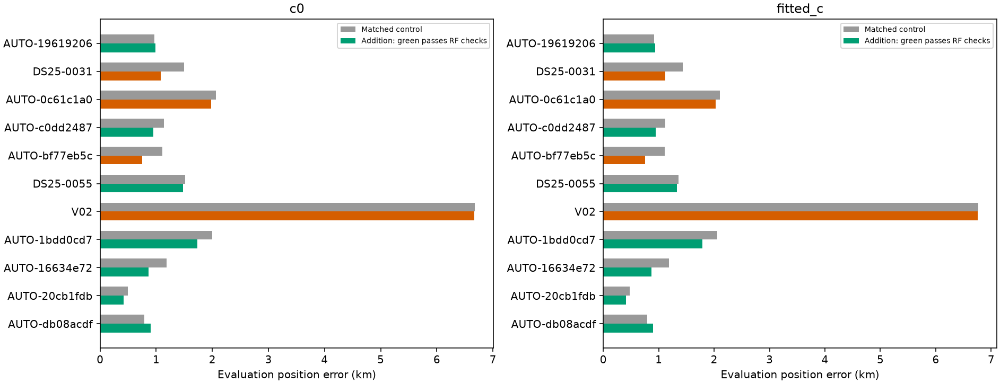
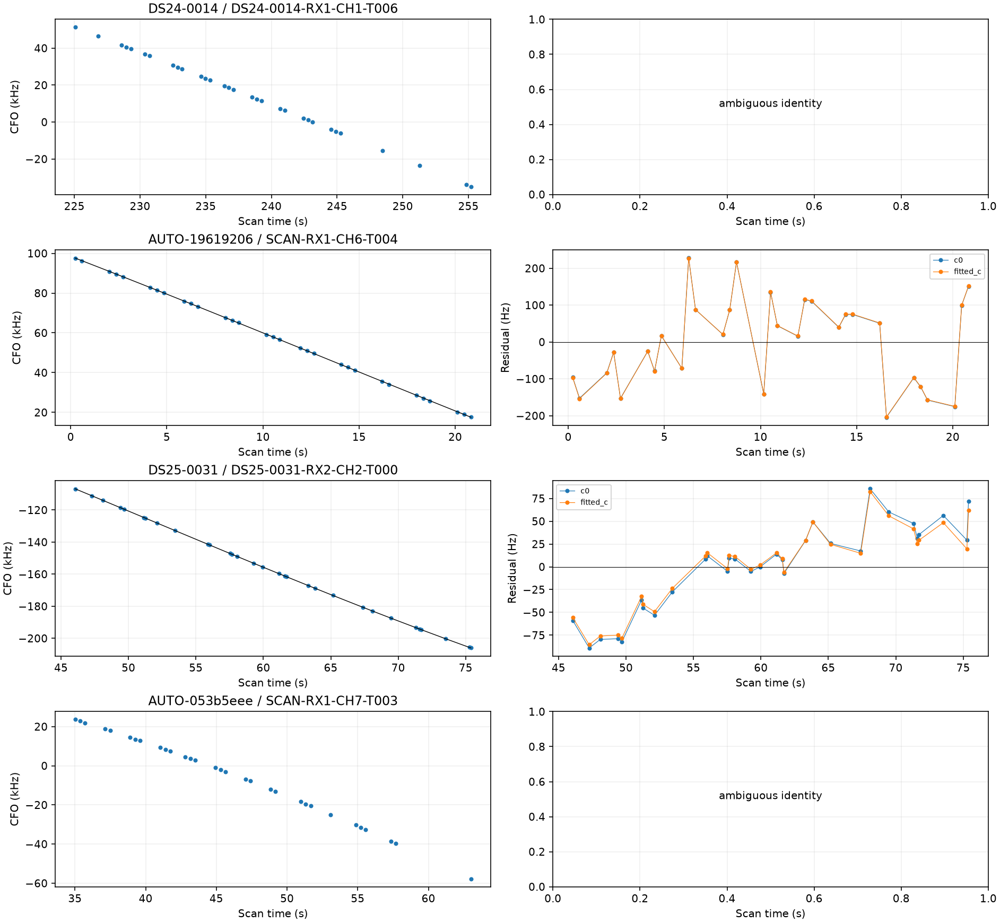
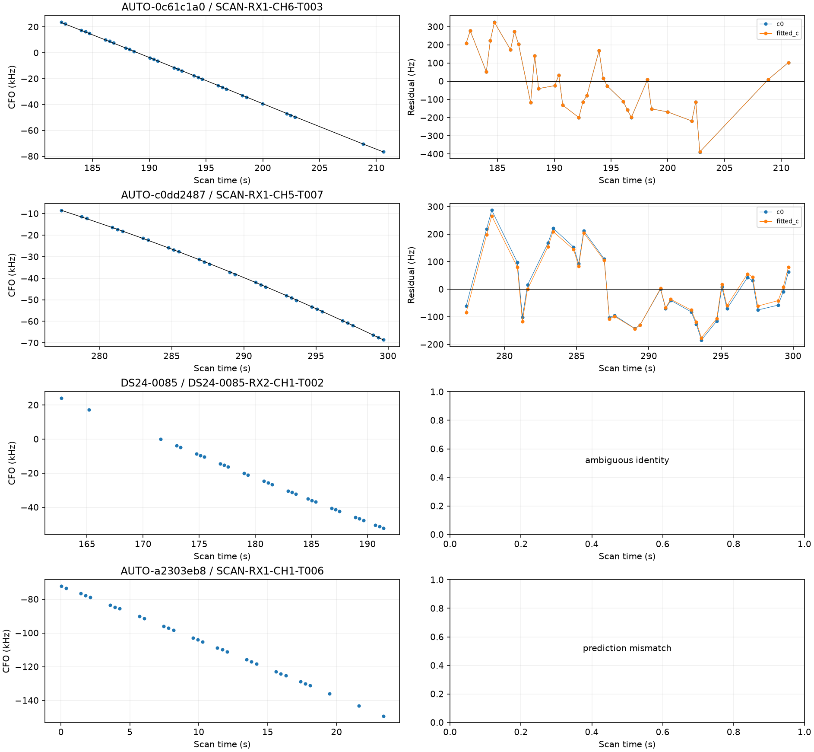
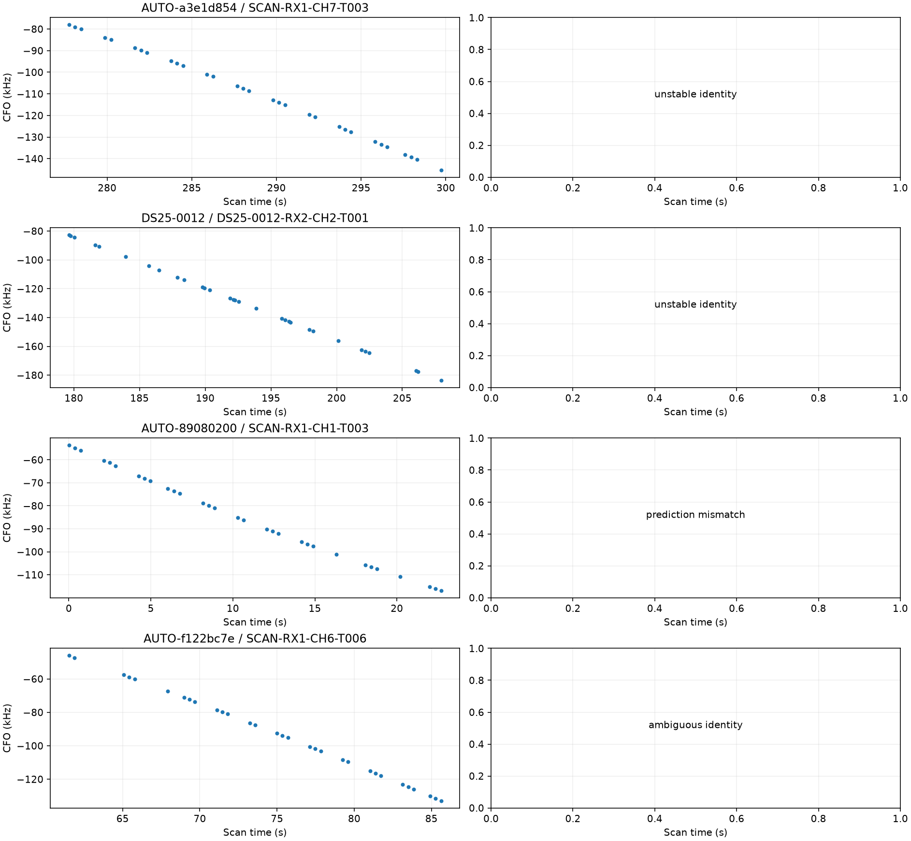
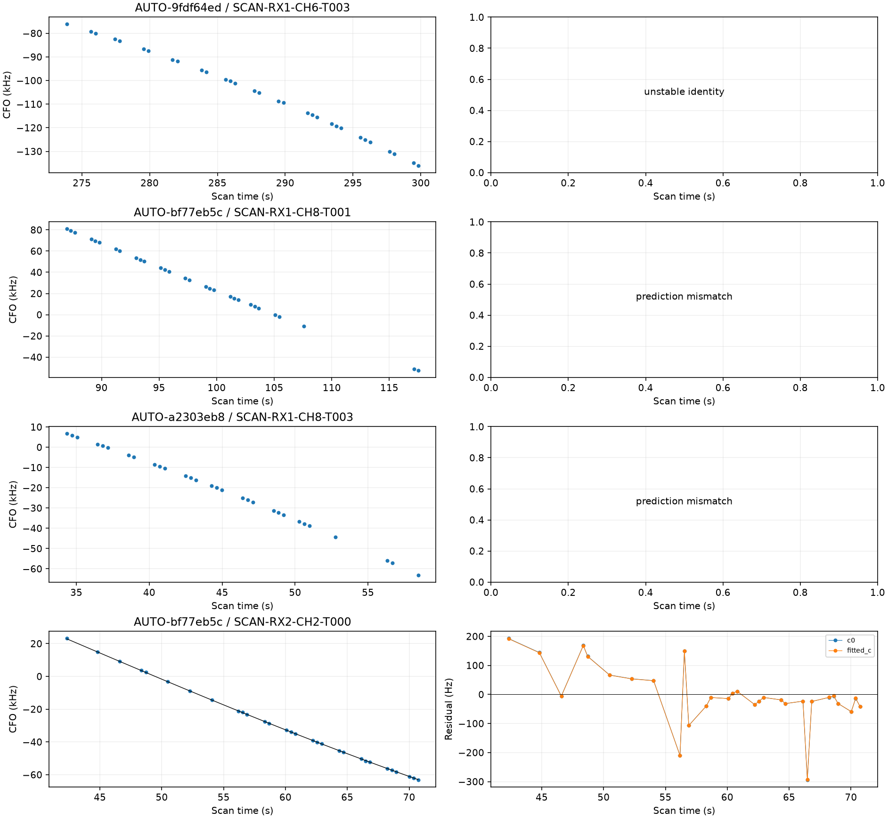
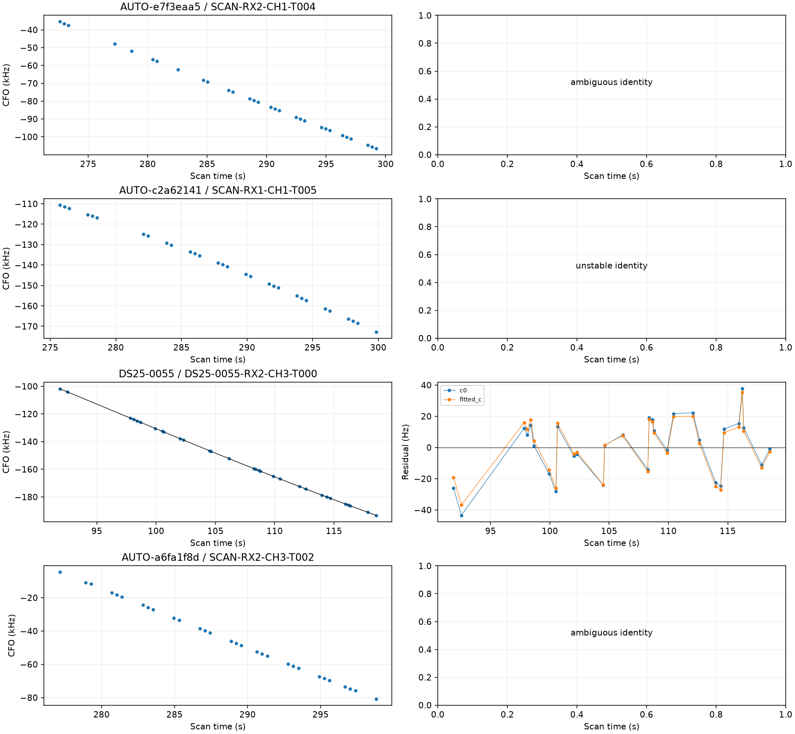
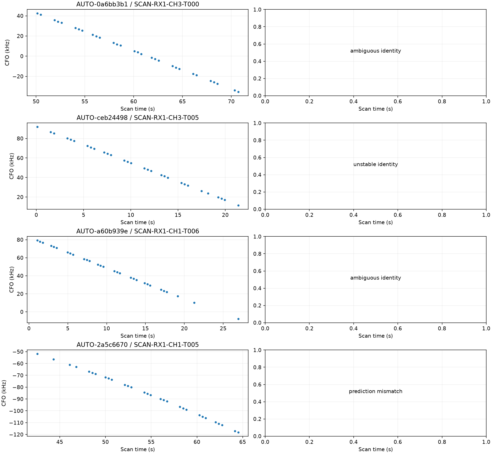
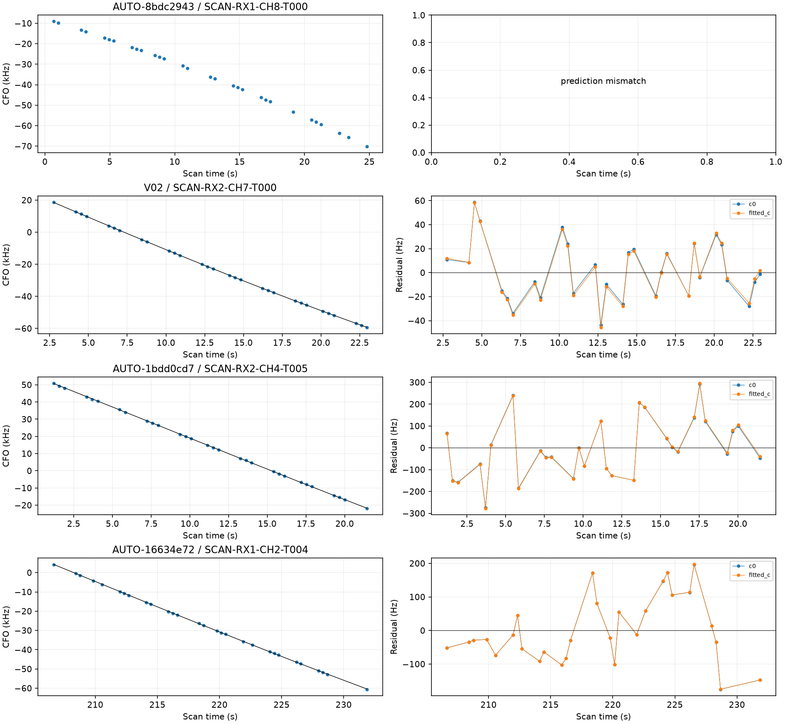
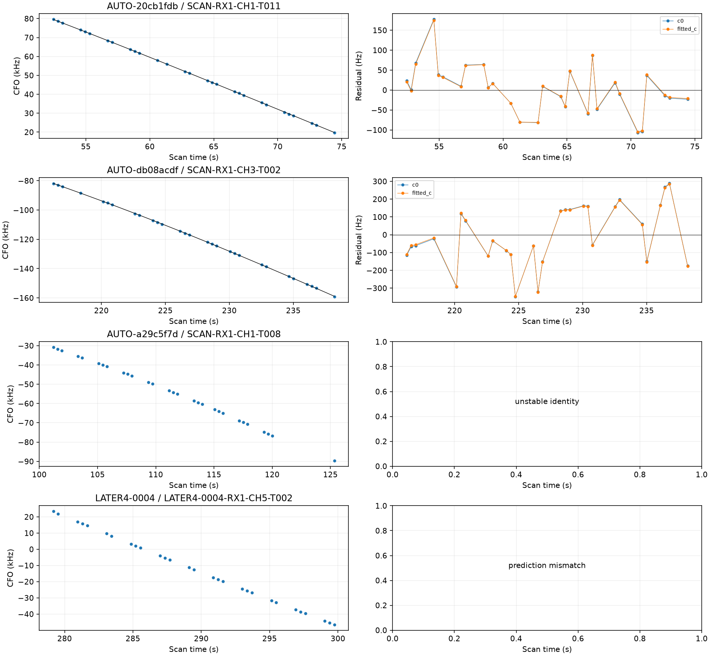

# Shifted-origin annotation batch 3

The next **32** wholly unowned curves from the frozen timestamp-selected queue have complete predictive-only assessments. Outcomes: **{'ambiguous_identity': 8, 'conditionally_supported_identity': 11, 'prediction_mismatch': 7, 'unstable_identity': 6}**. There are **11 full position trials**, with **7 RF-qualified curves / 209 points** in separate trials. This is not a combined recovery or a production change.

All 11 initially supported identities were reassessed with a candidate cap of 12 before position inclusion. 0 lost conditional support. The original scores, c arms, aliases and physical partitions replay unchanged; [candidate_competition.csv](candidate_competition.csv) records both outcomes and actual candidate counts. This expands the existing geometry nomination shortlist; it is not an exhaustive all-catalogue likelihood search.

## Scope, validation and capture provenance

Selection follows native point count and immutable track ID without GPS ranking. The reconciled remaining-candidate file prevents repeating assessments completed in other queues. Every target has three distinct timestamp-selected physical holdout sets, with seeded block origins, 12-second blocks, two-second guards, at least eight training points and four held points. Sets overlap and are not independent replications. No target calibrates the receiver during annotation; the graph and incumbent identities remain conditioning assumptions.

Capture modes are **{'fast': 29, 'adaptive': 3}**. Adaptive records use their authoritative source case in tables, retaining historical inventory aliases separately. Direct scanner contracts and digest-verified acquisition manifests establish capture provenance; the fast adapter compatibility label does not. Canonical source identities prevent an adaptive recovery from being reported as a fast-scan result.

| scan | inventory_alias | capture_mode | points | status | norad | margin |
| --- | --- | --- | --- | --- | --- | --- |
| DS24-0014 | DS24-0014 | fast | 31 | ambiguous_identity | 68051 | 1.723 |
| AUTO-19619206 | AUTO-19619206 | fast | 31 | conditionally_supported_identity | 67348 | 159.023 |
| DS25-0031 | DS24-0050 | adaptive | 31 | conditionally_supported_identity | 58458 | 21.386 |
| AUTO-053b5eee | AUTO-053b5eee | fast | 31 | ambiguous_identity | 63585 | 9.061 |
| AUTO-0c61c1a0 | AUTO-0c61c1a0 | fast | 31 | conditionally_supported_identity | 67421 | 99.180 |
| AUTO-c0dd2487 | AUTO-c0dd2487 | fast | 31 | conditionally_supported_identity | 66028 | 14.681 |
| DS24-0085 | DS24-0085 | fast | 31 | ambiguous_identity | 59159 | 0.111 |
| AUTO-a2303eb8 | AUTO-a2303eb8 | fast | 31 | prediction_mismatch | 63386 | 119.460 |
| AUTO-a3e1d854 | AUTO-a3e1d854 | fast | 31 | unstable_identity | None | 0.072 |
| DS25-0012 | DS24-0031 | adaptive | 31 | unstable_identity | None | 0.029 |
| AUTO-89080200 | AUTO-89080200 | fast | 31 | prediction_mismatch | 65898 | 77.681 |
| AUTO-f122bc7e | AUTO-f122bc7e | fast | 31 | ambiguous_identity | 52263 | 1.051 |
| AUTO-9fdf64ed | AUTO-9fdf64ed | fast | 31 | unstable_identity | None | 0.390 |
| AUTO-bf77eb5c | AUTO-bf77eb5c | fast | 30 | prediction_mismatch | 64687 | 239.651 |
| AUTO-a2303eb8 | AUTO-a2303eb8 | fast | 30 | prediction_mismatch | 59028 | 43.210 |
| AUTO-bf77eb5c | AUTO-bf77eb5c | fast | 30 | conditionally_supported_identity | 67828 | 103.652 |
| AUTO-e7f3eaa5 | AUTO-e7f3eaa5 | fast | 30 | ambiguous_identity | 63777 | 1.043 |
| AUTO-c2a62141 | AUTO-c2a62141 | fast | 30 | unstable_identity | None | 0.165 |
| DS25-0055 | DS24-0074 | adaptive | 30 | conditionally_supported_identity | 66475 | 28.510 |
| AUTO-a6fa1f8d | AUTO-a6fa1f8d | fast | 30 | ambiguous_identity | 55756 | 0.396 |
| AUTO-0a6bb3b1 | AUTO-0a6bb3b1 | fast | 30 | ambiguous_identity | 66075 | 8.454 |
| AUTO-ceb24498 | AUTO-ceb24498 | fast | 30 | unstable_identity | None | 0.083 |
| AUTO-a60b939e | AUTO-a60b939e | fast | 30 | ambiguous_identity | 68066 | 2.803 |
| AUTO-2a5c6670 | AUTO-2a5c6670 | fast | 30 | prediction_mismatch | 66252 | 205.668 |
| AUTO-8bdc2943 | AUTO-8bdc2943 | fast | 30 | prediction_mismatch | 52287 | 530.114 |
| V02 | V02 | fast | 30 | conditionally_supported_identity | 62149 | 580.874 |
| AUTO-1bdd0cd7 | AUTO-1bdd0cd7 | fast | 30 | conditionally_supported_identity | 57947 | 51.025 |
| AUTO-16634e72 | AUTO-16634e72 | fast | 29 | conditionally_supported_identity | 67024 | 11.106 |
| AUTO-20cb1fdb | AUTO-20cb1fdb | fast | 29 | conditionally_supported_identity | 57925 | 120.735 |
| AUTO-db08acdf | AUTO-db08acdf | fast | 29 | conditionally_supported_identity | 68322 | 19.679 |
| AUTO-a29c5f7d | AUTO-a29c5f7d | fast | 29 | unstable_identity | None | 5.775 |
| LATER4-0004 | LATER4-0004 | fast | 29 | prediction_mismatch | 53070 | 1.579 |

## Matched position inclusion

All supported identities receive matched controls/additions and c=0/fitted-c tests using causal candidates, existing physical priors and the same regional initialization. New-family phase quadrature is 0.025 seconds. The numerical-only retry selector produces **1** follow-ups, with matched Powell controls/additions and unchanged physical gates. Original and follow-up outputs remain in [comparisons.csv](comparisons.csv).

| scan | norad | points | qualified | c0_before_km | c0_after_km | fitted_c_before_km | fitted_c_after_km |
| --- | --- | --- | --- | --- | --- | --- | --- |
| AUTO-19619206 | 67348 | 31 | True | 0.971 | 0.989 | 0.917 | 0.937 |
| DS25-0031 | 58458 | 31 | False | 1.495 | 1.079 | 1.436 | 1.117 |
| AUTO-0c61c1a0 | 67421 | 31 | False | 2.066 | 1.982 | 2.105 | 2.023 |
| AUTO-c0dd2487 | 66028 | 31 | True | 1.138 | 0.947 | 1.115 | 0.946 |
| AUTO-bf77eb5c | 67828 | 30 | False | 1.111 | 0.750 | 1.112 | 0.751 |
| DS25-0055 | 66475 | 30 | True | 1.516 | 1.482 | 1.359 | 1.332 |
| V02 | 62149 | 30 | False | 6.677 | 6.670 | 6.763 | 6.754 |
| AUTO-1bdd0cd7 | 57947 | 30 | True | 1.997 | 1.731 | 2.055 | 1.789 |
| AUTO-16634e72 | 67024 | 29 | True | 1.185 | 0.860 | 1.180 | 0.865 |
| AUTO-20cb1fdb | 57925 | 29 | True | 0.494 | 0.422 | 0.478 | 0.407 |
| AUTO-db08acdf | 68322 | 29 | True | 0.788 | 0.906 | 0.797 | 0.899 |

Qualification requires acceptable residual structure, unchanged incumbent ownership, exact orbital/objective replay and numerical convergence. Qualified membership gains must equal exactly the independently tested target observations. [position_trials.csv](position_trials.csv) reports coverage percentages, point gains, target RMS, objectives and evaluation errors separately. Controls and additions contain different observations; lower raw objectives or more associated points do not prove improved position accuracy. [failed_gates.csv](failed_gates.csv) retains rejected results even if their position errors improve.

Any unscored automatic extension discoveries are excluded from the reviewed association gains using an explicit source-hashed membership audit. The raw membership remains unchanged, and raw versus reviewed counts are recorded separately. Such an audit must prove that incidental points never entered the position objective and that old owners and the tested target are preserved. It does not validate the incidental points themselves.

## Remaining work

**338 shifted-origin candidates and 839 older-role reassessments remain. These queues overlap and must not be added.** The [updated 1,630-row ledger](annotation_ledger.csv) preserves earlier ambiguity, rejections, native-IQ withholdings and joint-family results. Pass the corresponding `remaining_*_candidates.json` file to the next queue invocation using `--remaining-candidates`.

Continue bounded annotation/inclusion batches and independently supported model challenges. Research recoveries require joint consistency and cohort evaluation before promotion. Evaluation GPS never selects satellites or partitions; causal TLEs and physical gates remain unchanged. No new RF or production changes occurred. Source hashes, terminal receipts, physical partition assignments, compact scientific evidence and all figures accompany this report. The complete annotation-and-inclusion objective is unfinished.
