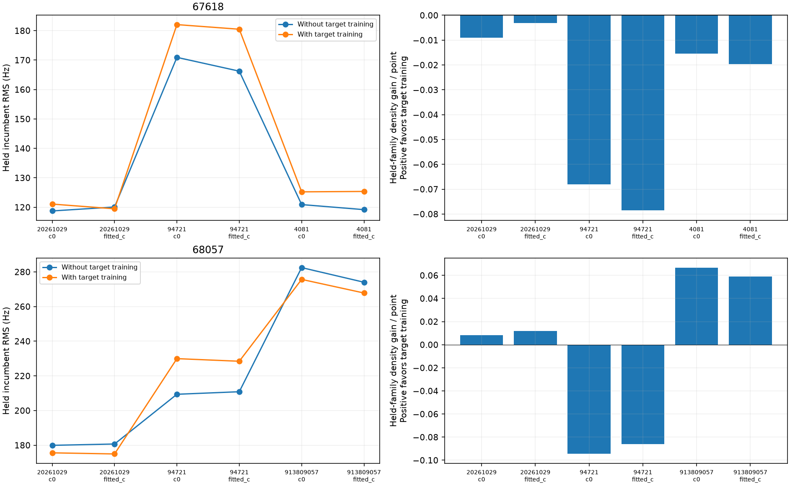
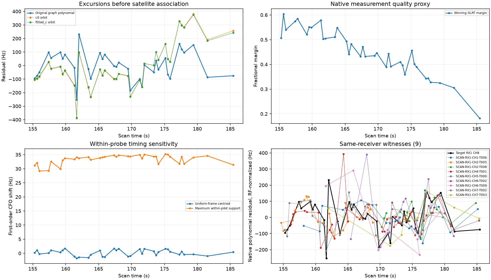
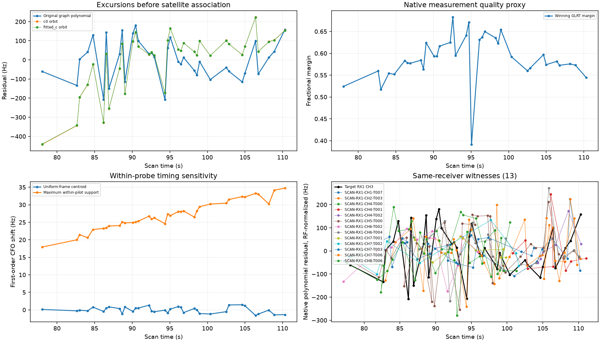
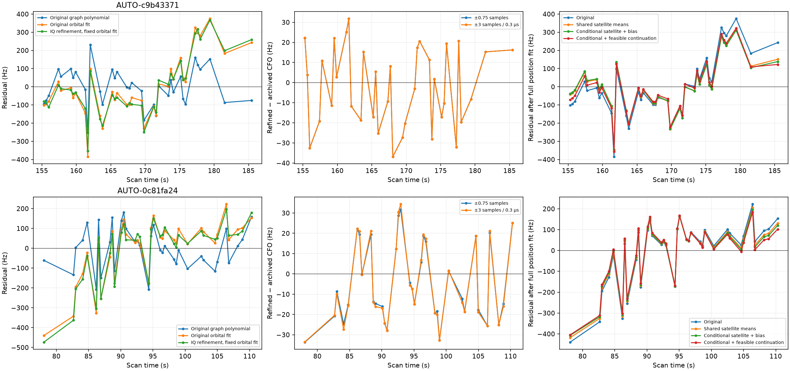

# Rejected shared-family curves: measurement replay and model consistency

Both shared-family rejections from shifted batch one receive the same diagnostic sequence, without selecting by GPS improvement: randomized bidirectional family prediction, exact native GLRT replay, complete-target IQ remeasurement, and matched shared-satellite model variants. No points are trimmed and no labels are forced. The targets remain research hypotheses unless all physical and ownership checks pass.

## Family evidence and residual origins

| scan | norad | component | role | points | start_s | end_s |
| --- | --- | --- | --- | --- | --- | --- |
| AUTO-c9b43371 | 67618 | SCAN-RX1-CH2-T005-RF10959687500.000000 | incumbent_calibration | 42 | 140.473 | 168.844 |
| AUTO-c9b43371 | 67618 | SCAN-RX1-CH5-T001-RF11709687500.000000 | incumbent_calibration | 60 | 111.518 | 155.146 |
| AUTO-c9b43371 | 67618 | SCAN-RX1-CH6-T001-RF11959687500.000000 | incumbent_calibration | 34 | 111.207 | 153.770 |
| AUTO-c9b43371 | 67618 | SCAN-RX1-CH7-T001-RF12209687500.000000 | incumbent_calibration | 44 | 111.606 | 153.814 |
| AUTO-c9b43371 | 67618 | SCAN-RX1-CH8-T004-RF12459687500.000000 | target | 36 | 155.279 | 185.426 |
| AUTO-0c81fa24 | 68057 | SCAN-RX1-CH2-T003-RF11190312500.000000 | incumbent_calibration | 44 | 82.965 | 114.867 |
| AUTO-0c81fa24 | 68057 | SCAN-RX2-CH3-T001-RF11440312500.000000 | incumbent_calibration | 55 | 112.783 | 158.849 |
| AUTO-0c81fa24 | 68057 | SCAN-RX1-CH2-T011-RF11190312500.000000 | incumbent_predictive | 11 | 43.986 | 54.968 |
| AUTO-0c81fa24 | 68057 | SCAN-RX1-CH3-T010-RF11440312500.000000 | incumbent_predictive | 14 | 130.853 | 142.194 |
| AUTO-0c81fa24 | 68057 | SCAN-RX2-CH4-T005-RF11690312500.000000 | incumbent_predictive | 8 | 106.449 | 114.245 |
| AUTO-0c81fa24 | 68057 | SCAN-RX1-CH3-T005-RF11440312500.000000 | target | 36 | 78.047 | 110.300 |

The family tests exclude the challenged family from receiver/position training and use the existing three randomized scanwide 12-second partitions with two-second guards. Target training can condition one shared phase/orbit distribution and receiver covariance, while the separately trained calibration stays fixed. Held points enter scoring only. The folds overlap; score changes are not calibrated association probabilities.

| scan | seed | held_family_points | before_RMS_hz | after_RMS_hz | density_gain |
| --- | --- | --- | --- | --- | --- |
| AUTO-c9b43371 | 20261029 | 78 | 120.083 | 119.467 | -0.245 |
| AUTO-c9b43371 | 94721 | 12 | 166.244 | 180.496 | -0.943 |
| AUTO-c9b43371 | 4081 | 25 | 119.178 | 125.364 | -0.491 |
| AUTO-0c81fa24 | 20261029 | 30 | 180.700 | 174.966 | 0.356 |
| AUTO-0c81fa24 | 94721 | 35 | 210.859 | 228.444 | -3.005 |
| AUTO-0c81fa24 | 913809057 | 2 | 274.024 | 267.812 | 0.118 |

67618's target produces small negative held-family density changes in all partitions. 68057 improves two partitions slightly and worsens one more noticeably. Neither gives consistent independent support for the required shared correction. Halving phase spacing from 0.05 to 0.025 seconds changes total density by at most **0.0000** and RMS by at most **0.001 Hz** across recorded prediction modes. The conclusions are not explained by this quadrature spacing.

Both targets consist of **one original polynomial piece**: degree three for RX1 CH8 / 67618, degree two for RX1 CH3 / 68057. There is no joined-fragment seam. Their saved graph screens report no detected structure; that is not proof of a correct satellite identity. Polynomial residual RMS is about 102 Hz, while full orbital residual RMS is 152–163 Hz. The remaining difference includes smooth shape error. Polynomial fits can absorb smooth receiver/orbit errors, so this decomposition is a diagnostic rather than a measurement-error certificate.

| scan | polynomial_RMS_hz | orbital_RMS_hz | polynomial_orbit_correlation | centered_model_gap_RMS_hz |
| --- | --- | --- | --- | --- |
| AUTO-c9b43371 | 101.700 | 163.289 | 0.634 | 126.285 |
| AUTO-0c81fa24 | 102.176 | 151.646 | 0.612 | 120.247 |

## Bounded IQ remeasurement

Every archived GLRT winner and alias lift is replayed exactly. All 36 target points in each scan are remeasured from existing IQ; no frequency point is chosen or discarded based on its residual. The local estimator fits known-pilot carrier frequency, fractional epoch and code rate, with independently fitted odd/even frame subsets and complementary-frame scores. It uses no GPS, TLE, satellite label, orbital prediction or polynomial target value. Odd/even fits share the original full-window nomination and are not independent end-to-end acquisitions.

The first export failed before reading samples because the research reader implements the 2.5 MS/s v1 contract while these 10 MS/s recordings use v2. Those terminal failures are preserved. The measurement-only exporter was decoupled from analysis imports and rerun through the pinned deployed multirate reader. The exporter verifies all source windows and the original raw authority digest, recording the reader and contract source hashes. No persisted contract, raw recording, or production reader was changed.

The initial ±0.75-sample epoch search hit its boundary once for 67618 and 34 times for 68057. At 10 MS/s that bound is only 75 ns; the same setting at 2.5 MS/s permits 300 ns. A measurement-only sensitivity test applies the same **300 ns physical bound**, i.e. ±3 samples at 10 MS/s, to both complete targets. It removes all boundary hits but barely changes CFO estimates. Original failed exports and both successful estimator settings remain in the evidence.

| scan | version | epoch_radius_samples | correction_RMS_hz | odd_even_RMS_hz | boundary_points | odd_complement_improved | even_complement_improved |
| --- | --- | --- | --- | --- | --- | --- | --- |
| AUTO-c9b43371 | 2 | 0.750 | 19.399 | 13.915 | 1 | 30 | 29 |
| AUTO-c9b43371 | 3 | 3.000 | 19.400 | 13.910 | 0 | 30 | 29 |
| AUTO-0c81fa24 | 2 | 0.750 | 19.832 | 24.199 | 34 | 35 | 35 |
| AUTO-0c81fa24 | 3 | 3.000 | 20.521 | 24.257 | 0 | 35 | 35 |

Corrections are only about **19–21 Hz RMS**. With the original orbital prediction, receiver and position held fixed, fitted-c centered residual RMS changes approximately **163.3→160.4 Hz** for 67618 and **151.6→153.7 Hz** for 68057. These local pilot refinements therefore do not explain the large smooth model gap. This does not rule out wrong peaks, source mixtures or other measurement models; it rules out this particular local refinement as a sufficient fix. Refined measurements are not substituted into production or the following position experiments.

## Existing shared-satellite update variants

All position experiments below use the original observations and causal candidate identities. Controls and additions are matched in each c arm and variant. The shared-moment projection exposes posterior satellite means while preserving receiver means at each position; it leaves the original marginal objective intact at a fixed phase reference. The conditional variant updates satellite and existing track-bias coordinates, holding excluded posterior coordinates at their means. That changes predictive uncertainty and the objective, so it is a separate model experiment, not an equivalent implementation.

The final variant uses the existing feasible optimizer with unchanged gates. It is explicitly a **continuation from the scan's saved RF-only incumbent**, not a fresh regional start and not a GPS initialization. Its matched control uses the same continuation. It tests whether the remaining violations are avoidable through constrained optimization; it does not establish global convergence.

| scan | variant | arm | control_valid | qualified | before_km | after_km | target_RMS_hz |
| --- | --- | --- | --- | --- | --- | --- | --- |
| AUTO-c9b43371 | original | c0 | True | False | 0.663 | 0.492 | 166.500 |
| AUTO-c9b43371 | original | fitted_c | True | False | 0.604 | 0.438 | 163.289 |
| AUTO-c9b43371 | shared_satellite_means | c0 | True | False | 0.663 | 0.493 | 141.554 |
| AUTO-c9b43371 | shared_satellite_means | fitted_c | True | False | 0.604 | 0.439 | 139.998 |
| AUTO-c9b43371 | conditional_satellite_and_bias | c0 | True | False | 0.657 | 0.455 | 138.752 |
| AUTO-c9b43371 | conditional_satellite_and_bias | fitted_c | True | False | 0.555 | 0.362 | 137.535 |
| AUTO-c9b43371 | conditional_feasible_continuation | c0 | True | False | 0.657 | 1.999 | 139.023 |
| AUTO-c9b43371 | conditional_feasible_continuation | fitted_c | True | False | 0.555 | 19.133 | 140.550 |
| AUTO-0c81fa24 | original | c0 | True | False | 0.384 | 0.387 | 152.303 |
| AUTO-0c81fa24 | original | fitted_c | True | False | 0.420 | 0.429 | 151.646 |
| AUTO-0c81fa24 | shared_satellite_means | c0 | False | False | 0.386 | 0.384 | 145.517 |
| AUTO-0c81fa24 | shared_satellite_means | fitted_c | False | False | 0.421 | 0.427 | 144.134 |
| AUTO-0c81fa24 | conditional_satellite_and_bias | c0 | True | False | 0.426 | 0.437 | 142.049 |
| AUTO-0c81fa24 | conditional_satellite_and_bias | fitted_c | True | False | 0.412 | 0.433 | 140.596 |
| AUTO-0c81fa24 | conditional_feasible_continuation | c0 | True | False | 0.426 | 5.021 | 140.000 |
| AUTO-0c81fa24 | conditional_feasible_continuation | fitted_c | True | False | 0.413 | 5.214 | 137.832 |

Residual RMS improvement alone cannot authorize inclusion. The shared-moment projection improves the target fit but creates incumbent residual failures; the 68057 control already fails an incumbent conditional-mean check. Some conditional-mean failures involve exposing satellite coordinates without their correlated incumbent track-bias coordinates. They must not be interpreted as proof of a wrong satellite. [All failing gates](failed_gates.csv), including controls, and [matched trial results](position_trials.csv) preserve those limitations. Position accuracy is evaluation-only, and no gate is relaxed because an endpoint is closer to GPS.

The conditional satellite-and-bias variant restores valid controls for both cases and removes the large incumbent mean failures. It still fails target shape checks; 67618 also conflicts with its existing CH2 track. That trial reaches about 362 m fitted-c error but remains unqualified. Across the additional model variants, **0 cases** pass full paired RF/replay/membership qualification. The feasible-continuation result is included in that count only if both c arms and the control pass every required check.

The feasible continuations also fail and produce substantial regressions: fitted-c errors reach about **19.13 km for 67618** and **5.21 km for 68057**. The latter loses 67 incumbent points, and the former proposes 29 additional unvalidated extension points beyond its target. None of those assignments counts as a recovery. Small phase-refresh changes do not make an infeasible endpoint acceptable. These failures are preserved rather than replacing them with the better-looking unconstrained endpoints; further optimization of these variants is stopped for this iteration.

## Inventory progress and next discriminating tests

[Shifted batch two](../2026_10_30_shifted_annotation_batch2/README.md) completes **32** further annotations and **17** matched inclusion cases. **7 curves / 236 points** qualify in separate trials. Its seven numerical-only follow-ups retain matched controls and physical gates. A source-hashed scope audit excludes 16 incidental extension points in one fitted-c result because they were not part of that target's validation or position fit.

The updated ledger preserves these two targets as unresolved and carries all batch results forward. **370 shifted-origin and 859 older-role cases remain; the queues overlap.** No new production version is justified by this iteration alone.

Next work should challenge the conditional identity hypotheses against broader causal candidates and compare simultaneous same-receiver evidence before adding receiver flexibility. A coherent satellite-and-track-bias posterior must also predict independently held family observations, not merely fix in-sample conditional means. For these two targets, another small local CFO adjustment is unlikely to be sufficient. Continue the remaining inventory in bounded batches and test recoveries jointly; do not keep optimizing only the same difficult curves. Source hashes, terminal receipts, native candidate evidence, worker receipts, all c arms and figures accompany this report. No new RF was collected, and the full objective remains incomplete.
