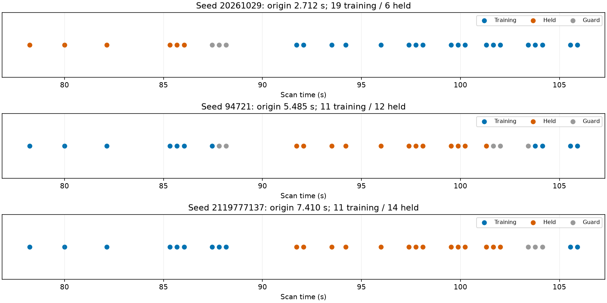
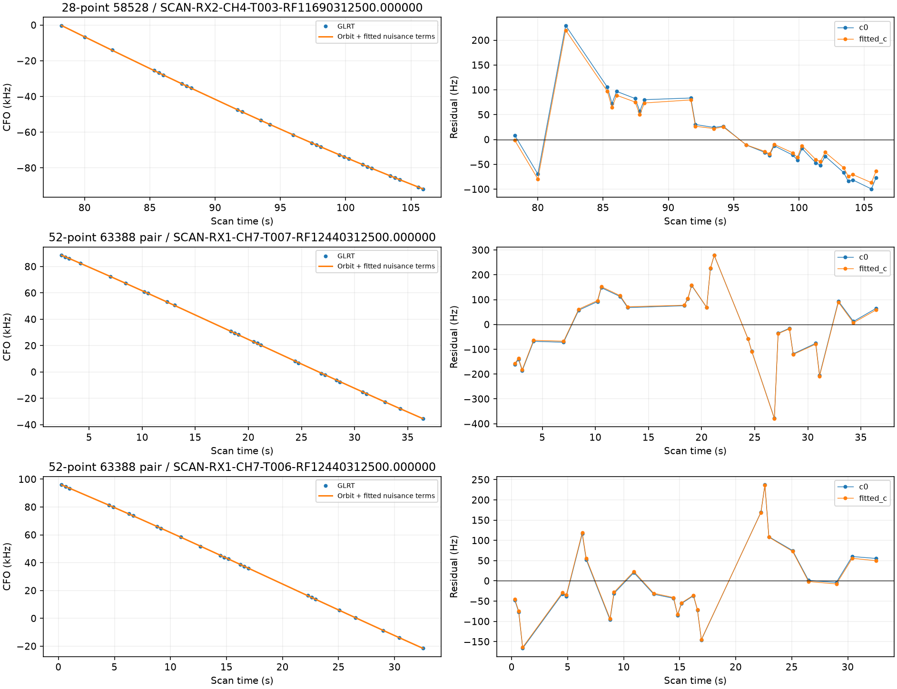

# Testing short curves without weakening the physical model

This iteration separates three questions: whether a curve has enough validation support, whether its identity is plausible, and whether it is jointly consistent with the positioning model. The 28-point RX2 CH4 curve passes the first two after a timestamp-only partition change, but fails the third. Two prior recoveries for satellite 63388 pass a joint 52-point test.

## A validation-alignment bottleneck

The 28-point AUTO-f08da5cb curve spans 78.230–105.913 seconds. Under the fixed zero-origin 12-second grid, its first block holds only three points, below the four-point minimum. Repeating random seeds produces only two usable physical holdout sets. The original insufficient-evidence result was correct under that protocol.

The new **opt-in research protocol** seeds the block origin uniformly within 12 seconds. Block width remains 12 seconds; training guards remain two seconds; each fold still needs at least eight training and four held target observations. All receivers and channels use the same scanwide split. The first three usable distinct physical holdout sets are chosen using timestamps alone from a frozen 67-seed pool. No frequencies, satellite identity, or GPS error select a partition. Existing zero-origin receipts and default behavior are unchanged.

| seed | origin_s | training | held |
| --- | --- | --- | --- |
| 20261029 | 2.712 | 19 | 6 |
| 94721 | 5.485 | 11 | 12 |
| 2119777137 | 7.410 | 11 | 14 |

These sets overlap; in particular, the final two share twelve held points. They are **distinct tests, not three independent replications** or a calibrated association probability. This is a changed validation design, not a retroactive pass under the old design.

A timestamp-only audit of all **1630** inventoried native curves finds 1,180 already eligible under the fixed design and **450 newly eligible** under the shifted design. Of those 450, **447 are wholly unowned**, including **419 marked insufficient partitions in the audit's input ledger**. Three are partly owned and require separate unused-fragment reconstruction. This is validation eligibility, not 450 recovered satellite associations. The audit reconstructs calibration timestamps from frozen graph rows; an exact comparison on the 28-point case matches all 2,381 context timestamps. Every frozen plan and source hash accompanies this report.

## 58528: a plausible identity still fails inclusion

The same causal candidate search favors **58528 in all three partitions and both c arms**, with minimum conditional score margin **57.24** over the tested runner-up 66206. This search is conditional on the frozen graph and incumbent labels; it is not a proof of identity. Target points do not calibrate the receiver during annotation.

The full inclusion trial fails the target residual slope check in both arms: absolute slope z is approximately **3.76 (c=0)** and **3.26 (fitted-c)** against a limit of 3. Fitted-c RMS is only **68.5 Hz**, yet the residual declines over time. Small RMS alone hides a systematic mismatch. Exact replay reports no other negative gate slack. The target remains withheld. A next discriminating test is whether independently held observations of the existing 58528 family support the same shape correction, before adding receiver or orbital freedom.

## 63388: earlier individual recoveries also work together

The 27- and 25-point RX1 CH7 curves in AUTO-ceb24498 share one satellite phase/orbit distribution, separate existing track-bias priors, and receiver uncertainty integrated once. Both had independently supported predictive annotations. Matched Powell controls and additions, exact orbit/ownership replay, and a same-receiver common-residual audit all pass. The 52 points were already counted as individual research recoveries; this result establishes joint compatibility and does **not** add another 52 unique recovered points.

| case | arm | qualified | target_points | before_km | after_km |
| --- | --- | --- | --- | --- | --- |
| 28-point 58528 | c0 | False | 28 | 5.565 | 5.605 |
| 28-point 58528 | fitted_c | False | 28 | 5.824 | 5.968 |
| 52-point 63388 pair | c0 | True | 52 | 2.144 | 2.027 |
| 52-point 63388 pair | fitted_c | True | 52 | 2.098 | 2.019 |

The plotted orbital curves include the model's fitted nuisance terms; residuals include the existing per-track constant bias. Numerical objectives are recorded separately in [position_trials.csv](position_trials.csv). Controls and additions contain different target observations, so raw objective changes are not evidence of better position accuracy. The 28-point trial is standalone and is not combined with the earlier 75-point 63906 recovery from the same scan.

## Inventory progress and next work

[Batch five](../2026_10_30_predictive_role_reassessment_batch5/README.md) completes another **32** older-role annotations and **12** position trials. **1 curves / 68 points** qualify in separate trials. Its complete accepted and rejected results, matched c arms, capture provenance, and figures are retained. The batch leaves 889 older-role cases; the separate 58528 assessment removes one more, leaving **888**. The updated ledger here additionally records the rejected 58528 trial and jointly qualified 63388 pair while preserving prior native-IQ and family-consistency withholdings.

The newly RF-qualified 68-point AUTO-9efe3f9e / 100165 target worsens error from **352 to 453 m (c=0)** and **222 to 268 m (fitted-c)** in matched trials. It remains a research association candidate, not an accuracy improvement. This is another direct counterexample to assuming that increasing associated-point count necessarily improves localization.

The following counts use the final trial for each scan, counting a scan once per gate and evidence role across both c arms. A scan can fail several gates; these are not disjoint rejection categories. Optimizer and phase-resolution failures are separately recorded in the original trial evidence.

| evidence_role | gate | cases |
| --- | --- | --- |
| incumbent | quadratic | 2 |
| incumbent | slope | 1 |
| incumbent | step | 1 |
| target | lag1 | 8 |
| target | quadratic | 5 |
| target | slope | 6 |
| target | step | 9 |

Structured target residuals dominate these final trials: nine scans fail the step statistic, eight fail lag correlation, six fail slope and five fail quadratic structure. This diagnoses the checks that reject them; it does not yet distinguish orbital error, receiver error, measurement contamination, or incorrect identities. No target RMS gate fails in this batch. Incumbent failures in some cases also expose tension between newly added evidence and existing associations.

Next work is bounded shifted-origin validation of wholly unowned curves that previously lacked partition support, followed by the same physical inclusion checks. For supported identities with structured residuals, family-to-target and target-to-family prediction should precede additional nuisance flexibility. Individual successes must then be tested together and on a fresh cohort before promotion. Causal TLEs and the regional 25 × 25 km initialization are retained; evaluation GPS is used only for reporting errors. No production version changes here, and the complete annotation-and-inclusion goal remains unfinished.
