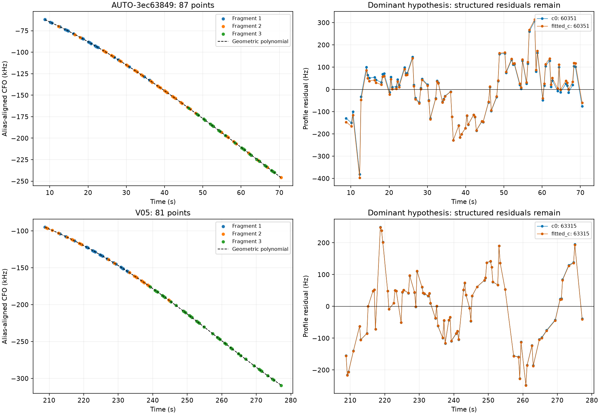
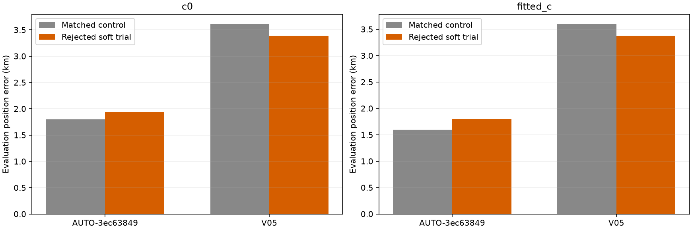
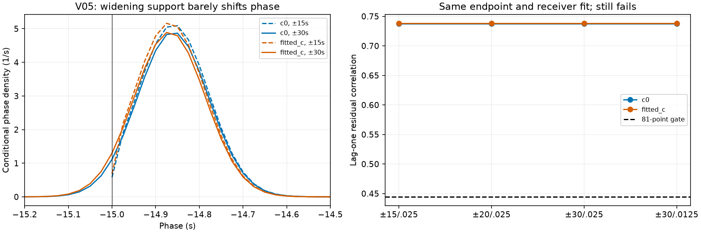

# Full-inventory fragment grouping and uncertain satellite identity

The frozen inventory now has a systematic geometric grouping pass across **1,630 curves in 254 scans**. It nominates **35 groups: 33 pairs and two triples**. Both triples have been tested with hard identity checks and a new conditional satellite-label mixture. **Neither qualifies for inclusion; zero additional hard-associated points are credited.** This is research code, with no production or ALGO promotion.

## Inventory and grouping

Of 1,630 curves, 1,582 are currently large and wholly unowned. The other 48 are excluded as no longer current-large or partially owned. Groups use the same receiver, channel and RF; overlap or gap at most 12 seconds; disjoint observation IDs and timestamps; consistent integer alias lifts around every cycle; one order 1–4 BIC-selected polynomial with a 150 Hz noise floor; and both pooled and individual-member RMS below 250 Hz. At least three 12-second timestamp blocks are required. No satellite or GPS selects the grouping. Nomination is conditional on the frozen graph and full CFO data, not independent validation of track construction.

There are 39 unique pair edges connecting 72 curves into 35 groups; 1,510 eligible curves have no nominated edge. An initial discovery file counted repeated c-arm rows as separate edges (156). Deduplication reduced that to 39 while preserving **every bundle's measurements, integer lifts, and selected jobs exactly**. The original annotation inputs remain immutable; the equivalence receipt and hashes are included. The [individual annotation ledger](annotation_ledger.csv) is unchanged; [group hypotheses](groups.csv) are separate and do not authorize joins.

## Identity uncertainty survives pooling

The largest eligible groups with at least three members and at most 180 points, from distinct scans, were selected automatically. These are AUTO-3ec63849 (87 points) and V05 (81 points). Each receives three distinct random scanwide 12-second block partitions with two-second guards, matching c=0 and fitted-c candidates, priors and budgets. These are randomized blocks, not point-wise or chronological holdouts.

AUTO-3ec63849 favors 60351 in all six fold/arm comparisons, but the weakest margin over 61217 is only 2.65 against the required 10. V05 alternates between incumbent 59770 and new-family 63315. This demonstrates unresolved identity within the tested candidate set; neither is a verified satellite assignment.

## Conditional satellite-label mixture

The prototype freezes the union of candidates within 20 negative-twice-log-density units of a fold's winner, with held RMS at most 450 Hz, phase closure at most 0.01 s and nonnegative elevation, in both c arms of at least one fold. This is RF-only development selection using saved held scores, not a new independent validation set. Candidates are 60351/61217/67196 for AUTO-3ec63849 and 59770/63315 for V05.

It scores `-2 log(sum_j prior_j * exp(-score_j/2))`, with equal family priors and equal alias priors within each family. New-family components integrate causal phase, physical orbital uncertainty and receiver uncertainty. Known-family components condition the full coefficient covariance on incumbent predictive observations once, then evaluate the target conditional density. Targets do not update receiver calibration at a fixed position. A Gaussian joint-minus-incumbent-density test verifies this conditioning.

This mixture is conditional on the nominated bundle and candidate subset, **has no clutter component**, and cannot be interpreted as a full-catalogue identity probability. A concentrated conditional weight is not permission to label or count the points. Continuous-phase/exact-target checks, member checks with the same bundle bias, incumbent exact-family replay, ownership preservation and numerical integration checks remain mandatory. At least 99% of conditional component weight must satisfy physical checks.

## Matched position trials: both rejected

Both arms start at the center of the same 25×25 km box, with five phase-refresh rounds and matched Powell budgets (48 iterations / 240 evaluations per round). The regional center is 37.906, -122.545. The true site 37.849061591561885, -122.48574968092912 is used only here to report error. No future TLE is used. Candidate selection never sees these errors.

| scan | points | arm | control_km | proposal_km | accepted | hard_target_points | phase_grid_pass |
| --- | --- | --- | --- | --- | --- | --- | --- |
| AUTO-3ec63849 | 87 | c0 | 1.800 | 1.941 | False | 0 | False |
| AUTO-3ec63849 | 87 | fitted_c | 1.599 | 1.799 | False | 0 | False |
| V05 | 81 | c0 | 3.613 | 3.392 | False | 0 | False |
| V05 | 81 | fitted_c | 3.601 | 3.381 | False | 0 | False |

V05 improves by about 220 m in both experimental arms, while AUTO-3ec63849 worsens by about 140–200 m. **These are rejected trial outcomes, not delivered position improvements.** Both show structured residuals despite small RMS. Continuous-phase checks still fail; individual member checks also prevent pooled residual cancellation. The 0.1-second quadrature fails its score/gradient audit. AUTO's 0.05/0.025-second results agree much better; V05 needs a separate boundary diagnostic. See [all component gates](component_gates.csv), [member gates](member_gates.csv), and [identity votes](identity_votes.csv).

## V05 phase boundary: a real diagnostic issue, not the recovery

The original 0.1-second grid placed about 52–56% of its conditional phase mass in the outer 0.1 seconds of the ±15-second support. That is not a claim that this mass lies outside the support. At the saved positions and fixed receiver fits, the diagnostic evaluates ±15, ±20 and ±30 seconds on a 0.025-second grid, plus ±30 on a 0.0125-second grid. It uses only the existing causal orbit bank and refuses extrapolation. Prior mean, scale and degrees of freedom stay fixed; the normalized integration support changes, so scores across limits are not identical-prior comparisons.

| arm | limit_s | spacing_s | phase_mean_s | boundary_mass | RMS_hz | lag1 | compatible_member_mass |
| --- | --- | --- | --- | --- | --- | --- | --- |
| c0 | 15 | 0.025 | -14.852 | 0.339 | 109.238 | 0.738 | 0.000 |
| c0 | 20 | 0.025 | -14.860 | 0.000 | 109.238 | 0.738 | 0.000 |
| c0 | 30 | 0.025 | -14.860 | 0.000 | 109.238 | 0.738 | 0.000 |
| c0 | 30 | 0.013 | -14.860 | 0.000 | 109.238 | 0.738 | 0.000 |
| fitted_c | 15 | 0.025 | -14.858 | 0.370 | 109.388 | 0.738 | 0.000 |
| fitted_c | 20 | 0.025 | -14.868 | 0.000 | 109.388 | 0.738 | 0.000 |
| fitted_c | 30 | 0.025 | -14.868 | 0.000 | 109.388 | 0.738 | 0.000 |
| fitted_c | 30 | 0.013 | -14.868 | 0.000 | 109.388 | 0.738 | 0.000 |

Expanded support removes boundary mass but moves the phase mean only about 0.008–0.009 seconds. The ±30 scores agree within 0.000006 between the two fine grids at these endpoints. RMS stays about 109 Hz and lag-one residual correlation stays about 0.738, above `4/sqrt(81) = 0.444`. The same member failures persist. **The phase cutoff does not explain the residual structure at these endpoints.** This fixed-endpoint diagnostic does not establish convergence of a new position fit or its gradient.

## What we learned and next tests

Combining fragments can expose satellite ambiguity that single-fragment screening misses. Allowing a soft label does not solve an inadequate waveform model: high conditional identity confidence can coexist with correlated residuals. These tests do not yet distinguish satellite-model error, receiver error, peak-tracking bias, or an imperfect join. Nor do they prove the curves contain no position information.

Next, investigate whether residual discrepancies repeat at the same times on independently associated curves: shared across satellites in one receiver/band suggests receiver structure; shared by one satellite across receivers suggests orbit/transmitter structure. Any extra correction needs independent support and matched c-arm validation. In parallel with that scientific direction, the 33 pair hypotheses provide the next bounded inventory queue, deduplicated against previously tested groups. Do not indefinitely tune these two scans, relax noise gates to reach coverage, or count soft probability as hard association.

## Reproduction and evidence

Tools: `discover_graph_bundle_components.py`, `predictive_label_mixture.py`, `run_soft_bundle_position.py`, `audit_soft_bundle_members.py`, `audit_soft_phase_domain.py`, and this report generator. Terminal receipts, immutable protocols, compact replay evidence, and source hashes are in [evidence.json.gz](evidence.json.gz) and [sources.json](sources.json). [summary.json](summary.json) records counts. Existing default phase support remains ±15 seconds; expanded support is opt-in research only. The 1,630-row ledger remains unique and unchanged.

Validation: 45 targeted tests pass across label-mixture normalization, shared-family conditional covariance, member-bias vetoes, bounded phase support, grouping/alias consistency, bundle ownership, family routing, randomized partitions, phase-resolution checks and predictive likelihoods. Report generation verifies 522 upstream source hashes, terminal completion, unchanged bundle measurements across deduplication, unique ledger identities, and no target leakage into hard associations. These tests validate implementation invariants; they do not qualify the rejected physical fits.
