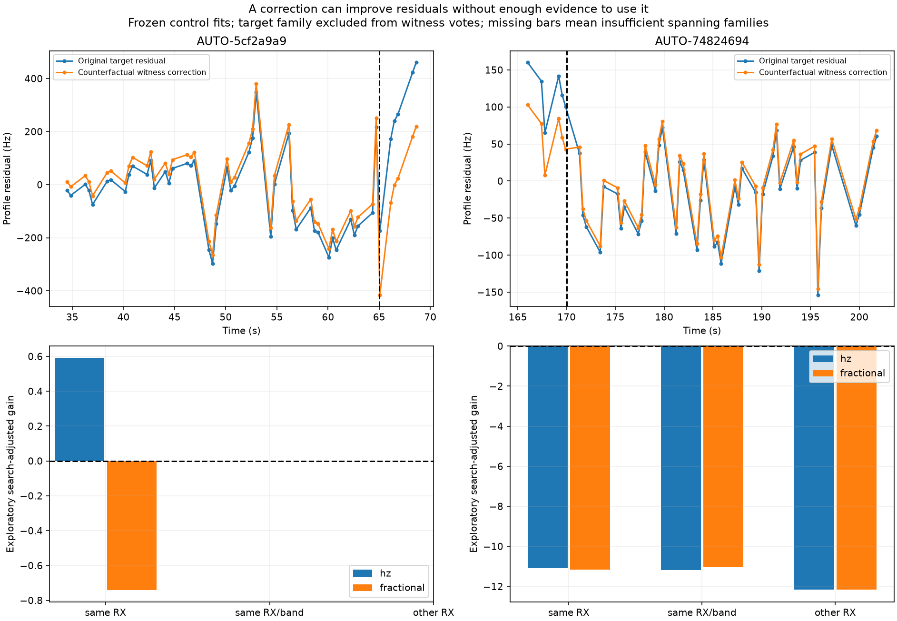
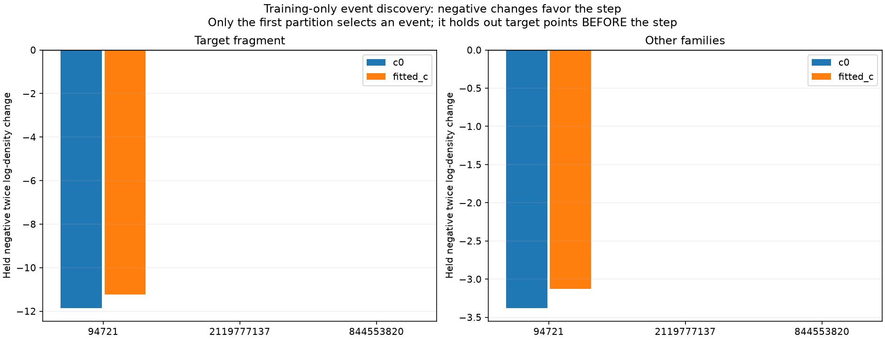
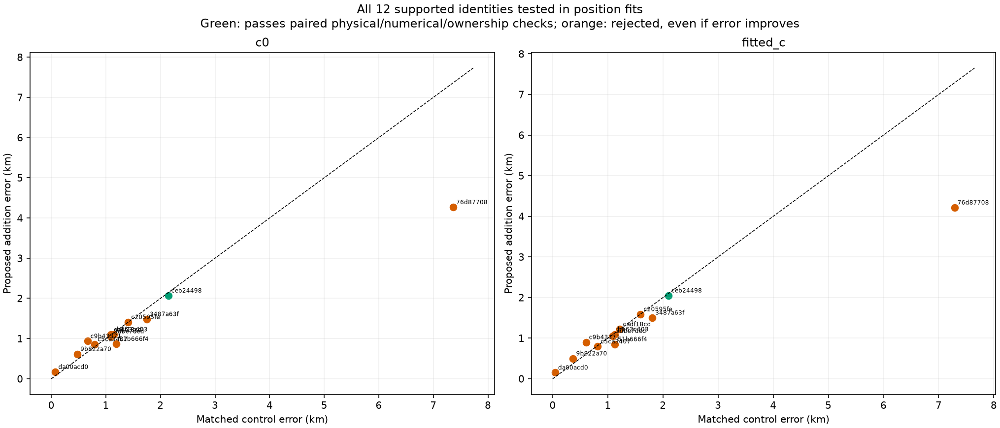
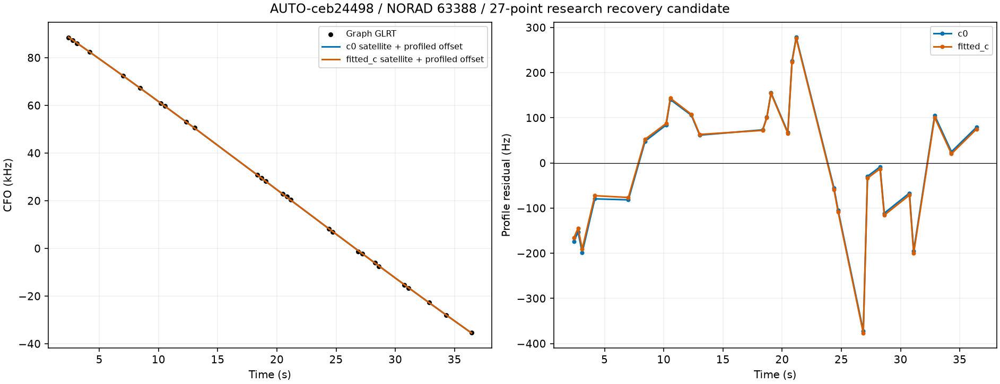

# Cross-family step evidence, random-block validation and inventory transfer

This iteration tests whether the two previously rejected partial curves have independent receiver-step witnesses, advances two bounded annotation batches, and runs every supported identity from the first batch through matched position inclusion. **One 27-point curve qualifies as a research recovery candidate; no production policy changes.** Other apparent improvements remain rejected when physical, numerical or ownership checks fail.

## Receiver-step evidence is uneven

Residuals are reconstructed at the saved **no-addition control position**. The unused fragment never enters that fit. Receiver-step discovery excludes every curve assigned to the target's satellite family. We examine a timestamp-defined 1 s grid across the target span, using witnesses within the span plus 10 s on each side. Each witness must have at least four points on either side of the proposed event. A constant and linear trend are removed per witness so a smooth rate discrepancy cannot automatically vote for a jump. Multiple channels of one family receive one averaged-information vote. At least two families are required.

The exploratory model uses fixed 150 Hz measurement noise and a 150 Hz Gaussian amplitude prior. We retain all three scopes (same receiver, same receiver/band, other receiver) and additive-Hz/fractional-frequency scalings. A proposal needs positive gain after a `2 log(grid points × 6)` search penalty and two same-sign family amplitudes exceeding two posterior standard deviations. This is a deliberately explicit **diagnostic rule, not calibrated event confidence**. The residuals share full-fit parameters, so different-family votes alone do not establish independent held-out prediction. Other-receiver results are controls, not permission to transfer a correction between receivers.

For AUTO-5cf2a9a9 / 64004, the target step maximum is between **65.06 and 66.13 s**, separating 45 earlier points from five later points. Other RX1 curves belonging to **59213 and 59222** favor an additive-Hz step at **65 s**, about **+274 Hz**. Their family-specific amplitudes are roughly +210 and +223 Hz after prior shrinkage. The aggregate exploratory search-adjusted gain is only **+0.59 / +0.62** in c=0 / fitted-c. Applying that estimate counterfactually reduces the target step statistic from **4.25 / 4.28** to **2.78 / 2.73**, with the unchanged limit of 4, and all target noise gates pass. Fractional scaling falls below the discovery threshold; same-band and other-receiver controls lack two spanning families. This is a plausible receiver hypothesis, not a recovered association.

For AUTO-74824694 / 69450, the target step maximum lies between **169.90 and 171.31 s**. A hypothetical roughly −66 Hz receiver step near 170 s would also make the target pass, but its witness gain is about **−11**, with no two-sigma family votes. That correction is unsupported. This distinction is important: finding a correction that improves the target is much easier than establishing that it belongs in the receiver model. [All 24 arm/scope/scaling outcomes](witness_models.csv) remain visible.

## Training-only discovery does not yet validate the changed interval

For the one scan with a positive exploratory proposal, we repeat discovery inside each of its three existing random scanwide **12 s block / 2 s guard** partitions. The target's entire satellite family is excluded from calibration, all predictive incumbents are excluded from training, noise is fixed at 150 Hz, and the event time is reselected from c=0 training residuals only. The same event candidate, prior, observations and search budget are then used in both c arms. If training does not support an event, the candidate policy falls back to the original model. Target training observations can condition the satellite predictive mixture, but cannot calibrate the receiver or event.

| seed | arm | event_selected | event_time_s | target_held_start_s | target_held_end_s | target_RMS_before_hz | target_RMS_after_hz | target_score_delta | existing_score_delta |
| --- | --- | --- | --- | --- | --- | --- | --- | --- | --- |
| 94721 | c0 | True | 65.000 | 36.270 | 46.931 | 375.027 | 130.290 | -11.863 | -3.381 |
| 94721 | fitted_c | True | 65.000 | 36.270 | 46.931 | 363.640 | 120.259 | -11.244 | -3.126 |
| 2119777137 | c0 | False | None | 48.354 | 59.020 | 225.359 | 225.359 | 0.000 | 0.000 |
| 2119777137 | fitted_c | False | None | 48.354 | 59.020 | 222.800 | 222.800 | 0.000 | 0.000 |
| 844553820 | c0 | False | None | 60.087 | 68.617 | 276.620 | 276.620 | 0.000 | 0.000 |
| 844553820 | fitted_c | False | None | 60.087 | 68.617 | 276.935 | 276.935 | 0.000 | 0.000 |

Only seed **94721** selects the 65 s event. It improves target held RMS from **375 → 130 Hz** (c=0) and **364 → 120 Hz** (fitted-c), and improves the held predictive score for other families too. However, its held target points are **36.27–46.93 s, before the event**. The partition withholding **60.09–68.62 s**, which contains the changed target interval, does **not** support an event from training. The remaining partition also falls below the discovery threshold. The neutral score changes in those folds are explicit no-event fallbacks, not successful step predictions. Thus this experiment does not yet independently validate prediction of the changed interval, integrate event-time uncertainty, or justify a position update using this correction. No step-based position trial or coverage gain is claimed here.

## Every supported identity in batch 35 reaches position evaluation

The 12 candidates are selected by predictive identity support, not by GPS error. All controls/additions start at the same 25 × 25 km regional-box center (37.906, −122.545), preserve causal TLEs and physical priors, and run c=0 and fitted-c with matched observation/candidate sets and budgets. GPS (37.849061591561885, −122.48574968092912) is read only for this report's error calculation. Existing-family candidates retain shared conditioning; absent/uncalibrated families use causal phase mixtures with orbital and receiver covariance. Each stage has a 600 s cap; four workers process the 12 independent cases. New-family fits use five phase rounds with 48 iterations / 240 objective calls per round; shared-family fits retain five rounds / 48 steps.

| scan | norad | points | c0_control_km | c0_addition_km | fitted_c_control_km | fitted_c_addition_km | RF_qualified |
| --- | --- | --- | --- | --- | --- | --- | --- |
| AUTO-da00acd0 | 66335 | 28 | 0.074 | 0.171 | 0.045 | 0.153 | False |
| AUTO-3dbe7ded | 69837 | 27 | 1.088 | 1.057 | 1.088 | 1.057 | False |
| AUTO-3487a63f | 66067 | 27 | 1.747 | 1.485 | 1.806 | 1.504 | False |
| AUTO-c9b43371 | 64166 | 27 | 0.663 | 0.937 | 0.604 | 0.901 | False |
| AUTO-9b822a70 | 56842 | 27 | 0.478 | 0.616 | 0.371 | 0.501 | False |
| AUTO-b163c403 | 64101 | 27 | 1.142 | 1.104 | 1.125 | 1.095 | False |
| AUTO-ceb24498 | 63388 | 27 | 2.145 | 2.069 | 2.100 | 2.050 | True |
| AUTO-51b666f4 | 68777 | 26 | 1.189 | 0.867 | 1.126 | 0.852 | False |
| AUTO-76d87708 | 63642 | 26 | 7.363 | 4.268 | 7.288 | 4.216 | False |
| AUTO-cadf18cd | 67503 | 26 | 1.091 | 1.101 | 1.220 | 1.220 | False |
| AUTO-c5ca3407 | 58480 | 26 | 0.794 | 0.861 | 0.817 | 0.797 | False |
| AUTO-c20595fe | 67424 | 26 | 1.409 | 1.411 | 1.595 | 1.591 | False |

**AUTO-ceb24498 / 63388** is the sole qualified research candidate: **27 added points**, no lost observations, no changed incumbent owners, and both physical/numerical qualification and independent exact-orbit replay pass. Error changes **2.145 → 2.069 km** (c=0) and **2.100 → 2.050 km** (fitted-c). Target RMS is about **143 / 142 Hz**; target noise gates pass. The minimum incumbent exact slack is about **0.0147 / 0.0148**, so this is a verified endpoint under the current gates, not a broad robustness guarantee. Exact replay substitutes one incumbent family at a time rather than refitting all orbits simultaneously.

The other 11 proposals remain rejected, even where GPS error appears much lower. The raw proposed coverage must not be counted as accepted coverage. [Every arm/role](position_trials.csv), [failed gates](failed_gates.csv), objective scores, quadrature status and owner omissions/reassignments are retained. Scores with different observation sets are not used as proof of improved localization. This small development cohort is not a full-dataset improvement or an ALGO promotion.

## Inventory progress and reproducibility

Attempts 35 and 36 assess **128** additional queued curves. Outcomes: **{'conditionally_supported_identity': 23, 'insufficient_partitions': 78, 'unstable_identity': 14, 'ambiguous_identity': 8, 'prediction_mismatch': 5}**. Partial curves now route automatically to their unused observations; whole curves retain the predictive-member route. Timestamp-only partition selection and exclusive attempt claims are preserved. Batch-36 supported identities have not yet received position trials in this report.

The [ledger](annotation_ledger.csv) contains **1468 / 1630** curves assessed in at least one likelihood role, including ambiguity, prediction mismatch and insufficient-partition outcomes. These are not accepted associations. [The remaining 162 records](remaining_assessments.csv) include **24 previously claimed cases**, which must be diagnosed rather than silently restarted. Completing the pending queue alone will therefore not prove inventory completion.

The active goal remains incomplete. Next work is to process the remaining inventory and supported candidates, and investigate event-time uncertainty or independent same-scan evidence for the 65 s change. The 170 s correction should not be fitted merely because it makes the target look better. [Execution receipts](executions.csv), [source hashes](sources.json), [compressed scientific evidence](evidence.json.gz), and [annotation outcomes](annotation_batches.csv) preserve the experiments. **50 targeted tests pass.** New tests verify that affine trends cannot vote for a step, duplicated channels cannot manufacture independent family support, target-family/receiver exclusions hold, and partial queue routing preserves its predictive role; the suite also covers existing receiver-event propagation, family exclusion, ownership, phase convergence and covariance handling. No RF collection, future TLE, production change or gate relaxation is introduced.
