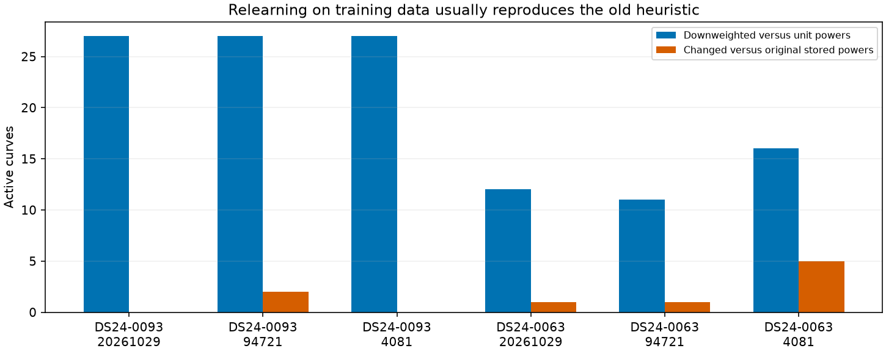
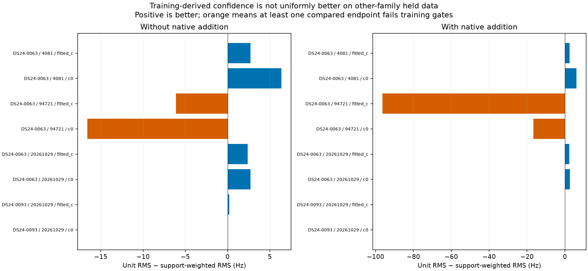
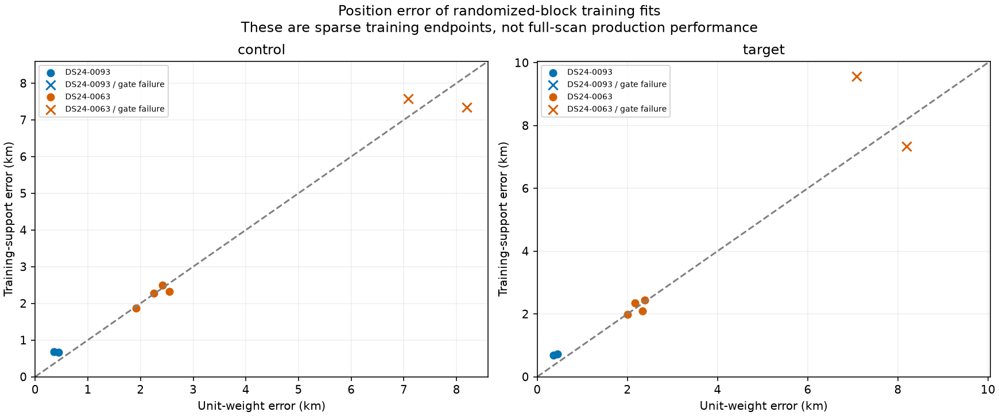
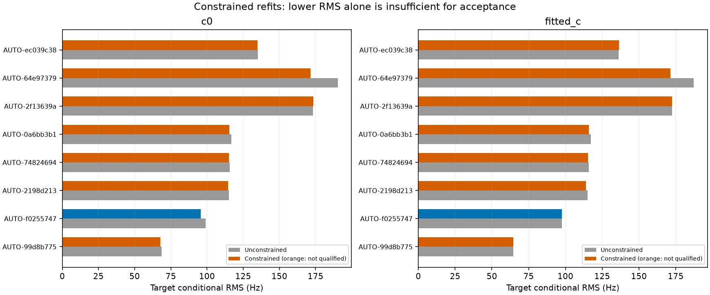
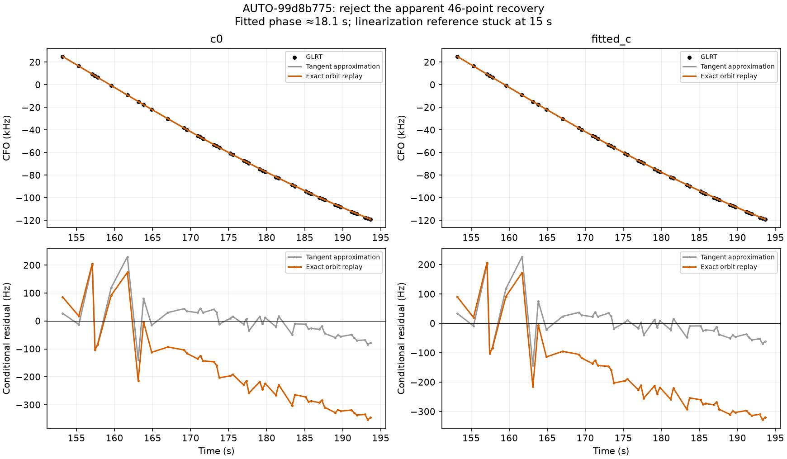
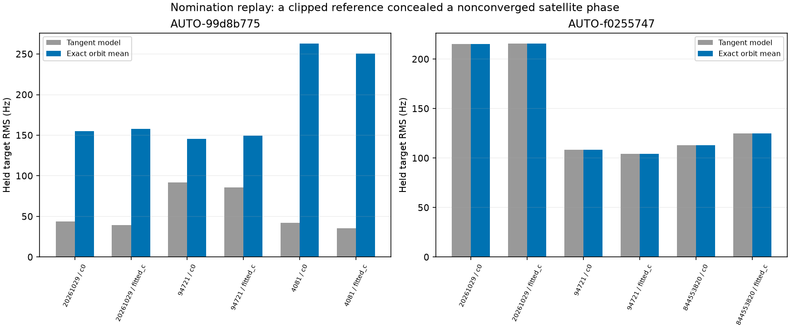

# Training-derived confidence and constrained graph recovery

Follow-up: the [expanded retrospective audit](../2026_10_30_phase_reference_retrospective/README.md) checks 64 additional annotations and all 12 previously paired-passing graph candidates in the audited batch directories, and tests a wider phase reference without changing the physical prior.

This iteration finds and fixes a concrete false-convergence bug: measuring phase-reference change **after clipping** can report convergence even when the fitted satellite phase remains several seconds beyond the reference. Exact orbit replay rejects one apparently successful recovery and invalidates its earlier conditional identity annotation. A different 46-point recovery passes exact replay and improves both position-error arms. Refreshing the old confidence heuristic is not a general solution.

The experiments test whether old confidence weights are stale and whether constrained fitting can retain supported curves in the original model. They continue the [cross-family prediction study](../2026_10_30_cross_family_prediction/README.md). Production and retained cohort policy remain unchanged; no result is selected using GPS error.

## Training-only confidence experiment

The old heuristic is recomputed from training observations, using the same randomized scan-wide 12-second blocks and 2-second guards as the prior experiment. The c=0 unit-weight curved pilot supplies radio correction and a position. Candidate competition is evaluated at that position and four offsets of ±2 km east/north, clipped to the original 25 × 25 km region. The full causal catalogue is screened at every anchor using only each curve's training points. The native recovery candidate does not participate in weight learning. The resulting **same frozen weights** are used by both c arms and both control/addition variants. Measurement noise remains 150 Hz, so this isolates the power heuristic from noise-scale changes.

As in the original heuristic, a satellite with active training support on two receivers gets power 1; otherwise multiple receiver/channel owners and per-curve minimum confidence ≥0.95 give 0.6, and remaining curves receive 0.2. The screen integrates a linearized phase and constant approximation and omits physical orbit modes. Its soft catalogue score is **not a calibrated probability**. The rule can give two-receiver families full weight despite ambiguous competitor scores; this experiment deliberately preserves that behavior rather than silently changing the rule.

The graph, identities, earlier guard/prior choices and alias assignments remain frozen conditioning assumptions. Therefore this is not independent satellite identification. All fitting and scoring of the new confidence policy excludes held observed values; tests perturb excluded frequency, geometry and radio-correction inputs to the confidence screen. Completed fitted endpoints are also rebuilt and checked with the excluded-value perturbation audit. No future TLE or new RF collection is used.

| scan | seed | unit_status | training_support_status |
| --- | --- | --- | --- |
| DS24-0093 | 20261029 | complete | complete |
| DS24-0093 | 94721 | timeout | timeout |
| DS24-0093 | 4081 | complete | timeout |
| DS24-0063 | 20261029 | complete | complete |
| DS24-0063 | 94721 | complete | complete |
| DS24-0063 | 4081 | complete | complete |

| scan | seed | active_curves | downweighted_curves | changed_from_original | weighted_points_fraction |
| --- | --- | --- | --- | --- | --- |
| DS24-0093 | 20261029 | 77 | 27 | 0 | 0.839 |
| DS24-0093 | 94721 | 76 | 27 | 2 | 0.844 |
| DS24-0093 | 4081 | 75 | 27 | 0 | 0.830 |
| DS24-0063 | 20261029 | 26 | 12 | 1 | 0.677 |
| DS24-0063 | 94721 | 25 | 11 | 1 | 0.663 |
| DS24-0063 | 4081 | 25 | 16 | 5 | 0.550 |

Recomputed weights mostly reproduce the original stored powers. This weakens the specific hypothesis that stale stored powers are the main cause in these two cases; it does not establish that the heuristic itself is well calibrated. Small numbers of changed powers can still have large geometric effects.

## Independent-family prediction and position

The primary witness is the identical held original curved evidence from other satellite families, requiring at least four training points per curve. Positive RMS gain means better prediction. The control omits the recovered native curve; the target includes its training-only view. Constants for held native/predictive curves are learned from training points only. This uses plug-in orbit/receiver means, not a fully marginalized predictive probability. Partitions overlap and cannot be pooled as independent statistical replicates.

| scan | seed | arm | control_qualified | target_qualified | other_RMS_gain_hz | native_RMS_gain_hz | control_error_km | target_error_km |
| --- | --- | --- | --- | --- | --- | --- | --- | --- |
| DS24-0093 | 20261029 | c0 | True | True | 0.027 | 7.108 | 0.660 | 0.715 |
| DS24-0093 | 20261029 | fitted_c | True | True | -0.002 | -1.231 | 0.680 | 0.682 |
| DS24-0063 | 20261029 | c0 | True | True | 0.003 | 2.053 | 2.278 | 2.440 |
| DS24-0063 | 20261029 | fitted_c | True | True | 0.006 | -2.226 | 1.866 | 1.975 |
| DS24-0063 | 94721 | c0 | False | False | -0.051 | 15.397 | 7.340 | 7.342 |
| DS24-0063 | 94721 | fitted_c | False | False | -90.224 | -3953.142 | 7.583 | 9.569 |
| DS24-0063 | 4081 | c0 | True | True | 0.098 | 21.446 | 2.317 | 2.094 |
| DS24-0063 | 4081 | fitted_c | True | True | 0.212 | 31.806 | 2.495 | 2.346 |

The weighting change helps some completed DS24-0063 partitions by a few Hz on other-family held evidence but substantially worsens seed 94721, where training gates also fail. The new curve's own held fit remains insufficient to certify a position improvement. DS24-0093 shows much smaller other-family changes. Neither this weighting rule nor the recovered-curve acceptance rule is ready for promotion.

These position errors describe **randomized-block training subsets**, not full-scan ALGO performance. GPS is used only for this evaluation. Some folds reach the regional boundary or fail gates; orange bars/crosses remain visible. A timeout is an unresolved execution and is excluded from paired comparisons, not relabeled as a scientific failure or success. The unit-policy comparison reuses the exact previous completed outputs and verifies identical held observation IDs. [All comparisons](weight_policy_comparison.csv), [family breakdown](held_family_comparison.csv), [native-addition effects](native_addition_held.csv), [weights](curve_weights.csv), [full validation receipts](validation_receipts.json.gz).

## Original-model graph inclusion and constrained refits

All 12 newly supported graph identities from annotation attempt 22 were tested in the original full model, with matched c arms and a refitted no-addition control. None passes. Eleven have residual-structure failures; one fails only the independent orbital-owner support gate. Several have both kinds of failure. Apparent position gains from rejected fits are not recoveries.

Eight trials have residual failures and **no** multiple-orbital-owner failure in either arm. Every such trial enters a second, bounded test; selection does not read position error. Both the control and target receive five additional phase-refresh rounds with 40 constrained optimizer steps each, starting at their corresponding original-model endpoints. The objective, identities, observations, receiver/orbit priors, noise, confidence powers, and acceptance gates remain unchanged. A 0.01 constraint margin is requested; final original gates and phase convergence are checked directly. The constrained optimizer can move position while nuisance parameters retain the original posterior-mean treatment. This is distinct from introducing an explicit satellite phase coordinate.

| scan | arm | paired_RF_pass | control_pass | exact_owner_verified | added | lost | control_error_km | target_error_km | minimum_gate_slack |
| --- | --- | --- | --- | --- | --- | --- | --- | --- | --- |
| AUTO-99d8b775 | c0 | True | True | False | 46 | 0 | 1.166 | 0.876 | 0.010 |
| AUTO-99d8b775 | fitted_c | True | True | False | 46 | 0 | 1.165 | 0.962 | 0.034 |
| AUTO-f0255747 | c0 | True | True | True | 46 | 0 | 1.899 | 0.250 | 0.010 |
| AUTO-f0255747 | fitted_c | True | True | True | 46 | 0 | 1.602 | 1.340 | 0.010 |
| AUTO-2198d213 | c0 | False | True | False | 46 | 0 | 1.292 | 1.117 | -0.045 |
| AUTO-2198d213 | fitted_c | False | True | False | 46 | 0 | 1.350 | 1.311 | -0.039 |
| AUTO-74824694 | c0 | False | True | False | 45 | 32 | 1.351 | 3.191 | -0.073 |
| AUTO-74824694 | fitted_c | False | True | False | 45 | 32 | 1.214 | 3.164 | -0.075 |
| AUTO-0a6bb3b1 | c0 | False | True | False | 45 | 0 | 0.974 | 2.141 | -0.119 |
| AUTO-0a6bb3b1 | fitted_c | False | True | False | 45 | 0 | 1.064 | 2.016 | -0.120 |
| AUTO-2f13639a | c0 | False | True | False | 45 | 0 | 1.700 | 0.183 | -0.442 |
| AUTO-2f13639a | fitted_c | False | True | False | 45 | 0 | 1.535 | 0.827 | -0.394 |
| AUTO-64e97379 | c0 | False | True | False | 81 | 17 | 4.539 | 4.438 | 0.010 |
| AUTO-64e97379 | fitted_c | False | True | False | 81 | 0 | 4.518 | 4.313 | 0.010 |
| AUTO-ec039c38 | c0 | False | False | False | 44 | 0 | 0.649 | 1.152 | -0.017 |
| AUTO-ec039c38 | fitted_c | False | False | False | 44 | 0 | 2.642 | 0.949 | -0.033 |

The constrained batch has **1 passing, exact-orbit/ownership-verified paired candidates**. `paired_RF_pass` is the archived tangent-model qualification, not final acceptance; `exact_owner_verified` is the independent follow-up check. Point additions in any failed row remain provisional. Complete fits retain all failure evidence, including failed gates on existing curves. [Every CFO and residual figure](graph_gallery.md), [all graph results](graph_trials.csv), [failures by component](graph_gate_failures.csv), [execution statuses](graph_executions.csv).

The verified recovery is **AUTO-f0255747, RX2 CH5, NORAD 67957, 46 points**. Error changes **1.899 → 0.250 km (c=0)** and **1.602 → 1.340 km (fitted c)** against the matched constrained controls. Both arms improve, but their large disagreement is important: this is not a robust 250 m localization claim. Exact selected-family orbit differences are below 10⁻⁸ Hz, and no incumbent or control satellite owner changes. Another constrained case, AUTO-64e97379, passes its modeled residual gates but loses **17 old points in c=0**, so it is rejected.

## A concrete bug: clipped phase is not convergence

AUTO-99d8b775 initially appears to recover 46 points with NORAD 100486. The fitted phases are **18.135 s (c=0)** and **18.079 s (fitted c)**, but the next linearization reference is clipped to **15 s**. Comparing successive clipped values gives a near-zero change, masking the remaining ~3.1 s error between the fitted phase and the linearization point. The tangent model and exact orbit differ by up to **269.9 / 260.3 Hz**. Exact replay fails slope, quadratic, mean, step and lag-one residual checks. The apparent position improvement is therefore not accepted evidence.

Reconstructing all original candidate endpoints for this annotation confirms the same problem in all six winning fold/arm fits. The winning phase is **18.06–18.39 s**, while the recorded clipped change is below 10⁻⁵ s. Held target RMS changes from roughly **36–92 Hz** under the tangent approximation to **145–263 Hz** under the exact orbit. Those RMS values alone do not prove a wrong satellite; they prove the earlier convergence and approximation claims were invalid. The candidate requires a valid exact/refreshed model before its identity can be supported.

The fix measures `max(abs(fitted_phase - reference))` **before clipping** the next reference. It keeps clipping for bounded geometry, records both changes and phase overflow, and rejects false convergence through the existing 0.01 s criterion. No phase window, prior or residual gate is relaxed. It is applied to future annotation training, graph inclusion, constrained graph refits and explicit-phase validation tools. The original historical receipts remain unchanged.

Replaying the annotation with only this convergence metadata corrected changes AUTO-99d8b775 from `conditionally_supported_identity` to **`prediction_mismatch`**; the scores are not reranked to manufacture a replacement identity. AUTO-f0255747 remains conditionally supported and has negligible tangent/exact discrepancy. The ledger records both the original state and the corrective audit source. The remaining historical annotations have not all received this retrospective check; their status remains conditional, and this audit must be expanded before relying on them for automatic inclusion.

[Winning-fold phase checks](annotation_phase_checks.csv) preserve both cases; all original competitor endpoints are archived in the numerical evidence. The displayed native validation qualification also uses newly replayed **unclipped** convergence checks, rather than trusting historical clipped flags.

## Inventory and next step

The original inventory now has **960 completed annotations out of 1,630 entries**, spanning DS24 and the automatic recordings. New batch classifications are `{'conditionally_supported_identity': 17, 'unstable_identity': 5, 'ambiguous_identity': 5, 'execution_timeout': 1, 'prediction_mismatch': 4}`. This is annotation coverage, not accepted association coverage. Timeouts and unresolved identity classes remain explicit. Native overlapping branches remain a separate inventory and are not added to this denominator. [Complete ledger](annotation_ledger.csv), [new batch](annotation_batch.csv).

The next priority is a bounded retrospective phase-consistency audit of supported annotations and passing inclusion candidates, followed by exact or correctly refreshed fitting for affected hypotheses. Refreshing the same support heuristic is not sufficient. Owner-only failures need independent family evidence rather than a weaker gate. Residual failures that survive the constrained fit need a model or evidence explanation, not acceptance based on lower GPS error.

## Reproduction and checks

Run `tools/run_explicit_phase_validation.py --weight-policy training_support` with the two diagnostic directories in the source receipts, then `tools/audit_explicit_phase_validation.py`. The noise level, masks, seeds, candidate catalogue, priors and per-fit budgets are matched to the previous unit-weight study. The 360-second per-job cap includes confidence learning; timeouts can therefore differ despite identical optimizer iteration budgets.

Run `tools/run_supported_graph_inclusions.py` on attempt 22, audit its rejected fits with `tools/audit_receiver_ramp_gates.py --graph`, and use `tools/refine_graph_inclusion_constraints.py run` for the recorded residual-only subset. Re-audit the constrained results with the residual and ownership/exact-orbit tools. The next annotation batch is attempt 23; all its terminal receipts are included.

**23 targeted tests pass**, covering exclusion of held values from confidence, active-training-owner counting, confidence thresholds, constrained-trial selection, training-view immutability, phase calculations, held observation identity, and false convergence at a clipped phase boundary. Endpoint replays and source hashes accompany the numerical evidence. No new ALGO version or dataset-wide improvement is claimed.

[Summary](summary.json), [source hashes](sources.json), [compact evidence](evidence.json.gz), [full validation receipts](validation_receipts.json.gz).
