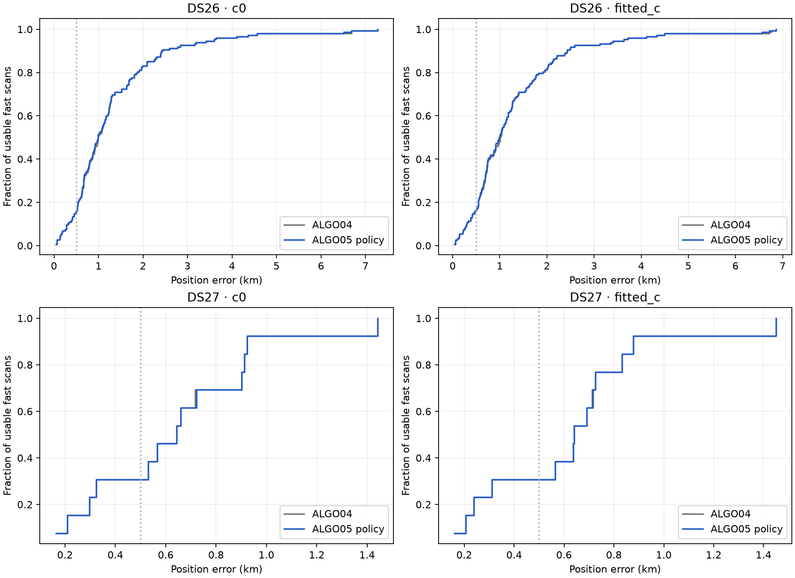
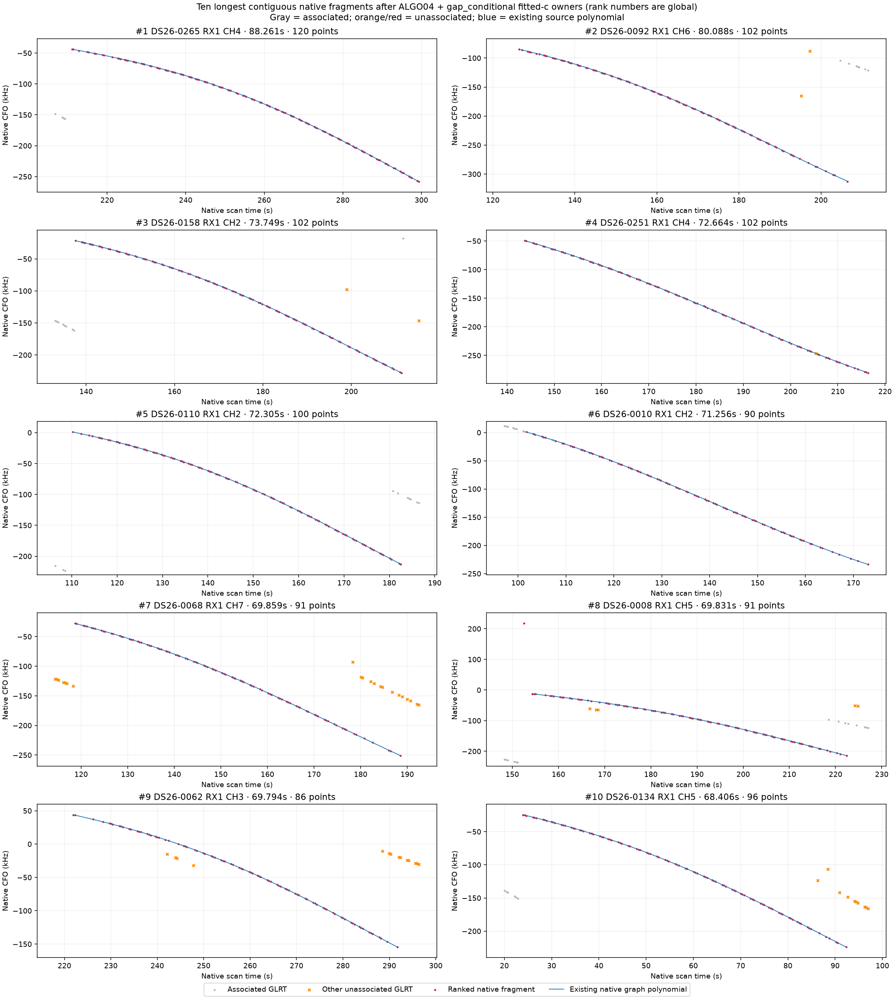
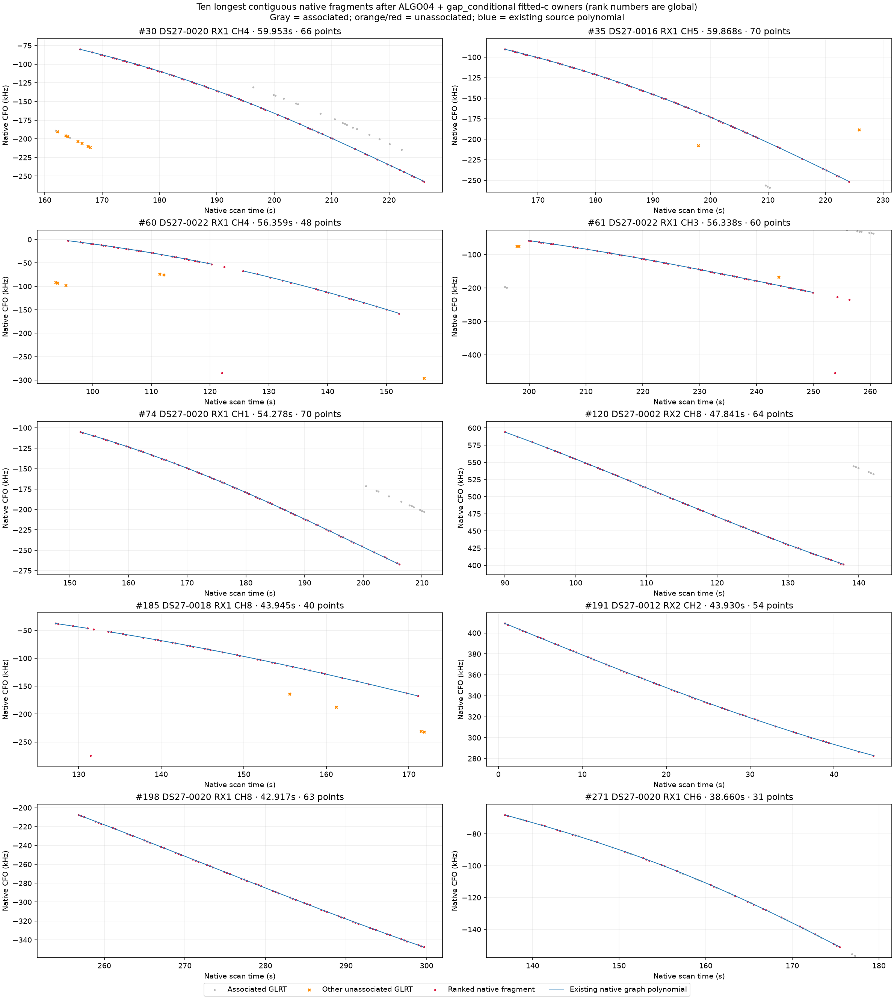
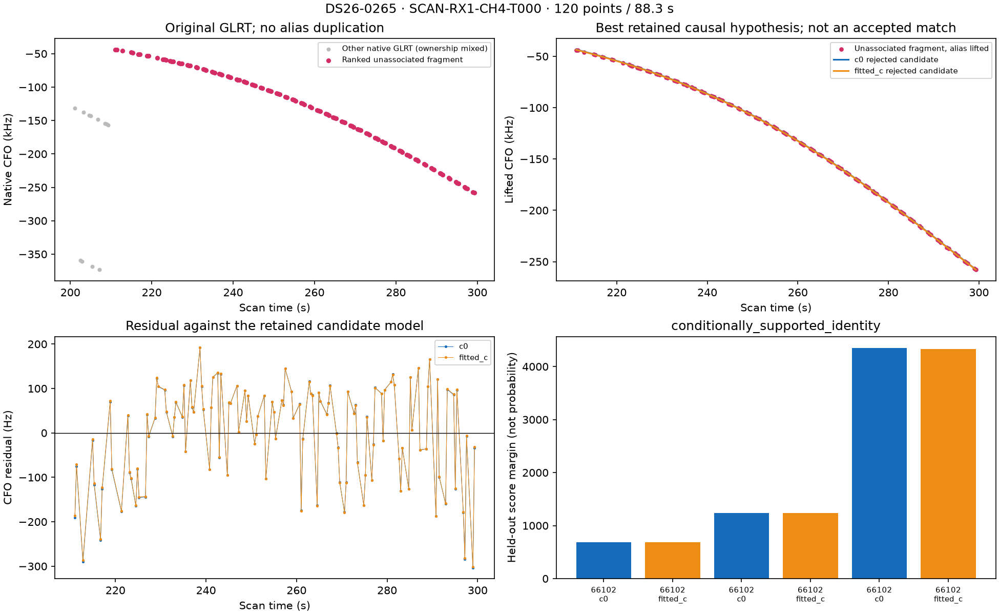
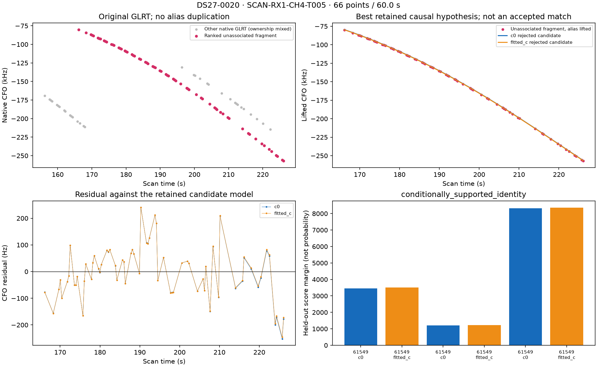

# ALGO05 promotion and the largest remaining DS26 / DS27 tracks

ALGO05 **is deployed as the production default**. The promoted method is timing-gap fragments with conditional satellite refresh, without the constrained-position variant. Numerical and API/UI releases are pinned to `4675ec446f2889d92eeea902c234f3f91ab48007`; the source was pushed to remote `main`. The [full algorithm specification](../ALGO05/README.md) describes its inputs, independent satellite competition, paired `c` ablation, exact gates, selection and fallback.

## Deployment and validation

The model is `algo05-causal-gap-conditional-v1`, with a separate v4 persisted namespace. The new watcher and API are active; the ALGO03 and ALGO04 services retained their existing processes. Acquisition and RF collection were not changed. The API explicitly selects ALGO05 and serves the new web bundle. A scan without a qualified addition retains its exact ALGO04 position; its actual fallback model remains visible.

Validation comprised 50 Python tests, seven UI tests, a successful UI build, unchanged hashes for all 1,994 frozen ALGO04 files, and two scientific integration checks. DS26-0012 reproduced identical fragment bytes, owner sets and coordinates in both arms, recovering the same 95 points with exact-orbit replay passing. The installed service-account DS27-0004 replay recovered 35 points for NORAD 67186 in 174.21 s, with all 11/11 process read receipts verified and no denied reads. The installed public-store canary took 7.75 s and retained the exact ALGO04 endpoint. Reprocessing that completed job did not launch inference or change its status/terminal hashes.

Evidence: [qualification](qualification.json), [live HTTP and service checks](activation-receipt.json), [activation plan](activation-plan.json), [new unit](leo-algo05-graph-position.service), [API override](leo-api-algo05.conf), [numerical staging](stage-numerical.log), [application staging](stage-app.log), and [prior service state](before-activation.txt). The explicit completion cutoff prevents an automatic historical backfill.

## Coverage and position accuracy

| Dataset / basis | Usable fast scans | Associated GLRT: ALGO04 → ALGO05 | Added points | Mean error, `c=0` | Mean error, fitted `c` |
|---|---:|---:|---:|---:|---:|
| DS26, sealed paired policy evaluation | 148 | 71.0338% → **71.1115%** | **505** | 1323.06 → **1318.08 m** | 1306.54 → **1301.06 m** |
| DS27, fresh installed full-cohort replay | 13 | 78.1896% → **78.2519%** | **35** | 637.64 → **638.04 m** | 619.37 → **619.06 m** |

The change is a modest coverage improvement, not a general 500 m localization solution. In DS27 the fitted-`c` mean improves by about 0.31 m while `c=0` worsens by about 0.40 m. A frequency fit or coverage increase alone is not evidence of better localization. The earlier targeted DS27 control actually localized slightly better without the added fragment; this remains a reason to avoid attributing every coordinate change to better geometric information.

DS26 uses the already sealed full paired evaluation and exact reproduction of an accepted case; this task did **not** rerun all 148 DS26 scans through the installed worker. DS27 did run the installed worker against every usable frozen ALGO04 export, with six concurrent workers. All final owner sets in both arms exactly match the cached policy used for the residual ranking. Eleven DS26 and two DS27 unavailable scans remain outside the accuracy denominator. DS27-0018 has a qualified prior position but its historical ALGO04 recovery tree lacks `decision.json`; the add-on failed safely and retained that prior position. Its incomplete recovery evidence is not an accepted new association.

The known evaluation site appears only in the reporting script, after inference. The inference used the existing causal catalogues, receiver/band model and initialized 25 km regional search. There was no location-specific tuning, post-observation TLE, or selection by position error.

Machine-readable [summary](summary.json), [per-scan errors](position-errors.csv), and [installed DS27 outcomes and owner-parity checks](installed-ds27-results.json) accompany the figure.

## What remains unassociated

The inventory subtracts the selected fit's **actual native point ownership**, not all proposed associations. It collapses duplicate alias representations and splits remaining sources at owned points, existing polynomial-piece boundaries and adjacent gaps greater than 5 s. Ranking is observed duration, then unique point count. It does not interpolate across missing data or join independent fits.

Across the 161 usable scans, the inventory contains **7,166 residual graph fragments**, covering **118,212 unique graph points**. Another **81,897 unassociated GLRT points are outside the existing graph** and are counted separately; this is not a claim to have discovered every possible curve among them. Unavailable scans have unknown ownership, not zero associated points.

The ten longest fragments from each dataset are in [DS26 CSV](residuals/DS26-top10.csv) and [DS27 CSV](residuals/DS27-top10.csv). The [complete compressed inventory](residuals/all-residual-fragments.json.gz), [per-scan accounting](residuals/per-scan.csv), [source hashes](residuals/sources.json), [all twenty detailed diagnoses](residuals/diagnostics/analysis.json), and [twenty-figure gallery](FIGURES.md) are included.

## Highest-priority findings

Satellite numbers below are causal hypotheses supported to the stated degree, not verified emitter truth. Independent nomination margins are scores, not probabilities. RMS and failing residual gates below refer to the fitted-`c` diagnostic proposal; the accompanying JSON retains both arms. These rejected proposals have not been used to change the deployed position.

| Dataset / scan | Remaining source | Points / span | Satellite hypothesis | Evidence and current obstruction | Next discriminating test |
|---|---|---:|---|---|---|
| DS26-0265 | RX1 CH4 T000 | **120 / 88.3 s** | **66102**, supported in all six votes | 108.7 Hz RMS; exact curvature and step gates fail. Normalized slacks −0.067 and −0.135; no incumbent points lost. The source is continuous, so a timing-gap split does not apply. | Compare residual curvature/step timing with other tracks from this satellite and receiver. Test a bounded shared orbital-curvature correction versus an independently supported receiver event. |
| DS26-0092 | RX1 CH6 T000 | **102 / 80.1 s** | **58788**, supported | 102.2 Hz RMS; lag-1 structure remains (slack −0.228), other tracks also fail and the proposal loses eight incumbent points. | Diagnose the affected family jointly. A target-only fit cannot override those ownership conflicts. |
| DS26-0158 | RX1 CH2 T000 | **102 / 73.7 s** | 66445 leads, **ambiguous** | Minimum nomination margin only 6.33 against alternatives including 53824/48681. No justified joint inclusion fit. | Expand independent competitor evidence and compare full curves across receivers/bands before fitting more nuisance freedom. |
| DS26-0251 | RX1 CH4 T000 | **102 / 72.7 s** | **65894**, supported new family | Outside the shared-family recovery path. Existing new-family proposal has 162.7 Hz profiled RMS, slope z=4.05, step z=4.34 and loses 12 incumbent points. | Audit the new-family phase/receiver coupling and preserve the incumbent set; splitting a continuous curve is not the remedy. |
| DS26-0110 | RX1 CH2 T001 | **100 / 72.3 s** | **64172**, supported | RMS only 85.5 Hz, but slope, curvature, step and lag-1 checks fail. Small RMS is concealing organized residuals. | Fit an explicitly penalized physical discrepancy and test it on held-out whole groups; distinguish receiver-common from satellite-common structure. |
| DS27-0020 | RX1 CH4 T005 | **66 / 60.0 s** | **61549**, strongly supported | 96.4 Hz RMS; the exact step gate misses narrowly, normalized slack −0.028, while ownership is preserved. | Inspect the end-of-track residual change and independently validate any receiver event or satellite correction. Do not simply relax the gate. |
| DS27-0016 | RX1 CH5 T000 | **70 / 59.9 s** | **63899**, supported | 97.8 Hz RMS but slope, curvature, step and lag-1 structure remain. | Resolve the coherent model discrepancy using independent tracks before adding this long source. |
| DS27-0022 | RX1 CH4 T001 | **48 / 56.4 s** | 59737 leads, **ambiguous** | Margin falls to 9.52 against 54159. | Improve identity discrimination first; more flexible corrections could make the ambiguity worse. |
| DS27-0022 | RX1 CH3 T000 | **60 / 56.3 s** | **57914**, supported parent | 104.3 Hz RMS; slope/curvature/step fail, and the joint proposal also breaks existing RX1 CH8 residual gates. | Test a shared family discrepancy while requiring both CH3 and CH8 to pass. |
| DS27-0020 | RX1 CH1 T004 | **70 / 54.3 s** | **Unstable: 67344 vs 50173** | Winner changes with randomized whole-group partition; weakest margin 0.56. | Search for independent distinguishing curvature or a second lane; no unique assignment is justified yet. |

The sixth-longest DS27 source, **DS27-0002 RX2 CH8 T001**, has 64 points over 47.8 s and no retained independent nomination. It is included in this ownership-correct inventory despite being absent from the earlier nomination inventory. That is a search-coverage gap, not evidence that a particular satellite model failed. DS27-0018 RX1 CH8 T002 likewise lacks retained nomination evidence in its incomplete recovery tree. Both warrant a fresh causal search from the actual unowned native IDs.

## Inspect the two largest sources

Pink points are the ranked unassociated fragment. Gray points are other native GLRT in that lane and time window, with **mixed ownership**; gray does not mean unassociated. Candidate predictions include the already fitted nuisance terms. The residual panels make discrepancies visible that are almost invisible on the full CFO scale. New-family panels use the existing profiled constant bias and display the corresponding centered residual.

The two `c` curves nearly coincide in these examples. Merely switching the existing RF coefficient is therefore not resolving the remaining structure. The supported identities make them useful cases for diagnosing the discrepancy, but do not establish whether it originates in the TLE, receiver response, graph construction or measurement noise.

## Recommended next experiment

Start with DS26-0265 / 66102 and DS27-0020 / 61549. They combine strong nomination evidence, preserved incumbent ownership and comparatively localized residual failures. Compare simultaneous and sequential residuals across receivers, bands and satellite families. A receiver event should recur across independent satellites on the affected hardware; an orbital correction should follow the satellite across independent receiver/band observations. Test these competing predictions with fixed causal catalogues, matched `c` arms, unchanged search budgets and randomized whole-group validation. Require the correction to improve independent residual behavior and preserve all existing owners before evaluating its position effect.

Keep ambiguous identities and unsearched sources as separate work items. Do not add polynomial freedom merely to make every long curve pass, and do not infer sample-rate or antenna-angle causation from these residuals alone. The current evidence points to both **structured model discrepancy** and **incomplete/ambiguous association search**, not one universal cause.

## Reproduction and rollback

`tools/analyze_algo05_residuals.py` verifies both sealed studies, applies only `gap_conditional`, and rebuilds ownership-based rankings using the supplied ranking implementation. `tools/diagnose_algo05_residuals.py` extracts existing nominations and rejected causal proposals without rerunning satellite selection. Their copies and the ranking implementation are in [reproduction](reproduction/). The copied renderer labels the new ownership policy explicitly; [its receipt](render-receipt.json) binds unchanged plot packets and the renderer hash. [replay_ds27.py](replay_ds27.py) runs the installed worker over verified private exports; the exports were copied and hash-checked with elevated read access, then all inference ran as service account `leo`. [summarize_installed.py](summarize_installed.py) verifies installed terminal contracts and exact owner parity before adding evaluation coordinates.

For rollback, stop and disable `leo-algo05-graph-position.service`, remove only the ALGO05 API drop-in at the exact path in [activation-plan.json](activation-plan.json), reload systemd and restart `leo-api.service`. The preceding ALGO04 override and worker remain installed and running. Preserve v4 outputs and receipts; no recordings or previous result namespaces need to be deleted or rewritten.
