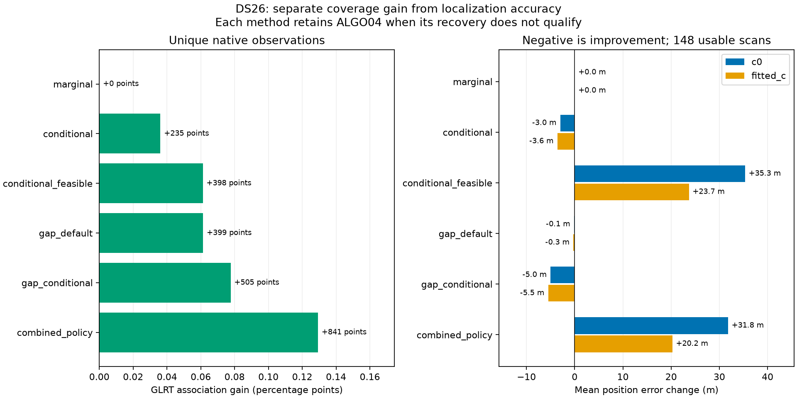
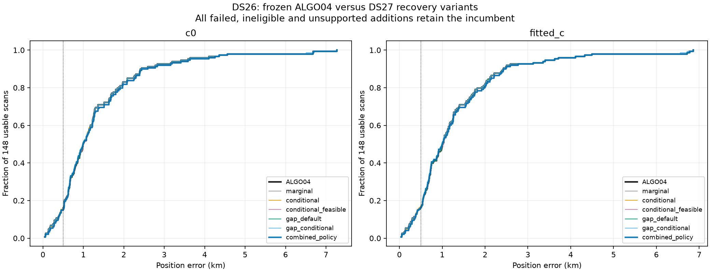
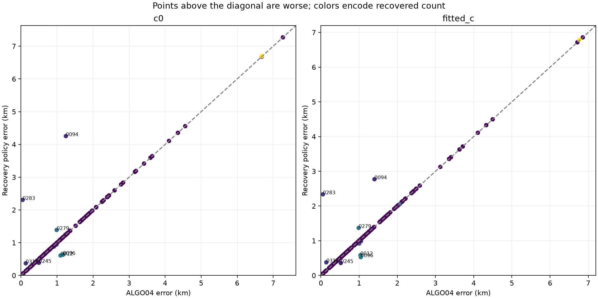
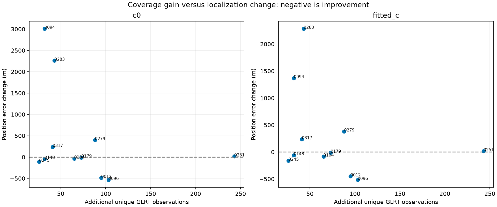
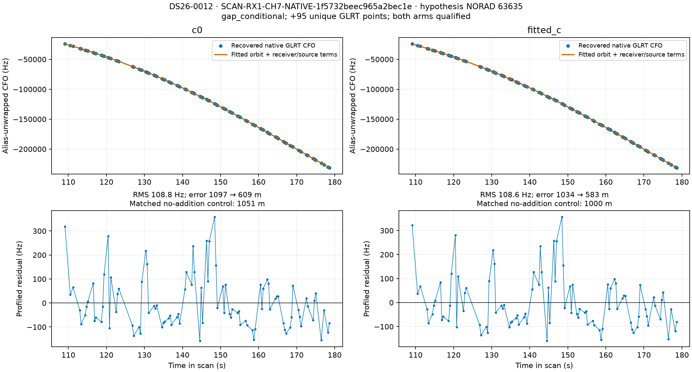
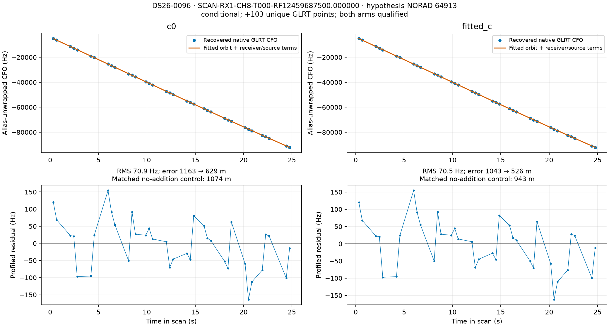
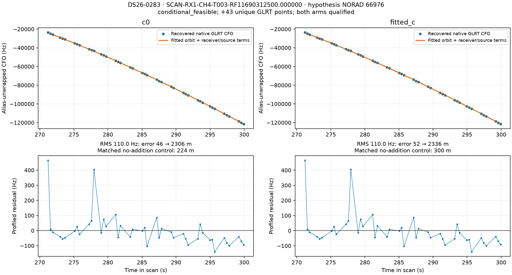
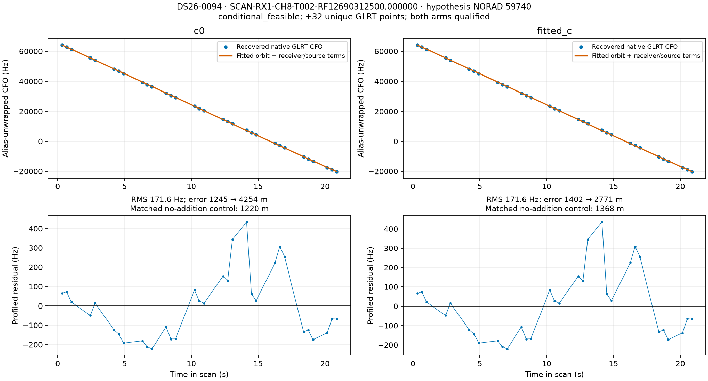
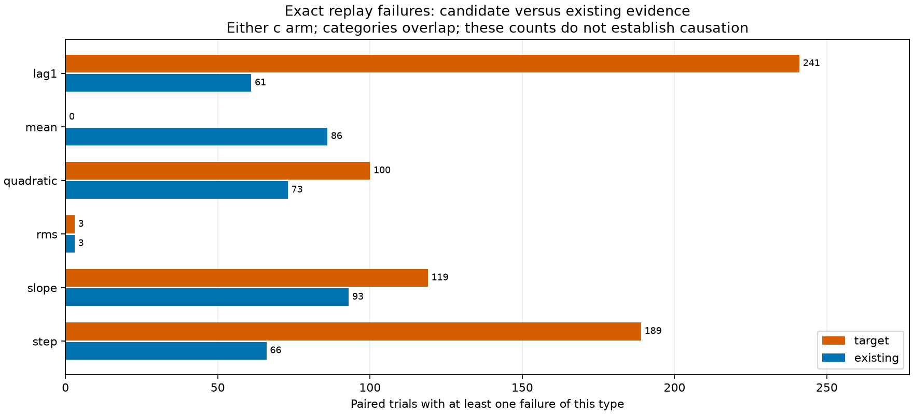

# DS26 evaluation of the DS27 confident-track recovery variants

The frozen recovery variants produce useful individual recoveries, but **the combined policy does not improve dataset-wide localization**. Across 148 usable DS26 fast scans, it adds **841 unique GLRT observations**, increasing association from **462,007 to 462,848 / 650,404 points: 71.034% to 71.163%**. Mean fitted-c position error worsens from **1,306.5 to 1,326.8 m**; mean c = 0 error worsens from **1,323.1 to 1,354.9 m**.

The conditional and gap variants show modest aggregate improvements when evaluated separately. The constrained-position variant produces large regressions despite passing the inherited RF gates. **Keep ALGO04 in production.** This study makes no production change and does not establish a new ALGO release.

This is a **cached graph-to-position recovery evaluation**, using the [sealed ALGO04-equivalent DS26 numerical replay](../2026_10_31_ds26_numerical_fix_evaluation/README.md) as the baseline. It is not a new acquisition, GLRT extraction, or complete fresh production-pipeline rerun. We tested 112 previously rejected, conditionally supported full-parent candidates in 74 scans. All other usable scans retain their baseline; all 159 fast scans remain in the roster, including 11 unavailable cases.

## Dataset results

Association is pooled over the same 650,404 native observations in the 148 usable scans. Each row uses its named variant when it qualifies and otherwise retains ALGO04. Both c arms must pass and agree on the added point-to-satellite mapping. Separate rows are alternatives, not additive recoveries.

| Method | Additional unique points | Associated GLRT | Changed scans | Mean error, c = 0 | Mean error, fitted c |
|---|---:|---:|---:|---:|---:|
| ALGO04-equivalent baseline | 0 | 71.034% | 0 | 1,323.1 m | 1,306.5 m |
| Marginal shared-satellite update | 0 | 71.034% | 0 | 1,323.1 m | 1,306.5 m |
| Conditional satellite update | 235 | 71.070% | 4 | 1,320.1 m | 1,303.0 m |
| Conditional update + constrained position | 398 | 71.095% | 7 | 1,358.4 m | 1,330.2 m |
| Gap fragments, original predictive model | 399 | 71.095% | 4 | 1,322.9 m | 1,306.3 m |
| Gap fragments, conditional update | 505 | 71.111% | 5 | 1,318.1 m | 1,301.1 m |
| Frozen combined policy | **841** | **71.163%** | **11** | **1,354.9 m** | **1,326.8 m** |

| Distribution statistic | ALGO04, c = 0 | Combined, c = 0 | ALGO04, fitted c | Combined, fitted c |
|---|---:|---:|---:|---:|
| Median error | 993.2 m | 993.2 m | 1,010.0 m | 1,000.0 m |
| 95th percentile | 3,531.2 m | 3,624.9 m | 3,550.7 m | 3,550.7 m |
| Worst error | 7,269.0 m | 7,269.0 m | 6,858.0 m | 6,858.0 m |
| Within 500 m | 24 / 148 | 23 / 148 | 24 / 148 | 24 / 148 |

The combined policy improves fitted-c error by more than one meter in six scans and worsens it in five. Its slightly better fitted-c median does not offset its worse mean. The best individual variant by mean error here is conditional gap recovery, improving the mean by only **5.5 m**; this is a descriptive result on DS26, not an independently validated selection rule or evidence of reaching the 500 m goal.

## Every selected recovery

Satellite numbers are conditional hypotheses from the causal catalogue, not externally verified satellite ground truth. Gains include all newly accepted native owners in the selected fit, which can extend beyond the nominated target.

| DS26 scan | Selected target / satellite hypothesis | Variant | Added points | Associated GLRT before → after | Fitted-c error before → after | c = 0 error before → after |
|---|---|---|---:|---:|---:|---:|
| 0012 | RX1 CH7 fragment / 63635 | Gap conditional | 95 | 70.625% → 73.337% | 1,034.2 → **583.4 m** | 1,096.9 → **609.1 m** |
| 0094 | RX1 CH8 T002 / 59740 | Constrained conditional | 32 | 77.068% → 77.788% | 1,402.0 → **2,770.9 m** | 1,245.0 → **4,254.2 m** |
| 0096 | RX1 CH8 T000 / 64913 | Conditional | 103 | 76.440% → 79.019% | 1,042.9 → **525.9 m** | 1,163.1 → **628.8 m** |
| 0104 | RX1 CH1 T001 / 63381 | Conditional | 65 | 71.111% → 72.461% | 1,002.0 → **917.9 m** | 916.8 → **883.4 m** |
| 0148 | RX1 CH4 fragment / 51812 | Gap original | 32 | 71.244% → 71.958% | 1,048.9 → **988.4 m** | 983.0 → **941.8 m** |
| 0179 | RX1 CH7 fragment / 63844 | Gap original | 73 | 73.966% → 75.653% | 2,068.6 → **2,054.8 m** | 2,083.7 → **2,074.6 m** |
| 0245 | RX1 CH8 T003 / 64597 | Conditional | 26 | 74.370% → 74.988% | 519.6 → **357.8 m** | 496.2 → **386.7 m** |
| 0251 | RX1 CH7 fragment / 67352 | Gap original | 243 | 57.879% → 63.619% | 6,767.8 → **6,783.4 m** | 6,681.1 → **6,696.9 m** |
| 0279 | RX1 CH2 T007 / 58836 | Constrained conditional | 88 | 69.293% → 71.268% | 988.2 → **1,368.2 m** | 989.1 → **1,387.3 m** |
| 0283 | RX1 CH4 T003 / 66976 | Constrained conditional | 43 | 78.934% → 80.115% | 52.1 → **2,336.3 m** | 45.8 → **2,305.9 m** |
| 0317 | RX2 CH7 T002 / 62424 | Conditional | 41 | 77.269% → 78.107% | 140.6 → **376.2 m** | 131.5 → **369.3 m** |

### Gains that survive comparison with a no-addition control

DS26-0012 is a useful CH7 recovery. The 98-point full parent fails the lag-1 residual gate. The timing-only split retains a 95-point segment at 109.100–178.583 s; it independently nominates 63635 and passes after conditional updating. Fitted-c target RMS is 108.6 Hz, with exact lag-1 slack 0.0727. Its matched conditional no-addition control has **999.9 m** error; adding the segment reduces it to **583.4 m**. The c = 0 control improves from **1,051.3 to 609.1 m**. This is a substantive improvement beyond the control refit.

DS26-0096 also improves beyond its control: **942.7 → 525.9 m** for fitted c, and **1,073.6 → 628.8 m** for c = 0. The selected 36-point CH8 target has 70.5 Hz fitted-c RMS. The same fit also accepts a 35-point companion assigned to 64913, while 32 points assigned to 64782 are already accepted in the no-addition control. Thus the full **103-point** gain is **36 direct + 35 companion + 32 control points**, not a single 103-point target.

The gains are not universal even without constraints. DS26-0317 passes the conditional fit but worsens from **140.6 to 376.2 m**, against a control of **177.9 m**. Its nearest fitted-c gate slack is only 0.000384. A correct-looking identity and passing residual tests do not guarantee useful geographic information.

### Constraining position to pass the gates is unsafe as a promotion rule

The three scans selected only by constrained optimization all worsen in both c arms. Their nearest exact gate slacks are at approximately the optimizer's nominal feasibility boundary:

| Scan | Fitted-c target RMS, ordinary conditional → constrained | Nearest constrained exact gate | Slack | Fitted-c control → target error |
|---|---:|---|---:|---:|
| 0094 | 173.0 → 171.6 Hz | Target lag-1 | 1.13e-7 | 1,367.6 → 2,770.9 m |
| 0279 | 73.8 → 73.3 Hz | Target lag-1 | 1.02e-6 | 979.4 → 1,368.2 m |
| 0283 | 113.6 → 110.0 Hz | Target slope | 1.99e-7 | 299.8 → 2,336.3 m |

These are small frequency-fit changes purchased with large position shifts. They demonstrate a failure of gate feasibility as a sufficient localization criterion. They do not independently establish whether the underlying identity, transmitter model, measurement covariance, or nuisance prior is wrong. We did not reject these fits after inspecting GPS: the frozen policy accepts them, and their regressions remain in every primary table.

### Do not attribute all newly counted points to new evidence

Of the 841 additional owners, **460 belong to the explicitly nominated targets and 381 to other tracks**. The selected no-addition controls already accept **346 extra points in both arms**. Fitted-c controls accept a further 26 points in 0245 that c = 0 does not; that particular control fails the paired-addition consistency check. The [control audit](evidence/selected-control-qualification.json) records this distinction. These controls are diagnostics, not a newly selected baseline policy.

The largest coverage increase, DS26-0251, adds **243 points**, but 210 assigned to 56548 already appear in its no-addition control. The new target is a 33-point fragment assigned to 67352. Its inclusion slightly worsens the approximately 6.8 km position error. DS26-0104's fitted-c control is already 920.3 m; adding its target changes this to 917.9 m, much smaller than the apparent 84.1 m improvement relative to published ALGO04.

Association percentage is therefore a useful coverage measure, but it is neither an independent measure of new position evidence nor an accuracy objective.

## Why most candidates remain rejected

We completed **380 paired inclusion trials**, each with a no-addition control and both c arms, plus **59 fresh gap-fragment identity tests**. All **931 bounded execution stages completed**; there were no worker exceptions or timeouts.

| Variant | Attempted paired trials | Qualified paired trials | Scans changed when evaluated alone |
|---|---:|---:|---:|
| Marginal | 112 | 0 | 0 |
| Conditional | 112 | 5 | 4 |
| Constrained conditional | 112 | 8 | 7 |
| Gap original | 22 | 5 | 4 |
| Gap conditional | 22 | 7 | 5 |

Only 22 of the 59 fragments independently support an identity. The other outcomes are 28 insufficient randomized partitions, five ambiguous identities, three unstable identities, and one prediction mismatch. They do not proceed to inclusion fitting.

Exact replay failures mostly concern structure, rather than RMS alone. Across paired trials, the candidate fails lag-1 correlation in **241**, a step check in **189**, slope in **119**, quadratic structure in **100**, and RMS in only **three**. Categories overlap and either arm can cause a failure. Existing evidence also fails in many trials. In **56 scans**, at least one no-addition control no longer preserves all baseline owners; not every failure can be attributed to the newly added target.

The trial tool reconstructs the upstream model context. Where that context or its refit omits a previously published recovery, the final ownership guard rejects the result. Such a rejected upstream screen is not proof that a complete joint refit containing every ALGO04 factor cannot work. A joint continuation from the published model remains a separate experiment.

## Frozen algorithm and experimental controls

These are the same scientific variants as the [DS27 confident-track study](../2026_10_31_ds27_confident_recovery/README.md). We broadened their application to all eligible retained DS26 parent nominations, without selecting scans by position error.

1. Verify the sealed DS26 roster, native observations, baseline outputs, and source hashes. Retain unavailable cases. Select prior RF-rejected, shared-family, full-parent nominations with conditionally supported identity and no points already owned by ALGO04.
2. Run marginal shared-satellite updating, conditional satellite/fragment updating, and conditional updating with constrained position. Conditional updating holds receiver coefficients at their posterior means at a given position; position changes still trigger refitting of the underlying model. Marginal and conditional variants do not optimize an identical predictive objective.
3. Split a parent solely where adjacent timestamps differ by **more than five seconds**. Test every proper component with at least **12 points and 10 seconds** of span. Preserve native observations, CFO values and alias lifts. Do not split on residuals or geographic error.
4. Re-nominate each eligible fragment from the causal catalogue, using three distinct randomized whole-block partitions: 12-second blocks and two-second guards, with seeds and assignments retained. Three shortlisted candidates are tested. Identity confidence is conditional on this graph and competitor search, not a calibrated probability of unique physical identity.
5. Require the existing paired RF checks, phase convergence, exact model replay, native-ID membership, agreement of added ownership between c arms, and preservation of every published ALGO04 owner. Also retain the historical verified-read safeguard. Fifteen usable baselines have unverified historical read audits; only three nominated targets occur in those scans, and none can be promoted by this study.
6. Select **one fit per scan**, in frozen order: conditional, gap original, gap conditional, constrained conditional, marginal. Within a mode, use minimum nomination margin, then added-point count, then stable target ID. Do not union independently fitted results. The same rule selects each method's scan result when reporting individual variants.
7. Hash the completed RF decisions and numerical outputs in an inference seal. Only afterward introduce the authorized evaluation position, **37.849061591561885, −122.48574968092912**, to calculate error and select illustrative figures.

The installed release is `f9e262f96b6e2e75b397f69d50a0ea9104e293ef`. Both c arms use the same observations, candidate sets, other priors and per-variant search settings. Fits retain five phase rounds, 48 position iterations, centered L-BFGS-B where applicable and bank-checked ±30 s numerical references. The constrained variant starts from the RF incumbent and uses SLSQP with the inherited gate inequalities; its objective-call cost is not claimed identical to L-BFGS-B. Other trials retain the original regional initialization. Full fits are capped at 360 seconds; gap fits and annotations at 240 seconds; audits at 180 seconds. Twelve workers use one numerical-library thread each.

Physical phase limits, causal orbit data, aliases, priors and acceptance thresholds were not retuned. No future TLEs, evaluation-position scoring, manual satellite whitelist, or new RF collection were introduced by the recovery runner. Smaller fragments inherit the existing sample-count-dependent correlation threshold, so a split can make a gate easier to pass without fixing covariance; a passing fragment alone does not establish a noise-model correction.

Five existing bundled or partial sources are excluded because this prototype handles full parents and its own timing-only fragments. They are recorded in the protocol; other eligible candidates in the same scans are still tested. The 11 unavailable baselines remain explicit and are excluded from accuracy and GLRT denominators, rather than scored as zero error. Full per-case accounting is in [per-case.csv](per-case.csv).

## Recommendation and next experiment

Keep ALGO04 as the production default. The frozen combined policy worsens mean localization on **both DS27 and DS26**, so increased coverage does not justify promotion.

Continue investigating conditional family updating and timing-defined fragments as research candidates. DS26-0012 and 0096 provide improvements beyond matched controls in both c arms. Test a predeclared policy on fresh scans before adopting it; choosing the best DS26 variant by its reported GPS error would turn this evaluation into tuning data.

Do not use constrained gate feasibility alone to retain a track for position fitting. The next discriminating checks should measure stability across independent observation groups and how much position information survives nuisance marginalization, while requiring preservation of the complete incumbent model. Inspect the source-specific residuals and covariance in the boundary cases before adding more free corrections. This study establishes useful recoveries and a concrete failure mode, not a solution to the 500 m accuracy goal.

## Evidence, validation and reproduction

- [Summary metrics](summary.json), [every scan and method](per-case.csv), [all trials including rejected fits](all-trials.csv), [selected changes](changed-scans.csv), and [failed gates](failed-gates.csv).
- [Frozen protocol](evidence/protocol.json.gz), [execution receipts](evidence/execution.json.gz), [selections](evidence/selections.json), and [inference seal](evidence/inference-seal.json.gz).
- [Compact trial diagnostics](evidence/trial-diagnostics.json.gz): target CFO/predictions/residuals, endpoints, exact gate slacks, owner changes, new owner IDs, and hashes binding full numerical outputs. Full repeated owner arrays and orbit banks remain in the sealed local studies.
- [Source verification](evidence/historical-source-verification.json), [installed-release verification](evidence/installed-release-verification.json), [supplementary execution-source receipt](evidence/additional-source-receipt.json), and [19 passing tests](evidence/test-receipt.json). The supplementary receipt was recorded during execution; the primary protocol was frozen before fitting. Two repository files changed since the historical baseline freeze, so their original bytes were verified against exact Git blobs at commit `47a9ea61f1320ebf71a75d1f8f92410b55feb887`; no data hashes were bypassed. All 2,065 installed-release file hashes match.
- [Reproduction scripts and tests](reproduction/), [artifact map](artifact-map.json), [publication checks](validation.json), and [publication manifest](publication-manifest.json).

Local study: `/srv/bulk/leo/research/ds26-confident-recovery-20261031`. Baseline: `/srv/bulk/leo/research/ds26-numerical-dataset-20261031`. DS27 adapters: `/srv/bulk/leo/research/ds27-confident-recovery-20261031`. Scientific interpreter: `/srv/bulk/leo-dev/fast-algo02-production-v1/.venv/bin/python`.

For a new numerical rerun, copy `evaluate.py` and `gap_wrapper.py` into a fresh local study directory and run `evaluate.py` there, with access to the sealed baseline, DS27 adapters and installed release. Do not resume into or overwrite this published study. Reporting scripts use explicit study/output paths; direct them to a new report directory when reproducing. The published scripts preserve the exact executed versions and original paths. No production v3 terminal, release manifest, database, recording, QNAP path or runtime default was modified.
