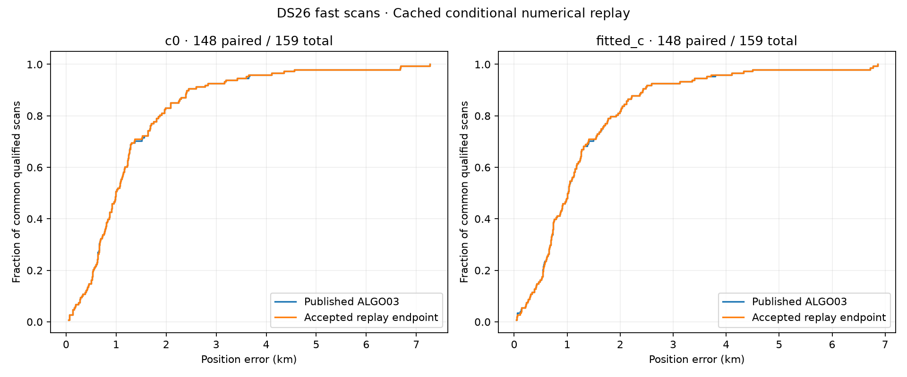
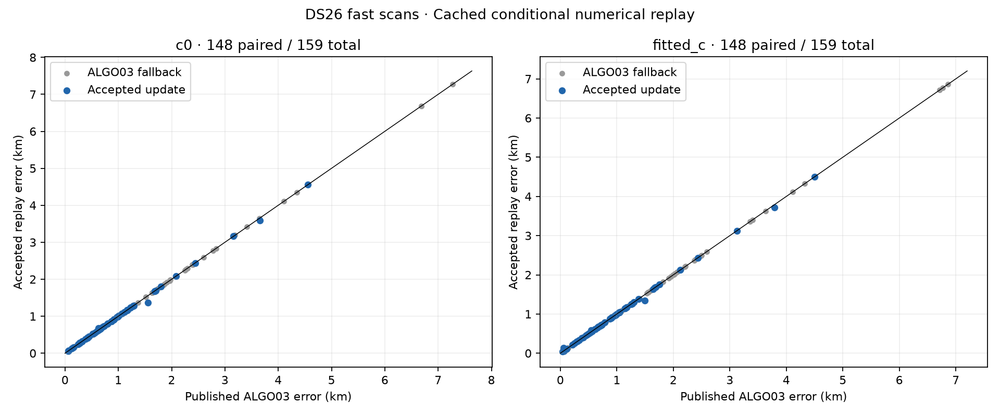
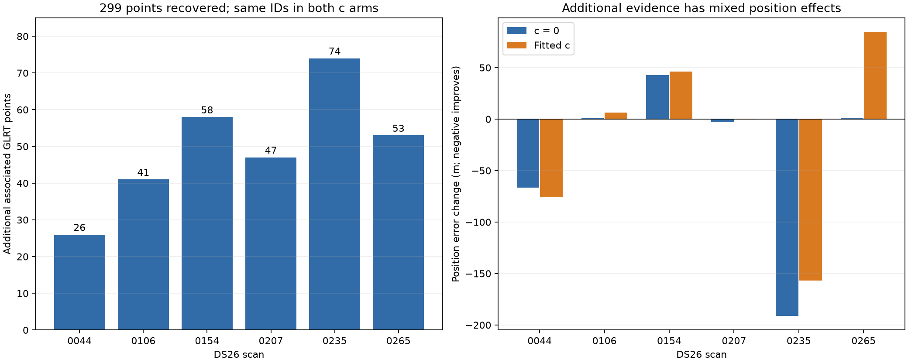
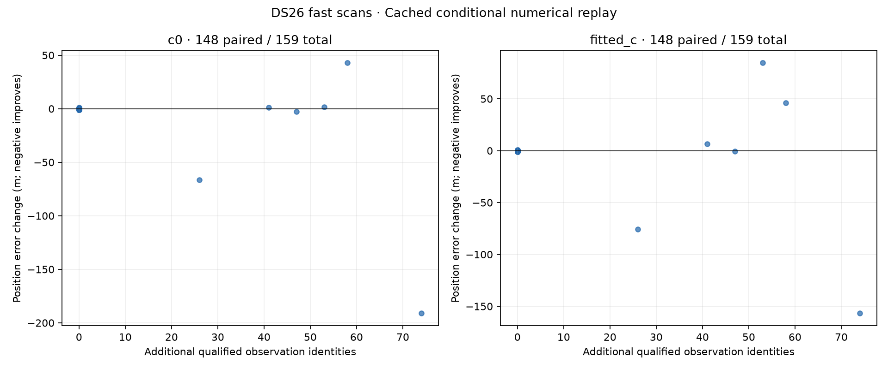

# DS26 numerical fixes: 299 recovered points, nearly unchanged position accuracy

The two current numerical fixes recover **299 additional GLRT observations in seven fragments across six scans**, increasing pooled association from **70.9879% to 71.0338%**. Fitted-c mean position error changes from **1.307223 to 1.306536 km**, an average improvement of only **0.69 m**. Its median, 95th percentile and worst error are unchanged. These repairs improve numerical reliability and recover some valid evidence; they do not resolve the dataset's localization bottleneck or warrant a new ALGO accuracy claim.

We accounted for all **159 DS26 fast scans**. There are **148 paired usable results** and 11 pre-existing unavailable cases: nine baseline failures, one unavailable baseline and one missing public GLRT input. No new case-level replay failure occurred. The comparison uses published ALGO03 terminal results, including its fallbacks, rather than raw worker selections or the embedded ALGO02 starting estimate. Production is unchanged.

This continues the [DS26 recovery-resolution experiments](../2026_10_31_ds26_recovery_resolution/README.md). This is a **conditional cached replay of the original completed target schedule**, not a fresh end-to-end catalogue search or GLRT extraction. Unaffected stages are reused after source checks. The distinction matters when interpreting both coverage and runtime.

## Dataset results

| Metric | Published ALGO03, c=0 | Numerical replay, c=0 | Published ALGO03, fitted-c | Numerical replay, fitted-c |
|---|---:|---:|---:|---:|
| Paired usable scans | 148 / 159 | 148 / 159 | 148 / 159 | 148 / 159 |
| Associated GLRT points | 461,708 | 462,007 | 461,708 | 462,007 |
| Pooled GLRT associated | 70.9879% | 71.0338% | 70.9879% | 71.0338% |
| Mean error, km | 1.324560 | 1.323061 | 1.307223 | 1.306536 |
| Median error, km | 0.993243 | 0.993244 | 1.009969 | 1.009969 |
| 95th percentile error, km | 3.562467 | 3.531152 | 3.550654 | 3.550654 |
| Worst error, km | 7.269004 | 7.269004 | 6.857982 | 6.857982 |
| Scans within 500 m | 24 / 148 | 24 / 148 | 24 / 148 | 24 / 148 |

Association percentages use **650,404 original GLRT observations** from the 148 available scans, including observations outside graph tracks. Unavailable scans remain explicit in the full roster and are not silently scored as accurate. The 299-point gain is **0.04597 percentage points**; it is not a substantial dataset-wide coverage increase.

The distributions almost overlap. The 31 m c=0 P95 improvement is a change to this cohort's empirical quantile, not a demonstrated generalization result. These scans have been used in debugging; this is not an untouched randomized validation cohort.

The worker selected a candidate in 77 cases. The additional publication safeguards accepted 61: 57 changed the endpoint and four were identical cached selections. Only six changed the associated observation set. The remaining 87 usable scans retain published ALGO03: 71 had no RF-qualified replay candidate, 15 lacked the required historical production read-audit verification, and one would lose or change an existing published owner. Those retained results are part of the comparison, not evidence that a bare optimizer replacement is equally safe.

## Which tracks were recovered?

| Scan | Added points | Hypothesized NORAD family | Error c=0, km before → after | Error fitted-c, km before → after |
|---|---:|---|---:|---:|
| 0044 | 26 | 59310 | 3.660 → 3.594 | 3.790 → 3.715 |
| 0106 | 41 | 60143 | 0.277 → 0.278 | 0.332 → 0.338 |
| 0154 | 58 | 61961 (30), 60319 (28) | 0.631 → 0.674 | 0.541 → 0.587 |
| 0207 | 47 | 66327 | 0.869 → 0.866 | 0.723 → 0.722 |
| 0235 | 74 | 58099 | 1.554 → 1.363 | 1.496 → 1.339 |
| 0265 | 53 | 62422, RX2 CH8 T001 | 0.132 → 0.134 | 0.056 → 0.141 |

Every gained observation has the same source identity, candidate family, alias and saved random whole-group partition as its original nomination. All published observation owners are retained in both c arms. The family labels are associations supported by the frozen candidate competition and physical checks, not independent satellite ground truth.

**225 points were blocked by phase-reference validation.** Six fragments had inadequate winning validation folds with clipped calibration references and final reference changes exceeding 0.01 s; their target RMS and elevation already passed. Expanding the numerical calibration-reference domain makes them eligible for inclusion. No original same-target inclusion trial existed for these fragments, so these gains must not be attributed solely to repairing an inclusion optimizer failure.

**The other 74 points expose a coarse-grid false rejection.** DS26-0235 already had stable identity and successful original optimizers. A 0.54 m change in its conditional c=0 inclusion endpoint switches two nearly tied phase-grid weights, moving the grid MAP from 0.475 to 0.500 s. Its grid slope statistic changes from 3.114 to 2.640 against a limit of 3. Yet the continuous-phase check passes at both endpoints, with slope statistics 2.8807 and 2.8817. This supports the curve while revealing a fragile discrete-MAP gate. The 0.54 m conditional endpoint difference is distinct from the 191 m change relative to the published c=0 fallback after accepting the curve. Neither residual threshold nor acceptance logic was relaxed in this replay.

The recovered 0106 track is **60143 / 41 points**, not the previously studied **59835 / 71-point** curve. Likewise, 0265 recovers **62422 / 53 points**, not the unresolved **66102 / 120-point** curve. The earlier 0154 experiment used separate conditional controls and counted one 30-point target plus incidental extensions. This report instead compares the published ALGO03 terminal against a qualified two-family, 58-point addition; the denominators and endpoints should not be interchanged.

See the [gain audit](reproduction/recovery-gain-audit.md) for original fold votes, identity margins, continuous-phase counterchecks and exact source-ID accounting.

## Precisely what changed

1. **Calibration phase-reference domain:** expand from ±15 s to a bank-checked ±30 s. The uncalibrated target's physical phase mixture remains ±15 s. Candidate catalogue, priors, aliases, observations and receiver/orbit model remain frozen.
2. **Position derivatives:** use centered finite differences at the existing one-metre step and an L-BFGS-B line-search allowance of 40. Start at the original regional initialization. Keep five rounds, 48 iterations and 240 physical objective evaluations per round, including derivative calls. There is no extra warm continuation.

Both changes are applied together in this cohort replay. The optimizer transition counts therefore measure the combined treatment; this is not a full factorial estimate of each change's independent effect. The c=0 and fitted-c comparisons retain matched observations, candidates, other priors and search budgets.

The read-only numerical audit matches 145 same-target trials, comprising 580 final control/addition × c-arm fits. **All 92 originally ABNORMAL final fits become successful; one original success becomes ABNORMAL.** That new failure, DS26-0269's fitted-c addition, remains rejected under the existing convergence rule. Across 3,530 recorded centered rounds, one reaches the 240-evaluation cap; none exceeds it. There are no helper hash, scientific-input or round-count mismatches. See the [numerical audit](reproduction/numerical-audit.md).

No catalogue satellites or locations are selected using evaluation error. The site coordinates, 37.849061591561885, −122.48574968092912, enter the reporter only after all inference outputs and source hashes are sealed. The acceptance rule is RF-only and additionally requires preserving every published ALGO03 observation owner in both c arms. Historical read-audit failures remain fallbacks; the research seal is not a replacement production OS read guard.

## Budgets, missing work and fit metrics

The original completed-target schedule has 721 entries. All appear as attempts; 696 reach a scientific decision, while **25 targets containing 1,041 points encounter the discovery budget limit**. Newly eligible work can consume the fixed budget before later scheduled work. Another 231 originally discovery-budget-omitted targets are outside this frozen completed-target schedule. Thus this study is not an exhaustive recovery search.

There are **seven stage timeouts**, in 0020, 0028, 0050, 0052, 0118, 0120 and 0221. They have no completed bootstrap receipt, but remain counted through authoritative worker decisions. Existing fallback or already-qualified single additions are retained. There are zero whole-case replay failures. [Work accounting](work-accounting.json) preserves all attempt and stage statuses.

The launcher uses 16 single-thread workers for the remaining cohort after four canaries. Reused original stage durations are still charged against the original discovery and case budgets. Summed per-case replay wall time is 9.55 hours and cached virtual charge is 14.17 hours; these are sums across concurrent cases, not elapsed job duration or a fresh-pipeline speed benchmark. Before scientific fitting, the first canary attempt hit a file-permission error while hard-linking root-owned inputs; byte copying fixed that infrastructure issue. Those archived attempts are excluded from scientific results.

Frequency-fit comparisons are reported separately from position accuracy. Exact observation IDs and owners match in 142 before/after pairs per c arm; the six support-changing scans are excluded from direct objective-delta comparisons. Available unchanged-support RMS pairs show no mean change. For the c ablation, fitted-c reduces mean reported RMS by about 0.029 Hz on 86 available replay pairs, while its mean position error is 16.5 m lower than c=0 across all 148. Those descriptive summaries do not establish that a better in-sample frequency score causes better localization. Raw objectives also contain model/prior terms and should not be interpreted as pure RMS.

## Interpretation and next validation

Keep these as candidate numerical repairs, with strict fallbacks and convergence checks. They remove demonstrated false rejections, but **do not justify promoting a new accuracy-improving ALGO version** on this evidence. The 500 m success count stays at 24/148. The largest remaining curves still fail structured-residual or shared-model checks, so optimizer termination alone cannot explain the error floor.

The next focused experiment should make the phase residual screen stable under grid refinement, using the existing continuous-phase countercheck and fixed thresholds. Validate its decisions across all original candidates, including rejected ones, before changing production gating. Separately, use the recovered curves to test residual consistency across independently observed receiver/band and satellite families: 0265 illustrates that a supported CH8 addition can increase position error. Model corrections must earn support from independent evidence, rather than being chosen to pull an estimate toward the known site.

## Evidence and reproduction

- [Per-case results, both arms](per-case.csv), [all positive error changes](tail-regressions.csv), [summary](summary.json), and [work accounting](work-accounting.json).
- [Frozen protocol](reproduction/dataset-protocol.json), [final cohort seal](reproduction/final-dataset-seal.json), and [source freeze](reproduction/source-freeze.json.gz).
- [Replay adapter](reproduction/run_dataset.py), [annotation replay](reproduction/annotation_replay.py), [numerical bootstrap](reproduction/numerical_stage.py), [numerical helper](reproduction/numerical_helper.py), and [sealed reporter](reproduction/report_dataset.py).
- [Cache audit](reproduction/cache-review.md), [numerical audit](reproduction/numerical-audit.md), [gain audit](reproduction/recovery-gain-audit.md), and [test summary](reproduction/test-summary.json).

**43 focused tests pass:** 39 across the adapter, annotation, numerical-helper and reporter suites, plus four numerical-audit tests. No production component changed. Source commit is `47a9ea61f1320ebf71a75d1f8f92410b55feb887`; local study root is `/srv/bulk/leo/research/ds26-numerical-dataset-20261031` and immutable baseline is `/srv/bulk/leo/research/algo03-full-evaluation-20261030`. Reproduction scripts refer to those existing local scientific inputs; raw IQ and full orbit arrays are not bundled in this report. Large JSON evidence may be gzip-compressed; `artifact-map.json` records source and published hashes and `publication-manifest.json` binds the published files.
