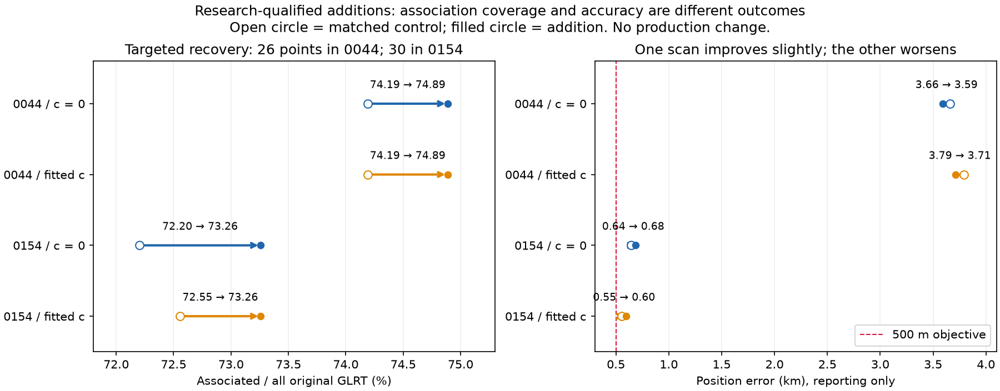
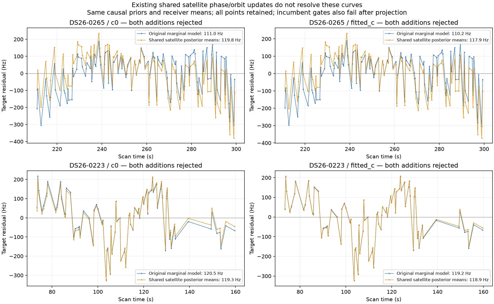
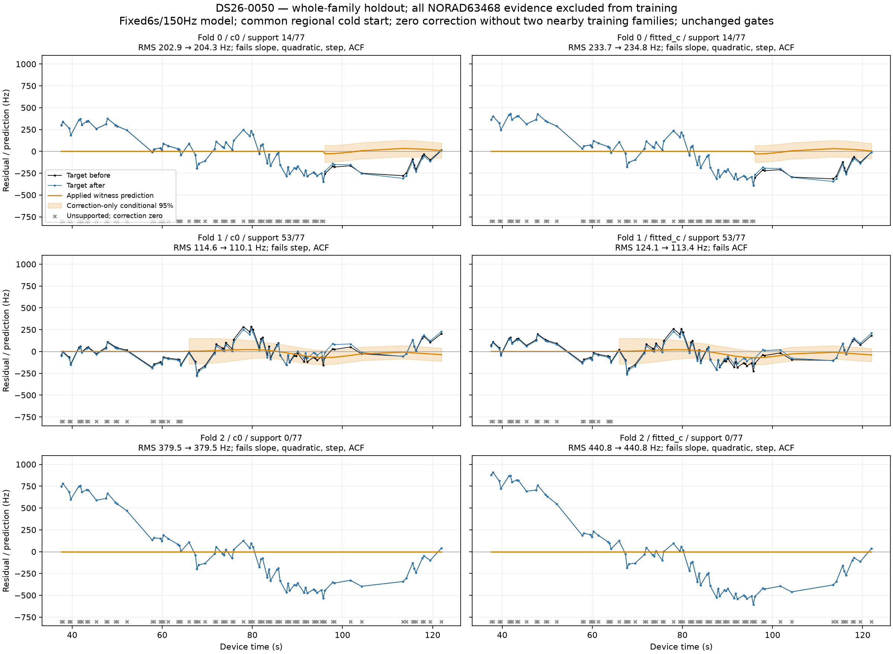
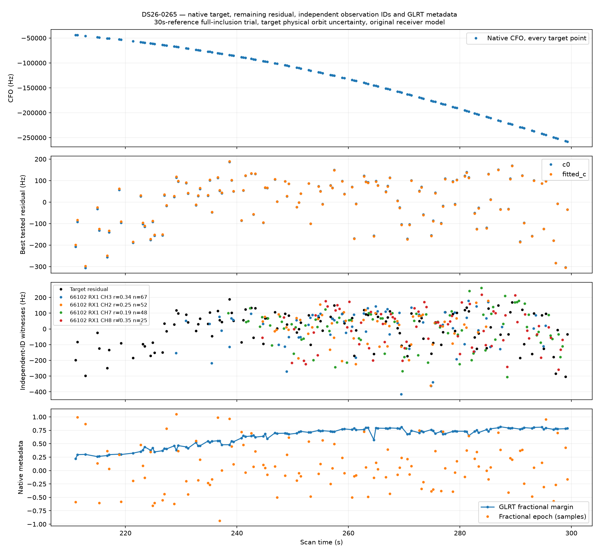
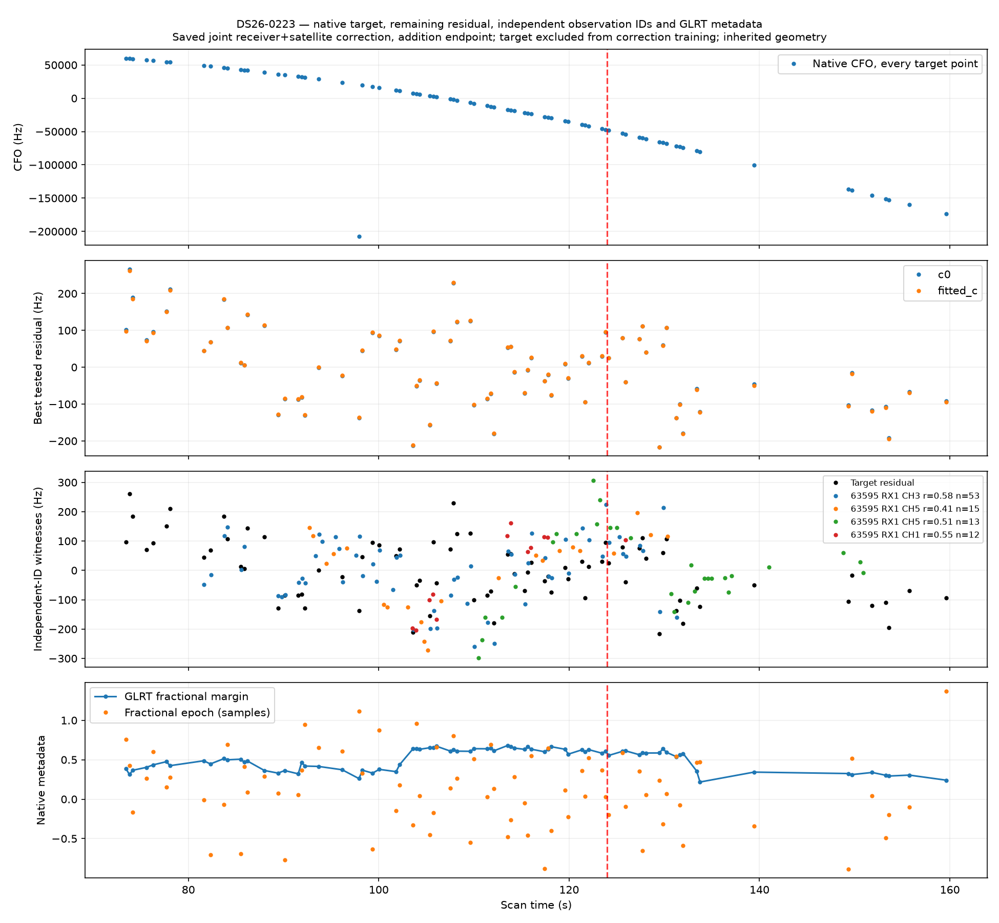

# DS26 recovery resolution: two numerical repairs, 56 qualified target points, and remaining model discrepancies

We resolved two numerical blockers and obtained **56 research-qualified target points across DS26-0044 and DS26-0154**, preserving the original RF, residual, ownership and exact-orbit checks in both c arms. The improvement in association coverage is real, but position accuracy is mixed: 0044 improves slightly and 0154 worsens. This is **not a new promoted ALGO release**, and production associations remain unchanged.

The remaining experiments narrowed the explanation for the long residual curves. More permissive shared satellite posterior updates fail; independently trained receiver and GLRT metadata corrections are not validated; graph joins and simple timing errors do not explain the measured patterns. A bounded raw-IQ counterfactual reproduces all 18 selected original measurements exactly, then shows that continuous GLRT frequency refinement worsens the target panel’s agreement with the frozen orbit despite improving its GLRT score.

This follows the [previous DS26 recovery validation](../2026_10_31_ds26_recovery_validation/README.md), starting from code/report commit `d1f0a8321` and the immutable ALGO03 evaluation at `/srv/bulk/leo/research/algo03-full-evaluation-20261030`. Research outputs are in `/srv/bulk/leo/research/ds26-recovery-resolution-20261031`. All experiments use existing causal inputs and recorded data. Known-site coordinates enter only reporting after inference is sealed; measurement refinement receives no position or TLE input.

## 1. Two numerical repairs unblock valid evidence

The previously frozen RF-only panel supplied three clipped cases. DS26-0044 and 0154 require the uncalibrated/new-family mixture route; 0106 has active same-family calibration and requires shared predictive inclusion. Treating all three as the same route would be incorrect.

| Case | Target NORAD | Proposed target points | Final qualified target points | Why |
|---|---:|---:|---:|---|
| DS26-0044 | 59310 | 26 | **26** | Wider numerical reference repairs identity validation; full inclusion passes. |
| DS26-0154 | 61961 | 30 | **30** | Wider reference repairs phase convergence; centered finite differences resolve a separate control optimizer failure. |
| DS26-0106 | 59835 | 71 | **0** | Target residual slope, step and time correlation still fail. |

Each reference comparison uses the same validated identity, aliases, observations, priors, starts and budgets for c=0 and fitted-c. Calibration reference limits change from ±15 to ±30 seconds, but uncalibrated target physical phase support remains ±15 seconds. Every reference and endpoint stays inside the existing causal orbit bank. The three initial cases complete in 78–97 seconds each; no threshold is relaxed.

**0044’s full-data fit passes even at a 15-second reference once supplied the repaired nomination.** Its original failure was in a randomized identity-validation fold. The wider domain therefore fixes a stage-specific false rejection rather than changing its full-data optimum.

**0154 exposes a second failure near numerical stationarity.** Its fitted-c control passed every physical check but L-BFGS-B returned `ABNORMAL`. At the existing one-metre finite-difference step, the forward north derivative was +0.00582, whereas centered differences gave −0.00695; the centered sign was stable over 0.1–10 metre steps. One matched continuation uses centered one-metre derivatives and a larger line-search allowance, with all four control/addition × c-arm fits receiving the same five rounds, 48-iteration and 240-total-objective-call-per-round limits. Derivative calls count toward the cap. All final statuses pass the original gradient tolerance, and all exact physical checks pass. Endpoints move only 0.196–0.469 m. This additional 25-second continuation is reported separately from the initial reference-limit comparison.

## 2. Association coverage and position accuracy are separate outcomes

The denominators below include **all original GLRT observations**, including points outside graph tracks. Counts are matched control → research-qualified addition, not production deployment results.

| Scan / arm | Associated points | % of all GLRT | Position error |
|---|---:|---:|---:|
| 0044 / c=0 | 2,777→2,803 / 3,743 | 74.19→74.89% | 3.660→3.594 km |
| 0044 / fitted-c | 2,777→2,803 / 3,743 | 74.19→74.89% | 3.790→3.715 km |
| 0154 / c=0 | 3,078→3,123 / 4,263 | 72.20→73.26% | 0.644→0.683 km |
| 0154 / fitted-c | 3,093→3,123 / 4,263 | 72.55→73.26% | 0.554→0.599 km |

0154’s c0 addition includes 15 incidental extension points beyond the 30 target points. They belong to RX2 CH4 T009 / NORAD 57328 and are already associated in the fitted-c control. Their c0 bias crosses the unchanged ±3000 Hz limit from −3002.59 to −2999.74 Hz. They are threshold-sensitive and excluded from the **56 targeted-point total**. Exact IDs and ownership are preserved in the [extension accounting](phase-inclusion/extension-id-accounting.json).

0044 remains far from the 500 m objective. 0154’s additional valid evidence moves its estimate farther from truth. Neither result supports selecting models by association percentage or improved in-sample fit alone.

For 0106, RMS is only 75.22/74.77 Hz, but the exact target slope z is 3.481/3.496 against a limit of 3, step z is 6.013/5.979 against 4, and lag-one correlation is .509/.504 against .475. Its 71 points remain rejected. See the [complete inclusion report](phase-inclusion/SUMMARY.md), [coverage CSV](phase-inclusion/qualified-coverage.csv), and [initial matched trials](phase-inclusion/INITIAL-SUMMARY.md).

## 3. Existing shared satellite updates do not solve 0265 or 0223

Both target families already have physical orbital modes in the model. We tested the existing opt-in shared satellite posterior update, exposing their phase/orbit posterior means while retaining receiver means and the same physical priors. The 30-second numerical reference, regional starts, five-by-48 budgets and all gates remain matched. Exact endpoint replay verifies objective, membership and ownership. Every result is retained, including control failures.

| Case | Target RMS original → shared update, c=0 / fitted-c | Result |
|---|---|---|
| 0265 / 66102 | 110.99→119.84 / 110.19→117.90 Hz | Target slope/curvature/step worsen; incumbent gates also fail. |
| 0223 / 63595 | 120.52→119.30 / 119.22→118.88 Hz | Negligible RMS gain; target correlation and incumbent gates fail. |

The rejected additions also worsen position error relative to their controls. For example, the original 0223 matched control/addition is 823→920 m (c=0) and 758→854 m (fitted-c); shared posterior updating leaves that result essentially unchanged. For 0265 the shared variant changes approximately 135→174 m and 59→117 m. All these additions remain rejected.

This falsifies this particular receiver-frozen posterior projection as a fix. It does not establish that all possible orbital corrections are wrong: selectively moving satellite means can also leave correlated fragment/calibration moments inconsistent. We retain the established original model rather than taking its lower score or a plausible identity as sufficient evidence.

See [every control/addition/c-arm result](shared-refresh/paired-table.csv) and [sealed reporting summary](shared-refresh/reporting-summary.json). Large exact replay receipts are compressed JSON in their case folders.

## 4. The 0050 receiver correction lacks sufficient independent support

The previous conditional result reduced target RMS from about 117 to 100 Hz. The stronger experiment removes the entire target family 63468 from position, phase, receiver calibration and correction fitting, and randomly holds out other whole satellite families. Sixteen other families form three seeded folds (6/5/5); both c arms cold-start from the same regional centre with identical fixed 150 Hz preprocessing and budgets. No target-derived hyperparameter is selected.

The receiver-only correction remains a six-second Gaussian basis with 150 Hz coefficient/noise priors. It is applied only where at least two distinct training satellite families on the same receiver supply evidence within 18 seconds; unsupported predictions are zeroed and flagged.

| Fold | Supported target points | Target RMS before→after, c=0 / fitted-c | Outcome |
|---|---:|---|---|
| 0 | 14/77 | 202.86→204.25 / 233.73→234.83 Hz | Full track fails. |
| 1 | 53/77 | 114.55→110.10 / 124.11→113.44 Hz | Correlation remains; c0 also fails step. |
| 2 | 0/77 | 379.50→same / 440.80→same Hz | No supported correction. |

Removing all target-family RF evidence leaves its phase/orbit weakly identified. The approximate target prediction uncertainty becomes about 15.8 kHz, making nominal coverage uninformative. Larger residuals in this experiment do **not** refute a receiver mechanism; they show that the current data split cannot isolate one reliably. Held-family results include improvements and regressions. All six full-target evaluations fail unchanged gates; no favorable subset is relabelled as a recovered whole track.

The [receiver-family report](receiver-family/results/SUMMARY.md) includes every held family, receiver/band comparison, temporal support, uncertainty limits and source hashes. The six scientific fits completed in 17.99 seconds.

## 5. Native-point and metadata checks rule out simple repairs

0265 is one original graph piece with no join or alias transition. In 0223, the strongest prefix/suffix residual mean contrast occurs at 88–89 seconds, approximately 35 seconds before the graph join at 124 seconds. A fixed join-offset correction worsens one saved random-group fold in both c arms. The correctly lifted alias point at 97.93 seconds is elsewhere. The step statistic compares group means and does not itself prove a physical discontinuity.

Every target timestamp equals its recorded sample-counter window start plus 10 ms. The tested detected-epoch timing variation contributes only about 1 Hz through the orbital derivative, far below the observed discrepancy. Candidate-rank and margin relationships do not explain the residuals.

A modest target-only relationship with fractional epoch in 0265 fails the required transfer test: coefficients learned from other satellites worsen the untouched target. The analogous 0223 correction also worsens its target and some held families. These findings reject arbitrary metadata regression as a validated correction. Existing same-family and other-family residual correlations are descriptive and do not uniquely attribute the effect to the receiver or satellite.

## 6. A source-bound raw-IQ frequency counterfactual

The current GLRT scorer selects a frequency from its default 512-point residual-frequency grid; fractional timing refinement does not make that frequency search continuous. The nominal grid spacing is 443.892 Hz. However, original products for all 18 preselected points have **zero residual-CFO increment**, so their total exported CFO equals the continuous acquisition estimate. We must not describe these absolute measurements as quantized onto a 444 Hz grid.

Seed 20261031 freezes 12 uniformly selected target observations and six active other-family controls on the same receiver/channel, without residual-based selection. The original acquired CFO, fractional epoch, exact/control scores, observation IDs and IQ hashes are recovered from digest-verified products. The existing verified reader is used only on seven selected recording segments: 3,584 windows are decoded to verify complete chunks, but only the 18 selected windows are retained and scored. Export takes 15.39 seconds; this is existing data, with no new RF collection. The initial study-specific 20-window decoding cap is amended before IO, preserving that earlier receipt; it was not a user permission restriction.

All 18 original discrete CFO and exact/control scores replay with **zero difference**. The existing exact-DTFT continuous-frequency prototype then refines exact and control equally at the same fractional epoch and 64 symbols, preserving the alias branch. Its measurement outputs are sealed before reading orbital residuals. Refinement takes 0.475 seconds.

For the 12 target points, CFO changes span −98.28 to +127.59 Hz (59.70 Hz RMS). Despite the higher GLRT score, agreement with the frozen orbital prediction worsens: residual RMS **110.61→131.86 Hz (c=0)** and **109.20→130.79 Hz (fitted-c)**, without refitting bias or position. These are small-panel fixed-model comparisons, not independent true-frequency error or full-track inclusion tests. They weaken the hypothesis that this simple sub-bin refinement is the missing fix; they do not prove the original acquisition estimate is universally more accurate.

The six control points also worsen against their frozen incumbent geometry: 105.00→108.07 Hz (c=0) and 105.33→108.71 Hz (fitted-c). Both target and control geometries were fitted using the original CFO measurements, so this comparison is conditional on those original fits. A fresh measurement-and-geometry refit would be required to assess localization benefit.

See the [native audit and final raw-pilot details](track-audit/SUMMARY.md), [frozen selection](track-audit/raw-plan.json), and [raw export receipt](track-audit/raw-export-receipt.json). Raw IQ remains local and is excluded from this report publication.

## 7. Best next directions

1. **Validate the two numerical repairs across a frozen dataset panel.** Use bank-checked phase reference updates and centered derivatives/verified stationarity. Include previously successful controls and numerical failures, matched c arms and explicit total-call budgets. They fix demonstrated failures without giving individual tracks extra physical freedom. Do not promote based on these two scans alone.
2. **Separate receiver and satellite discrepancies using simultaneous contrasts.** Use unique, time-matched RX1−RX2 differences for the same satellite, then compare those differences across independent satellites and bands. This approximately cancels shared orbit effects and tests whether an independently supported receiver signal remains. Require temporal coverage before fitting another smoother.
3. **Retain independent orbital witnesses when testing receiver transfer.** For 0050, use independent 63468 observations on RX2 to constrain its orbit/phase through a separately trained receiver posterior, while keeping the RX1 CH1 target out of all calibration and correction training. Hold other whole families out, propagate uncertainty, and keep both c arms matched. This addresses the identified confounding rather than merely increasing model flexibility.
4. **Investigate the remaining position errors with fixed measurement evidence.** 0044 still has kilometre-scale error despite valid additional association. Family influence/ablation and regional loss geometry are more informative there than maximizing coverage alone. Use the newly verified raw panel as a control; the present sub-bin frequency test provides no basis for expanding a raw campaign.

These are prioritized experiments, not established fixes for the remaining curves. All tested variants and negative results are retained. Neither new RF, larger sample rate nor different receiver pointing has been shown necessary by this iteration.

## Verification and reproduction

**21 focused tests passed**: five route/domain/qualification and centered-gradient tests, four family-holdout tests, three native metadata/scorer tests, and nine existing continuous-GLRT numerical-oracle tests. Scientific runs additionally assert paired masks, source digests, no duplicate ownership, causal bank bounds, frozen objective replay and inference seals. No production component, public persisted contract, golden fixture, database, QNAP recording or association was changed.

Scripts are research drivers using the pinned existing evaluation inputs and source paths. Run numerical inference with `PYTHONPATH=src:tools` and one BLAS/OpenMP thread; raw export uses the recorded deployed reader through its public read interface and separate process. Inputs/commands and exact source hashes are in the protocol and receipt files. The [source artifact map](source-artifact-map.json) maps original research paths to published evidence. Large JSON files are gzip-compressed without changing their decompressed contents; decompress them before replay. CSV line endings and generated Markdown links are normalized for publication, while original study seals refer to immutable on-disk source artifacts. The [publication manifest](publication-manifest.json) hashes all published files except itself.
