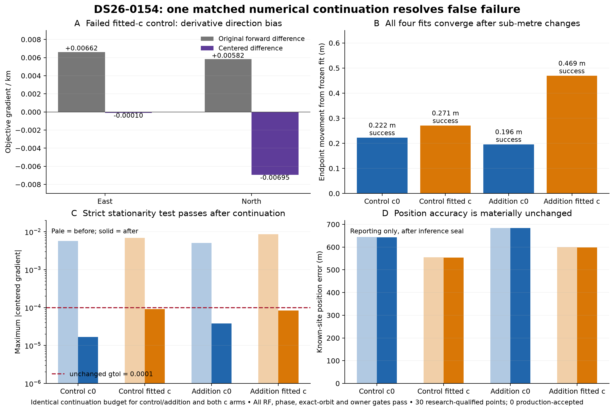

# Full inclusion: 56 research-qualified points; production unchanged

Three cases were selected by the frozen RF-only phase panel, with no position-error criterion. The initial matched 15 s / 30 s trials qualify DS26-0044’s 26 points under both limits. A separately authorized, matched numerical continuation resolves DS26-0154’s sole control-optimizer failure and qualifies another 30 points. DS26-0106’s 71 proposed points remain rejected by residual-structure gates. **Final total: 56 / 127 proposed points research-qualified; 0 production-accepted.**

| Case | Target | Initial qualified, 15 s / 30 s | Separate numerical continuation | Final research-qualified |
|---|---|---:|---|---:|
| DS26-0154 | 61961; uncalibrated family | 0 / 0 | All four fits now converge; all physical gates pass | 30 |
| DS26-0044 | 59310; uncalibrated family | 26 / 26 | None | 26 |
| DS26-0106 | 59835; shared calibrated family | 0 / 0 | None | 0 |

The initial comparison is preserved in [INITIAL-SUMMARY.md](INITIAL-SUMMARY.md), [summary.json](summary.json), and its [PNG](phase-inclusion.png)/[PDF](phase-inclusion.pdf). Both numerical references use the same frozen 30 s validated nomination, physical priors, aliases, observations, calibration masks and paired c arms. New-family physical phase support remains ±15 s. Every phase update and exact-orbit replay stays within the frozen causal bank.

## Research-qualified association coverage

Denominators are the **original complete GLRT observation lists**, including observations outside graph tracks. Counts below are matched control → research-qualified addition, not persisted production changes.

| Case / arm | Original GLRT observations | Associated control → addition | % of all GLRT control → addition | Position error control → addition (m) |
|---|---:|---:|---:|---:|
| DS26-0044 / c = 0 | 3743 | 2777 → 2803 | 74.19% → 74.89% | 3659.9 → 3593.8 |
| DS26-0044 / fitted c | 3743 | 2777 → 2803 | 74.19% → 74.89% | 3790.3 → 3715.0 |
| DS26-0154 / c = 0 | 4263 | 3078 → 3123 | 72.20% → 73.26% | 643.6 → 683.4 |
| DS26-0154 / fitted c | 4263 | 3093 → 3123 | 72.55% → 73.26% | 554.4 → 599.0 |

DS26-0154’s c0 count increases by 45: the 30 target observations plus a separate 15-point graph extension, `SCAN-RX2-CH4-T009-RF11690312500.000000`, assigned to NORAD **57328**. Those same 15 IDs are already associated to 57328 in the fitted-c control. They pass the unchanged extension gates at the c0 addition endpoint: RMS **91.98 Hz**, bias **−2999.74 Hz** within the unchanged ±3000 Hz limit, positive elevation and all noise screens passing. The c0 control narrowly fails only the offset bound at **−3002.59 Hz**. The reported **30-point targeted recovery is the intersection of newly recovered target IDs in both arms**; the extra c0 extension is excluded from the 56-point targeted total. Exact IDs, owners and gate values are preserved in [extension-id-accounting.json](extension-id-accounting.json).

## DS26-0154 numerical audit and continuation

Initially, the 30 s addition passed, but the matched fitted-c control ended with L-BFGS-B `ABNORMAL` after 51 final-round evaluations. Every frozen physical RF, phase, exact-orbit and owner check already passed. At the original 1 m forward-difference step, its north gradient was **+0.00582**; centered differences gave **−0.00695**, with the sign stable across 0.1–10 m centered steps. The biased derivative is consistent with a false line-search failure near a stable endpoint; the continuation changes both derivative calculation and line-search allowance.

One continuation was applied identically to control/addition and both c arms, starting at their corresponding frozen endpoints: five phase rounds, at most 48 optimizer iterations and **240 total physical objective calls per round**, centered 1 m derivatives, and `maxls=40`. All derivative calls count toward the cap. Physical priors, noise, candidates, target grid, objective and acceptance thresholds remain unchanged. All four final optimizer statuses and physical audits pass; centered-gradient components satisfy the original `gtol=1e-4`. No failed status was accepted.

| Role / arm | Final optimizer before → after | Objective change | Endpoint movement (m) | Physical objective calls, five rounds |
|---|---|---:|---:|---:|
| control / c = 0 | True → True | -0.00002071 | 0.222 | 45 |
| control / fitted c | False → True | -0.00002794 | 0.271 | 45 |
| new_family / c = 0 | True → True | -0.00001694 | 0.196 | 45 |
| new_family / fitted c | True → True | +0.00001129 | 0.469 | 55 |

The continuation finished in **25.2 / 590 s**. Its extra budget is separate from the original reference comparison; it does not establish a matched-budget 15 s versus 30 s localization benefit. The endpoint changes are sub-metre and position accuracy is materially unchanged.

## Why DS26-0106 remains rejected

With the 30 s reference, target RMS is only **75.22 / 74.77 Hz** (`c = 0` / fitted `c`), but the exact target replay fails **slope, step and lag-one correlation** tests. Phase convergence and the matched control pass. Its 71 points remain proposals; no threshold or residual pruning is applied.

| Exact target statistic | c = 0 | fitted c | Unchanged maximum |
|---|---:|---:|---:|
| Slope z | 3.4809 | 3.4965 | 3 |
| Maximum step z | 6.0132 | 5.9792 | 4 |
| Absolute lag-one correlation | 0.5086 | 0.5042 | 0.4747 |

All original cases finished in 78–97 s, each below its 590 s limit, with one numerical-library thread per case. Existing associated memberships and owners are preserved. Known-site coordinates enter only after the initial and continuation inference seals; frequency fit and position accuracy remain separate outcomes. DS26-0044 still has about 3.6–3.7 km error despite qualified association. The other additions worsen error. No new RF, future TLE, bank extension, production change or push occurred.

Artifacts: [final summary JSON](final-summary.json), [coverage CSV](qualified-coverage.csv), [pre/post numerical table](numerical-continuation-table.csv), [continuation inference seal](DS26-0154-numerical-continuation/inference_seal.json), [pre-gradient audit](DS26-0154-numerical-continuation/pre_continuation_audit.json), [exact continuation replay](DS26-0154-numerical-continuation/exact_owner_replay.json.gz), [source/test/report hashes](publication-source-receipts.json). Five focused tests pass.
