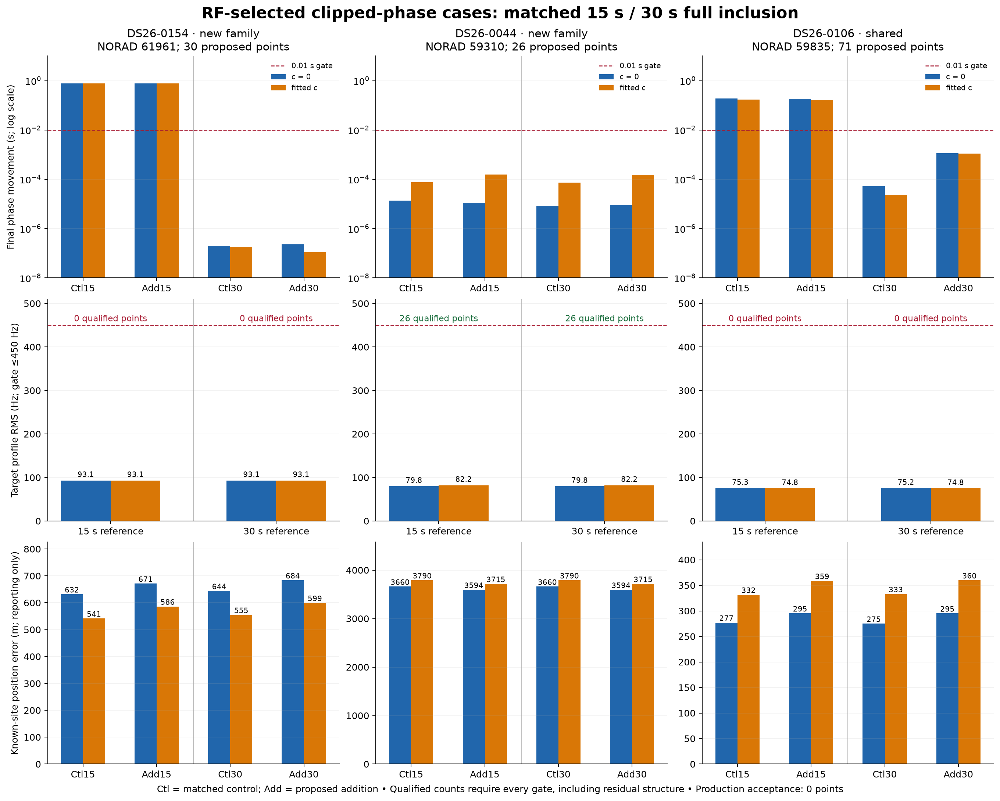

# Full inclusion after numerical phase repair

Three cases were selected by the frozen RF-only phase panel, without position-error selection. Each uses the same 30 s validated nomination for matched 15 s and 30 s numerical-reference trials, both `c = 0` and fitted-`c` arms, and matched control/addition starts, masks, physical priors, noise policy, and budgets. No gate is relaxed. The two uncalibrated families retain the original ±15 s physical target-phase integration support; only calibration reference coordinates change.

| Case | Route | Proposed points | Qualified at 15 s | Qualified at 30 s | Wall time / limit |
|---|---|---:|---:|---:|---:|
| DS26-0154 | new family | 30 | 0 | 0 | 94.8 / 590 s |
| DS26-0044 | new family | 26 | 26 | 26 | 77.8 / 590 s |
| DS26-0106 | shared | 71 | 0 | 0 | 97.1 / 590 s |

**Research-qualified recovery: 26 of 127 proposed points at 30 s. Production-accepted points: 0.** A qualified count requires both c arms and the matched control/addition to pass all original RF, phase, incumbent-membership, exact-orbit and ownership checks. These are isolated research trials; no persisted production associations changed.

| Case / 30 s | Target RMS, c0 / fitted c (Hz) | Position error: control → addition, c0 / fitted c (m) | Remaining failures |
|---|---:|---|---|
| DS26-0154 | 93.1 / 93.1 | 644 → 684 / 555 → 599 | control fitted c final optimizer: ABNORMAL: |
| DS26-0044 | 79.8 / 82.2 | 3660 → 3594 / 3790 → 3715 | none |
| DS26-0106 | 75.2 / 74.8 | 275 → 295 / 333 → 360 | lag1, slope, step |

DS26-0044 qualifies under both numerical limits once the same 30 s validated identity is supplied: its full-data calibration fit itself was not clipped. The 30 s change repairs its randomized identity-validation fold, rather than improving full-data inclusion numerics. DS26-0154 passes every 30 s RF, phase and exact-owner replay, including the addition, but the matched fitted-c control ends with L-BFGS-B `ABNORMAL` after 51 final-round evaluations. The unchanged optimizer-success requirement keeps its 30 points unqualified; this is a control numerical-termination blocker, not target RF rejection. DS26-0106 still fails target slope, step and lag-one structure checks despite RMS near 75 Hz.

Position errors use the known site only after all inference artifacts are sealed. Frequency-fit changes and localization accuracy are reported separately; a lower in-sample score or a qualified association alone does not establish better localization. The qualified DS26-0044 addition changes errors from 3.660 to 3.594 km (`c = 0`) and 3.790 to 3.715 km (fitted `c`); this small reduction does not establish accurate localization. The other two additions worsen error in both arms.

Each case is limited to 590 s, with one numerical-library thread and three case subprocesses running in parallel. Every fit uses five phase rounds and at most 48 position iterations per round. New-family trials also use the original 240 function-evaluation limit per round and the unchanged local phase-resolution audit. All reference updates, physical target phase boxes, and exact endpoint orbit evaluations are checked against the existing bank; no extrapolation, orbit-bank extension, future TLE, or RF collection is used.

Evidence: [paired CSV](paired-table.csv), [full summary](summary.json), [execution receipts](execution.json), [batch inference seal](batch_inference_seal.json). Case folders contain matched control/addition JSON, optimizer termination records, exact-orbit/owner audits, bank-domain checks, and source hashes. Three focused tests cover route selection, prohibited extrapolation, and rejection of proposals when any required qualification gate fails.
