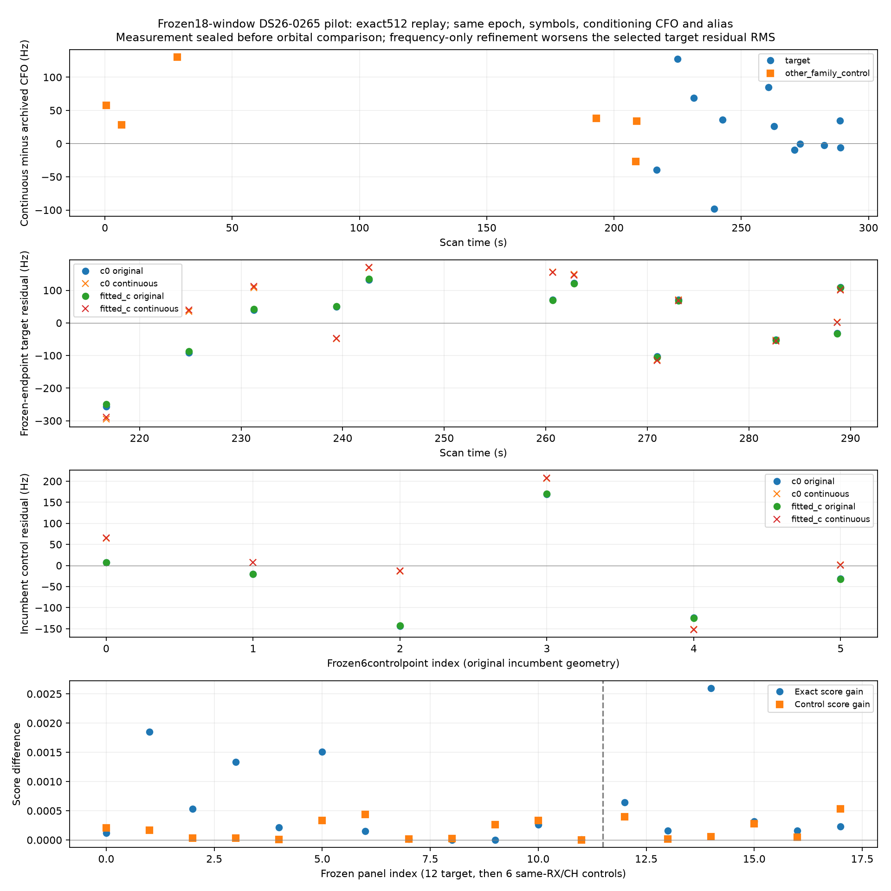

# Remaining residual structure: no validated correction yet

The frozen native evidence does not support repairing these targets by splitting the graph, deleting an alias point, or applying a target-regressed GLRT metadata correction. A source-bound 18-window raw-IQ counterfactual now also gives a negative result: fixed-epoch continuous-frequency GLRT refinement reproduces the archived discrete scores first, then worsens the selected target's frozen-endpoint residual RMS in both c arms. None of these results authorizes recovery or identifies a unique physical cause.

## What is actually present

**DS26-0265, RX1 CH4 T000 / 120 points:** one original degree-four graph piece, no alias transition, one RF edge, and no graph join. The best tested 30 s-reference full-inclusion residual retains quadratic BIC gains 16.50 / 14.61 and maximum prefix/suffix mean-split z values 5.06 / 4.87 in c=0 / fitted-c. The maximizing split falls between 226.6406 and 226.9936 s. This statistic compares whole prefix/suffix means; it does **not** prove a discontinuous physical jump. The same-family retained RX1 CH3 witness correlates only 0.344 over 67 unique one-to-one pairs; other same-family channels are 0.187–0.346. Another family on RX1 CH1 correlates 0.335 over 54 pairs. These inherited-model descriptive comparisons do not isolate a receiver or satellite cause. Earlier independent 20 s catalogue checks favor 66102 throughout.

**DS26-0223, RX1 CH2 T002 / 80 points:** the best tested saved joint receiver+satellite correction retains slope z 4.158 / 4.189 and prefix/suffix split z 4.714 / 4.665; ACF is already below its original threshold. The maximizing split is 87.9923–89.4118 s, inside the first graph piece, approximately 35 s before the predetermined graph join at 123.99981645 s. A fixed join-offset model improves two conditional whole-group folds but worsens the third in both c arms (111.9→134.0 / 111.4→133.0 Hz). The join is not an adequate explanation. One native point at 97.9299211 s lies on an alias branch displaced by 227272.727 Hz, returning at 98.283906 s; the existing graph lift handles it. It coincides with neither the maximizing mean-split nor the graph join. Earlier local catalogue checks keep 63595 across usable segments. Same-family RX1 CH3 has descriptive correlation 0.582 over 53 pairs after the target's best correction, but other families also correlate (e.g. RX1 CH4 52662, 0.692 over 15 pairs); no unique attribution follows.

Every target timestamp in both cases is exactly the recorded sample-counter window start plus **10 ms**, to maximum arithmetic error 9.1e-15 s. No sample-clock or edge switch occurs within either target. Variation of detected epoch within the probe would contribute only about **0.99–1.02 Hz RMS** through the orbital frequency derivative, far below the remaining residual. This estimate is descriptive and does not rule out every possible clock model. Fractional margins remain 0.218–0.816 / 0.217–0.680; no low-margin point deletion was used. Candidate ranks change, but their residual correlations are −0.014 / −0.138 and do not establish a source switch.

## Prespecified small metadata checks

We used the original three saved shifted-origin random group receipts, both c arms, a fixed one-feature model with 150 Hz feature/noise priors and a 300 Hz nuisance constant, and training-only feature preprocessing. Geometry and upstream selection are inherited, so these are **conditional residual diagnostics**, not fresh end-to-end holdouts or acceptance evidence.

- A fractional-margin feature fails to transfer consistently in either target.
- For 0265, fractional-epoch offset correlates modestly with residual (r≈0.238) and improves target-only conditional held RMS by about 2–10 Hz in all six comparisons. That association alone is inadequate: fitting the identical fractional-epoch mechanism on **other satellite families on RX1** produces coefficients −2.11 / −1.85 Hz per fractional sample and worsens untouched target RMS 110.99→111.20 / 110.19→110.38 Hz. Held-family RMS changes only approximately −0.06 Hz.
- For 0223, other-family coefficients +41–53 Hz/sample worsen untouched target RMS by 0.74–1.68 Hz. One held-family partition also worsens 69.7→75.3 Hz. The metadata correction has no demonstrated transferable benefit.

The witness randomization repeats a held-family set: all three requested seeds select family 67514 for 0265, so there is only **one distinct split**, not three independent replications. For 0223 there are two distinct held-family sets. All target values are excluded from these other-family coefficient fits. Receiver/geometry fits remain inherited and are not refit here. Both negative and positive results remain in [cross-channel.json](cross-channel.json).

## Completed raw-IQ GLRT counterfactual: negative result

Current source `fast_scan_scores._glrt_pair_*` returns an argmax frequency from its default 512-point FFT without sub-bin CFO interpolation. With a 4.4 μs symbol interval this grid spacing is 443.892045 Hz. A focused noiseless-tone test confirms the existing scorer rounds off-bin residual tones to these bins. A uniform-bin RMS of 128.14 Hz is only an illustrative scale, not a calibrated measurement-noise model or evidence that quantization caused these residuals.

**Crucially, original source products for the frozen raw-pilot panel show zero fractional residual-CFO increment in all 18 points.** Total tracking CFO equals the continuous acquisition conditioning CFO. Thus this is potentially a **refinement deadband around acquisition**, not a 443.892 Hz grid in absolute measured CFO. Zero increments cannot identify archived FFT size: they fit every candidate grid. The current default and source test establish code mechanics; archived products have no explicit FFT-size field, and capture-binary/config identity was not proved. The actual IQ reproduces all 18 archived CFO, exact-score and control-score values with exactly zero differences using the explicit 512-point oracle; this is consistent with 512, but still does not uniquely identify FFT size from zero-bin observations.

The measurement-only [raw-plan.json](raw-plan.json) freezes seed **20261031**, 12 uniformly selected target observations and six uniformly selected actively retained other-family controls on the **same receiver and channel**, before any residual-based panel selection. All original observation identities, visits, sample starts, fractional epochs and ranks are preserved. [raw-pilot-receipt.json](raw-pilot-receipt.json) recovers acquired CFO, fractional residual CFO, exact/control scores, raw window hashes and 16 digest-verified original scientific-product paths. The original pipeline release is `fast-1f3a91c6a882b6e7eac8827fbb95f215`. An initial metadata-only plan included unretained nominee controls; its v1 plan/receipt are preserved. Before any IQ access, the final control pool was restricted to 82 active incumbent IDs and six were sampled; the same 12 target indices remain fixed.

The initial stop-before-IQ receipt is preserved as [raw-pilot-blocked-before-amendment.json](raw-pilot-blocked-before-amendment.json). Its wording was too strong: **the earlier 20-window limit was an agent-declared scientific scoring limit, not a user authorization constraint**. [raw-amended-protocol.json](raw-amended-protocol.json), written before IQ access, permits decoding only the seven selected segments {0,1,8,9,10,11,12}, at most 3584 windows, while retaining and scoring only the same 18 frozen windows. No new storage API or acquisition setting was introduced.

The existing pinned multirate reader decoded exactly **3584 windows across those seven segments in 15.39 s**, exhausting each segment so all compressed-chunk, raw-chunk and individual-window digest checks completed. It retained exactly 18 RX1 20 ms arrays; all other decoded windows were discarded without scoring. [raw-export-receipt.json](raw-export-receipt.json) binds reader source, segment manifests, raw IQ digests and exported array hashes. No source path was written.

After exact discrete replay of **all 18 points**, existing `continuous_glrt_score` refined exact and control on the **same original fractional epoch, conditioning CFO, 64 symbols and alias branch**, in **0.475 s**. No joint timing, acquisition, satellite, polynomial, position, bias or noise parameter was fit. The measurement JSON was hashed and sealed in [raw-pilot-measurement-seal.json](raw-pilot-measurement-seal.json) **before** the reporting stage read orbital residuals.

| Frozen panel | CFO delta range | CFO delta RMS | Exact-score gain range | Margin-gain range |
| --- | ---: | ---: | ---: | ---: |
| 12 target points | −98.28 to +127.59 Hz | 59.70 Hz | 0.000000037 to 0.001852 | −0.000290 to +0.001682 |
| 6 same-RX/CH other-family controls | −27.09 to +130.25 Hz | 63.78 Hz | 0.000156 to 0.002597 | −0.000295 to +0.002539 |

Both exact and control scores increase, so margin need not increase; the minimum continuous target margin remains 0.27882. Higher local score is not evidence of a more accurate frequency estimate.

At the unchanged saved 30 s-reference inclusion endpoints, the **same 12 target observations** have residual RMS **110.61→131.86 Hz (c=0)** and **109.20→130.79 Hz (fitted-c)**. These are the frozen panel's before/after values, not full 120-point RMS. The original target-inclusion geometry was learned from the old CFOs; there is no independent frequency truth here and no claim that the estimator is generally worse. The concrete conclusion is that **this frequency-only counterfactual does not resolve the discrepancy at the tested endpoints**. It provides no basis to accept a target, refit position, reinterpret gates from 12 points, or tune a target-specific frequency correction. Acquisition bias, timing/receiver structure and orbit adequacy remain distinct unresolved hypotheses.

The **same six control observations** also worsen slightly at their existing original incumbent geometry: **105.00→108.07 Hz (c=0)** and **105.33→108.71 Hz (fitted-c)**. [raw-controls-reporting.json](raw-controls-reporting.json) records the fixed endpoints, exact baseline-objective replay and all point residuals; no coefficient, offset, phase or position was refit. These controls use their inherited curved conditional residuals, whereas the target uses its saved inclusion-model residuals. Both geometries were learned from the original CFOs. Increased disagreement with either frozen orbit model is **not independent proof of true-CFO error**.

Full evidence: [measurement-only results](raw-pilot-measurements.json), [reporting-only residual comparison](raw-pilot-summary.json), [export code](raw_export_segments.py), [fixed-epoch scoring code](raw_pilot.py), and [reporting code](summarize_raw_pilot.py). Exported .npy arrays remain local in `raw-panel/` and are excluded from the report payload; the receipts retain their hashes. These complete the bounded counterfactual; no further fit was performed.

## Artifacts and verification

[0265 native/residual/witness/metadata plot](DS26-0265.png) · [0223 plot](DS26-0223.png). PDFs are alongside the PNGs. The graph join is marked on 0223; raw points and alias-wrapped points are retained. Witness IDs are distinct from target IDs, but the residual geometries remain inherited.

The native audit took **5.31 s**, and the other-family transfer check **0.37 s**. **Twelve tests pass**: three focused audit tests and nine existing continuous-GLRT numerical tests, covering off-bin tones, frequency seams, direct/dense objective oracles and known synthetic pilot CFOs at 2.5/5/10 MS/s. No production code, public association, golden fixture, source recording or QNAP path changed; nothing was pushed.
