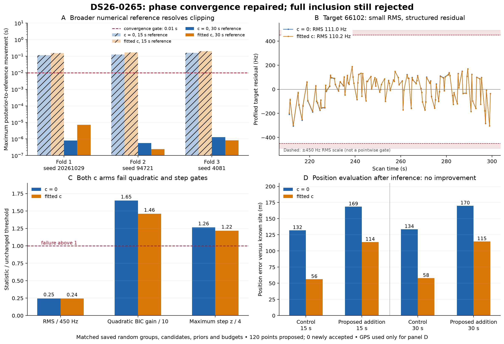
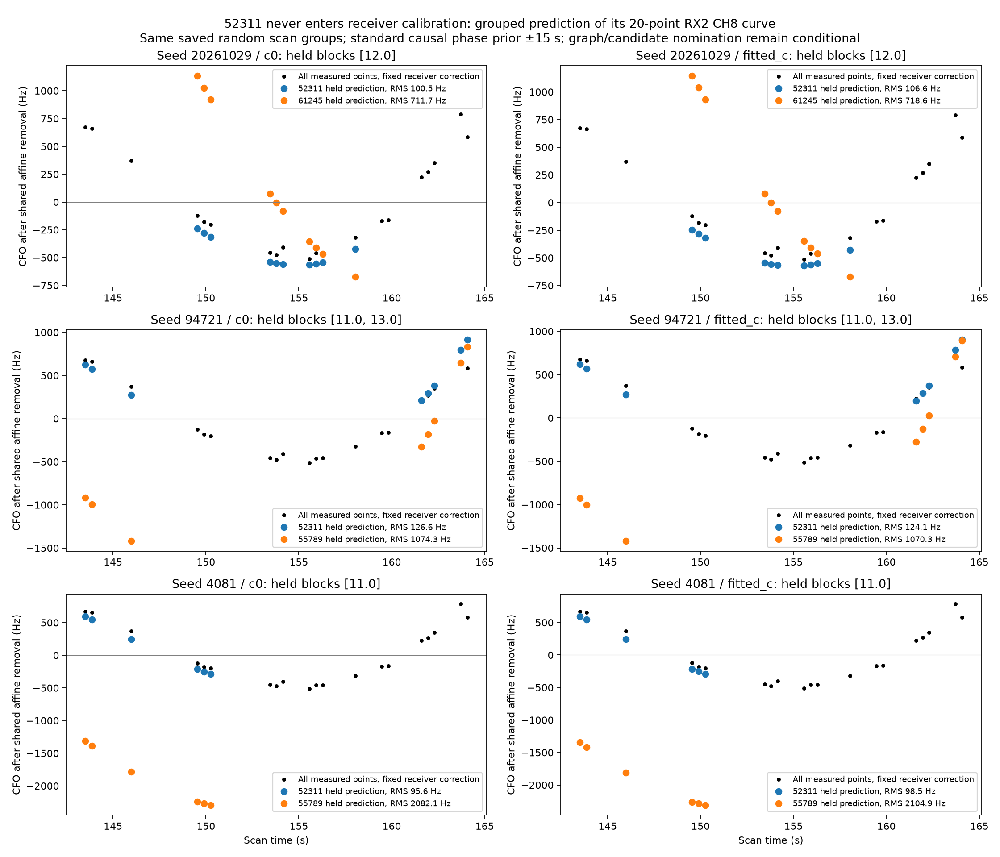
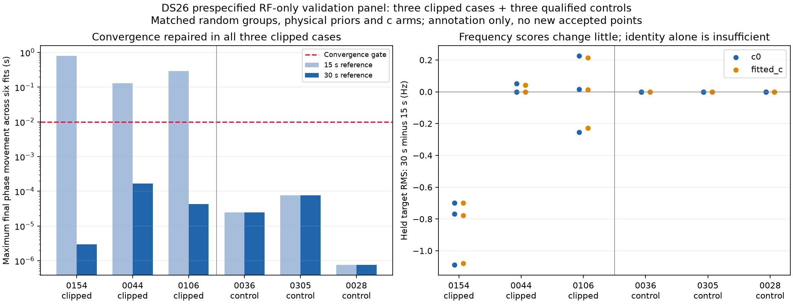
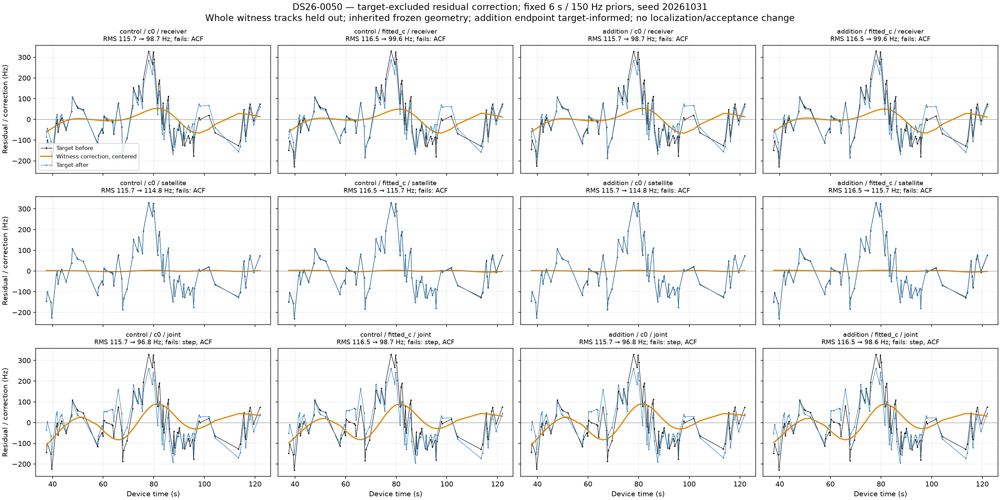
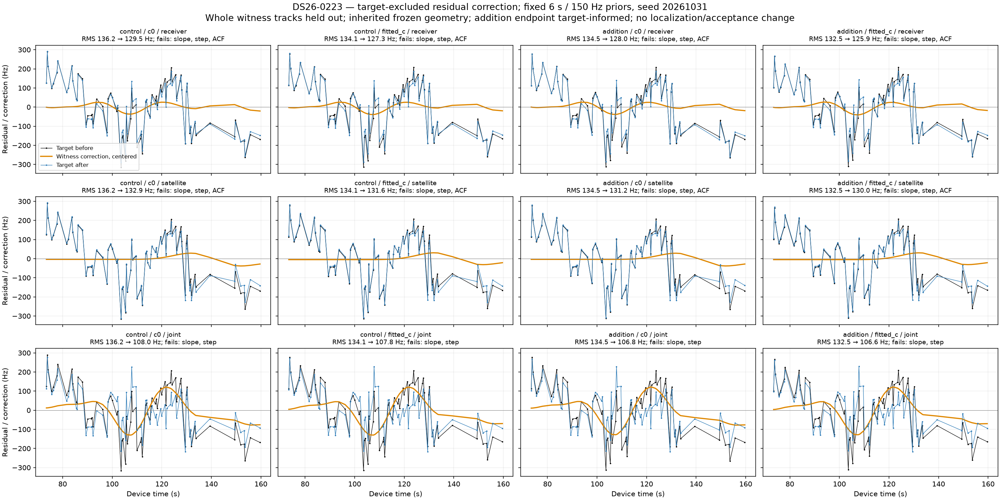
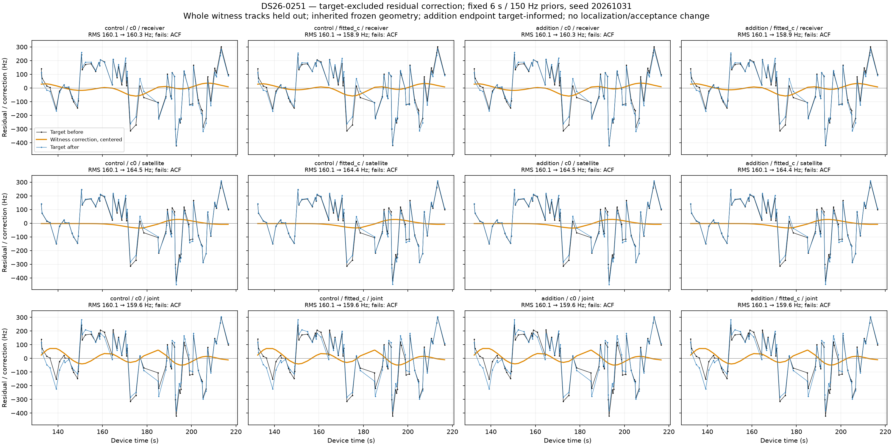

# DS26 residual-track recovery: numerical phase repair and independent correction tests

The ±15-second numerical phase reference can block otherwise strong satellite identity evidence. Widening that reference to ±30 seconds, while retaining the same physical priors and causal orbit bank, repairs the diagnosed failure in DS26-0265 and three independently selected clipped scans. Three qualified comparison scans retain identical predictive scores. However, **the 120-point 0265 target still fails full inclusion**, and the independently trained corrections tested on 0050, 0223 and 0251 also leave structured residuals. **Zero new points are accepted; ALGO03 production is unchanged.**

This iteration follows the [five-longest-residual inventory](../2026_10_30_ds26_longest_residual_tracks/README.md). The baseline is the immutable ALGO03 evaluation at `/srv/bulk/leo/research/algo03-full-evaluation-20261030`, with report/code context at commit `bb2da4652`. The new experiments are in `/srv/bulk/leo/research/ds26-recovery-validation-20261031`. These are bounded causal-data experiments, not a full new release evaluation.

## What changed in our understanding

| Scan / residual track | Points; span | Best-supported identity | Experiment and outcome | Remaining issue / next test |
|---|---:|---|---|---|
| 0265, RX1 CH4 T000 | 120; 88.26 s | 66102 | Wider numerical reference repairs identity/convergence gates. Full addition still fails quadratic and step gates. | Compare the remaining residual with independent same-family and receiver witnesses; do not add target-specific curvature merely to pass. |
| 0223, RX1 CH2 T002 | 80; 86.19 s | 63595 | Joint receiver/satellite correction reduces fitted-c control RMS 134.08→107.77 Hz; ACF now passes. | Slope and step remain significant, and two held witnesses worsen. Diagnose band/receiver versus shared-family structure before inclusion. |
| 0050, RX1 CH1 T001 | 77; 84.39 s | 63468 | Receiver-only correction reduces fitted-c control RMS 116.52→99.64 Hz and improves all three held receiver witnesses. | Strongest next correction candidate; remaining ACF .607 exceeds .456. Validate on held whole satellite families with preprocessing fitted only on training evidence. |
| 0251, RX1 CH7 T004 | 67; 84.01 s | 67352 | Joint correction barely changes target RMS 160.06→159.58 Hz and worsens held-witness pooled RMS. | No support for this correction here. Existing regional-boundary/convergence problem remains; revisit a bounded multi-start geometry test. |
| 0094, RX1 CH6 T001 | 46; 80.47 s | 66365 versus 58722 unresolved | No new fit in this iteration; previous random partitions disagree on identity. | Seek independent channel/receiver evidence for both candidates; retain ambiguity. |

Spans are first-to-last observation, not gap-free durations. Identities are conditional evidence, not independently verified transmitter truth. Receiver-test RMS values use their new matched held-witness baseline, not the earlier full-calibration baseline. All target and witness results for both c arms are preserved below.

## 0265: an unrelated family clipped the phase reference

The original 66102 target won all six saved partition/c-arm competitions with minimum score margin 686.74 and held RMS 86–178 Hz. The blocking phase movement came from incumbent **52311 on RX2 CH8**, whose posterior lay just below −15 seconds while its next numerical reference was clipped to −15 seconds. Additional rounds could not remove that discrepancy.

The experiment compares ±15 and ±30 seconds using the same observations, random grouped masks, candidate identities, alias choices, starting positions, physical priors and search budget. Each graph fit uses five reference rounds, with up to 48 position iterations per round. The target predictive phase integration support stays unchanged. Every update remains inside the existing causal orbit bank; there is no extrapolation or additional TLE retrieval. Frozen 15-second scores replay within `1e-5`.

| Annotation result | ±15 s | ±30 s |
|---|---:|---:|
| Maximum final phase movement, six fits | .197624 s | .000007225 s |
| Fits passing the .01 s phase gate | 0/6 | 6/6 |
| Winning identity | 66102 | 66102 |
| Held RMS range | 86–178 Hz | 86–178 Hz |

The full shared-family inclusion test is decisive. At 30 seconds the control passes phase, RF, exact-orbit and ownership checks. The proposed 120-point addition preserves every incumbent membership and owner, but **fails residual structure** in both c arms:

| 30-second inclusion diagnostic | c = 0 | Fitted c | Limit |
|---|---:|---:|---:|
| Target RMS | 110.99 Hz | 110.19 Hz | ≤450 Hz |
| Exact-target quadratic BIC gain | 16.50 | 14.61 | ≤10 |
| Exact-target maximum step z | 5.06 | 4.87 | ≤4 |
| Final phase movement | .00001051 s | .00000453 s | ≤.01 s |
| Control position error | 133.67 m | 57.89 m | Evaluation only |
| Proposed-addition position error | 170.06 m | 114.73 m | Evaluation only |

The addition increases position error in both arms. The maximum exact-orbit prediction difference for the addition is below .000074 Hz, so the remaining failure is not explained by the orbit approximation. The raw trial contains 3,589 incumbent points plus 120 proposed points; **3,709 is trial membership, not a new accepted association count**. The experiment accepts zero additions.

GPS (37.849061591561885, −122.48574968092912) was used only after sealing inference, to compute the last two rows. Lower frequency-fit residuals are not interpreted as better localization. These control/addition comparisons hold other inputs and budgets fixed within each c arm.

See the [phase experiment details](phase0265/SUMMARY.md), [reporting summary](phase0265/shared-run01/reporting_summary.json) and [inference seal](phase0265/shared-run01/inference_seal.json). Initial wrong-route and metadata-write errors were retained in the evidence archive; completed scientific fits were reused on resume.

## 52311 is supported; exclusion is a diagnostic, not the fix

The independent audit removes all 52311 points from receiver calibration before predicting that curve. A uniform catalogue/regional nomination and ±30-second nominal phase search returns seven identities. 52311 wins all six nominal comparisons, with phase −15.274 to −15.230 seconds and RMS 64.76–66.29 Hz. In the saved grouped prediction checks it also wins all six comparisons: minimum margin 77.064, held RMS 95.64–126.63 Hz.

The causal TLE is 17.37 hours old. Previous/latest causal element alignment is −13.29 seconds, and its inherited Student-t phase scale is 9.05 seconds. The nonzero signed prior center comes from earlier TLE innovations, not an RF-selected or GPS-selected value. This supports allowing the numerical reference to follow the permitted posterior. It does not warrant deleting the family or broadening its physical prior merely to rescue another track.

Only one retained 52311 fragment exists: 20 IDs on RX2 CH8 T006. Removing it eliminates 7/8/11 training points in the three saved folds and restores convergence, but changes calibration evidence. It provides no independent cross-channel replication and is not a membership-preserving recovery. The identity evidence remains conditional on the saved graph, aliases and catalogue search.

See [audit findings and causal provenance](incumbent52311/FINDINGS.md), [summary](incumbent52311/SUMMARY.md) and [all 20 point roles](incumbent52311/point-accounting.csv).

## Does the numerical issue occur elsewhere?

A receipt-only census finds **721 assessed annotations in 146 DS26 scans**. Sixty have a winning-fold phase failure; 37 show clipping; 19 pass the other inspected identity checks; 16 both pass those other checks and show clipping, across five scans. These are diagnostic counts, not recoverable-point estimates. Annotation files are absent for budget-exhausted attempts, so this is not a census of every residual track.

Before rerunning inference, seed 20261031 selected three other clipped scans and three qualified comparison scans using RF-only strata. No position errors entered selection. Each case reuses its original random grouped partitions, competing identities, priors and budgets, with both c arms. Six cases ran in three parallel processes with one numerical thread each and a 600-second per-case cap. All completed in 30–71 seconds per case.

| Scan | Panel role; target NORAD | Maximum phase movement, 15→30 s reference | Passing fits, 15→30 s | Maximum absolute held RMS change |
|---|---|---:|---:|---:|
| 0154 | Clipped; 61961 | .789545→.000002985 s | 0/6→6/6 | 1.088 Hz |
| 0044 | Clipped; 59310 | .131092→.000164749 s | 4/6→6/6 | .052 Hz |
| 0106 | Clipped; 59835 | .286830→.000042283 s | 0/6→6/6 | .255 Hz |
| 0036 | Qualified comparison; 63975 | .000024527→same | 6/6→6/6 | 0 Hz |
| 0305 | Qualified comparison; 57411 | .000075910→same | 6/6→6/6 | 0 Hz |
| 0028 | Qualified comparison; 67098 | .000000761→same | 6/6→6/6 | 0 Hz |

All three clipped targets change from prediction mismatch to conditionally supported identity. All three controls retain identical scores and identities. The 36 matched partition/c-arm masks agree across limits, and all frozen 15-second scores reproduce. **This panel tests annotation only; full inclusion and position effects are not evaluated on these six cases.**

See the [census](phase-cohort-audit.csv), [frozen selection](phase-validation-panel.json), [panel summary](phase-panel/summary.csv), [protocol](phase-panel/protocol.json) and [execution receipts](phase-panel/terminal.json).

## Can independent tracks predict the remaining residuals?

Three prespecified corrections were compared: receiver-only, trained on other satellites on the target receiver; satellite-only, trained on the same satellite on other receivers; and their joint model. All use fixed Gaussian basis knots with 6-second spacing/width, 150 Hz coefficient priors and witness noise, and 300 Hz per-track constant priors. RF scaling is relative to 11.5 GHz. There is no target-driven hyperparameter search.

Seed 20261031 holds out whole witness components, with identical assignments across c arms and control/addition endpoints. Target observations never train the correction; held curved witnesses are removed before refitting receiver coefficients. Geometry and phase references remain inherited from saved endpoints, so these are conditional residual diagnostics, not fully independent localization tests. Addition endpoints are target-informed; control endpoints exclude the target. Full saved curved objectives replay exactly.

| Case / correction | Target RMS c=0, before→after | Target RMS fitted-c, before→after | Held pooled RMS fitted-c, before→after | Remaining target failures |
|---|---:|---:|---:|---|
| 0050 receiver-only | 115.74→98.73 Hz | 116.52→99.64 Hz | 86.35→74.50 Hz; 3 tracks, none worsen | ACF .600/.607 > .456 |
| 0223 joint | 136.19→108.01 Hz | 134.08→107.77 Hz | 106.47→104.37 Hz; 10 tracks, 2 worsen | Slope z 4.21/4.24 >3; step z 4.83/4.78 >4 |
| 0251 joint | 160.14→159.63 Hz | 160.06→159.58 Hz | 113.66→115.27 Hz; 6 tracks, 2 worsen | ACF .554/.553 > .489 |

All **36** case × endpoint × c-arm × correction comparisons fail at least one unchanged target noise screen. No full inclusion is attempted for these corrections. Passing ACF in 0223 is insufficient because its trend and step remain. The 0050 receiver-only result is the best evidence of a transferable discrepancy, but its remaining time correlation is substantial. 0251 offers little reason to spend more effort on this particular correction.

See [all paired metrics, limits and interpretation](receiver/results-v3/SUMMARY.md), [36 comparisons](receiver/results-v3/summary.csv), and [every held-witness outcome](receiver/results-v3/held_witnesses.csv). Pooled improvements do not hide individual regressions.

## Recommended next bounded iteration

1. Take the bank-checked wider numerical reference through full inclusion on the three newly supported panel targets, retaining exact-orbit, ownership, residual and incumbent-preservation checks. Compare both c arms and report post-seal position error separately. The present result supports fixing numerical clipping, not promoting a new scientific release.
2. Prioritize 0050 receiver-only correction with whole satellite-family holdouts. Fit geometry, preprocessing and calibration using training evidence only, then predict untouched families and the target. Keep the current 6-second/150 Hz model fixed for the first replication. A success must improve independent witnesses and pass every target gate before position inclusion.
3. For 0265 and 0223, inspect the remaining shape against synchronized receiver/band and cross-receiver same-satellite witnesses. Choose the smallest independently supported correction. Do not give each target its own free polynomial to guarantee acceptance.
4. Deprioritize the unsuccessful 0251 smoother and the unresolved 0094 identity until new independent evidence distinguishes their alternatives. A long track is useful evidence, but it does not guarantee the current model can safely use it for position.

## Reproduction and artifact integrity

Eight focused tests passed: two phase-reference checks, two exclusion-mask checks, and four receiver-correction checks. Pytest emitted one cache-directory permission warning; there were no failed or silently skipped tests. Panel summarization also asserts replay agreement and identical paired masks. No runtime component, public persisted contract, frozen fixture, production service, database, QNAP path or recording was modified.

The published scripts retain original absolute research-input paths and require the pinned evaluation files; they are research drivers, not production dependencies. Run using the working checkout environment with `PYTHONPATH=src:tools` and one BLAS/OpenMP thread. The [panel driver](run_phase_panel.py) records exact per-case commands; the [receiver driver](receiver/receiver_validation.py), [phase driver](phase0265/run_phase0265.py), [shared inclusion continuation](phase0265/continue_shared.py) and [52311 audit](incumbent52311/audit.py) contain the remaining protocols. Summaries and plots read sealed or completed outputs rather than choosing new fits.

Raw phase [evidence](phase0265/raw-evidence.tar.gz), panel [evidence](phase-panel/raw-evidence.tar.gz) and 52311 [evidence](incumbent52311/raw-evidence.tar.gz) preserve JSON/logs, masks, source hashes, termination reasons and failed wrapper attempts. Large directly linked phase receipts are gzip-compressed JSON; decompress before replay. Extract each archive into a separate directory to inspect its original relative layout. [publication-manifest.json](publication-manifest.json) hashes every published artifact except itself.
