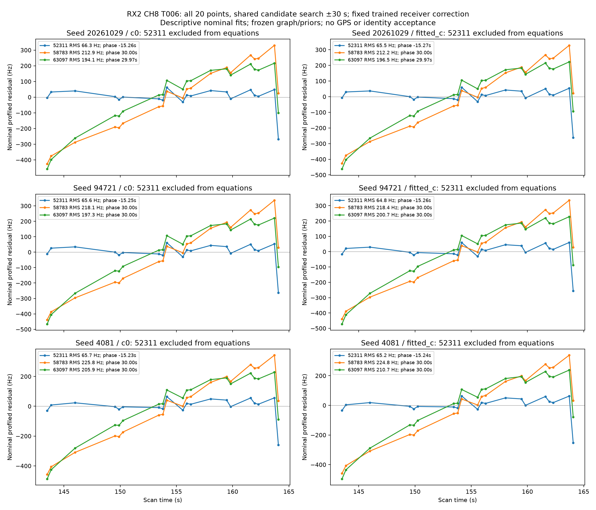

# DS26-0265 incumbent 52311 audit

**The retained 52311 identity is supported by the available conditional evidence. Its phase domain is inadequate for this fragment. Removing this family is a diagnostic isolation experiment, not a justified identity correction or baseline-preserving recovery.**

The frozen case exactly replays in both c arms (objective differences 0). All 52311 retained evidence is accounted for: 20 observation IDs, one RX2 CH8 T006 fragment, scan time 143.5072648–164.0690716 s, one degree-two original graph piece, active curvature, and no predictive, postfit, second-fragment, or other-channel witness. The final baseline residual is 75.689 Hz for c=0 and 71.687 Hz for fitted-c. The original seed row's 1004.77 Hz RMS and `compatible=False` describe an earlier nominal nomination, not the final calibrated residual. 52311 has a phase coordinate but is absent from the baseline's supported physical orbit-mode families.

## Causal orbit and phase evidence

The frozen provenance names STARLINK-3750 / NORAD 52311, Space-Track snapshot `sha256:29983d9cf21b7913a86618d0dea722f6fc80695bbbd6d9a67bda36160587f470`. Its element epoch is 2026-10-28 21:04:17.217984 UTC; the scan begins 2026-10-29 14:26:26.669633 UTC, an age of 17.36929 h. The frozen latest provenance records collection before the causal cutoff. Five archived element versions are available; every epoch and collection timestamp is before that cutoff.

The prior's old/new alignment is −13.288469 s over an epoch gap of 84,407.390496 s. The history-based phase scale is 9.894831 s, multiplied by 0.9146101 to 9.049912 s, with Student-t ν=3. The inherited signed center is −0.223321 s. These signed centers come from earlier TLE innovations (`ds23_causal_phase_location.adjust_means`), not RF fitting. The baseline posterior phase is −15.158111 s (c=0) / −15.204514 s (fitted-c), beyond the −15 s refreshed reference limit.

The standard independent-family prediction uses the causal forecast mean 0, the same scale and ν, ±15 s quadrature at 0.1 s, and physical orbital uncertainty. Its phase box retains only 80.3997% of its untruncated prior mass. After all 20 points are evaluated descriptively, 99.9342–99.9926% of the phase posterior mass occupies |phase|≥14.9 s. This independent calculation reproduces the boundary pressure without allowing any 52311 observations into receiver calibration. It does not establish why the orbit/phase discrepancy arose or demonstrate an orbital maneuver.

## Matched family-exclusion experiment

All three **original shifted-origin random scan-group receipts** used for target 66102 were replayed, including their original block origins, 12 s blocks, 2 s guards, target masks and candidate/alias lists. The c=0 and fitted-c fits use the same observations, graph, identities, aliases, existing prior means, fixed 150 Hz training noise, five phase rounds and 48 position steps per round. No GPS enters any fit or selection. The complete experiment finished in 29.94 s, under its 590 s cap.

| Seed | 52311 training points removed | Other original training points retained | 52311 predictive training / held points |
| --- | ---: | ---: | ---: |
| 20261029 | 7 | 1704 | 7 / 10 |
| 94721 | 8 | 1879 | 8 / 8 |
| 4081 | 11 | 1867 | 11 / 6 |

The other 52311 points in each fold were already held or guard-purged; no point disappears without an accounting role. [point-accounting.csv](point-accounting.csv) lists all 20 IDs and each fold's role; [audit.json](audit.json) also records every removed training ID and original/excluded mask hashes. The unused family coordinate remains in the original design and prior support. All original and final masks are asserted exactly, and the exclusion helper has two passing tests for complete family removal, preservation of unrelated partial masks, and no input mutation.

All six training fits converge: maximum final phase change is 0.00001729 s. 66102 remains the best of its original per-fold nominees, with held RMS 86.129–178.336 Hz and minimum score margin 686.421. Its changed calibration endpoints move 0.00838–0.11333 km from their corresponding original random-fold endpoints. These are changes in model endpoints, **not position-accuracy improvements**; no evaluation position was read. The excluded evidence mask differs from the published baseline, and the 20 original retained points are not preserved as calibration evidence. This experiment did not run or authorize an addition/inclusion trial.

## 52311 identity versus competitors

Catalogue nomination searches all causal-bank satellites over both c-arm endpoints and a shared ±10 km 3×3 regional grid, using phase −30 to +30 s in 5 s increments. The union has seven distinct identities: 52311, 55789, 58783, 61245, 63097, 66113 and 100445. Every nominee receives the same full-domain one-second grid and bounded exact phase refinement on all 20 points, a constant offset prior of 1000 Hz, and no extra rate. This nomination is descriptive and uses the full 20-point fragment; it is not an independently selected held-data identity search.

52311 wins every full-fragment nominal fit, with RMS 64.765–66.291 Hz and phase −15.274 to −15.230 s, consistently just outside the existing reference domain. The lowest-cost nominal competitor is 58783 at RMS 212–226 Hz and the +30 s domain edge. 63097 reaches RMS 194–211 Hz but requires a larger offset penalty. 100445, 55789, 66113 and 61245 are poorer. Other currently calibrated families are tested using their existing shared posterior; inactive/new families receive the independent causal phase mixture and physical orbit covariance. 58783 and 63097's retained-family posteriors do not explain the 52311 fragment.

Using the **same original scan partitions** for the 52311 fragment itself, 52311 wins all six matched-c held comparisons, minimum score margin 77.064 and held RMS 95.639–126.629 Hz. 61245 is the runner-up in the first partition and 55789 in the other two. The held point counts are only 10, 8 and 6, and these partitions reuse one 20.56 s fragment: they are not three independent satellite passes or independent cross-channel confirmations. The competitors' standard predictive phase domain remains ±15 s; the separate nominal diagnostic extends all candidates equally to ±30 s. Wider-domain competitors beyond that interval remain untested.

The receiver-corrected fragment's affine residual RMS is 431.596–435.285 Hz, versus 65–66 Hz for 52311 and approximately the original polynomial noise scale for a quadratic. Its fitted second derivative is 22.336–22.535 Hz/s². This supports active curvature conditional on the independently trained receiver correction; the polynomial fit itself supplies no satellite identity.




## Limits and reproducibility

This is conditional on an incumbent graph, identities and aliases selected from the original full-scan RF evidence. There is no new raw-RF extraction or blind acquisition experiment, no additional independent channel support, no uniquely established physical cause for the phase discrepancy, and no localization accuracy claim. Keeping 52311 while testing an explicit, orbit-bank-verified broader phase-reference domain is better supported than treating this 20-point identity as wrong and deleting it. Domain expansion still requires the subsequent unchanged adequacy and inclusion checks.

Run from `/srv/bulk/leo-dev/fast-algo02-production-v1`:

```sh
PYTHONPATH=src:tools OPENBLAS_NUM_THREADS=1 OMP_NUM_THREADS=1 .venv/bin/python /srv/bulk/leo/research/ds26-recovery-validation-20261031/incumbent52311/audit.py
PYTHONPATH=src:tools OPENBLAS_NUM_THREADS=1 .venv/bin/python /srv/bulk/leo/research/ds26-recovery-validation-20261031/incumbent52311/summarize.py
PYTHONPATH=src:tools:/srv/bulk/leo/research/ds26-recovery-validation-20261031/incumbent52311 .venv/bin/python -m pytest -q -p no:cacheprovider /srv/bulk/leo/research/ds26-recovery-validation-20261031/incumbent52311/test_audit.py
```

No frozen inputs, production code, golden fixture, QNAP path, or published association was changed. All work is in this research directory; nothing was pushed. `audit.json`, `summary.json`, `fold-summary.csv`, the two PNG/PDF figure pairs, source files and `manifest.json` provide the full evidence and reproducibility record.
