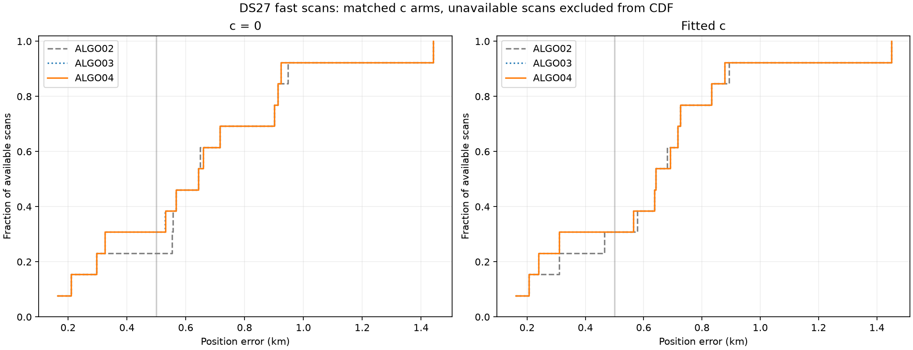
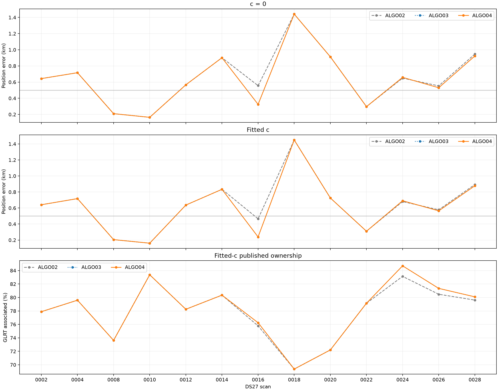
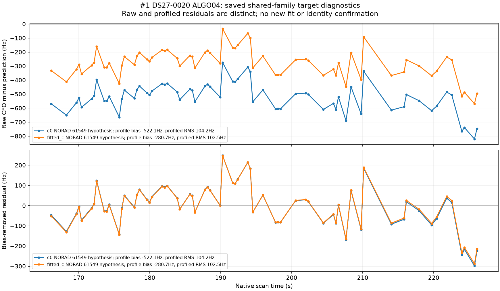
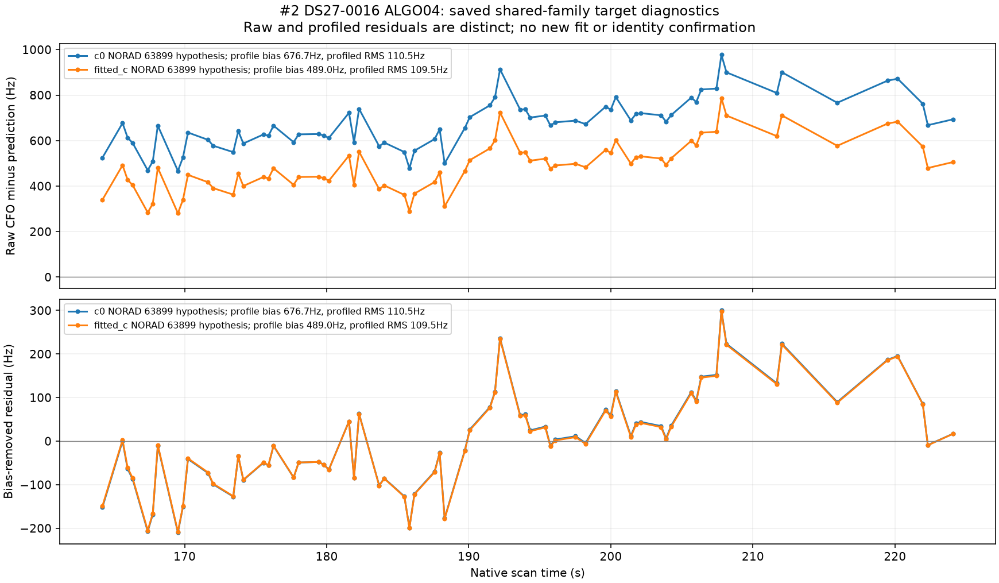

# DS27: ALGO04 evaluation and the longest remaining GLRT curves

DS27 is frozen with **28 new acquisitions: 15 fast and 13 adaptive**, all at 10 Msps. ALGO04 produces usable results for **13 of the 15 fast scans**. On those scans it associates **43,923 / 56,175 GLRT observations (78.19%)**, with **619 m mean**, **641 m median**, **1,106 m P95** and **1,449 m worst** fitted-c position error. Four of the 13 results are within 500 m.

ALGO04 adds **no observations over published ALGO03 on this cohort**. Its mean position error changes by only 0.033 m. Relative to ALGO02, the combined recovery pipeline adds 154 observations and lowers mean fitted-c error by 18.9 m. These are descriptive results from a small, single-site cohort, not evidence that the 500 m goal has been reached generally.

The residual investigation finds three different obstacles: four strongly nominated curves fail structured-residual checks; five long curves have ambiguous or unstable satellite identities; and one 64-point CH8 curve is omitted from recovery because an unpublished internal ownership list treats it as already associated. That last finding is a concrete recovery-queue inconsistency, not evidence that its satellite identity is established. Production and scientific acceptance gates were not changed.

## Dataset and execution scope

Membership includes whole acquisitions starting in **[2026-10-30 14:42:46.099491067 UTC, 2026-10-31 14:34:49.391893560 UTC)**. The lower bound is DS26's frozen cutoff, not the time of its last recording. The upper bound was fixed once before discovery. This is approximately 7:42 a.m. October 30 through 7:34 a.m. October 31 Pacific time.

The inventory retains incomplete and unavailable members, applies no signal-quality or error filter, and has no content-identity overlap with DS26. There are 27 complete acquisitions and one incomplete acquisition. Metadata account for 129,037 windows and 328,733,990,306 compressed bytes; no IQ payload was read or rehashed. Adaptive recordings remain in the dataset but are inventory-only in this fast-scan evaluation.

See the [dataset description](dataset/dataset-section.md), [full manifest](dataset/manifest.json.gz), [28-row acquisition inventory](dataset/inventory.csv), and [provenance](dataset/provenance.json). The uncompressed manifest SHA256 is `a0cf50e71336519b649677c91ae39ef2438a14b6e007ce2bc70da2b47211af32`.

We used existing public GLRT inputs and qualified ALGO02 results, reused qualified ALGO03 exports only when their exact ALGO02 comparator matched, and ran missing stages through the frozen executable. ALGO04 used installed release `f9e262f96b6e2e75b397f69d50a0ea9104e293ef`. At most 12 case workers ran concurrently, each with one numerical-library thread. Each scientific stage retained its 1,200-second cap. This mixes cached upstream results with fresh bounded recovery; elapsed replay time is not an end-to-end speed benchmark.

The search starts from the existing **25 × 25 km region centered at 37.906, −122.545**. All 13 available snapshots pass the causal catalogue and initialization audit: epochs and collection times precede each scan's causal cutoff, original/repaired prior inputs and orbit-bank hashes agree, and the candidate filter has no satellite whitelist. The independent audit performs 1,053 checks. Evaluation coordinates **37.849061591561885, −122.48574968092912**, confirmed by the user, enter only the reporting step after inference is sealed. See the [causal audit](audits/causal-initialization-audit.md).

## Position and association results

Association uses original unique GLRT IDs, including points outside graph tracks. The denominator below is the 56,175 observations in the 13 usable paired scans; unavailable scans remain in the 15-scan roster and are not assigned zero error.

| Method | c arm | Associated points | GLRT associated | Mean error, m | Median, m | P95, m | Worst, m | Within 500 m |
|---|---|---:|---:|---:|---:|---:|---:|---:|
| ALGO02 | c = 0 | 43,769 | 77.915% | 658.3 | 643.4 | 1,144.5 | 1,441.1 | 3 / 13 |
| ALGO03 | c = 0 | 43,923 | 78.190% | 637.7 | 643.4 | 1,130.3 | 1,441.1 | 4 / 13 |
| ALGO04 | c = 0 | 43,923 | 78.190% | 637.6 | 643.4 | 1,130.2 | 1,441.1 | 4 / 13 |
| ALGO02 | fitted c | 43,769 | 77.915% | 638.2 | 640.9 | 1,115.7 | 1,449.4 | 4 / 13 |
| ALGO03 | fitted c | 43,923 | 78.190% | 619.4 | 640.9 | 1,106.3 | 1,449.4 | 4 / 13 |
| ALGO04 | fitted c | 43,923 | 78.190% | 619.4 | 640.9 | 1,106.2 | 1,449.4 | 4 / 13 |

Four ALGO04 numerical candidates pass admission: 0016, 0024, 0026 and 0028. All retain exactly the incumbent's point counts and owners in both arms. Nine usable cases retain ALGO03, including its ALGO02 fallbacks. A numerical candidate being accepted is therefore not a point-recovery count.

| Scan | ALGO02 → ALGO04 points | Fitted-c error, m before → after |
|---|---:|---:|
| 0016 | 3,385 → 3,406 | 465.4 → 239.0 |
| 0024 | 4,140 → 4,218 | 680.6 → 690.7 |
| 0026 | 3,042 → 3,075 | 577.9 → 564.8 |
| 0028 | 3,635 → 3,657 | 893.3 → 877.4 |

Those 154 point additions were already achieved by ALGO03. Scan 0024 illustrates that a supported addition can increase position error. Exact values for every scan and both arms are in [per-case.csv](results/per-case.csv) and [summary.json](results/summary.json).

The c ablation holds observations, candidates, other priors and budgets matched. All 13 c-arm pairs have identical published ID-and-NORAD support. For ALGO04, fitted-c reduces mean position error by 18.27 m and the mean reported frequency objective by 1.479. On the nine pairs with reported RMS in both arms, mean RMS falls by only 0.0112 Hz. Four selected-candidate summaries do not expose that RMS field and are excluded from the RMS statistic. Frequency-fit improvement and geographic accuracy are separate measurements; neither is used to select the other.

## The ten longest contiguous residual fragments

Ranking subtracts the **chosen ALGO04 fitted-c published owners** from the original graph sources. It collapses identical-ID alias duplicates and splits at claimed source points, existing polynomial-piece boundaries and adjacent observation gaps greater than five seconds. Fragments are ordered by observed first-to-last duration, then unique point count. The two- and ten-second sensitivity results and full parent spans remain in the downloadable inventory. This measures actual observed continuity rather than interpolating through gaps.

All ten below are wholly unassociated fragments. Some are only part of a longer native parent. NORAD numbers are **hypotheses from retained causal candidate comparisons**, not independent satellite ground truth. Polynomial RMS describes the graph fit, not the satellite fit.

| Rank | DS27 scan / native track | Time, s | Duration, s | Points | Satellite hypothesis | Recorded obstacle |
|---:|---|---:|---:|---:|---|---|
| 1 | 0020 RX1 CH4 T005 | 166.14–226.09 | 59.95 | 66 | 61549 | Strong nomination; shared-fit quadratic and step residuals |
| 2 | 0016 RX1 CH5 T000 | 164.21–224.08 | 59.87 | 70 | 63899 | Strong nomination; slope, quadratic, step and lag-1 residuals |
| 3 | 0022 RX1 CH4 T001 | 95.81–152.17 | 56.36 | 48 | 59737; competitor 54159 | Insufficient identity margin: minimum 9.52 |
| 4 | 0022 RX1 CH3 T000 | 199.96–256.30 | 56.34 | 60 | 57914 | Strong parent nomination; slope, quadratic, step and lag-1 residuals |
| 5 | 0020 RX1 CH1 T004 | 151.82–206.10 | 54.28 | 70 | 67344 / 50173 | Winning identity changes across validation partitions |
| 6 | 0002 RX2 CH8 T001 | 89.98–137.82 | 47.84 | 64 | Not established | Unpublished post-fit ownership suppresses recovery inventory |
| 7 | 0004 RX1 CH2 T002 | 84.77–129.08 | 44.31 | 35 | 67186 | Strong parent nomination; lag-1 gate narrowly fails |
| 8 | 0018 RX1 CH8 T002 | 127.19–171.14 | 43.94 | 40 | 58121 | Insufficient identity margin: minimum 4.07; scan also falls back |
| 9 | 0012 RX2 CH2 T002 | 0.76–44.69 | 43.93 | 54 | 57999 / 63782 | Winning identity changes across partitions |
| 10 | 0020 RX1 CH8 T008 | 256.77–299.69 | 42.92 | 63 | 55430 / 51969 | Winning identity changes across partitions |

**Gray means associated; red is the ranked residual; orange is other unassociated GLRT; blue is the existing graph polynomial.** The blue line is not an orbit prediction. Native CFO is shown without hiding alias-branch jumps; offsets of about 227.273 kHz can move individual native points away from the displayed branch. Polynomial residual panels use the graph's stored alias lift.

The [figure gallery](FIGURES.md) contains every native close-up, point-minus-polynomial residual, retained held-group satellite residual and available final shared-fit residual. [Top-ten data](residual-ranking/top10.csv), [all 410 residual fragments](residual-ranking/residual_fragments.csv), and [per-scan counts](residual-ranking/per_scan.csv) preserve the underlying accounting.

### Whole-track duration gives a different ordering

If “longest track” means the full remaining native parent span, including gaps, the ranking is below. This is also supplied explicitly rather than replacing it silently with the continuity definition.

| Rank | Scan / native parent | Residual points | Full span, s | Largest gap, s | Longest contiguous fragment, s |
|---:|---|---:|---:|---:|---:|
| 1 | 0022 RX1 CH3 T000 | 67 | 72.64 | 7.44 | 56.34 |
| 2 | 0014 RX1 CH8 T002 | 28 | 70.16 | 9.93 | 12.05 |
| 3 | 0020 RX1 CH4 T005 | 66 | 59.95 | 3.90 | 59.95 |
| 4 | 0016 RX1 CH5 T000 | 70 | 59.87 | 3.90 | 59.87 |
| 5 | 0022 RX1 CH4 T001 | 48 | 56.36 | 4.26 | 56.36 |
| 6 | 0004 RX1 CH2 T002 | 41 | 56.01 | 7.45 | 44.31 |
| 7 | 0020 RX1 CH1 T004 | 70 | 54.28 | 2.13 | 54.28 |
| 8 | 0018 RX1 CH8 T002 | 41 | 50.68 | 6.73 | 43.94 |
| 9 | 0018 RX1 CH2 T000 | 41 | 48.55 | 5.67 | 22.68 |
| 10 | 0002 RX2 CH8 T001 | 64 | 47.84 | 2.13 | 47.84 |

See [parent-top10.csv](residual-ranking/parent-top10.csv) and [all parent sources](residual-ranking/parent_tracks.csv). Parent identity and exact native IDs prevent confusing two receivers' similarly named tracks.

The two additional parents outside the contiguous top ten were audited separately. **0014 RX1 CH8 T002** consistently nominates 61641 (minimum margin 40.86), but its shared fit fails slope, quadratic, step and lag-1 checks. **0018 RX1 CH2 T000** nominates 58121 (minimum margin 16.23), but its new-family fit fails lag-1 in both the grid and continuous-phase checks: correlations are 0.7212 and 0.7209. A continuous-phase refinement alone therefore does not cure that rejection. Their gap-preserving plots are included in the gallery.

## What the residual investigation establishes

**Strong satellite nominations can still fail shared-model consistency.** Ranks 1, 2, 4 and 7 each nominate the same family in all six partition/arm comparisons. Their minimum score margins are approximately 1,203, 147, 257 and 1,898 respectively. The final inclusion checks nevertheless reject structured residuals. For the first three, phase reference convergence and existing-owner preservation pass; enlarging the phase reference again or changing a constant frequency offset alone would not remove the observed residual structure.

For rank 1, the fitted-c shared prediction has a raw bias of −280.7 Hz and a bias-profiled RMS of 102.5 Hz. Quadratic and step checks fail. For rank 2, the corresponding values are +489.0 Hz and 109.5 Hz; slope, curvature, step and lag-1 checks fail. Rank 4's full 67-point parent has −221.0 Hz bias and 156.0 Hz bias-profiled RMS, with the same four structural failures. These are retained trial diagnostics, not newly fitted models or accepted associations.

Rank 7 is a useful near-boundary case: its fitted-c lag-1 normalized slack is −0.0200 and the other reported gates pass. That supports testing a physically justified measurement-correlation model and gate stability; it does not justify changing a threshold solely to accept this scan.

**The CH8 omission is an ownership-accounting mismatch.** In DS27-0002, the recovery inventory subtracts 3,910 internal proposed IDs while the actual published ALGO02 proof contains 3,846. Their exact 64-ID difference equals RX2 CH8 T001 and is explicitly recorded as `unreported_postfit_ids`. Those points remain absent from chosen ALGO04. Inventory generation happens before published-support reconciliation and is not rebuilt afterward, so the curve has no recovery target or retained annotation. The other 12 snapshots have no such discrepancy. Its graph fit has correlated residuals (`structure_flagged`), so entering recovery would still require genuine identity and inclusion tests. See the [ownership audit](audits/inventory-publication-audit.md).

**Ambiguous identities are not missing detections.** Ranks 3 and 8 have consistent winners but insufficient competition margins. Ranks 5, 9 and 10 switch winning families across partitions. Their smooth appearance is evidence of a coherent source, not enough to choose between the competing orbital predictions. The retained fold plots show which portions of each source support different candidates.

## Unavailable scans and bounded-work failures

DS27-0001 is incomplete and has no public GLRT input. DS27-0006 has GLRT and native graph sources, but its ALGO02 family-excluded calibration fails the ≤0.01 s phase-convergence requirement. The wrapper subsequently reports a missing family-position file; the earlier phase exception is the underlying failure. A bounded retry reproduces this failure. ALGO04 cannot repair a scan that never supplies its required qualified upstream result.

The [failed-scan native supplement](failed-native-ranking/failed-scan-native-inventory.json.gz) and figure gallery retain 0006's curves with **ownership unknown**, not falsely classified as all unassociated. Its longest continuous native pieces are CH5 T002 (66.66 s, 87 points), CH4 T000 (62.06 s, 87 points), and CH4 T003 (60.27 s, 74 points). The 86.15 s CH5 T000 parent and 71.62 s RX2 CH6 T001 parent contain larger gaps. These sources are excluded from the post-ALGO04 ranking because there is no qualified association outcome.

DS27-0018 is the worst usable fitted-c result at 1.449 km. Its recovery wrapper receives 47 process exit receipts for 48 expected after the remaining-budget timeout of the `retry-joint-fitted_c` stage. No denied reads are logged, but process accounting is incomplete, so the wrapper retains ALGO02 and ALGO04 retains that incumbent. A missing exit receipt is consistent with a killed child not reaching its exit hook; the retained schema does not establish the missing PID. The raw worker selection is not substituted for the failed publication proof. See the sealed [read-audit diagnostic](proofs/DS27-0018-read-audit-diagnostic.json).

## Next tests, in order

1. **Fix recovery inventory accounting.** Generate residual targets from validated published ownership. Keep unpublished post-fit predictions as candidate hints rather than using them to remove targets. Validate exact coverage on 0002 and all 13 snapshots, then send the 64-point curve through the unchanged causal candidate and residual gates. Do not promote a coverage claim before that test passes.
2. **Test a shared-family correction for the strongly nominated curves.** Refit the smallest physically justified satellite timing/rate correction against independent existing tracks and the new curve, with receiver priors retained. Require improvement on independent evidence, stable identity, unstructured residuals and unchanged incumbent ownership in both c arms. Compare satellite-shared versus receiver/band-shared discrepancies before adding nuisance parameters.
3. **Resolve close competitors jointly.** For ambiguous curves, use additional independent receiver/channel evidence and bounded family competition. Avoid a location-selected satellite switch or independent high-order correction for every track.
4. **Improve bounded-work accounting.** Preserve complete parent/child termination evidence and reserve cleanup time, then reproduce the 0018 deadline case. Any accepted result must still meet the full read-audit contract. Investigate 0006's upstream phase convergence separately from ALGO04's add-on.

The ten contiguous fragments contain **570 unique points**. Recovering every one would raise pooled association only to **79.20%**, and is not yet justified. There are 12,252 residual observations overall: **5,856 in graph sources and 6,396 outside the graph**. Even accepting every remaining graph point would reach only **88.61%**. Reaching 90% therefore also requires recovering some evidence outside the existing graph, not merely loosening satellite gates on these ten curves.

## Reproduction and evidence

The analysis index contains all 15 fast slots, exact terminal/observation/track hashes and the native identity basis. It is sealed before geographic reporting. The reporter validates the v3 terminal, follows the chosen nested fallback, checks both c arms, and obtains missing V1 linear-track NORAD labels from the validated V2 source-support proof. This label reconciliation changes no associated IDs.

The report bundle includes the frozen acquisition manifest, execution and analysis seals, source adapters and tests, causal/ownership audits, per-case results, full residual rankings and standalone native/annotation plot packets. The packets preserve the observations and stored predictions used in the figures without raw IQ or full orbit-bank arrays. Full scientific reruns require the existing local corpus and frozen numerical releases; the report does not package that corpus.

Validation: **77 tests pass**, covering inventory, causal initialization, orchestration, seals, ownership, reporting, residual ranking, diagnostic rendering and publication packaging. Native and satellite diagnostic figures were also reproduced byte-for-byte from the portable plotting packets. See the [test receipt](proofs/final-test-summary.json), [plot reproduction receipt](proofs/plot-reproduction.json), [source-to-publication map](artifact-map.json), and [publication file hashes](publication-manifest.json).

Local study root: `/srv/bulk/leo/research/ds27-algo04-20261031`. Source checkout revision at launch: `574f48e98f403052634ce8e1527a912fd963757d`. [ALGO04 specification](../ALGO04/README.md) and the [earlier DS26 comparison](../2026_10_31_ds26_numerical_fix_evaluation/README.md) document the inherited algorithm. No production deployment, RF collection or scientific gate modification is part of this report.
