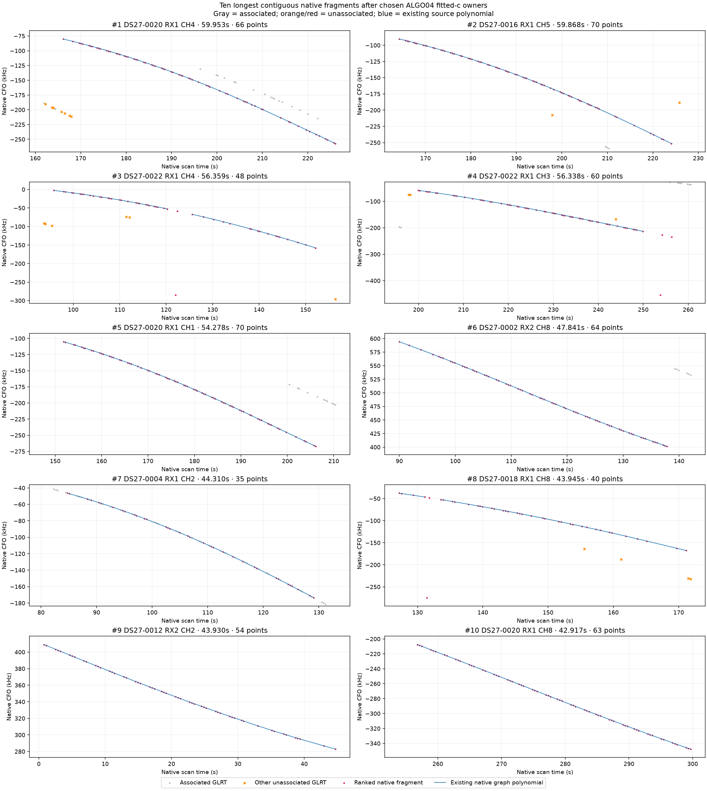
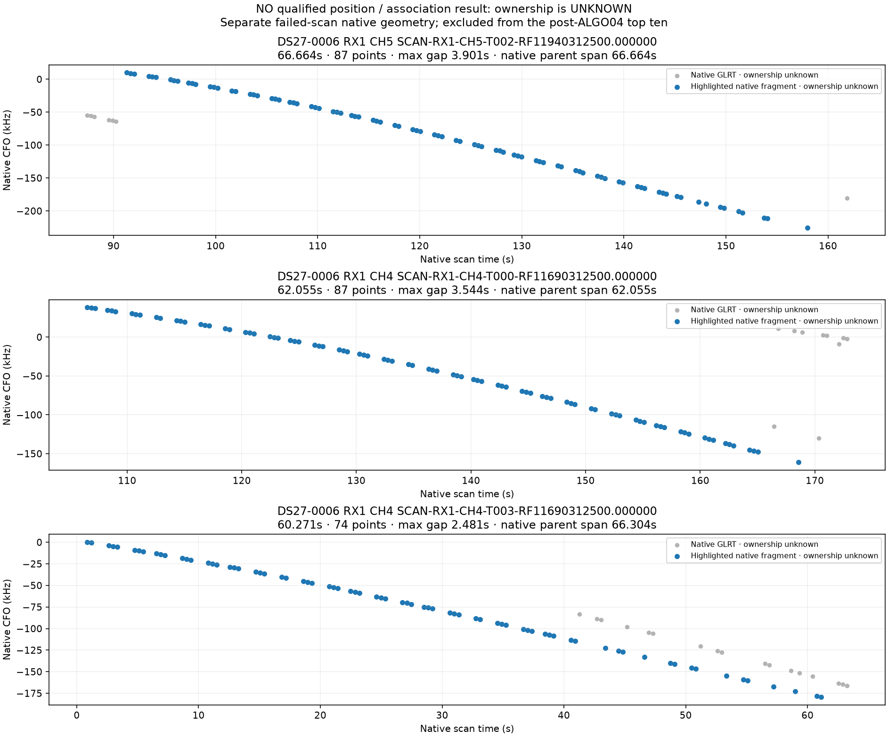

# DS27 retained native GLRT fragment audit

The primary top ten covers **13 qualified scans out of 15 evaluated slots**.
DS27-0001 and DS27-0006 have no qualified association result and are excluded
explicitly. Rankings subtract the exact chosen ALGO04 fitted-c published owners,
including truthful ALGO03/ALGO02 fallback. The two calibration arms have identical
published observation-owner maps in all 13 qualified scans.

The qualified scans contain 56,175 original GLRT observations: 43,923 published
associated observations and 12,252 remaining observations. Of the latter, 5,856
belong to retained graph sources and 6,396 are untracked by that existing graph.
The graph contains 1,671 canonical native sources; no duplicate source aliases
were encountered. Subtraction, native polynomial boundaries and gaps greater
than five seconds yield 410 residual fragments, including 43 singletons.
These come from 330 residual parents; 27 parents are partly claimed and retain
that distinction throughout the full inventory.
Untracked points remain separate evidence; this is not an exhaustive search for
all possible curves.

| Rank | Scan | Native source | Points | Duration (s) | Max gap (s) | Retained evidence / reason not published |
|---:|---|---|---:|---:|---:|---|
| 1 | DS27-0020 | RX1 CH4 T005 | 66 | 59.953 | 3.898 | Hypothesis 61549 supported in six votes; inclusion fails quadratic and step screens |
| 2 | DS27-0016 | RX1 CH5 T000 | 70 | 59.868 | 3.901 | Hypothesis 63899 supported in six votes; inclusion fails slope, quadratic, step and lag-1 screens |
| 3 | DS27-0022 | RX1 CH4 T001 | 48 | 56.359 | 4.256 | Ambiguous annotation; top hypothesis 59737, minimum margin 9.517 |
| 4 | DS27-0022 | RX1 CH3 T000 | 60 | 56.338 | 3.897 | Hypothesis 57914 supported in six votes; inclusion fails slope, quadratic, step and lag-1 screens |
| 5 | DS27-0020 | RX1 CH1 T004 | 70 | 54.278 | 2.128 | Unstable annotation: fold winners 67344 / 50173; alternate fold has boundary mass approximately one |
| 6 | DS27-0002 | RX2 CH8 T001 | 64 | 47.841 | 2.129 | Exact source IDs suppressed from recovery inventory by unpublished postfit membership; no retained nomination or proven owner |
| 7 | DS27-0004 | RX1 CH2 T002 | 35 | 44.310 | 3.545 | Hypothesis 67186 supported in six votes; inclusion fails lag-1 only, normalized slack −0.02003 |
| 8 | DS27-0018 | RX1 CH8 T002 | 40 | 43.945 | 4.606 | Original ALGO03 annotation ambiguous, top hypothesis 58121, minimum margin 4.073; chosen ALGO04 fallback has no separate retained recovery decision |
| 9 | DS27-0012 | RX2 CH2 T002 | 54 | 43.930 | 3.542 | Unstable annotation: fold winners 57999 / 63782 |
| 10 | DS27-0020 | RX1 CH8 T008 | 63 | 42.917 | 1.421 | Unstable annotation: fold winners 55430 / 51969 |

All NORADs above are conditional hypotheses, not confirmed identities. All ten
parents are wholly unpublished in the chosen result, although several ranked
fragments cover only part of their native parent because of gaps. Original and
numerical replay evidence agree where both retain an annotation. No fit or
identity change was introduced by this audit.

The four inclusion rejections have positive control replay slacks and negative
target structure slacks in both calibration arms. Their saved nomination folds
converge in phase (maximum final change below 0.000028 seconds), have minimum
target elevations above 41 degrees and zero target-phase boundary mass. Thus
these retained rejections provide evidence of residual structure, rather than
a demonstrated phase-window failure. Rank 7 is close to its existing lag-1
threshold; that observation does not justify changing the gate after selection.
Per-fold scores, source memberships and exact replay slack ranges are retained
in [the compact annotation audit](top10-annotation-audit/annotation-audit.json).

Shared-family residual figures distinguish raw CFO-minus-prediction from the
stored bias-removed residual. For example rank 1 fitted-c has profiled RMS
102.478 Hz, profile bias −280.731 Hz and raw RMS 299.848 Hz. The profiled RMS
must not be described as raw RMS or independent position accuracy. All plotted
held residuals were matched to exact native IDs, recorded whole-group blocks
and native order; no residual array was accepted by length alone.

The rank-6 omission is a separate implementation finding. In both retained
ALGO03 and ALGO04 inventories, proposed associated membership is 3,910 IDs,
whereas actual published support is 3,846 IDs. The exact difference is all 64
RX2 CH8 T001 IDs and equals `publication_support.unreported_postfit_ids`.
There is no target row or annotation for these IDs. The saved evidence proves
an inventory/publication mismatch, not a budget rejection or weak-curvature
rejection. The unpublished owner is unknown: NORAD 69482 belongs to another
RX1 source and is not evidence for this RX2 fragment. A defensible next fix is
to construct recovery inventory from actual published owners and rerun the
same bounded competition, preserving the original result as its control.

The [secondary parent ranking](residual-ranking/parent-top10.csv) uses remaining
first-to-last native-parent span. Its first two rows are DS27-0022 RX1 CH3 T000
(72.637 s, maximum gap 7.440 s; longest contiguous fragment 56.338 s) and
DS27-0014 RX1 CH8 T002 (70.163 s, maximum gap 9.925 s; longest contiguous
fragment 12.052 s). The second parent does not appear in the primary top ten.
Parent span and contiguous duration therefore answer distinct questions. Full
2/5/10-second gap sensitivities and all exact source IDs/aliases are retained.
The ten primary parents each have one native polynomial piece; their shorter
fragments arise from gaps, rather than a new polynomial join invented here.
Native alias lifts change at ranks 3, 4 and 8; all are exact integer multiples
of the native period, and plots break polynomial lines at wraps.

Both parent-top-ten sources absent the primary top ten have a separate
[exact-ID annotation audit and explicitly gapped native figures](parent-extra-audit/annotation/annotation-audit.json).
DS27-0014 RX1 CH8 T002 has a supported 61641 hypothesis (minimum margin 40.862)
but fails slope, quadratic, step and lag-1 inclusion screens. DS27-0018 RX1 CH2
T000 spans 48.552 seconds / 41 points with a 5.668-second maximum gap and a
22.678-second longest contiguous fragment. Its supported 58121 hypothesis
(minimum margin 16.228) fails the lag-1 screen in both the grid and continuous
phase replays: autocorrelation 0.721200 / 0.720877, respectively, with both
`compatible` values false. The refined phase is 0.108741 seconds; the continuous
profiled RMS is 108.685 Hz. These are additional parent-view rejections, rather
than additions to the primary contiguous ranking. Native polynomial lines and
residual lines are broken at the retained gaps. Whole-group held residuals and
portable plot inputs accompany both parent views.

The complete context figures also retain visibly clustered untracked winners,
for example DS27-0002 RX2 CH4 around 55–120 seconds. This is descriptive visual
evidence, not a new assigned curve or satellite nomination. The extra parent
figures similarly show all nearby unpublished points without silently appending
them to the exact native source IDs used in either ranking.

DS27-0006 is presented separately in
[the failed-scan native inventory](failed-native-ranking/failed-scan-native-inventory.json).
Its native data were bound by a supplementary hashed index because the sealed
main index did not include their paths; the main index was not changed.
Ownership remains **unknown**. Under the same five-second continuity rule its
longest native fragments are RX1 CH5 T002 (66.664 s / 87 points), RX1 CH4 T000
(62.055 s / 87 points) and RX1 CH4 T003 (60.271 s / 74 points). The longer
86.146-second CH5 T000 and 71.623-second RX2 CH6 T001 parent spans contain
7.797- and 9.933-second gaps; their longest contiguous pieces are 32.616 and
32.264 seconds. None is labeled post-ALGO04 unassociated.

Reproduction uses the study-local ranking and annotation scripts, exact hashed
inputs and deterministic gzip packets. Both main packets are free of local
`/srv` and `/mnt` paths and contain no orbital/truth arrays. All 25 native and
25 annotation diagnostic PNGs reproduced byte for byte from their packets;
the failed-scan figure is also retained with its standalone packet. The extra
parent native and held figures also reproduce from their standalone packet.
Twenty-one component tests pass (19 primary/audit plus two parent-view tests).
No GPS, TLE, IQ, new fit, RF collection or production
mutation was used for ranking or this retained-evidence audit.
