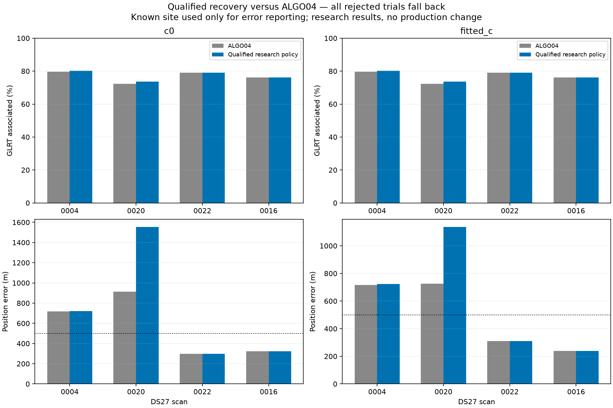
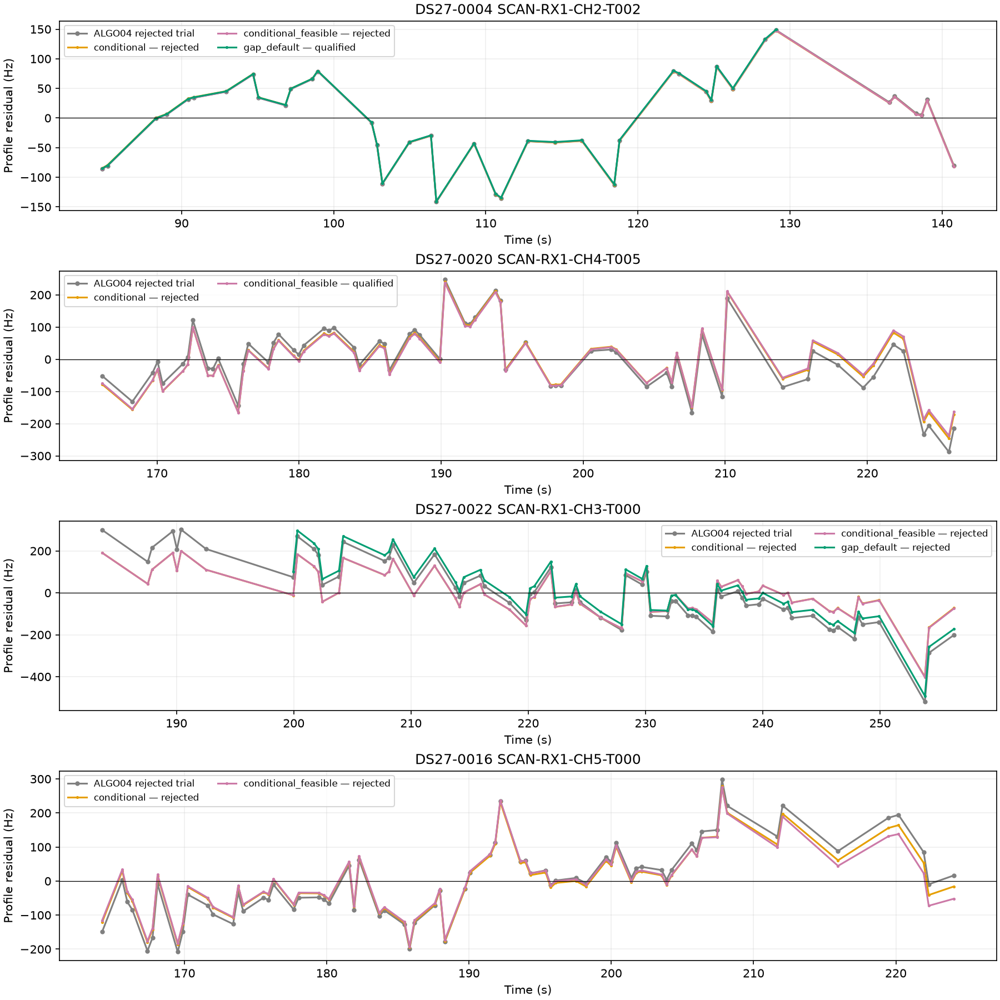
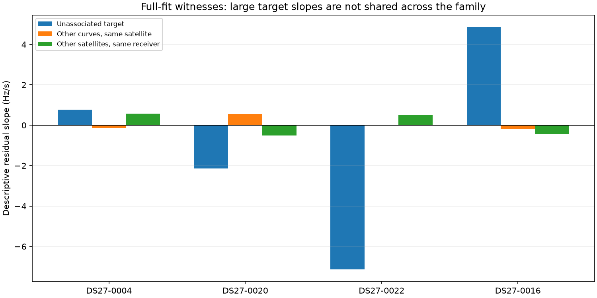

# DS27 confident-track recovery: more coverage, no localization improvement

We tested the four strongest satellite nominations from the [DS27 residual investigation](../2026_10_31_ds27_algo04_review/README.md). Two sources have research fits that pass the existing RF and exact-orbit checks: a **35-point fragment of DS27-0004 RX1 CH2 T002**, and **66-point DS27-0020 RX1 CH4 T005**. Both preserve published ALGO04 owners in both c arms.

Using those results raises association from **43,923 to 44,024 / 56,175 points: 78.190% to 78.369%**. It does **not** improve localization. Mean fitted-c error rises from **619.4 to 651.3 m**, driven by scan 0020. Production remains ALGO04; the combined research policy is not recommended for promotion.

## Results against published ALGO04

| Scan / target | Research outcome | Associated GLRT before → after | Fitted-c error before → after | c = 0 error before → after |
|---|---|---:|---:|---:|
| 0004 RX1 CH2 T002, hypothesis 67186 | Recover 35-point gap fragment; six-point remainder stays unassociated | 79.593% → **80.284%** | 717.4 → **722.3 m** | 716.3 → **721.1 m** |
| 0020 RX1 CH4 T005, hypothesis 61549 | Conditional satellite update with constrained position; 66 points | 72.205% → **73.652%** | 725.4 → **1,135.8 m** | 912.8 → **1,553.1 m** |
| 0022 RX1 CH3 T000, hypothesis 57914 | Reject tested fits; retain ALGO04 | 79.142% → 79.142% | 310.2 → 310.2 m | 296.6 → 296.6 m |
| 0016 RX1 CH5 T000, hypothesis 63899 | Reject tested fits; retain ALGO04 | 76.248% → 76.248% | 239.0 → 239.0 m | 324.7 → 324.7 m |

| Aggregate over 13 usable DS27 fast scans | ALGO04 | Research recovery policy |
|---|---:|---:|
| Unique associated points, either c arm | 43,923 | 44,024 |
| Associated percentage | 78.190% | 78.369% |
| Mean error, c = 0 | 637.6 m | 687.3 m |
| Mean error, fitted c | 619.4 m | 651.3 m |
| Median error, c = 0 | 643.4 m | 643.4 m |
| Median error, fitted c | 640.9 m | 640.9 m |
| Within 500 m, either arm | 4 / 13 | 4 / 13 |

Only these four selected difficult cases were investigated. The other nine usable scans retain their sealed ALGO04 results in the aggregate; this is **not a fresh full-cohort algorithm rerun**. The original two unavailable fast scans remain unavailable. [All trials](all-trials.csv) include rejected fits; [accepted-policy.csv](accepted-policy.csv) applies fallback. Rejected proposed points never count as recovered coverage.

## Experiments and controls

We completed **16 paired inclusion trials**, each with a matched no-addition control and both c arms, plus fresh three-partition identity tests on the two eligible gap fragments.

| Variant | Scope | Gate-qualified paired trials |
|---|---:|---:|
| Marginal shared-satellite update | Four full parents | 0 / 4 |
| Conditional satellite/fragment update | Four full parents | 0 / 4 |
| Conditional update with constrained position optimization | Four full parents | 1 / 4 |
| Time-gap fragments, original predictive model | Two eligible fragments | 1 / 2 |
| Time-gap fragments, conditional satellite update | Same two fragments | 1 / 2 |

The last two passing trials recover the same 35 points, not additional coverage. Marginal updating exposes satellite posterior means while keeping the marginal predictive objective. Conditional updating fits existing satellite and fragment-bias coordinates while holding receiver coefficients fixed at a given position. These methods change predictive uncertainty and are not equivalent optimizers of one score.

We used installed ALGO04 release `f9e262f96b6e2e75b397f69d50a0ea9104e293ef`: five phase rounds, 48 position iterations, centered derivatives for ordinary bounded L-BFGS-B and bank-checked ±30 s numerical references. Physical phase limits, causal catalogue, aliases, priors and RF thresholds were retained.

Ordinary trials start at the original regional origin in the 25 × 25 km box centered at **37.906, −122.545**. The constrained variant is a downstream continuation from the RF-derived incumbent, using SLSQP and the existing gate inequalities with a nominal 1e-6 interior. It uses five 48-iteration rounds and a 360-second wall cap; its objective-call budget is not claimed equivalent to L-BFGS-B. Both c arms share settings within each variant. At most four trial workers ran concurrently, with one numerical-library thread each.

Search did not use evaluation GPS, future TLEs or a hand-selected satellite whitelist. Parent candidates were chosen by retained identity evidence, not position error. Gap fragments perform fresh causal nomination and three distinct randomized whole-block partitions (12-second blocks, 2-second guards). Satellite identities remain conditional hypotheses, not external truth. No IQ collection or production change occurred.

## 0004: a passing fragment, not a covariance correction

The 41-point parent has a **7.447-second gap** after 129.083 s. Applying the **five-second continuity rule already declared in the previous report** yields 35 points at 84.774–129.083 s and six points at 136.530–140.785 s. All eligible components were tested; six points fail the predeclared 12-point minimum. Selection uses timing alone, not frequency residuals or geographic accuracy.

The 35-point component independently nominates 67186 in all six arm/partition comparisons, with minimum competitor margin **309.6**. Inclusion and exact replay pass without a satellite refresh or new nuisance parameter. All 4,033 published IDs and satellite owners remain.

The residual waveform barely changes. Adjacent correlation remains approximately 0.65, while the inherited threshold rises from `4/sqrt(41) = 0.625` to `4/sqrt(35) = 0.676`. This is **not evidence that correlation was corrected**. It establishes a passing fragment under the inherited rule; covariance validation or independent CFO refinement remains desirable.

The conditional fragment fit gives an apparently better **713.3 m** than published ALGO04's 717.4 m, but its matched conditional no-addition control is already **708.7 m**. Adding the fragment worsens that control by **4.6 m**. The original-model fragment worsens its matched control by **4.9 m**. We select the simpler original-model recovery, not the smallest evaluated error.

## 0020: passing the gates can move position the wrong way

The conditional update reduces fitted-c target RMS from the retained trial's approximately **102.5 Hz** to **96.4 Hz**, but the step gate still fails. Constrained optimization obtains **94.7 Hz** RMS, passing all gates and preserving old owners, while worsening geographic error from 725.4 to 1,135.8 m. Relative to its matched conditional control, error increases from **767.9 to 1,135.8 m**.

The smallest exact gate slack is **2.17e-7** for fitted-c and **1.00e-6** for c = 0. This is a boundary solution, not a robust margin. It demonstrates that forcing residual compatibility through position can hurt localization; it does not establish that the gate or satellite identity is wrong.

Plots show full native parents except explicitly labeled gap fragments. No residual outliers were deleted. Passing refers to paired acceptance and exact replay, not RMS alone.

## 0016 and 0022: their discrepancies do not follow the whole satellite

All four families already have the causal **three-mode orbital correction** (mean motion, inclination and RAAN perturbations) plus phase. [Physical support](evidence/physical-support.json) records prior scales from pre-scan TLE differences and active witness tracks. Missing orbital coordinates are not the immediate explanation.

At each unchanged control fit, we compared target residual slopes with overlapping active curves. Targets remain excluded from control position and calibration. Witnesses need four points and at least half the target span; each other satellite receives one descriptive vote.

| Scan | Target slope, Hz/s | Same satellite, other overlapping curves | Other satellites, same receiver |
|---|---:|---:|---:|
| 0004 | +0.770 | −0.132, three curves | +0.565, one curve |
| 0020 | −2.135 | +0.545, two curves | −0.509, one curve |
| 0022 | **−7.133** | **−0.012**, two curves | +0.523, one curve |
| 0016 | **+4.857** | **−0.188**, three curves | −0.456, two curves |

These are descriptive full-fit comparisons with limited witness counts, not independent probability estimates. They do not support applying the target's large rate error to every receiver or satellite track.

For **0022**, conditional updating lowers target RMS from about 156.0 to 104.3 Hz but makes established 55-point RX1 CH8 T000 fail. The 60-point gap fragment retains a slope discrepancy and the same ownership failure. Some rejected fits happen to have excellent geographic errors (about 92 m fitted-c for the conditional fragment), but remain rejected: truth cannot override inconsistent RF evidence.

For **0016**, slope, quadratic, step and lag-1 failures persist. Its published ALGO04 result also includes a separate 21-point new-family recovery. The existing shared-family trial tool operates on the upstream context and does not jointly include that factor. Qualification checks against **published ALGO04**, rejects omission of those 21 owners and retains the 239 m result. A full mixed new-family/shared-family refit has **not** been demonstrated here; these failed upstream screens are not a complete test of that joint model.

## Recommendation

Keep ALGO04 as the localization default. Preserve the gap-fragment result as a coverage candidate and 0020 as a diagnostic counterexample; neither establishes improved localization.

Next distinguish a **source-specific measurement or transmitter discrepancy** from an incorrect nearby satellite identity. For 0016 and 0022, inspect native-window CFO and timing against simultaneous same-family curves, then test competitors jointly. An extra source-rate or colored-noise term needs a justified prior and independent predictive validation, rather than a free parameter that erases the slope. For 0004, validate measurement covariance or refine CFO instead of relying on shorter-fragment thresholds. For 0020, require stability across independent groups and useful information after nuisance marginalization; do not make position absorb the last gate violation.

Unique-looking identity, residual compatibility and geographic information are separate requirements. Increasing associated-point counts did not improve accuracy here.

## Evidence and reproduction

The [RF decisions](evidence/rf-decisions.json) were hashed in an [inference seal](evidence/inference-seal.json) before the reporting process introduced evaluation coordinates **37.849061591561885, −122.48574968092912**. Qualification requires both c arms, exact replay, native-ID membership, stable owners and preservation of every published ALGO04 owner. Proposed point lists can retain IDs whose owners fail replay, so those lists are checked against actual owner maps.

These are research fits, not production v3 terminals or a release qualification. Installed runtime, source data and historical outputs were not modified. The research adapters and qualification logic have **13 passing tests** covering gap selection, owner preservation, matched arms and missing proof rejection.

Scripts/tests are in [reproduction](reproduction/). Trial outputs, controls, exact replay slacks, grouped identity evidence, numerical receipts and bounded execution logs are under [evidence](evidence/); large JSON files are losslessly compressed. [All trials](all-trials.csv), [failed gates](failed-gates.csv) and [summary](summary.json) provide compact tables. The [artifact map](artifact-map.json) binds published files to local study sources. Full reruns require sealed DS27 inputs and the installed release; IQ and orbit-bank arrays are not duplicated.

Local study: `/srv/bulk/leo/research/ds27-confident-recovery-20261031`. Tests: `.venv/bin/python -m pytest -q -p no:cacheprovider /srv/bulk/leo/research/ds27-confident-recovery-20261031/test_*.py`.
