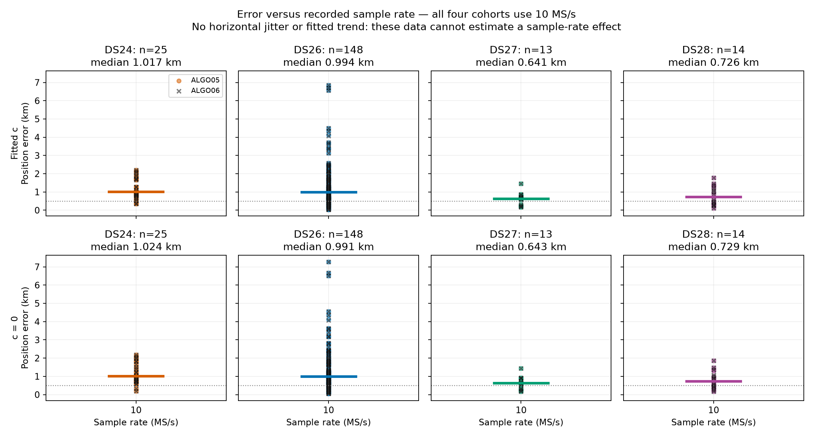

# ALGO06 production promotion

The approved policy is 72-hour causal new-family recovery with ±30-second phase bounds and no recency penalty. See [the algorithm specification and paired cohort results](../ALGO06/README.md).

ALGO06 is deployed and selected as the production default. The deployment uses a separate v5 persisted namespace and preserves ALGO05 as the upstream incumbent and exact fallback. All previous scientific manifests remain pinned.

The numerical release is `cf16ac5bd6a8f1ac65f626eba57326f2a2d2e6b5`; the API/application release is `292980924a4501cd3e5cf6e9f384b090bce3fd82`. Both were pushed to remote main. The API release adds direct lookup of completed, validated ALGO06 terminals and the ALGO06 UI label; it does not change the sealed scientific implementation. The first API smoke request exposed an expensive historical-input enumeration and timed out after 30 seconds. The direct lookup fixes that completed-result path while preserving the existing fallback for unavailable results.

Qualification passed 60 Python tests (57 contract/storage/cache/screen/worker tests and three direct-lookup tests) and eight web tests. Nine central scientific functions have AST parity with the evaluated research implementation. The fresh replay under the installed production service account reproduced the qualified DS28-0015 candidate exactly, including both c arms. Its recovery took 367.6 seconds. See [installed replay receipt](installed-canary-receipt.json), [scientific parity](scientific-port-parity.json), [research replay parity](canary-parity.json), [Python tests](tests.txt), and [web tests](web-tests.txt).

The final live API request returned HTTP 200 in 2.83 seconds, selected `algo06-causal-residual-family-v1`, reported `ALGO06_additive` with no fallback, and returned the verified candidate position. The frontend returned HTTP 200 and contains the ALGO06 label. The API, ALGO06 worker, upstream ALGO05 worker, and acquisition timer were active. Exact results are in the [activation receipt](activation-receipt.json). This is deployment qualification of the existing paired cohort analysis, not a new full-cohort rerun.

The capture timer's post-recording gap is now 7 minutes 30 seconds rather than 20 minutes. Five-minute recordings and fast/adaptive alternation are unchanged, doubling the nominal acquisition cadence from 25 to 12.5 minutes and nominal fast-scan cadence from approximately 50 to 25 minutes. Existing backlog protection remains active, so actual intervals can be longer. After activation, a fast capture ran from 07:24:15 to 07:29:21 PST on November 1, 2026; the next scheduled trigger was 07:36:52 PST. Configuration is recorded in [before](cadence-before.txt) and [after](cadence-after.txt) snapshots.

All 224 acquisitions in the compared DS24/26/27/28 cohorts used 10 MS/s; 200 have position outcomes. The plot therefore compares error distributions at one sample rate and cannot establish a sample-rate effect. Colored circles and median lines represent ALGO05; black crosses represent ALGO06. Missing outcomes are excluded, not assigned zero error.

No historical result or recording was rewritten. The worker uses a completion cutoff to avoid automatic historical backfill. Rollback instructions are in the [algorithm report](../ALGO06/README.md#deployment-and-rollback).
