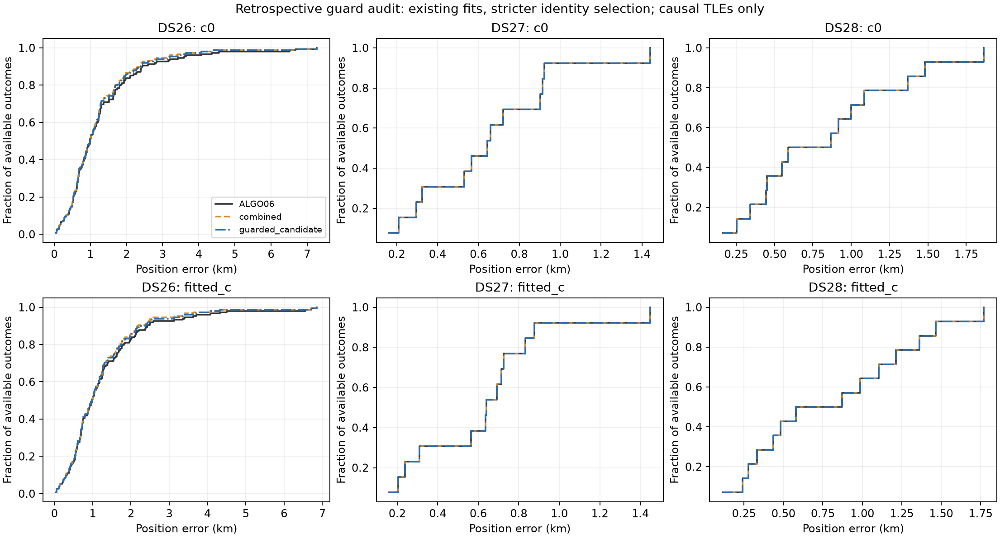

# ALGO07 production qualification

The user authorized promotion of the frozen guarded reassociation candidate. The [ALGO07 specification](../ALGO07/README.md) records its exact algorithm, paired dataset evidence and limitations.

**ALGO07 is deployed and selected as the production default.** The new implementation uses schema 6 and preserves every earlier contract. Qualification passed **174 Python tests**: 115 contract/storage/application/API/CLI/deployment checks and 59 scientific-parity/runner/worker checks. Ten web tests and the production web build passed. The installed numerical release pins 2,076 scientific source/test members across ALGO03–07. Source and both immutable releases are revision `7cafccaced18e6b0fa9266bd18339d61f0f9c1f4`, pushed to remote main.

Historical accepted DS26 cases are saved research outcomes and have no matching completed public ALGO05/06 job. Their numerical acceptance check is therefore explicitly a research canary. The separate real production canary exercises public export, read confinement, baseline replay and exact fallback; it must not be described as an accepted live reassociation.

## Accepted research replay

The clean DS26-0066 replay completed in 45.46 s and accepted **62025 → 68047**. Its c=0 and fitted-c endpoints, objectives, phase references, native-ID hashes and owner hashes match the frozen study exactly. The ten-fold receiver guard's minimum competitor margin is 47.2565. Penalized RF gains are 55.537 and 56.992 respectively; these are score gains, distinct from geographic accuracy.

The production contract's physical/guard/mapping checks also pass on that real proof. All 2,770 baseline IDs remain, with precisely 170 changing owner across five curved tracks. The nominal replacement TLE is 52.087 hours old and its snapshot was collected 0.463 hours before cutoff. Both c arms use the same evidence and candidate set.

The first integration attempt exposed a missing `ARMS` import in the extracted remapping module. It failed before producing a winner; the import was fixed, a new remapping test was added, and the clean attempt reran all screening and fitting from empty numerical output. The failed attempt is retained in the [canary outcome](research-canary/canary-outcome.json); see the [exact parity summary](research-canary/attempt2-summary.json) and [replay harness](research-canary/run_research_canary.py). This failure and fix changed no scientific threshold or search budget.

## Production qualification

The API and numerical releases were staged independently from the exact committed revision. The installed API imports successfully. The public-job replay runs as `leo`, the production service account, using the same bounded application/CLI/worker path that will run automatically. Its source is the qualified ALGO06 job for `fast-bf74eee31e8b48a5fd9ec95f63e78ab6`, which contains an accepted ALGO06 addition. This checks composition of an actual additive incumbent, not just a baseline-only fixture.

Both installed production canaries completed normally with verified read audits and no failure:

| Canary | Recovery runtime | Result | Preserved native points per c arm |
|---|---:|---|---:|
| Fresh FRSH-0001, `fast-fbd77837c84f46b2cb1753be50970fc7` | 132.35 s | Exact ALGO06 fallback | 3,453 |
| Additive incumbent, `fast-bf74eee31e8b48a5fd9ec95f63e78ab6` | 753.13 s | Exact ALGO06 fallback | 1,776 |

The fresh installed replay exactly matches frozen research coordinates, objectives, trigger families, common nominees and proposals. The slower case completed within the 1,200 s cap. A nonblocking profiler snapshot identifies repeated two-family phase integration during omission fitting as its bottleneck. This runtime limit remains; promotion does not substitute a faster approximation or claim that these two cases estimate average production latency. See [fresh receipt](installed-fresh-canary-receipt.json), [fresh parity](fresh-canary-parity.json), [additive-incumbent receipt](installed-additive-canary-receipt.json), and [profile](slow-canary-profile.txt).

## Live activation

Activation completed on **November 2, 2026 at 00:19:49 UTC**. The API uses `leo.api.production_v6_lookup` and `LEO_GRAPH_POSITION_MODEL=algo07-causal-guarded-reassociation-v1`. `leo-algo07-graph-position.service` is enabled and active, with zero restarts at verification. The ALGO06 upstream worker remains active. The explicit ALGO06-completion cutoff is `1793578788796018566` ns, so activation does not launch historical backfill beyond the two explicit canaries.

Both live graph endpoints returned HTTP 200 with the ALGO07 model and exact validated fallback positions. The concurrent smoke requests took 11.10 and 10.86 s. The frontend returned HTTP 200 and its served JavaScript contains the ALGO07 label. The API, ALGO07 worker, ALGO06 worker and acquisition timer were all active. Acquisition cadence and RF settings were not changed. See [activation receipt](activation-receipt.json), [live API/UI checks](live-smoke.json), and [activation script](activate.py).

The first invocation of the activation helper used system Python, which lacked NumPy and stopped before changing service configuration. Re-running it with the pinned numerical-release interpreter completed activation. This was an operational invocation correction, not a scientific or release-source change.

Rollback is limited to stopping/disabling the ALGO07 worker and removing the ALGO07 API override named in the activation receipt, then reloading systemd and restarting the API. The earlier ALGO06 configuration and every result namespace remain available.

Full cohort denominators and the distinction between retrospective and newly executed results are in the [ALGO07 specification](../ALGO07/README.md#paired-evidence). No new dataset-level improvement is inferred from deployment checks.
