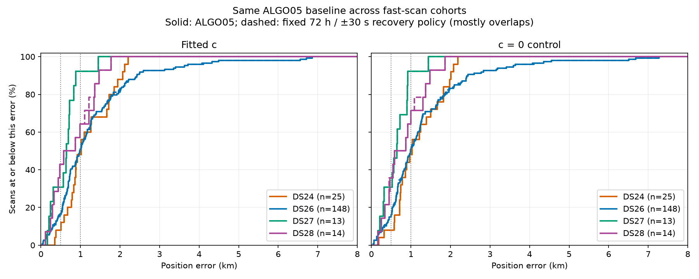
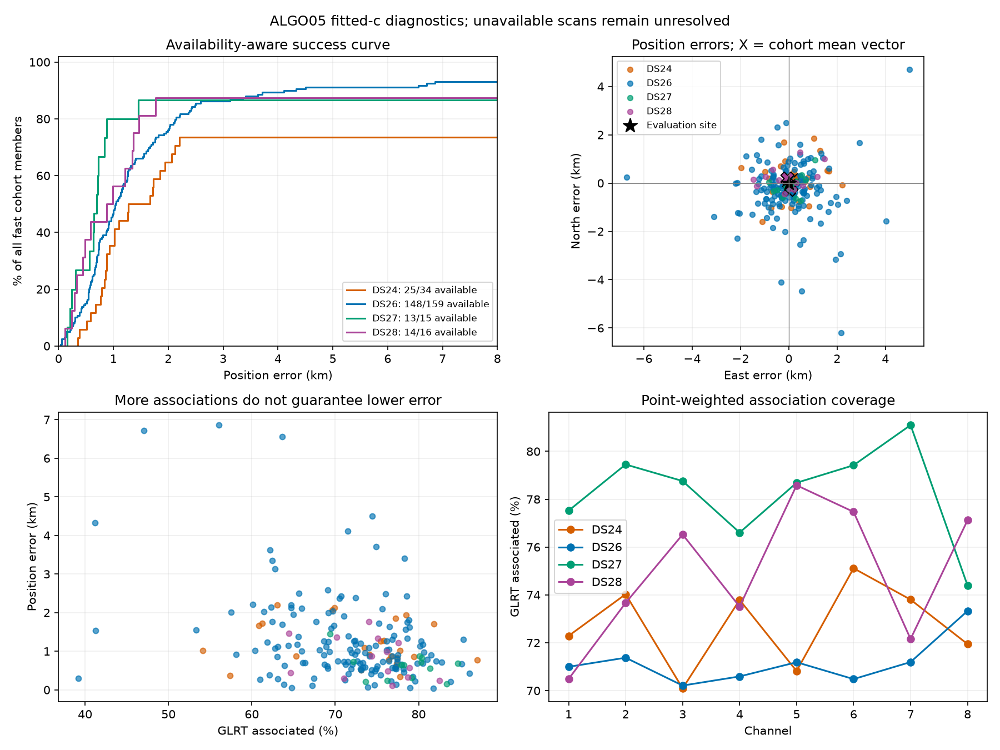
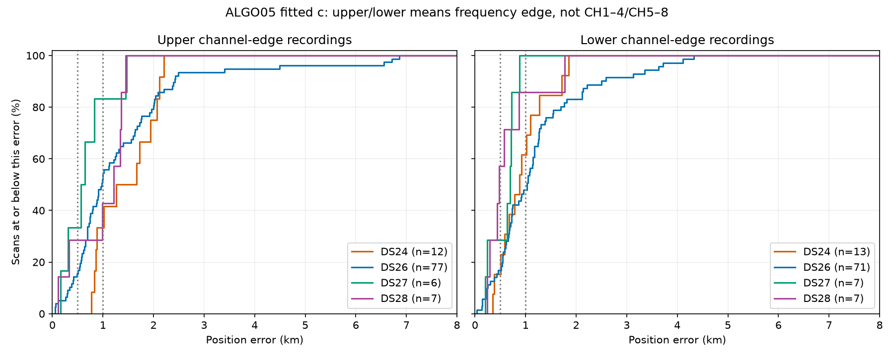
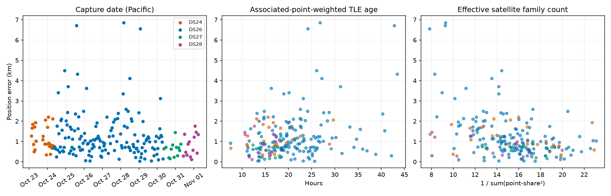
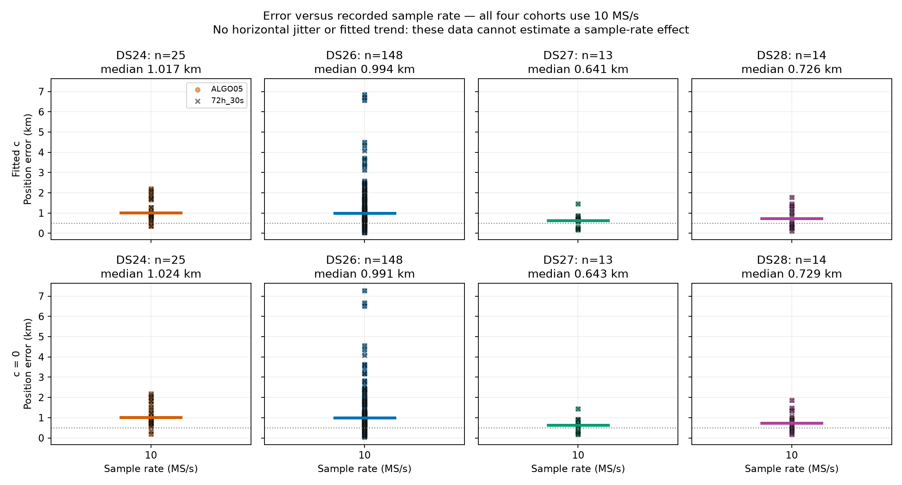

# DS24 and later fast-scan cumulative error comparison

DS24 and DS26 have almost identical median position error. DS24 has fewer very accurate results, but DS26 has a substantially worse tail. DS27 and DS28 have better observed distributions on much smaller, later cohorts. The current aggregate evidence does not identify a single physical cause for the difference.

This is a read-only reanalysis of 200 frozen position outcomes across 224 fast acquisitions. No inference, association, prior, or production settings were changed. Evaluation coordinates are used for error reporting only. DS25 is adaptive-only; the study named `ds25_fast_causal_variants` contains the 34 DS24 fast comparison recordings. DS28 here means revision 2; revision 1 is a subset and is not counted separately.

## How to read the curves

At error x, the empirical cumulative distribution is the percentage of available estimates whose error is at most x. Higher/leftward is better. The 50% crossing is the median; the 90% crossing is the 90th percentile. This is an observed frequency distribution, not a posterior probability or a confidence interval for a particular location.

Solid curves use the saved ALGO05 baseline for every dataset. Dashed curves apply the same fixed 72-hour / ±30-second conditional recovery policy. The c=0 arm is shown separately. Both arms use the matched observations, candidate policy and search budgets of their originating experiments; these are saved baseline-plus-recovery studies, not new uniform cold-start raw-IQ reruns. Inherited upstream inference lineage and unavailable results remain limitations.

| Dataset | Available / fast members | Mean error | Median | P90 | Maximum | Within 500 m | GLRT associated |
|---|---:|---:|---:|---:|---:|---:|---:|
| DS24 | 25 / 34 | 1.175 km | 1.017 km | 2.013 km | 2.205 km | 2/25 (8.0%) | 72.73% |
| DS26 | 148 / 159 | 1.301 km | 0.994 km | 2.424 km | 6.858 km | 24/148 (16.2%) | 71.11% |
| DS27 | 13 / 15 | 0.619 km | 0.641 km | 0.869 km | 1.449 km | 4/13 (30.8%) | 78.25% |
| DS28 r2 | 14 / 16 | 0.821 km | 0.726 km | 1.434 km | 1.770 km | 6/14 (42.9%) | 74.85% |

All figures above are ALGO05 fitted c. Association percentages use summed point counts; position statistics weight each scan equally. Threshold counts are exact; percentiles use NumPy linear interpolation. No GPS-based choice of the best method per scan is made.

DS24 and DS26 cross: neither distribution dominates the other. The median difference is only 23 m. DS24 is concentrated more heavily in the middle; DS26 includes both more sub-500 m results and worse failures. The maximum alone is especially sensitive to the much larger DS26 sample.

Each DS24 scan moves its curve by 4 percentage points, versus 0.68 for DS26, 7.69 for DS27 and 7.14 for DS28. The later curves therefore have large steps and limited evidence about rare failures. Adjacent recordings can share conditions, so these are not assumed to be independent draws for formal significance claims.

The usable DS24 recordings span October 23 02:54 to October 24 07:31 PDT; DS26 October 24–30; DS27 October 30–31; DS28 October 31–November 1. These are different observation periods at the same user-confirmed evaluation site, not repeated algorithm trials on identical sky conditions.

## Checks that narrow down the explanation

### Acquisition settings do not explain the cohort difference

The first segment configuration of every one of the 224 fast acquisitions was read. All datasets contain exactly the same two configuration hashes, corresponding to upper/lower channel edges. Settings include 10 MS/s, 20 ms windows, 40 dB gain, −38 dBFS threshold, two receivers, all eight channels, and identical RF/IF/LO mappings for each edge. Complete configuration values and counts are in [capture-audit.json](capture-audit.json).

This rules out a recorded configuration change between these cohorts as the explanation. It does not prove sample rate is sufficient in absolute terms, inspect every segment, measure receiver orientation, or establish identical actual hardware/thermal conditions. Native observation spans are approximately 300 seconds in all four cohorts.

### Neither fitted c nor the recent recovery variants cause the large separation

| Dataset | Mean error, c=0 | Mean error, fitted c | Mean change from 72 h / ±30 s recovery, fitted c |
|---|---:|---:|---:|
| DS24 | 1,162 m | 1,175 m | +0.28 m |
| DS26 | 1,318 m | 1,301 m | −5.53 m |
| DS27 | 638 m | 619 m | 0 m |
| DS28 | 830 m | 821 m | −18.19 m |

The main separation already exists in the baseline, and remains with c fixed to zero. It cannot be explained by the latest recovery changes. In DS24, 48 h / ±15 s changes no outcome; the broader policies add 62 points to one scan and worsen its error by 7.12 m. A better frequency fit or increased association is not assumed to imply a better position. Frequency-objective values are preserved where available in the source CSVs, but cross-scan raw objective totals are not comparable performance scores because point counts differ.

### DS24 has no exceptional TLE-age burden or single failed channel

Median per-scan associated-point-weighted TLE ages are 17.0 h (DS24), 20.6 h (DS26), 15.9 h (DS27), and 14.8 h (DS28). Within DS24, rank correlation between this age and error is only +0.15. Age alone is not a supported explanation; this does not test orbital-element error or maneuver-specific effects.

DS24 channel-level association coverage ranges from 70.1% to 75.1%, including CH8 at 71.9%. There is no isolated CH7/CH8 coverage collapse in these current results. Median native point counts are 4,492, 4,385, 4,273, and 3,863.5 respectively, so DS24 is not simply short of detected points.

### A frequency-edge difference is a useful lead

“Upper/lower” here means which frequency edge is sampled within each channel, not CH1–4 versus CH5–8. Every included recording has all eight channels.

| Dataset | Upper-edge scans | Upper mean error | Lower-edge scans | Lower mean error |
|---|---:|---:|---:|---:|
| DS24 | 12 | 1.445 km | 13 | 0.926 km |
| DS26 | 77 | 1.383 km | 71 | 1.212 km |
| DS27 | 6 | 0.660 km | 7 | 0.584 km |
| DS28 | 7 | 0.974 km | 7 | 0.668 km |

Upper-edge mean error is higher in every cohort. DS24's 519 m difference is substantial descriptively, but these are different acquisitions at different times, with different satellites. Cohort membership is already almost evenly split between the two edges, so a simple imbalance in upper/lower counts does not explain the cross-cohort result. This is evidence to investigate an edge-dependent model or evidence-quality problem, not proof of a wavelength correction or permission to tune one using GPS errors. DS26's upper/lower medians even reverse the mean ordering, illustrating the role of outliers.

### Satellite support matters more than a raw point target, but is not the whole explanation

The rank correlation between error and effective satellite family count is −0.37, −0.41, −0.53 and −0.59 across DS24/26/27/28. Effective count is `1 / sum(point_share²)`; it measures how broadly points are distributed among families, not sky geometry or independence. Error versus association percentage correlations are weaker in each cohort: −0.22, −0.28, −0.16 and −0.48.

This is consistent with diverse satellite evidence helping more than accumulating points on a few families. However, DS24's median effective family count (16.0) exceeds DS28's (14.1), despite worse accuracy. Family count alone therefore does not explain the cohort gap. Actual geometric leverage, association correctness, and residual orbit/receiver model error remain candidates that need controlled ablations.

DS24's mean error vector is about 219 m east and 123 m north, magnitude 252 m. Its errors occur in multiple directions. That common vector accounts for only approximately 3.7% of the observed squared error using the local tangent-plane approximation. A single constant position offset would not resolve most of the error; subtracting an offset learned from these GPS errors would also be evaluation leakage.

## Missing outcomes and lineage

DS24 has nine acquisitions without frozen public GLRT inputs. They are the early DS24-0001 through DS24-0009 cases, not a random subsample. DS24-0091 additionally retains its verified original incumbent through the current algorithm envelopes after the recovery audit failed; it is included unchanged in all policies. Its error is approximately 923 m, so this one fallback does not explain the kilometer-scale cohort gap.

DS26 has eleven unavailable original ALGO03 results, DS27 two unavailable outcomes, and DS28 two (one upstream failure, one missing public GLRT input). The availability-aware plot divides successes by all fast members and tops out at 73.5%, 93.1%, 86.7%, and 87.5%. Missing estimates are unresolved, not assigned zero error or an invented large error. The direction of their selection bias is unknown.

## Recommended next experiment

1. Use the upper/lower edge split to prioritize paired satellite-family diagnostics: compare residuals for the same satellite and receiver across edges where the data permit, while accounting for observation time. Fit any proposed RF correction without evaluation GPS, then test on held scans/dates with both c arms.
2. On a small matched selection of DS24 and later scans, measure position sensitivity after projecting out nuisance variables, and perform satellite-family leave-one-out fits. This separates weak sky geometry from one influential bad family; raw GLRT percentage cannot do that.
3. Examine residuals shared across receivers versus residuals following a satellite across receivers. This discriminates local receiver corrections from orbit/TLE corrections before introducing extra flexibility.
4. Revisit missing upstream outcomes separately and preserve full-cohort availability in every performance report. Avoid claiming general improvement from a later cohort's better ECDF alone.

The immediate conclusion is a cohort/evidence difference rather than a demonstrated sample-rate or c-prior cause. The physical root cause remains unresolved; these checks narrow the next experiment rather than establish it.

## Reproduction and validation

Run `analyze.py` in the existing numerical virtual environment. `audit_capture.py` performs read-only first-segment metadata reads; historical file permissions may require privileged read access. No QNAP paths are mutated and no IQ payloads are read or rewritten.

Assertions verify native GLRT denominators, owner counts, availability of nominal TLE ages for every associated family, uniqueness of case/arm/method rows, and 200 matched feature rows. Outputs include [summary.csv](summary.csv), [scan-features.csv](scan-features.csv), [diagnostics.json](diagnostics.json), and [paired-variant-effects.csv](paired-variant-effects.csv). These are descriptive checks, not new algorithm validation or causal experiments.

The complete comparison rows and diagnostics are committed beside this report. Original large research runs remain locally under `reports/2026_11_01_ds25_fast_causal_variants`, `reports/2026_11_01_ds26_ds27_causal_variants`, and `reports/2026_11_01_ds28_revision2_evaluation` in the research checkout. The promoted policy is documented in [ALGO06](../ALGO06/README.md).

## Error versus sample rate

Every audited fast acquisition uses 10 MS/s. The plot therefore shows the observed error distribution at that single rate, without horizontal jitter or a regression line. It cannot establish whether another rate would improve accuracy.

