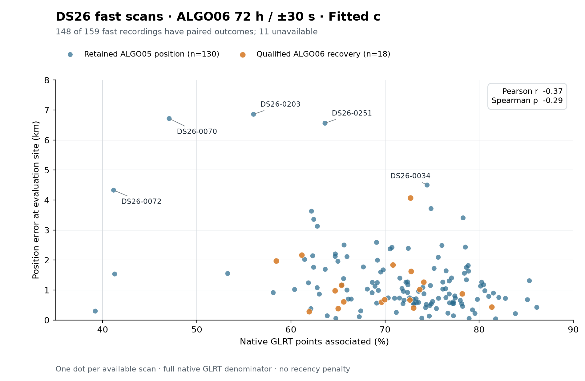
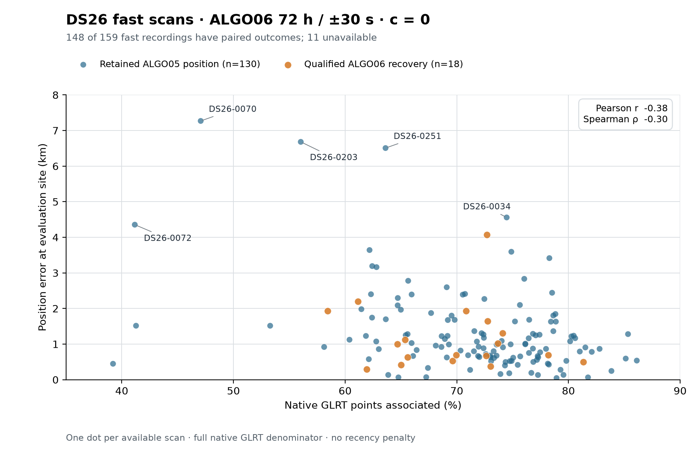

# DS26 native GLRT association versus position error

The DS26 fast-scan paired ALGO06 research replay shows a moderate negative association between the percentage of native GLRT points assigned and position error. It does not establish that increasing association causes a better position: accepted recovery can also worsen an individual estimate, and sky geometry, satellite identity, and model error are not held fixed across scans.

| Matched arm | Pearson r | Spearman ρ | Mean error | Median error | Largest error |
|---|---:|---:|---:|---:|---:|
| Fitted c | −0.374 | −0.286 | 1,295.5 m | 982.8 m | 6,858.0 m |
| c = 0 | −0.382 | −0.296 | 1,313.1 m | 993.2 m | 7,269.0 m |

The horizontal coordinate is `100 × associated / total` for each scan, where `total` is **all native GLRT observations in that scan**, across its eight channels and both receivers. This is full-scan coverage, not the fraction of points in an ALGO06 candidate fragment. Across the 148 available scans, 463,453 of 650,404 native points are associated (71.2562%, weighted by point count). The selected policy accepts 941 additional points in 18 scans. Both c arms have the same observation counts, accepted points, and scan membership. The original fast-scan roster has 159 recordings; 11 lack an upstream paired outcome and have no plotted point. [joined-scans.csv](joined-scans.csv) includes all 159 members with those 11 marked unavailable.

The largest fitted-c errors are DS26-0203 (6,858 m; 56.03% associated), DS26-0070 (6,716 m; 47.07%), and DS26-0251 (6,561 m; 63.62%). DS26-0034 still has a 4,498 m error at 74.47% coverage, illustrating why coverage alone is an insufficient accuracy measure. The fitted-c mean error is 17.5 m lower than c = 0 on this matched cohort; this descriptive difference does not isolate the effect of c from the upstream inference lineage. Frequency objectives are not compared here: their raw totals vary with observation count and do not supply a cross-scan position-quality score.

These rows are frozen baseline-plus-recovery evaluations for the promoted `algo06-causal-residual-family-v1` policy: causal TLEs within 72 hours, phase search ±30 seconds, and no recency penalty. They are not a fresh full DS26 production rerun or new raw-IQ inference. ALGO06 retains the ALGO05 position when recovery fails or is not qualified. The user-confirmed site, 37.849061591561885° N, −122.48574968092912° E, is used only to report horizontal error, never to select an association or endpoint.

## Reproduce and provenance

Run `plot.py` with `/srv/bulk/leo-dev/fast-algo02-production-v1/.venv/bin/python`. It reads [position-errors.csv](../2026_11_01_ds24_plus_error_comparison/position-errors.csv), [scan-features.csv](../2026_11_01_ds24_plus_error_comparison/scan-features.csv), [summary.csv](../2026_11_01_ds24_plus_error_comparison/summary.csv), and the frozen DS26 manifest at `/srv/bulk/leo/research/ds26-20261030/dataset/manifest.json`. The source comparison's `analyze.py` checked ALGO05 native observation and owner counts directly against the saved native outputs. This script also checks unique case/arm/method keys, manifest-to-recording joins, 148 matched arm pairs, per-scan percentages, ALGO06 additions relative to baseline ownership, native totals against scan features, and every saved error against the evaluation-site haversine distance. It writes both plots, the joined roster, and [statistics.json](statistics.json).

Missing upstream outcomes have unknown selection bias. Scans are adjacent in time and can share conditions, so the correlations are descriptive rather than independent-sample significance tests. Association correctness, satellite diversity and geometry, and receiver/orbit residuals are unmeasured in this two-axis view.
