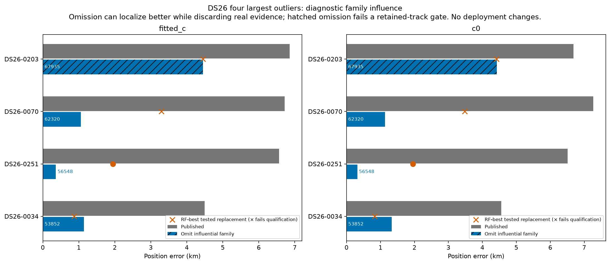
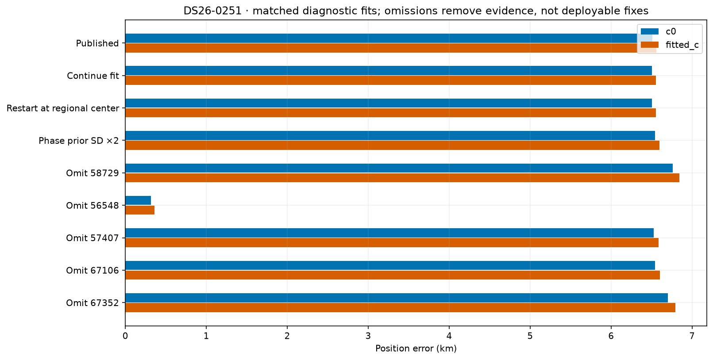
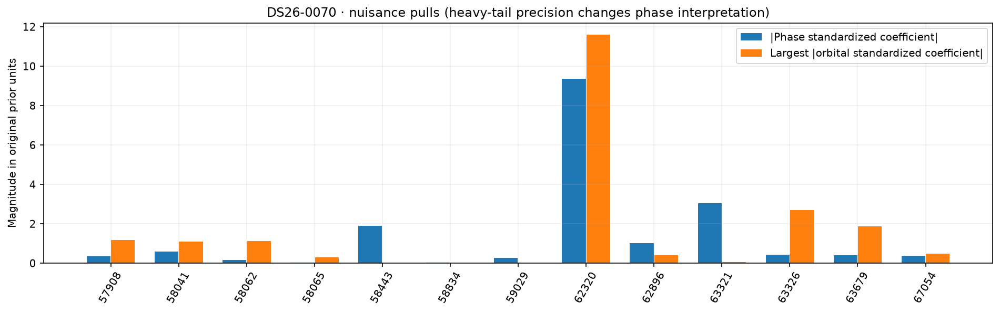
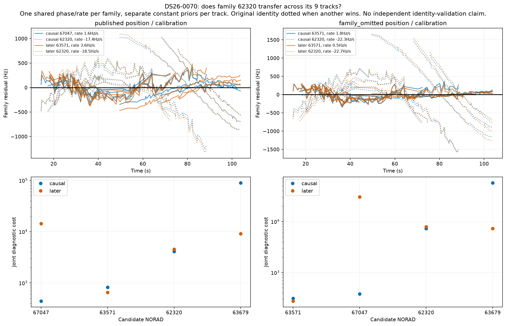
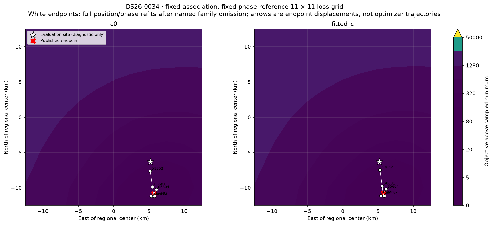
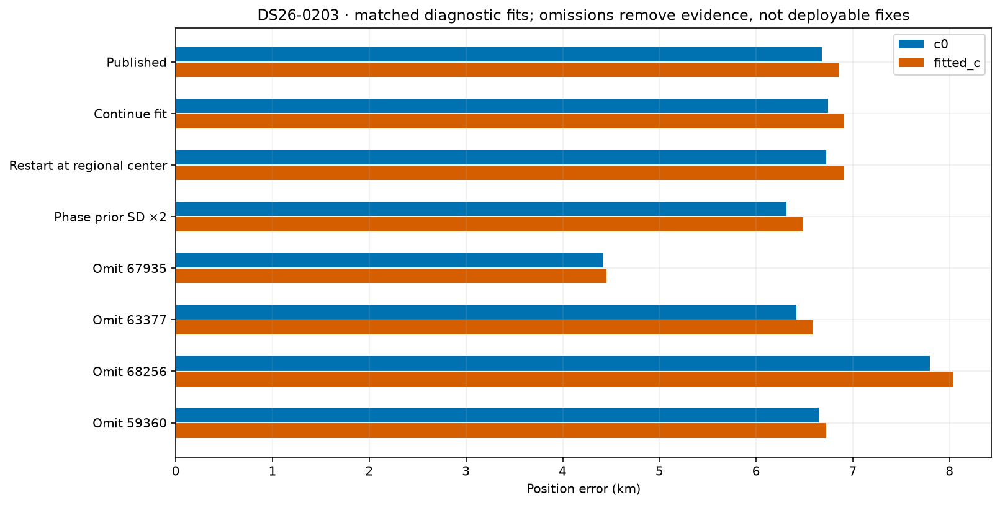

# DS26: root-cause investigation of the four largest ALGO06 outliers

The main problem is **influential satellite-family hypotheses and the flexibility used to reconcile them**, rather than simply too few associated points or an optimizer needing more iterations. Three scans have a dominant family whose removal substantially improves position. Two have plausible competing satellites excluded from the original 48-hour causal catalogue. The promoted ALGO06 residual-recovery policy cannot repair those existing identities because it preserves published owners.

This is a bounded diagnostic study of the four largest fitted-c errors in the frozen DS26 ALGO06 evaluation, not a fresh full-dataset production rerun. The `find-glrt-association` skill was applied to each: exact incumbent replay, native ownership accounting, polynomial and join audit, causal and first-post catalogue screens, nuisance-level comparisons, receiver/family transfer, and paired localization ablations. No production algorithm, recording, or observation ownership was changed.

## Main findings

| Scan | GLRT associated | Original fitted-c error | Most influential problematic family | Error after omitting that family, c=0 / fitted c | What is established |
|---|---:|---:|---:|---:|---|
| [DS26-0203](DS26-0203/README.md) | 2,337/4,171 = 56.03% | 6.858 km | 67935: 129 curved points on three tracks | 4.422 / 4.453 km | Multi-family/model inconsistency; omission does not solve it and violates another family's step gate. Identity 67935 remains preferred among tested competitors. |
| [DS26-0070](DS26-0070/README.md) | 2,023/4,298 = 47.07% | 6.716 km | 62320: 366 curved points on nine tracks | 1.133 / 1.060 km | Strong association/model suspicion, extreme phase/orbit correction, weak geometry and incomplete phase convergence. The definitive replacement remains unresolved. |
| [DS26-0251](DS26-0251/README.md) | 2,693/4,233 = 63.62% | 6.561 km | 56548: 219 curved points on six tracks | 0.317 / 0.360 km | Strong causal alternative 58787 was absent from the original catalogue. Replacing the family retains fitted observations and produces a qualified diagnostic improvement to 1.956 / 1.948 km. |
| [DS26-0034](DS26-0034/README.md) | 2,765/3,713 = 74.47% | 4.498 km | 53852: 119 curved points on three tracks | 1.328 / 1.138 km | A family conflict can remain despite good coverage and apparently clean original residuals. Alternative 59188 improves error but conflicts with family 69188. |

Omission errors identify influence; they are **not proposed deployment results**. Removing real satellite evidence can improve one evaluation case while making an estimator less reliable elsewhere. The remaining base residual gates pass for the highlighted omissions in 0070, 0251 and 0034. The 0203 omission fails a residual-step gate. Extended omission fits close the phase reference in both c arms.



The orange marker is the tested identity replacement with the lowest sum of the two c-arm RF objectives, not the lowest GPS error. A cross marks failure of residual, phase, or optimizer qualification. Hatched blue bars mark an omission with a remaining-track gate failure. Detailed tables retain all unsuccessful trials.

## DS26-0251: the strongest actionable association lead

The published endpoint is on the southern boundary of the configured 25 × 25 km box: north = −12.5 km. Continuing optimization and restarting at the regional center reproduce approximately 6.55 km error. Doubling every phase-prior standard deviation leaves approximately 6.60 km error. The fitted objective prefers moving farther south at the boundary; this is not fixed by another nearby start.

The 56548 family explains six curved tracks across both receivers and CH2/6/7/8. Its posterior uses a −6.96 s phase and a −5.62-unit first orbital-mode coefficient. Its longest inspected source is a single graph piece with a clean cubic fit (56.1 Hz RMS). This is strong curved evidence; deleting an endpoint or undoing a graph join is not the demonstrated solution.

Omitting 56548 changes fitted-c error from 6.561 km to 0.360 km, with c=0 changing from 6.507 km to 0.317 km. Omitting five other diagnostic families does not reproduce this improvement; importantly, removing the earlier recovered 67352 family makes the result worse. The prior gap-fragment recovery is not the main cause of this outlier.

With calibration and position fitted without 56548, the same family's native curves prefer **58787** among the tested causal competitors. Its causal element was **55.40 hours old**, outside the original inference bank but inside the later 72-hour residual-search catalogue. Its archive collection also precedes the observation. It was not introduced using a later TLE or the evaluation position.

The bounded replacement 56548 → 58787 retains the fitted observation mask. Both c arms converge, pass all checked base inequalities, and pass exact-orbit gate replay for the replacement family. Fitted-c objective changes **29,148.48 → 29,012.03**, while curved residual RMS changes only **116.49 → 116.08 Hz**. Position error improves **6.561 → 1.948 km**; c=0 improves **6.507 → 1.956 km**. The small RMS change beside a large positional change shows why RMS alone is a poor localization-quality indicator.

This is a **supported diagnostic replacement within the tested competitor set**, not an independently established unique identity or a ready production patch. A full ownership/extension replay, new-family quadrature audit where applicable, and validation on independent scans remain necessary. The 0.360 km omission result is not the result with the evidence retained.



## DS26-0070: an extreme correction and unresolved competing identities

The 62320 family spans nine tracks, both receivers and CH1/5/6/7/8. The selected long source has one graph piece and a well-supported quartic shape, with 94.1 Hz polynomial RMS; this is not merely a linear track freely aligned to another line.

The published fit requires phase **−14.13 s**, about **−9.35 original phase-prior units**, plus a **+11.60-unit first orbital-mode coefficient**. Its residual gates nevertheless pass. These large corrections allow a nominally poor orbit hypothesis to fit cleanly enough to influence the shared position. The local objective-curvature eigenvalue ratio is about **31**, indicating a weak positional direction conditional on the selected model.

The saved phase-reference change is 0.205 s in fitted c and 0.309 s in c=0. Even a 15-round continuation does not close the reference at 0.01 s, and errors remain approximately 6.15 and 7.60 km. Thus incomplete convergence is real but is not the whole explanation. Omission of 62320 converges and leaves **1.060 km fitted-c / 1.133 km c=0**, with remaining base gates passing.

Catalogue and multi-track diagnostics prefer different alternatives depending on calibration: **67047** is competitive at the published fit; **63571** is preferred under the family-omitted calibration. Causal 63571 was **50.72 hours old** and absent from the original inference bank. Its first later TLE also supports it as a useful hypothesis, but neither alternative supplies an adequate replacement of the entire current model:

- 62320 → 67047: **3.299 km fitted-c**, but family **63679**, RX1 CH4 T004, fails the residual-step gate.
- 62320 → 63571: **4.940 km fitted-c**, with residual failures in **63679** and **58443**; the c=0 phase iteration also remains unclosed.

The evidence justifies questioning 62320 and reopening joint family competition. It does **not** yet prove one unique replacement, or prove that all nine tracks belong to one alternative. The failures follow multiple tracks and receivers; a simple receiver-wide constant correction has not been established.





## DS26-0034: high coverage can conceal a conflicting family

This scan has 74.47% association and 4.498 km error. Its saved phase reference is effectively closed. Continuation and a regional-center restart reproduce the same position. Doubling phase-prior width does not improve it.

Removing **53852** improves fitted-c error to **1.138 km** and c=0 to **1.328 km**, with the remaining base gates passing. Its three contributing tracks span both receivers and CH2/3. The inspected CH2 curve is one graph piece; its quartic polynomial RMS is 60.3 Hz. The original fitted orbit is plausible and its phase correction is not extreme: −0.98 s, approximately −0.57 original phase-prior units. An extreme-phase threshold alone would miss this failure.

Original 53852 fits best under its own published calibration, but **59188** becomes competitive under calibration fitted without that family. The first-post TLE comparison reinforces that competition; it does not simply improve 53852's residuals. A same-observation replacement yields **0.872 km fitted-c / 0.829 km c=0** and a lower RF objective. However, **69188**, RX1 CH1 T002, then fails slope and curvature gates; the fitted-c optimizer also reports non-success. The attractive error therefore cannot authorize this replacement.

The best-supported diagnosis is **multi-family inconsistency hidden by shared calibration and nuisance freedom**. Wrong 53852 identity, a model discrepancy in 69188, or an interaction between them remains unresolved. The previously recovered new family 67632 is not the main cause: removing it worsens fitted-c error to about 4.86 km.



## DS26-0203: distributed model bias, not one obvious wrong label

The saved fit is a well-defined local minimum under its fixed assignments. Continuing or restarting at the regional center produces about **6.91 km** fitted-c error. Doubling phase-prior widths changes that to approximately **6.48 km**, a modest change rather than a resolution.

Family **67935** supplies 129 curved points across RX1/2 CH8. It requires a −5.85 s phase, approximately −6.39 original phase-prior units; its heavy-tail phase precision is reduced, so these units are not a calibrated Gaussian outlier probability. The most influential inspected curves are single graph pieces with polynomial RMS 39.1 Hz for 67935 and 31.3 Hz for 63377. The 67935 identity remains preferred in both causal and later catalogue tests.

Removing 67935 moves error to **4.453 km**, but family **68062**, RX1 CH4 T001, then fails a residual-step gate. Removing other influential families does not solve the scan, and replacing 67935 with its tested runner-up 59360 gives catastrophic frequency residuals and dozens of gate failures. The first-post TLE does not rescue the nominal 67935 shape at the frozen published calibration: refitted diagnostic RMS worsens from 41.0 to 150.9 Hz.

This is evidence for **distributed orbit/radio-model tension and a biased objective**, with no supported single-label repair. A wrong 67935 identity is less supported than in the other outliers. The current evidence cannot attribute the discrepancy uniquely to receiver drift, orbital error, or the weighting of other families. Broader nuisance freedom alone is not justified by this result.



## Why the long residual curves remained unassociated

The skill also inspected the longest remaining contiguous native graph fragment in each scan, ranked by duration. These are residual fragments, not an arbitrary span bridging already-owned points. Causal full-catalogue screening used up to 20 native points for nomination, then exact full-point fits for the top three candidates per model plus the current identity. Later catalogues used the first valid element epoch after scan end, with an archive-collection lookahead capped at 48 hours.

| Scan | Residual fragment | Best hypotheses | Why ALGO06 did not take it |
|---|---|---|---|
| 0203 | RX2 CH1 T002; 71 points, 50.3 s | 64133; runner-up 63466 | Published screening margins are only 1.5–6.6 across arms/partitions, below 10, and residual-structure gates fail. Later TLE does not resolve adequate unique shape. |
| 0070 | RX1 CH6 T003; 65 points, 44.7 s | 58065; competitor 62317 | Full-data shape can pass, but fitted-c margin is only 8.9 and one whole-block partition changes winner to 62317. |
| 0251 | RX1 CH4 T000; 102 points, 72.7 s | 65894 | Strong identity margin, but residual structure and excessive required rate fail. First later TLE modestly reduces RMS without curing the discrepancy. |
| 0034 | RX2 CH8 T001; 52 points, 47.8 s | 57641 | Strong identity margin, but remaining structure/rate is inadequate; later elements do not provide a clean fit under the frozen published calibration. |

These reasons are checked against the existing ALGO06 full-data and randomized whole-block screening records as well as the new diagnostics. They are not a reason to relax gates to increase association percentage. A biased position/calibration can prevent a real residual curve from matching; conversely, a real curve need not be modeled accurately enough to help position.

## What the evidence rules out—and what it does not

- **More iterations alone:** restarting at the same regional center and continuing phase refresh do not resolve these four errors. The 0070 convergence issue remains a contributor. This does not prove global optimality; the loss grids freeze identities and phase references and are not full reassociation sweeps.
- **A single missing correction c:** both matched c arms exhibit the same principal failures and family influence. c is not the dominant explanation.
- **Bad graph joins in the inspected sources:** all 12 inspected sources have one parent graph piece, strong departure from a line, and polynomial residuals passing the legacy noise screen. This does not certify every graph source or all family ownership. Endpoint leverage remains visible in the 20-second plots.
- **Later TLE automatically fixes it:** paired frozen-correction and refitted-correction comparisons were run. First-post elements often shift the required phase but do not eliminate the important shape/model conflicts. They are strictly diagnostic and never enter causal replacement fits.
- **RMS/gates prove identity:** all four published base fits pass their residual gates, including the exact-orbit replay. Yet their positions are wrong. In 0070, the large orbital and phase correction hides an especially questionable nominal match. In 0034 the nuisance values are less extreme, showing why an outlier threshold alone is insufficient.
- **Receiver pointing violation:** horizon checks are part of the gate replay and pass for the published active tracks. No calibrated beam-pattern or boresight evidence was available to impose an additional sky-angle exclusion. No antenna field of view was invented.

The largest exact-versus-linearized orbit discrepancy in the original fits is about 14.5 Hz for 0070, 0.50 Hz for 0203, 0.035 Hz for 0251, and 0.001 Hz for 0034. All pass the exact-orbit gates. Thus linearization error alone is not demonstrated to explain kilometre-scale position error.

## Recommended next implementation

Build an **RF-triggered family reconsideration stage**, rather than increasing residual recovery alone:

1. Use family-omission influence together with phase/orbital prior pulls and prediction on other families to nominate conflicts. An omission is a diagnostic probe, not permission to discard observations.
2. Search the same causal 72-hour catalogue for replacement of existing families, including candidates absent from the original 48-hour inference bank. Keep a no-match alternative and record catalogue age. ALGO06 currently expands only residual-family discovery.
3. Compare keeping the original identity, replacing it, and explicitly modeling structured discrepancy using the same native observations and comparable priors. Preserve failed alternatives and test both c arms.
4. Require convergence, exact-orbit/residual checks, independent track/receiver evidence and full ownership replay. Do not accept a better objective if it harms another family, as in 0070 and 0034. Test a small joint competitor set only after independent RF evidence identifies the conflicting family.
5. Freeze the resulting rule before a dataset-wide comparison. Use 0251 as the first implementation case, 0070 and 0034 as safeguards against unsafe replacement, and retain 0203 as an unresolved model-discrepancy case rather than forcing it.

No single prototype here is ready for promotion. The most concrete positive result is the 0251 same-observation causal replacement, **6.56 → 1.95 km**, not the **0.36 km** result obtained by omitting a real family.

## Reproduction, provenance and limits

The full galleries link every figure and machine-readable artifact: [0203](DS26-0203/README.md), [0070](DS26-0070/README.md), [0251](DS26-0251/README.md), [0034](DS26-0034/README.md). [Localization trials](localization_trials.csv) report frequency objectives separately from geographic error; [run manifest](run_manifest.json) records the exact repository revision, script and input hashes, observation counts, scan receipts, fixed regional box, and TLE policy. [Three diagnostic tests](tests.txt) verify covariance integration against a dense calculation, position-coordinate roundtrip/derivatives, and polynomial order behavior.

Use the existing numerical environment, from this worktree:

```bash
export PYTHONPATH=src:tools
export OPENBLAS_NUM_THREADS=1 OMP_NUM_THREADS=1 PYTHONDONTWRITEBYTECODE=1
PY=/srv/bulk/leo-dev/fast-algo02-production-v1/.venv/bin/python
$PY reports/2026_11_01_ds26_outlier_root_cause/diagnose.py audit DS26-0251
$PY reports/2026_11_01_ds26_outlier_root_cause/diagnose.py fits DS26-0251
$PY reports/2026_11_01_ds26_outlier_root_cause/track_debug.py DS26-0251
$PY reports/2026_11_01_ds26_outlier_root_cause/family_debug.py DS26-0251
$PY reports/2026_11_01_ds26_outlier_root_cause/replacements.py DS26-0251 --expand
$PY reports/2026_11_01_ds26_outlier_root_cause/diagnose.py validation DS26-0251
```

The other cases use the same commands; 0203/0070 also use `diagnose.py extended`. The first archive export used the read-only archive adapter under an account with archive access (`track_debug.py CASE --archive-only`); numerical analyses then read the saved ledger without privilege. `frozen_tle_swap.py`, `render.py CASE`, and `summarize.py` reproduce comparisons and figures. No archive file was modified. Existing immutable source artifacts are not overwritten by the analysis.

The four scans were selected by observed error, and the highlighted family conclusions are post-hoc diagnostics. No evaluation coordinate was passed into association or optimizer objectives; the known site appears only in error reporting and explicitly labeled oracle-position loss probes. These four development cases do not establish generalization. The fixed-position target screens and per-track polynomial BIC have simplified independent-noise assumptions; whole-track transfer uses a previously nominated shortlist and is not independent identity validation. Unique identity confidence is therefore qualified, and all unrun acceptance steps remain unclaimed.
