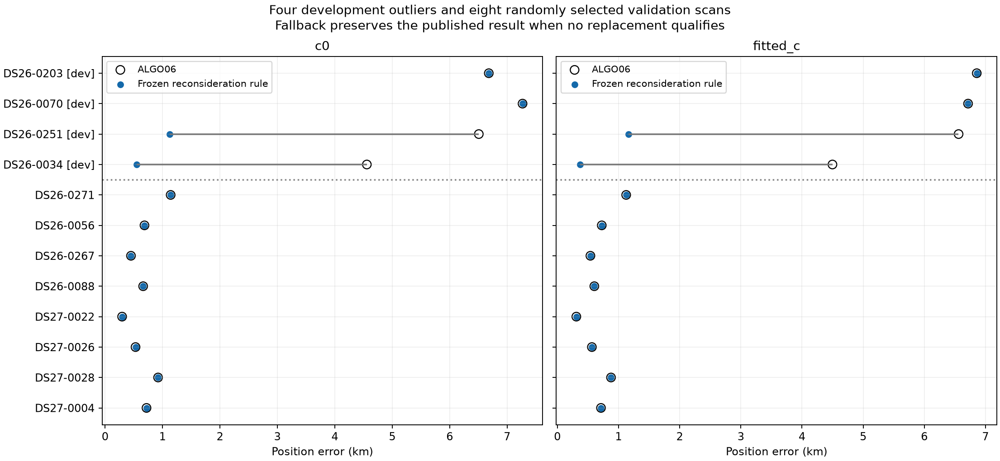
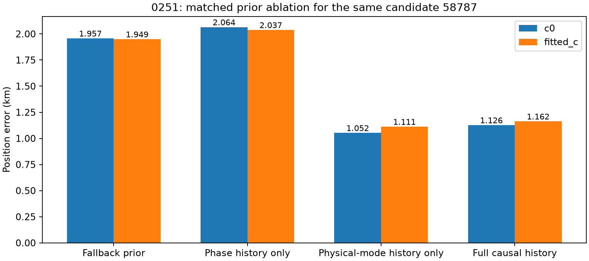
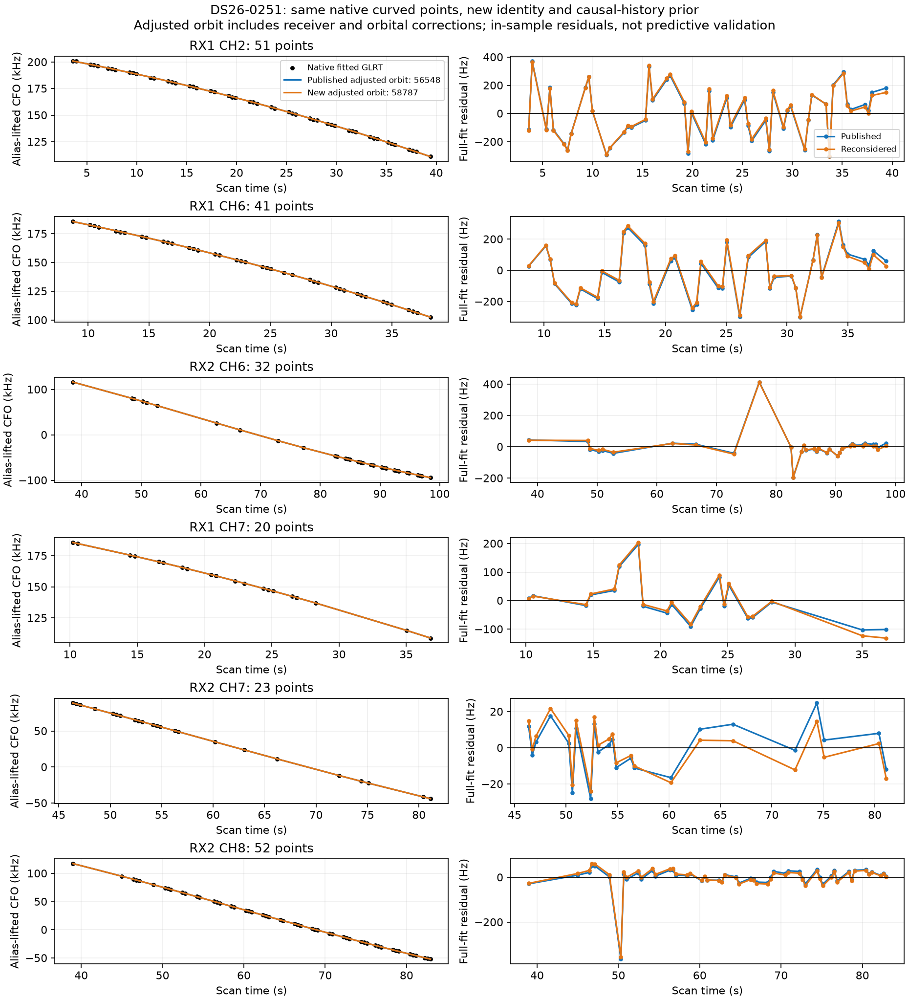
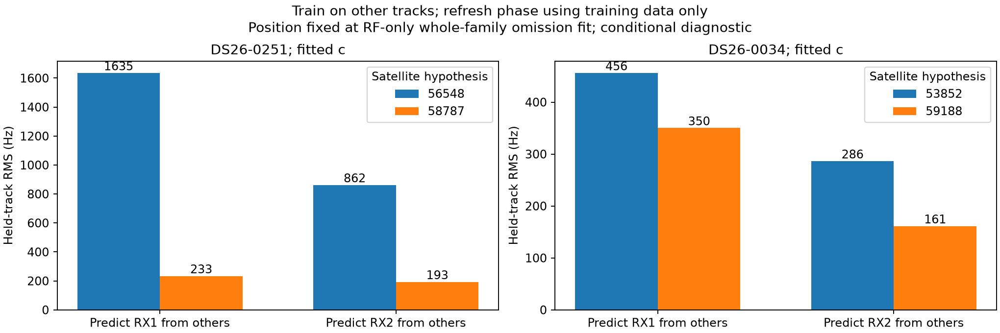
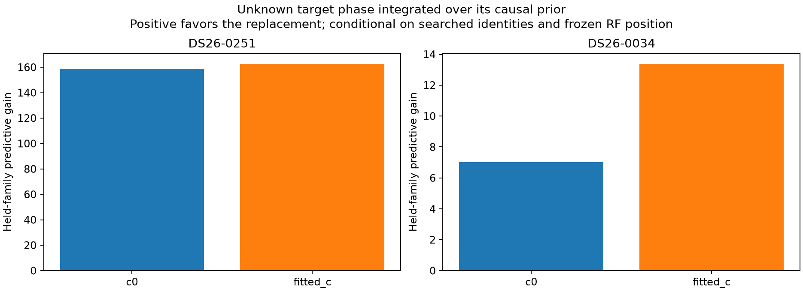
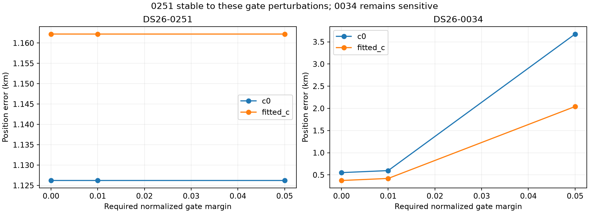
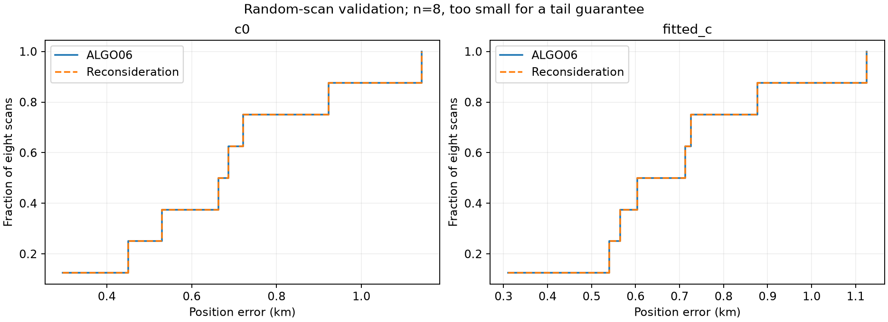

# RF-triggered satellite reconsideration and causal-history repair

2026-11-01. Research continuation of the [ten-prototype investigation](../2026_11_01_ds26_ten_solutions/README.md), based on ALGO06. Production is unchanged.

**The strongest new finding is that newly admitted satellites need the same causal orbital-history treatment as incumbents.** On DS26-0251, automatic reconsideration discovers 58787, restores its earlier causal TLE, and reduces fitted-`c` position error from **6.561 to 1.162 km**. The preceding replacement with missing-history fallbacks gave 1.949 km. A matched ablation attributes the new gain primarily to the physical orbital uncertainty model, not a wider phase prior.

The same RF-only rule rediscovers the DS26-0034 replacement and its **0.374 km** result. Independent-track prediction supports both replacements conditionally, but 0034 remains sensitive to residual-gate margins. DS26-0203 and 0070 remain unresolved. A frozen-rule evaluation on eight reproducibly selected additional scans accepts no replacements: all eight published positions and association percentages are preserved. This is a useful conservative check, not evidence of a dataset-wide accuracy gain or a tail-error guarantee.

## Result accounting

| Development scan | ALGO06 fitted `c` | New rule fitted `c` | ALGO06 `c=0` | New rule `c=0` | GLRT associated, unchanged |
|---|---:|---:|---:|---:|---:|
| DS26-0203 | 6.858 km | 6.858 km | 6.681 km | 6.681 km | 56.03% |
| DS26-0070 | 6.716 km | 6.716 km | 7.269 km | 7.269 km | 47.07% |
| DS26-0251 | 6.561 km | **1.162 km** | 6.507 km | **1.126 km** | 63.62% |
| DS26-0034 | 4.498 km | **0.374 km** | 4.558 km | **0.552 km** | 74.47% |

These results come from one recorded decision rule, with fallback when no proposal qualifies. They are not a per-scan selection of the lowest known-site error. The 176 m receiver-prior diagnostic remains outside the selected rule.

The primary suite contains **96 position attempts: 92 completed numerical fits and four explicit interpolation-domain failures**, all on the 0070 secondary replacement 63321→62422. No extrapolation was allowed. Earlier service-archive access failures were corrected and their affected scans rerun; those initial failures remain separately archived. Completed fits can fail acceptance. There are 16 additional matched history-ablation fits and 12 gate/receiver sensitivity fits.

The four development cases' fitted-`c` median changes from 6.638 to 3.939 km, but their maximum remains 6.858 km. These selected outlier statistics are not population estimates. The [position table](positions.csv) and [all primary attempts](trials.csv) preserve error, RF objective, acceptance, ownership changes, runtime and failure status separately.

## The frozen reconsideration rule

1. Reconstruct the exact published ALGO06 objective and native ownership from immutable input receipts. Fail on replay disagreement.
2. For each family containing at least 30 fitted native points and two admitted curved tracks, estimate its local position influence by removing that family's likelihood from the finite-difference gradient. Rank by summed displacement across both `c` arms. Search at most the top two families with score at least 0.5 km. This is a search trigger, not a probability of wrong identity; Hessian conditioning is recorded.
3. Fit a diagnostic position and receiver calibration with the entire target family omitted. The target never supplies its own frozen calibration for catalogue nomination.
4. Search the complete existing 72-hour causal regional catalogue on the two longest target tracks. Screen at most 16 uniformly spaced native times per track over phases −30…+30 s in 2 s increments. Union the top two nominees from each track and `c` arm with the incumbent. This is full-bank coarse discovery followed by a bounded shortlist, not exact exhaustive catalogue fitting.
5. Evaluate complete-family nominees on all target points with one shared phase and frequency rate, per-source offset priors, and normalized scores. Use 300 Hz offset, 0.5 Hz/s shared rate, 150 Hz noise and 5 s phase SD in this **reduced nomination model**. Its nuisance assumptions are not substituted for the production physical model in the final position fit.
6. Require positive average held-block predictive gain and at least four positive gains among five random splits in each `c` arm. Splits hold 20% of synchronized 5 s blocks, exclude adjacent 5 s blocks from training, and require minimum training/test support in every source. Aliases and fitted nuisance coefficients use training points. Candidate discovery and graph construction used the full source, so these are conditional checks, not independent satellite-discovery validation.
7. Before fitting a new identity, retrieve its latest genuinely earlier causal TLE within the 72-hour archive collection window. Reject epoch differences under one second. Apply the existing causal phase-width, signed-mean and physical-mode machinery; explicitly record missing history. No epoch is chosen by RF score or known-site error.
8. Fit each proposal from the same two RF-derived starting positions in both arms: published fitted-`c` endpoint and family-omitted fitted-`c` endpoint. Use 15 phase rounds, 40 constrained position iterations per round, the same 25×25 km box and existing gates. Require solver success, phase closure ≤0.01 s, exact-orbit checks, preserved owners and no unintended family reassignment.
9. Require each arm's RF score to improve beyond `2 log(number of shortlisted identities)`. Choose the best paired RF gain. Modify at most one family per scan; otherwise retain the published result. No age preference is added.

The rule selected the previously investigated primary family in all four development scans without using their errors. The second targets were 63377, 63321, 58729 and 68681 for 0203, 0070, 0251 and 0034 respectively. All rankings and selected targets are in [triggers.csv](triggers.csv).

Whole-track partitions were also prototyped: retain the incumbent on ambiguous tracks, and propose a different identity only when it wins at least four of five training subsets in each arm. These mappings are selected across the same folds used to inspect prediction, so they are explicitly **diagnostic-only and cannot be accepted by this rule**. No polynomial is split or truncated.

## 0251: what the earlier TLE actually changes

The 58787 candidate's selected nominal TLE remains 55.40 h old and causal. Its earlier archived element is separated by approximately 7.85 h and was also collected before the observation. The archive-derived alignment is −0.324 s. The resulting unmultiplied phase SD is 2.498 s, or 2.648 s after the existing calibrated multiplier, compared with the previous roughly 1.06 s fallback.

The additional history changes the scales of the physical mean-motion, inclination and ascending-node uncertainty modes. Specifically, the history-implied radial SD is **0.904 km**, versus the **0.500 km** fallback; cross-track SD is **1.282 km**, versus **0.250 km**. Thus this candidate needs more physically supported orbital uncertainty, rather than a blanket tightening of orbital priors. These are prior scales derived from successive TLE disagreement, not measured orbit-truth errors. Extending the history produces exactly zero objective change when replaying the original fitted family labels. See [the prior metadata](DS26-0251/orbital_prior_metadata.json).

We separated these effects with identical observations, candidate identity, starts, budgets and `c` arms:

| Prior treatment for 58787 | Fitted-`c` error | `c=0` error |
|---|---:|---:|
| Existing missing-history fallback | 1.949 km | 1.957 km |
| History-derived phase mean/width only | 2.037 km | 2.064 km |
| History-derived physical orbital modes only | **1.111 km** | **1.052 km** |
| Full causal-history treatment | **1.162 km** | **1.126 km** |

The full-history policy is the selected proposal. The slightly lower error from the orbit-only diagnostic is not a reason to choose that configuration using GPS. This ablation identifies a mechanism worth fixing generally: new identities were receiving fallback physical uncertainty despite useful pre-scan history being available.

All original fitted native points remain. The replacement relabels existing evidence; it does not increase the GLRT association denominator or claim new recovered observations. Complete causal TLE receipts, final fitted parameters and per-point residuals remain in the hashed local experiment archive.

This figure uses the replacement's alias-lifted CFO branch. The two predictions include their fitted receiver and orbital corrections, so the residuals are training-fit diagnostics, not independent validation. Previous reports contain the original polynomial, alias, later-TLE and track-join audits; they were not rerun or relabeled as new evidence here.

## Independent-track transfer and phase handling

We withheld all target-family tracks on one receiver, learned shared corrections from the remaining curved tracks, and predicted the held receiver. Position was fixed to the same whole-family-omitted RF estimate for both identity hypotheses. Phase starts use causal prior means, then refresh from training coefficients only. The local Gaussian model uses the production physical feature structure, fixed 150 Hz noise and inherited observation weights. It does not learn the held receiver's target-track offsets from those held measurements.

| Scan / candidate change | Held receiver | Fitted-`c` predictive RMS before → after | Normalized predictive score gain |
|---|---|---:|---:|
| 0251: 56548→58787 | RX1 | **1,635 → 233 Hz** | +31.78 |
| 0251: 56548→58787 | RX2 | **862 → 193 Hz** | +74.25 |
| 0034: 53852→59188 | RX1 | **456 → 350 Hz** | +6.39 |
| 0034: 53852→59188 | RX2 | **286 → 161 Hz** | +15.59 |

Both `c=0` comparisons also improve; full values are in [receiver_transfer.csv](receiver_transfer.csv). These results strengthen the 0251 reassociation argument because the improvement transfers across receivers. They remain conditional on the searched identity set, inherited graph/alias preprocessing, fixed RF position and specified noise model.

A first fixed-phase linearization gave misleadingly large errors, particularly for 0034's approximately −15.6 s correction. We retained those outputs and added training-only phase refresh. When the *entire* target family is held out, its phase cannot be learned from other satellites. A local linear prediction at its prior mean is then inadequate. We therefore also integrated the unknown target phase over its causal prior, retaining physical-mode uncertainty and training-only calibration. The grid is bounded by actual propagation support; excluded prior mass is recorded, rather than extrapolated or silently renormalized. The included mass is effectively one for these checks.

The replacement improves this whole-family predictive score by approximately **159 / 163** (`c=0` / fitted `c`) on 0251 and **7 / 13** on 0034. These are conditional score differences, not calibrated identity probabilities. Physical-mode uncertainty remains Gaussian; orbit-family uniqueness still requires broader independent evidence.

The original random sampling allowed repeated subsets between folds. For the short 0034 target, five draws contained three distinct subsets. We disclosed this and ran a supplementary audit requiring five distinct subsets: 59188 wins all five in both arms, with mean predictive gains 16.61 and 19.71. The competing 100303 loses all five. The folds can still overlap and are not five independent statistical trials. The frozen scan-level rule was not retuned from this diagnostic or from GPS error.

## Receiver correction versus orbital correction

Training-only transfer compares the full physical model, reduced receiver smoothness (200→50 Hz), disabled nonlinear receiver smoothness, disabled physical orbit modes, and both disabled. Receiver constants and linear drift remain in every model. Phase refresh uses the same budget in each cell. Detailed point predictions and uncertainties are retained in `transfer*_refreshed.json`.

No blanket receiver-prior change is supported. On 0070, reducing receiver smoothness worsens cross-receiver predictive scores in both directions for the original primary family. On 0203, the same change also worsens the primary family's predictions. On 0251, the replacement improves transfer much more decisively than a global receiver restriction; some receiver-prior cells help one direction but hurt another. On 0034, tightening the receiver prior gives a very accurate fitted position, but independent predictive gains are much smaller and gate sensitivity remains substantial.

This is evidence of coupled identity/calibration uncertainty, not proof that all discrepancies follow one receiver or all follow one satellite. The training-only physical-feature checks use fixed RF positions and simplified Gaussian noise; they are not a new geolocation estimator or an empirical noise calibration.

## Gate sensitivity distinguishes the two repairs

| Scan | Original constraints | +0.01 normalized margin | +0.05 normalized margin |
|---|---:|---:|---:|
| 0251 fitted `c` | 1.162 km | 1.162 km | 1.162 km |
| 0251 `c=0` | 1.126 km | 1.126 km | 1.126 km |
| 0034 fitted `c` | 0.374 km | 0.420 km | 2.041 km |
| 0034 `c=0` | 0.552 km | 0.597 km | 3.676 km |

0251's history-aware result is stable to the tested margins. 0034 remains model-sensitive. Reducing receiver smoothness gives 0.176 km fitted `c` / 0.268 km `c=0` on 0034, but fails the acceptance screen on 0251. Those sensitivity settings are diagnostics, not per-scan GPS-selected hyperparameters.

## Additional randomized scans

Before evaluating their outcomes, seed `20261103` selected four scans from each eligible input inventory: DS26-0271, 0056, 0267, 0088 and DS27-0022, 0026, 0028, 0004. The four development outliers were excluded. These are additional scans for this prototype, not previously untouched datasets.

All eight retain ALGO06. Fitted-`c` median is **0.659 km**, maximum **1.125 km**; `c=0` median is **0.675 km**, maximum **1.142 km**. Both distributions are unchanged. No owner is lost and no GLRT coverage increase is claimed. Eight scans with no accepted change do not establish improved population accuracy, noninferiority, or robustness on unseen severe outliers.

The bounded research implementation is not optimized for embedded use. Median completed primary fit time was about 8.1 s, with a maximum about 138.5 s, excluding catalogue discovery/imports and prior export. A scan can require several fits. All eight evaluation jobs completed within their 900 s process caps. This is not a matched production runtime benchmark.

## Decision and next action

Keep ALGO06 in production. The general RF trigger and causal-history completion are now concrete prototypes, with a reproducible validation cohort and explicit fallback. **Prioritize a broader paired evaluation of the 0251-style incumbent reconsideration plus full causal history.** Freeze the search/acceptance rule and evaluate other RF-triggered cases without selecting by known-site improvement.

0034 deserves a confidence warning for gate sensitivity even though it passes current checks and conditional transfer. 0070's stable-track partition still fails the full-scan requirements in this suite; its attractive partial endpoints are not accepted. 0203 remains unresolved. Do not keep increasing nuisance freedom or relaxing gates to make those scans succeed. Carry their recorded ambiguity forward and investigate other high-conflict families.

No new ALGO number or deployment is justified by this small evaluation alone. Useful next promotion evidence would include improvements on additional scans, stable tail behavior, owner retention, prediction calibration, reasonable sensitivity to priors/gates and a bounded runtime policy.

## Reproduction and provenance

- [Frozen protocol and cohort](protocol.json), [run manifest](run_manifest.json), [summary](summary.json).
- [Positions/coverage](positions.csv), [all primary trials](trials.csv), [RF triggers](triggers.csv), [prior ablation](history_ablation.csv), [receiver transfer](receiver_transfer.csv), [phase-integrated prediction](phase_mixture.csv), [sensitivity](sensitivity.csv).
- [Reconsideration implementation](reconsider.py), [read-only history exporter](read_history.py), [transfer diagnostics](transfer.py), [phase mixture](phase_mixture.py), [unique-subset audit](unique_holdouts.py), [prior ablation](history_ablation.py), [gate sensitivity](sensitivity.py), [renderer](render.py), [tests](test_reconsider.py), [test receipt](tests.txt).
- [Previous constrained-reassociation report](../2026_11_01_ds26_solution_prototypes/README.md) and [ten-variant report](../2026_11_01_ds26_ten_solutions/README.md).

From the recorded worktree, use `/srv/bulk/leo-dev/fast-algo02-production-v1/.venv/bin/python`, `PYTHONDONTWRITEBYTECODE=1 OPENBLAS_NUM_THREADS=1 OMP_NUM_THREADS=1 PYTHONPATH=src:tools`. Run `reconsider.py CASE`, `transfer.py CASE --refresh`, and `transfer.py CASE --selected --refresh` for selected replacements. The other scripts take a case argument except `unique_holdouts.py`, `render.py` and `test_reconsider.py`. `freeze` creates a new protocol and must not overwrite an existing receipt during reproduction. Input receipts and large raw fits remain in their recorded local archives; this publication includes source, compact machine-readable evidence, hashes and figures.

Inference uses causal elements only; both epoch and archive availability precede cutoff. The regional position box remains centered at 37.906, −122.545, width 25 km. Evaluation coordinates 37.849061591561885, −122.48574968092912 appear only in the inherited error reporter. No new recordings, production components, public contracts, golden fixtures or QNAP paths were changed. Five tests verify the predictive covariance calculation, training/held separation, synchronized guard masks, zero-feature predictive behavior, and native-evidence/acceptance accounting for every completed primary trial.
