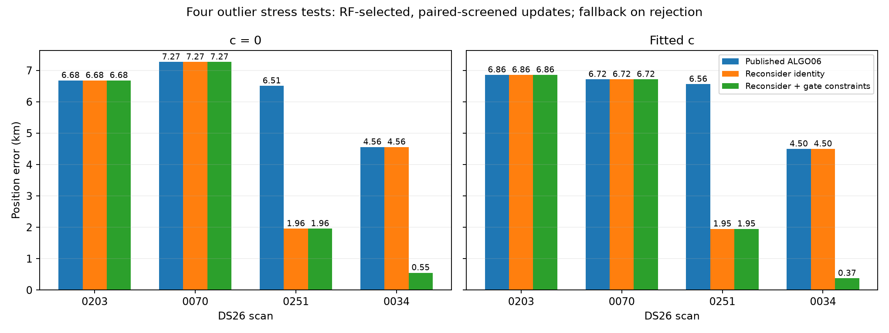
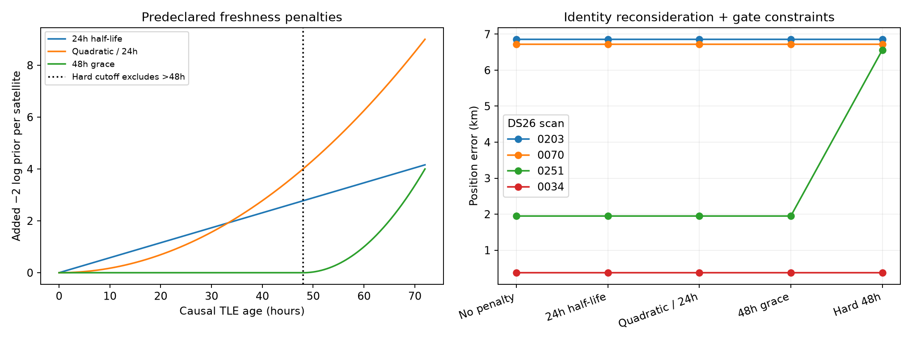
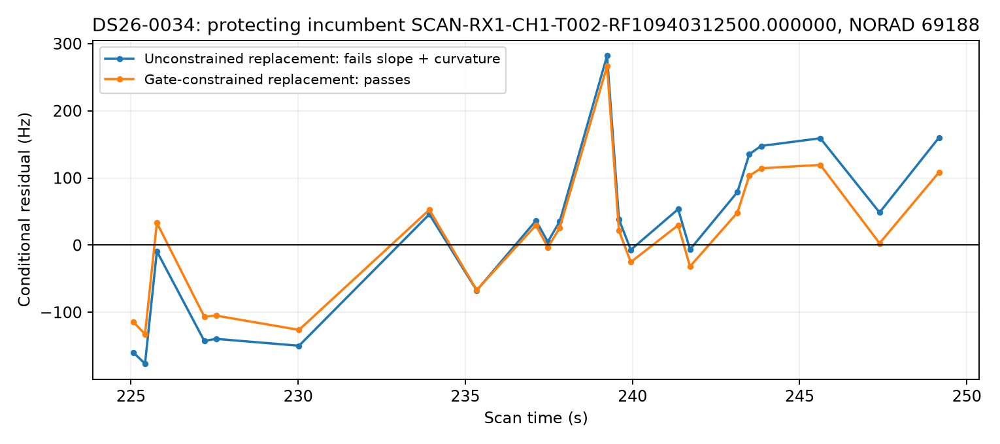
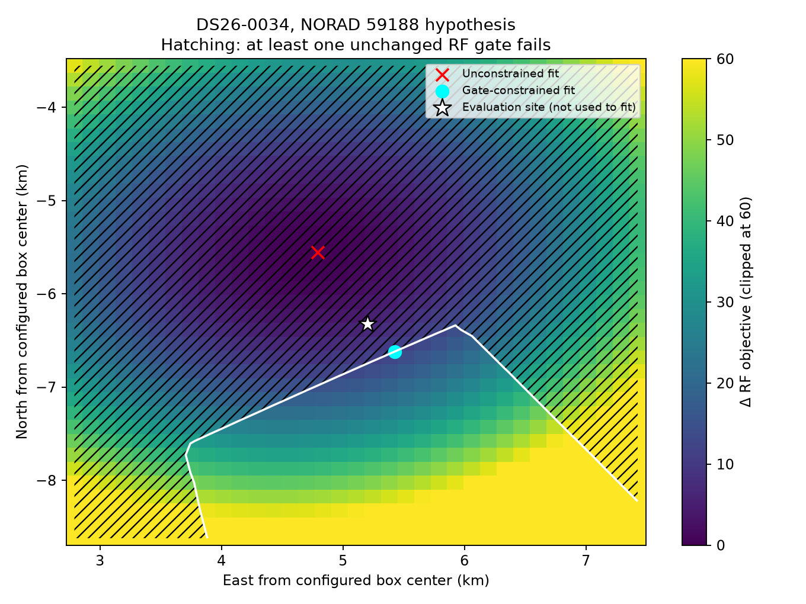
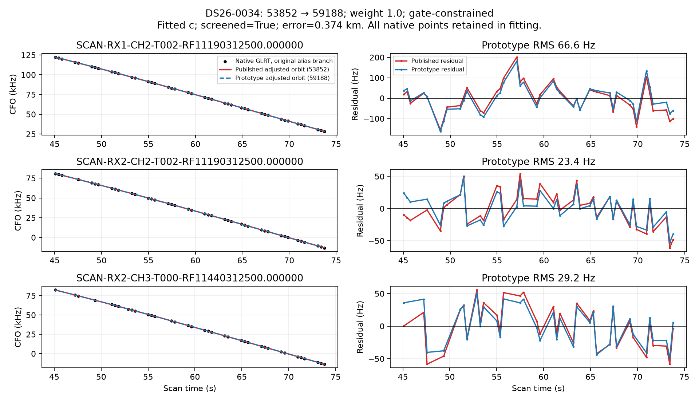
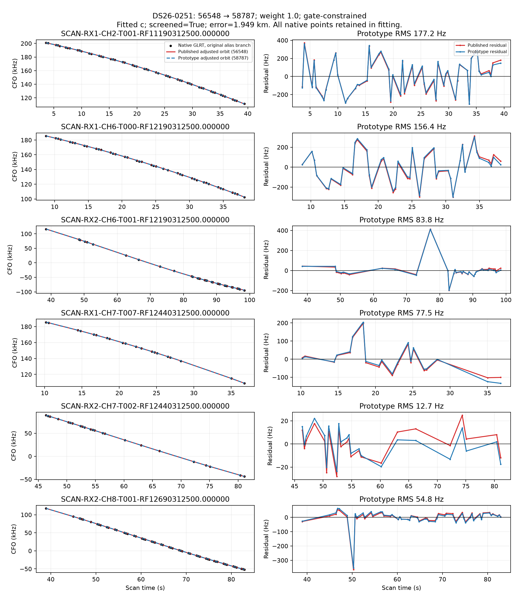
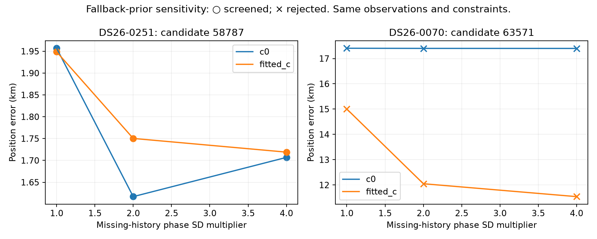
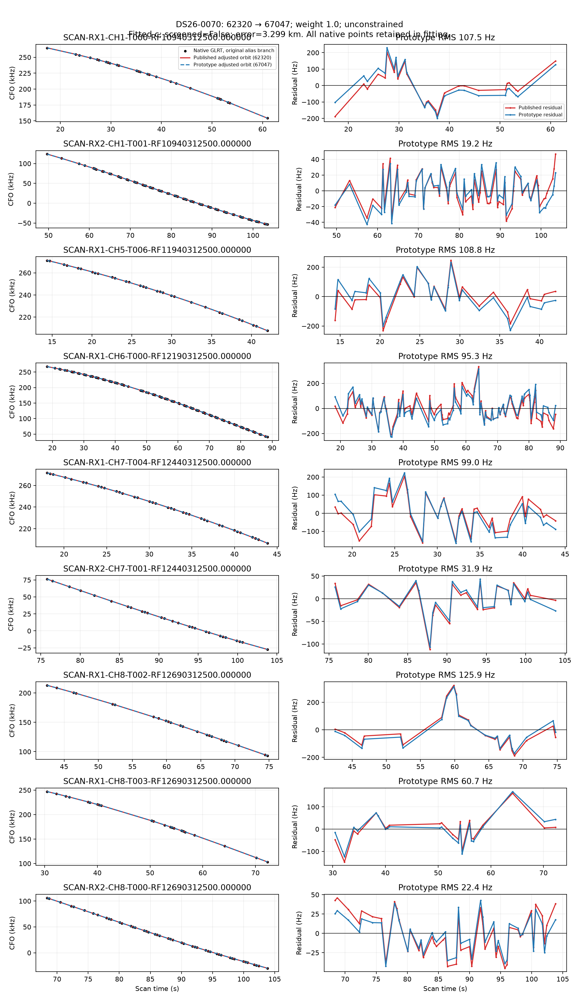
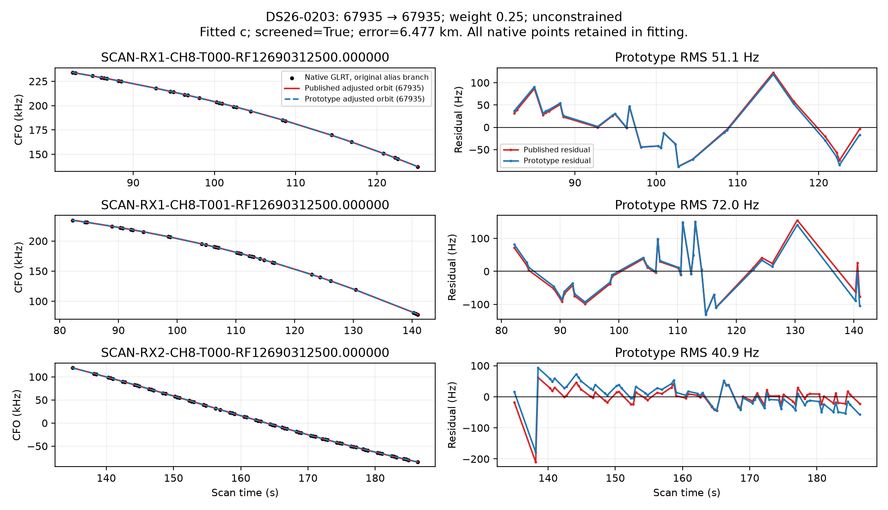
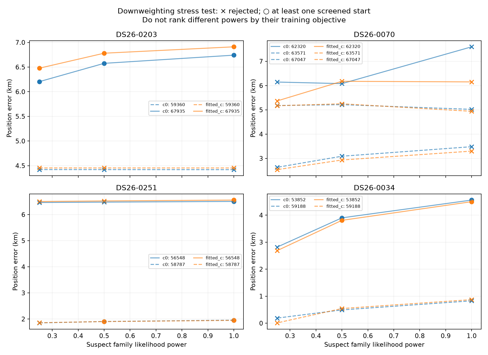

# DS26 outlier solutions: causal reassociation, TLE-age priors and constrained fitting

2026-11-01. Research prototypes based on deployed ALGO06, revision `b78d4fbd5eb9fc6dce8ae7e4eb58fc3820299493`. No production inference or ownership was changed.

Reopening an existing satellite assignment, then optimizing position **subject to the existing residual gates**, is the strongest direction in this experiment. It produces promising repairs for two of the four largest DS26 outliers. Soft TLE-age penalties do not change those decisions. A hard 48-hour cutoff prevents the useful repair of scan 0251. The other two scans remain unresolved under the screened reassociation policy.

These are four deliberately selected failure cases, not a random validation cohort or a new production algorithm. Candidate identity remains conditional on the searched shortlist and nuisance model. Good position error is reported after fitting and does not select the candidate, prior, weight, start or constraint.

## What was tested

The preceding `find-glrt-association` investigation replayed ALGO06, searched causal and first-post-observation catalogues, audited polynomial shape and joins, and performed family omissions. This experiment reuses its causal RF nominees; it does not repeat or claim a new exhaustive catalogue search. Later TLEs are **not** used in any prototype fit here.

1. **Reopen the existing family assignment.** ALGO06 can recover residual families while preserving incumbent owners. That cannot repair an incumbent assigned to the wrong identity. Here the suspect family's existing fitted observations can move together to a competing identity from the 72-hour causal catalogue.
2. **Compare freshness priors.** Add a satellite-level age term to the normalized RF score. Compare no penalty, exponential age prior, quadratic age prior, a 48-hour grace interval, and the original hard 48-hour exclusion.
3. **Reduce family influence.** Multiply all curved-track likelihood powers in the suspect family by 1, 1/2 or 1/4. Retain observations and all original residual/ownership checks. These are sensitivity experiments, not a validated rule for selecting weights.
4. **Constrain the position fit.** Minimize the RF objective subject to the existing profile, conditional residual, alias, elevation and support inequalities. Recompute the phase reference and independently replay exact-orbit gates afterwards. A lower-scoring but infeasible endpoint is not accepted.

There are **144 primary position fits**, plus **16 supplementary fallback-prior fits**. The primary suite is nine case-specific identity hypotheses × four configurations × two `c` arms × two common starts. The four configurations are full-weight unconstrained, full-weight constrained, half-weight unconstrained and quarter-weight unconstrained. The five age policies are rescoring experiments on those same continuous fits; they are not 720 independent pipeline reruns.

The two starts are the saved fitted-`c` position and the RF-only family-omission position. Both starts are shared across the two `c` arms and all candidates within a scan. The regional box remains 25 × 25 km centered on **37.906, −122.545**. The evaluation site **37.849061591561885, −122.48574968092912** is used only to calculate error and draw the explicitly labeled diagnostic marker.

## Position results with unchanged family weights

Selection requires a screened candidate in **both** `c` arms and improvement of each arm's normalized RF objective, including its age term. Choose the candidate with the smallest summed paired RF score; select the best screened start within each arm. Keep the published result when no candidate qualifies. The table below uses no age penalty; all three soft penalties give the same result.

| Scan | Published fitted-`c` error | Reconsider identity only | Reconsider + unchanged gate constraints | Published `c=0` → constrained `c=0` | Decision |
|---|---:|---:|---:|---:|---|
| DS26-0203 | 6.858 km | 6.858 km | 6.858 km | 6.681 → 6.681 km | No qualified replacement; fallback |
| DS26-0070 | 6.716 km | 6.716 km | 6.716 km | 7.269 → 7.269 km | No qualified replacement; fallback |
| DS26-0251 | 6.561 km | 1.948 km | **1.949 km** | 6.507 → **1.957 km** | 56548 → 58787 |
| DS26-0034 | 4.498 km | 4.498 km | **0.374 km** | 4.558 → **0.551 km** | 53852 → 59188 |

The selection screen requires: existing RF gates, exact-orbit checks for every active curved family, the existing integrated-family gates where applicable, phase-reference change ≤0.01 s, optimizer success and retention of all published native owners. Only the intended family can change identity. Additional graph-extension proposals are recorded separately and not adopted. This is not the complete production promotion procedure: independent identity validation and mixture-resolution acceptance still require evaluation before deployment.

## What the age penalties do

Let `a` be hours from TLE element epoch to the scan cutoff. The element's archive collection time must also precede that cutoff. Each satellite uses its selected causal element set; this experiment does not search older versions for whichever best fits a track.

The minimized score is `RF negative-twice-log-evidence + sum(P(a))`, with one age term per **unique satellite**, never one per point or track. If an assignment merges into an already modeled satellite, its age term is not counted twice. Common terms cancel in comparisons.

| Policy | Added −2 log prior | Meaning | Result here |
|---|---|---|---|
| None | `0` | ALGO06 age treatment within eligible bank | Two screened repairs |
| 24-hour half-life | `2 ln(2) × a/24` | Each extra 24 h halves prior odds before RF evidence | Same decisions |
| Quadratic / 24 h | `(a/24)²` | Increasing penalty with age | Same decisions |
| 48-hour grace | `(max(a−48,0)/12)²` | No age preference until 48 h, then a soft penalty | Same decisions |
| Hard 48 h | Ineligible when `a>48` | Excludes rather than penalizes | Loses 0251's repair |

For a fixed identity and selected TLE, `P(a)` is constant with respect to position and nuisance parameters. Its position gradient is zero. It can change the winning **identity**, but it cannot move that identity's continuous minimum. Reusing the fitted endpoints when testing these penalties is therefore exact for this formulation.

Scan 0251 illustrates the tradeoff. The incumbent 56548 TLE is **19.11 h** old; the alternative 58787 TLE is **55.40 h** old. The latter reduces the fitted-`c` RF objective by **136.45**, while the additional age costs are only **2.10**, **4.69** and **0.38** under the three soft priors. All keep the older candidate. A hard cutoff makes that candidate unavailable, leaving the 6.56 km error. Multiplying the respective soft penalties by approximately 65, 29 or 359 would erase that fitted-arm score advantage; those are algebraic sensitivity thresholds, not recommended hyperparameters or calibrated identity odds. Paired-arm decisions also depend on the `c=0` score.

Age and flexibility are distinct. The older 58787 candidate has a fallback phase SD of **1.06 s**, while the younger 59188 candidate in scan 0034 has a history-derived phase SD of **11.00 s**. Current priors already penalize nuisance amplitudes and include model-volume terms. An extra age prior is an additional identity preference, not a substitute for correctly modeling orbit uncertainty.

## Scan-by-scan mechanism and remaining ambiguity

### DS26-0034: a replacement was previously rejected because it hurt another family

The incumbent 53852 family contains 119 fitted curved points and owns 143 published points including extensions. Candidate 59188 is competitive under RF-only family-omitted calibration. An unconstrained replacement gives **0.872 km** fitted-`c` error but violates slope and curvature gates on **69188 RX1 CH1 T002**. It is rejected despite its attractive position error.

Constrained optimization finds a different point at **0.374 km** while satisfying those unchanged gates, exact-orbit checks, phase closure and ownership retention. The independent `c=0` fit gives **0.551 km**. Both initial positions converge to the same constrained solution. The fitted-`c` RF objective improves by 33.59 and curved-point RMS changes from **72.51 to 71.97 Hz**. The small RMS change should not obscure the large effect of a coherent family identity on position.

The map profiles the shared radio/orbital coefficients on a 35 × 35 grid, with identity, ownership and the final phase reference fixed. It is **not** a full-pipeline or reassociation map. Hatching denotes failure of at least one original RF inequality. Grid bounds come from the inferred unconstrained/constrained endpoints, not truth. The truth star is evaluation-only.

The evaluation site itself lies outside the displayed feasible region under this fixed-reference hypothesis. Thus the gates help this particular fit move closer, but they are not a calibrated map of position truth. Remaining model discrepancy and the constraint-boundary solution are reasons to require independent validation.

The replacement still needs a −15.69 s phase correction, with a phase prior SD of 11.00 s, and a largest standardized orbital coefficient of 3.58. Its maximum exact-versus-linearized orbit difference is about 0.0024 Hz at the checked endpoint. This supports numerical consistency, not uniqueness. The constrained solution also lies close to an acceptance boundary; independent predictive evidence is necessary to distinguish a real repair from fitting the gate boundary on these development data.

### DS26-0251: the original catalogue could not reconsider a plausible older family

Replacing 56548 with 58787 retains the same 219 fitted curved observations across six tracks. The complete ownership replay changes **448** published point identities and loses none. Its causal TLE is 55.40 hours old and therefore absent from the original 48-hour inference bank. Merely penalizing age within the old bank cannot discover it.

The constrained estimate gives **1.949 km** fitted-`c` error and **1.957 km** with `c=0`; unconstrained fitting is essentially identical. RF objective improves by 136.45 and curved-point RMS changes **116.49 → 116.08 Hz**. The fitted phase is −0.346 s and the largest standardized orbital correction is 1.54. All active-family exact-orbit checks pass; the largest approximation difference is approximately 0.035 Hz.

The much lower approximately 0.36 km error from the preceding **family-omission** diagnostic is not the retained-evidence result. Here all fitted evidence remains. Reopening the catalogue is useful, but the remaining 1.95 km error is not solved.

The new candidate uses the existing missing-history prior fallback. That is an explicit limitation: being absent from the old inference bank does not prove that no useful pre-scan archive history exists. A supplementary 2×/4× phase-width sensitivity check is recorded separately; production reconsideration should construct the same causal-history inputs for new and incumbent identities.

| 58787 phase prior SD multiplier | Fitted-`c` error | `c=0` error | Screen |
|---|---:|---:|---|
| 1×, existing fallback | 1.949 km | 1.957 km | Pass |
| 2× | 1.750 km | 1.617 km | Pass |
| 4× | 1.719 km | 1.707 km | Pass |

The repair survives these wider priors with no lost published owners. This supports robustness to the fallback width; it does not justify choosing 2× or 4× from known-site error. The same predeclared sensitivity test on missing-bank candidate 63571 in scan 0070 does **not** produce a qualified solution.

### DS26-0070: unresolved coupled identity and phase instability

The incumbent 62320 family has 366 fitted curved points across nine tracks. Alternatives 67047 and 63571 were nominated from causal RF scores; their TLE ages are 44.17 h and 50.72 h. The unconstrained 67047 replacement reaches **3.299 km**, but fails the step checks on 63679 RX1 CH4 T004. Exact-orbit and full-scan checks therefore still matter.

Adding position constraints does not produce a qualified paired solution within the matched budget. For 67047, phase-reference changes remain about 1.2–1.5 s from the published start after 15 rounds, and exact-orbit checks fail. Different starts can reach very different constrained endpoints. For 63571, one constrained `c=0` fit reaches **17.4 km**, fails gates and has solver failure. These rejected runs are retained in the CSV; they are not improvements.

The next useful experiment is a jointly consistent phase/position fit with a small RF-nominated multi-family alternative set, including the conflicting 63679 family. Increasing an age penalty cannot fix an oscillating phase reference or settle whether all nine fragments share one satellite. Keep the published result until a full-scan solution passes.

### DS26-0203: reduced influence helps modestly; identity remains unresolved

67935 remains the stronger candidate among the tested causal family hypotheses. The alternative 59360 produces severe residual/gate failures and loses 187 existing owners. It is not a repair. Quarter-weighting the original 67935 family's curved evidence yields **6.858 → 6.477 km** fitted-`c` error and **6.681 → 6.204 km** with `c=0`, while passing the experiment screen and preserving ownership. This is modest sensitivity, not a solution or a validated automatic weighting rule.

The preceding omission study also left substantial error. Multiple families contribute to the position disagreement. The next test should compare shared receiver discrepancy against satellite-specific correction using independent tracks, rather than assigning more freedom to this one family solely because of its error contribution.

## Why blanket downweighting is not the recommendation

| Scan | Original identity, half weight: fitted-`c` error | Original identity, quarter weight | Full-screen status |
|---|---:|---:|---|
| 0203 | 6.781 km | 6.477 km | Both screened |
| 0070 | 6.177 km | 5.366 km | Half weight not phase-closed; quarter weight loses 91 owners and fails gates |
| 0251 | 6.521 km | 6.499 km | Loses 12 / 140 owners respectively; quarter weight also fails gates |
| 0034 | 3.807 km | 2.686 km | Half weight screened; quarter weight loses 119 owners and fails 16 gate inequalities |

An especially misleading result is the quarter-weight 59188 replacement in scan 0034: **0.011 km** fitted-`c` error, but eight failed gate inequalities. It is rejected. This is a useful warning against choosing hyperparameters by known-site position error. Objectives under different likelihood powers also have different normalization/weighting; we do not compare their raw values to choose a power.

## Association accounting

The screened full-weight policy preserves the published native point inventory. Relabeling a point is not adding evidence. Newly proposed incidental extensions remain outside these reported percentages.

| Scan | Retained associated / all native GLRT | GLRT associated | Published points relabeled | Additional extension proposals, not adopted |
|---|---:|---:|---:|---:|
| 0203 | 2,337 / 4,171 | 56.03% | 0 | 0 |
| 0070 | 2,023 / 4,298 | 47.07% | 0 | 0 |
| 0251 | 2,693 / 4,233 | 63.62% | 448 | 0 |
| 0034 | 2,765 / 3,713 | 74.47% | 143 | 18 |

The fitted evidence uses the same native observation IDs under all candidates, powers, starts and `c` arms. No polynomial samples, alias copies or alternative peaks are added to the denominator. The displayed curves are adjusted orbit predictions on the original alias branch, with actual native GLRT points and their residuals. The preceding skill archive contains wrapped context, orbital-only curves, GLRT scores, polynomial-order audits and 20-second zooms.

## Recommendation and validation plan

Prioritize **RF-triggered incumbent-family reconsideration over the complete 72-hour causal bank, followed by constrained fitting and exact incumbent ownership checks**. Keep the no-age-penalty control. A weak 24-hour half-life is interpretable as an optional preference, but this experiment shows no benefit over no penalty; do not promote it as an accuracy improvement. Avoid a hard 48-hour exclusion in the reconsideration stage.

Before promotion:

1. Replace these manually investigated target families with a frozen RF-only trigger based on family conflict/influence and prior corrections. An influential family is a diagnostic trigger, not automatically a bad identity.
2. Give newly admitted identities the same pre-scan TLE-history treatment as incumbents. Check sensitivity to missing-history fallbacks, phase basins and physical orbit priors.
3. Freeze the search, constraints and optional age prior before examining new errors. Validate on reproducibly randomized **whole-scan** DS26/DS27 groups, keeping these four development outliers separate; record seed and assignments. No independent holdout result is claimed here.
4. Report matched `c=0` and fitted-`c` coverage, reassignment/loss counts, median/tail position error, convergence failures and runtime. Retain fallback on unresolved ambiguity; do not discard incumbent points merely to obtain a cleaner position.

## Artifacts and reproduction

- [Primary frozen protocol](protocol.json), [supplementary prior protocol](fallback-prior-protocol.json), [input/TLE provenance](provenance.json), and [run manifest](run_manifest.json).
- [All primary fit summaries](trials.csv), [age policy comparison](age_comparison.csv), [RF-selected outcomes](selected.csv), [age sensitivity thresholds](penalty_crossovers.csv), [fallback-prior sensitivity](fallback_prior.csv), [summary JSON](summary.json).
- [Prototype adapter](prototype.py), [comparison renderer](summarize.py), [native-point/map renderer](details.py), [fallback prior experiment](fallback_prior.py), [receipt tests](test_prototypes.py).

Raw per-start JSON, native arrays and causal/later ledgers are retained locally under this report directory and the preceding `2026_11_01_ds26_outlier_root_cause` directory. Large raw files are not required to view the report figures or summary tables. The scripts require those archived research inputs and the same repository numerical helpers; they are not standalone production commands.

Use `/srv/bulk/leo-dev/fast-algo02-production-v1/.venv/bin/python` from the repository worktree, with `PYTHONDONTWRITEBYTECODE=1 OPENBLAS_NUM_THREADS=1 OMP_NUM_THREADS=1 PYTHONPATH=src:tools`. Run `prototype.py freeze` only to create a new experiment protocol, then `prototype.py DS26-XXXX` for each listed case, `fallback_prior.py` for the two missing-bank cases, `summarize.py`, `details.py`, and `test_prototypes.py`. Existing trial outputs are preserved rather than overwritten by the primary fitting command.

During execution, the ownership adapter initially attempted graph extension on appended gap rows in scan 0251. It was corrected to use the repository's `original_graph_view` helper and that scan was rerun completely. This changes the diagnostic ownership replay, not production code or numerical fitting. Final input hashes, code hashes, receipt checks and figure validation are recorded in the run manifest.
