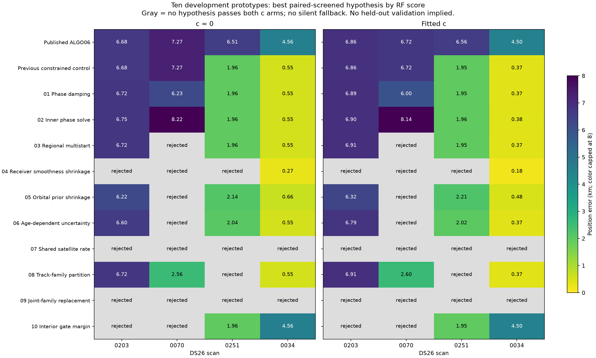
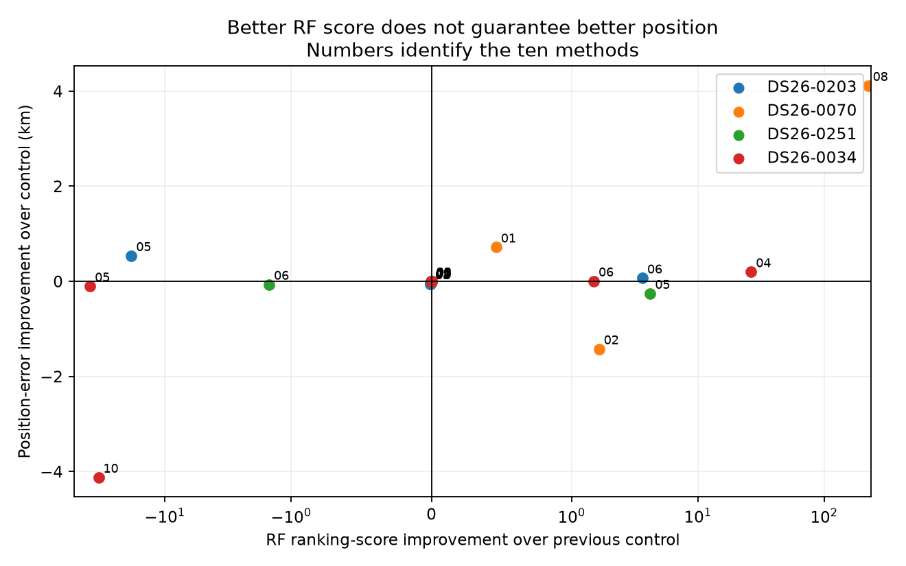
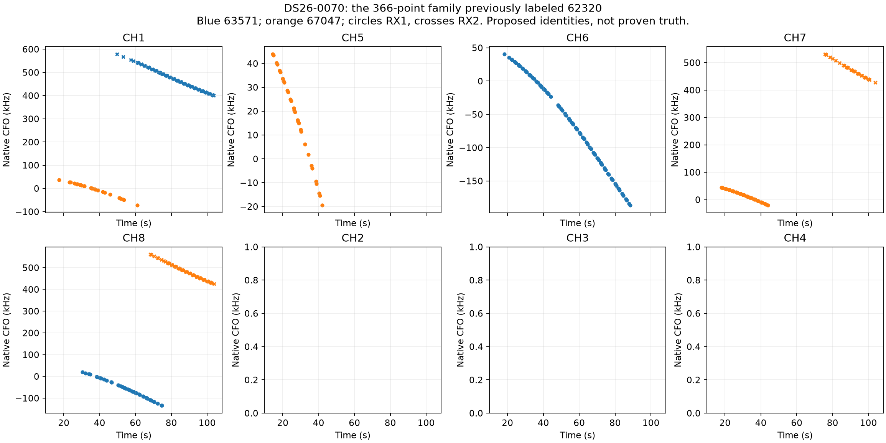
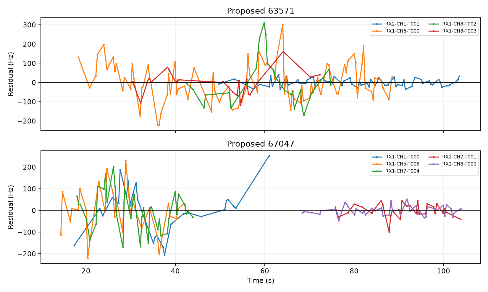
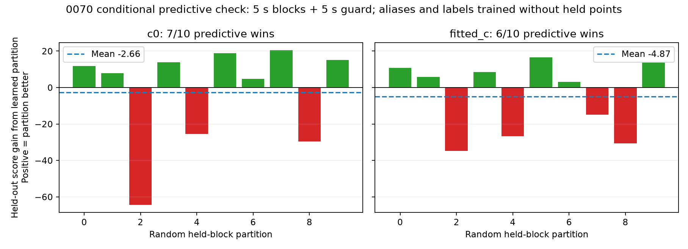
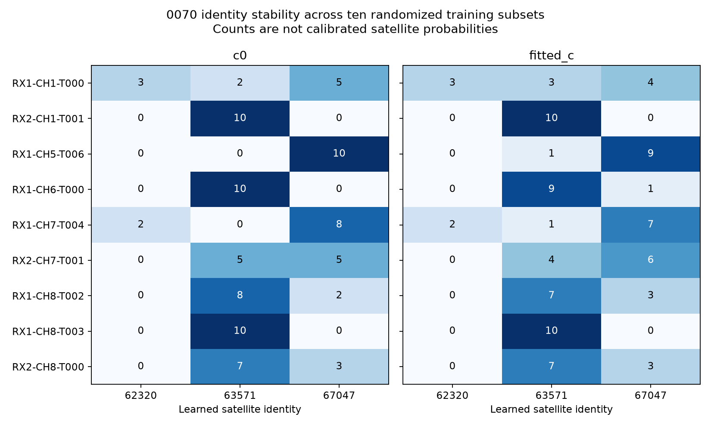

# Ten causal localization prototypes on the four DS26 outliers

2026-11-01. Research based on ALGO06 and the preceding constrained-reassociation experiment. Production is unchanged.

The strongest new lead is that DS26-0070's nine-track group may not represent one satellite. An RF-nominated partition into two identities retains all 366 fitted points and reduces position error to about **2.60 km**, with **2.56 km** in the matched `c=0` arm. However, a randomized-block conditional predictive check does not establish a reliable improvement: the partition's average held-out score is worse and several track identities change between subsets. Treat this as a useful model hypothesis, not a solved association.

DS26-0034 provides another warning. Tightening nonlinear receiver drift produces a promising sub-200 m fitted-`c` result, but even a modest interior margin on the existing gates changes the position substantially. The earlier 0.37 km result is sensitive to the nuisance model and residual constraints. More optimizer starts, lower in-sample residuals or passing the existing gates alone do not establish correctness.

## Ten distinct hypotheses

| # | Prototype | Mechanism tested | What is held fixed |
|---|---|---|---|
| 01 | Damped phase refresh | Use half of each proposed phase-reference update to suppress oscillation | RF likelihood, identities, bounds and final phase tolerance |
| 02 | Inner phase-consistency solve | Solve the phase fixed-point equations at each position evaluation, rather than alternating full position and phase steps | Existing likelihood and residual gates; inner solve bounded to 45 s per fit |
| 03 | Regional multistart | Score a 3×3 grid across the 25 km regional box; add the best two common RF-ranked starts | Same candidate bank, priors and local fitting procedure |
| 04 | Receiver smoothness shrinkage | Reduce nonlinear receiver smooth prior SD from 200 to 50 Hz | Receiver constants and linear drift remain; no per-track drift added |
| 05 | Physical orbit shrinkage | Halve the prior SDs of the existing physical orbital modes | Modes, observations, phase priors and hardware model |
| 06 | Age-dependent uncertainty | Add a phase SD of one second per 24 h TLE age in quadrature | No additive freshness score; all extra flexibility retains its normalized marginal-likelihood cost |
| 07 | Shared satellite frequency rate | Add one Gaussian frequency-rate term, SD 0.5 Hz/s, shared by the suspect satellite's tracks | No independent track slopes; all original constraints and observations |
| 08 | Whole-track family partition | Let complete graph tracks in the suspect group take different satellite identities | No point deletion, track truncation or polynomial splitting |
| 09 | Joint two-family replacement | Reconsider the suspect family together with a conflicting or influential second family | Causal catalogue, full-scan objective and ownership checks |
| 10 | Interior gate margin | Require a 0.05 normalized slack inside every optimization inequality | Original thresholds are still independently replayed; this is a stricter optimizer constraint |

All methods are applied to DS26-0203, 0070, 0251 and 0034 with both `c=0` and fitted-`c`. These are post-hoc development outliers, not a representative random validation set. The previous experiment's three soft TLE-age penalties and hard 48-hour cutoff remain separate controls; they are not repackaged as ten new algorithms here.

## Results and how to read them

Within each method, choose a hypothesis only if it passes the experiment's checks in **both** `c` arms. Select the best screened start within each arm and rank hypotheses by the sum of their paired normalized RF scores plus the declared partition/search penalty. Evaluation-site error never enters this selection. The table does not silently replace failed trials with ALGO06; rejected cells mean that no proposed hypothesis passed both arms. There is no automatically selected global winner across these ten methods.

Position errors below are kilometres in the fitted-`c` arm; the figure gives both matched arms. A dash means no hypothesis qualified in both arms.

| Method | 0203 | 0070 | 0251 | 0034 |
|---|---:|---:|---:|---:|
| Published ALGO06 | 6.858 | 6.716 | 6.561 | 4.498 |
| Previous constrained control | 6.858 | 6.716 | 1.949 | 0.374 |
| 01 Damped phase refresh | 6.885 | 5.999 | 1.948 | 0.374 |
| 02 Inner phase solve | 6.905 | 8.139 | 1.961 | 0.375 |
| 03 Regional multistart | 6.912 | — | 1.949 | 0.374 |
| 04 Receiver smoothness shrinkage | — | — | — | **0.176** |
| 05 Physical orbit shrinkage | 6.321 | — | 2.206 | 0.478 |
| 06 Age-dependent uncertainty | 6.792 | — | 2.015 | 0.370 |
| 07 Shared satellite rate | — | — | — | — |
| 08 Whole-track family partition | 6.912 | **2.601** | — | 0.374 |
| 09 Joint two-family replacement | — | — | — | — |
| 10 Interior gate margin | — | — | 1.949 | 4.498 |

The final inventory contains **372 attempts: 364 completed numerical fits and eight incomplete attempts**. Four attempts exceeded the 45-second nested-solver cap; four rejected phase requests outside the interpolation domain instead of extrapolating. Completed fits can still fail the acceptance screen. Earlier adapter failures are archived separately and are not counted as final successful trials. Five implementation and accounting tests pass.

The full [trial table](all_trials.csv) includes failed solvers, phase closure, exact-orbit gates, lost-owner counts and explicit incomplete attempts. [Selected variants](selected_variants.csv) gives the RF-chosen paired result, not the lowest GPS error among all attempts. The known evaluation position is used only after inference to calculate these errors.

Positive horizontal values indicate improved RF ranking score relative to the preceding constrained-reassociation control; positive vertical values indicate improved localization. A point in the lower-right quadrant improves the RF criterion but worsens position accuracy. Method numbers correspond to the table above. This is why a lower training objective cannot alone justify promotion.

## DS26-0070: test the family grouping, not just another phase value

The preceding investigation tried assigning the entire 62320 family to 67047 or 63571. Those whole-family replacements failed full-scan checks or phase convergence. Method 08 instead assigns **five original graph tracks to 67047 and four to 63571**, then jointly refits their shared satellite parameters and the scan position.

The training-data fit passes the existing profile/conditional residual, exact-orbit, visibility, support and phase-closure checks. It retains all published owners and relabels 366 points. Both common starting positions give approximately the same 2.60 km fitted-`c` result. The original fitted-`c` error was 6.716 km; the `c=0` error changes from 7.269 to approximately 2.555 km. The smallest original normalized gate slack is about 0.024, so the solution is still near a residual constraint.

The partition is proposed from pooled per-track RF residual costs under the previously calculated family-omitted receiver calibration. Every resulting satellite gets one shared phase and physical orbital correction in the full fit. An extra-family penalty `2 × extra_families × ln(number_of_native_family_points)` is included in the ranking score; for this proposal it is 11.81. This is a conservative research search penalty, not a calibrated posterior identity probability. The graph curves themselves are unchanged.

The figure contains only this 366-point family. Blue means proposed 63571, orange means proposed 67047; circles are RX1 and crosses RX2. Blank channel panels mean this selected family contributes no points there. These labels are hypotheses, not ground truth.

This does not establish that the graph algorithm incorrectly joined two curves. It shows that **grouping multiple existing curves under one satellite** can be too restrictive. Distinguishing an incorrect family grouping from position-dependent identity ambiguity remains necessary.

## Randomized prediction check: encouraging pieces, insufficient overall evidence

We added ten reproducible random holdouts of synchronized **5-second time blocks**, with a **5-second adjacent guard** excluded from training. The same blocks apply across receivers and channels. Each original track must have at least five training points and two test points; resampling to meet that requirement uses only data availability. Seed: `20261102`. Exact masks and rejected partition counts are in [the predictive protocol](predictive_protocol.json).

For every partition and `c` arm:

1. Freeze the RF-only position and receiver calibration estimated after omitting the entire suspect family. No evaluation-site calibration is used.
2. Fit candidate phase, one shared frequency rate and per-source offset priors on training blocks. Aliases are selected from training points only.
3. Relearn each whole-track label from training residual costs, then refit each resulting satellite group jointly.
4. Compare normalized held-point predictive densities, integrating linear-parameter uncertainty and the phase grid. Compare against the single-satellite hypothesis selected on training evidence.

This check uses a **reduced curve model**: 150 Hz noise, 300 Hz per-source offset priors, 0.5 Hz/s shared rate and 5 s phase prior. It omits the full production orbital-mode model and freezes receiver calibration. It tests the stability of the nomination, not the full pipeline's held-out position accuracy. The candidate universe was discovered previously using all scan data; these results are conditional model checks, not independent catalogue discovery or untouched-scan validation.

| Arm | Partition wins on held blocks | Median held-score gain | Mean held-score gain | Training evidence selects partition after penalty |
|---|---:|---:|---:|---:|
| `c=0` | 7 / 10 | +9.87 | **−2.66** | 0 / 10 |
| fitted `c` | 6 / 10 | +4.40 | **−4.87** | 0 / 10 |

Positive gain means the partition predicts better. A few substantial losses outweigh the majority of small gains. The folds overlap, so these win counts are not independent statistical trials or calibrated confidence levels.

Several tracks are stable—for example RX2 CH1 and RX1 CH8 T003 favor 63571 in all ten subsets of both arms. RX1 CH1 and RX2 CH7 are much less stable. The stable subset is a useful lead for the next nomination/refit experiment; this study does not silently accept it after inspecting these results.

## Other failure mechanisms exposed

**Phase convergence is a real issue, but not the whole issue.** Damping stabilizes an incumbent 0070 fit near 6.0 km. An inner phase solve can converge to a different poor position. Convergence verifies numerical consistency of a hypothesis, not its satellite identity. The regional multistart control adds common RF-ranked starts from the entire regional box; it is a bounded basin search, not proof of global optimality.

**Receiver flexibility matters in 0034.** The reduced nonlinear receiver prior gives approximately **0.176 km fitted-`c` / 0.268 km `c=0`**, with unchanged linear drift and original gates. The same reduction does not yield a qualified paired solution in the other three cases. It therefore supports a receiver-versus-orbit identifiability issue, not a universal instruction to tighten all receivers.

**Physical and age-dependent priors can improve RF score while degrading position.** Orbital shrinkage changes the 0251 replacement to about 2.21 km fitted-`c`, versus 1.95 km in the preceding control. Adding age-dependent phase variance is not the same as an age penalty: it grants more uncertainty to older elements but charges its marginal-likelihood cost. Neither should be promoted from these four cases alone.

**A small gate margin can have a large position effect.** For 0034's 59188 replacement, requiring 0.05 normalized interior slack gives about **2.04 km fitted-`c` / 3.68 km `c=0`**, rather than 0.374 / 0.551 km. Within that method the RF ranking can prefer the original identity again. For example, 0.05 slack changes a slope threshold from 3 to 2.85 and a step threshold from 4 to 3.8. That sensitivity means the previous endpoint is influenced by the shape of the feasible region. It does not justify relaxing gates until the known site passes.

**Joint reassociation did not supply a qualified paired repair in this bounded search.** Secondary families were nominated from the actual failing RF inequalities of a promising primary replacement, or from RF-only family influence when there was no such conflict. The secondary sources were 63377, 63679, 58729 and 69188 respectively. The longest secondary source was screened against the complete eligible causal bank, then the top two alternative phase nominees were propagated through the joint fit. This does not exhaust all two-family combinations.

**A shared satellite rate is not a free track slope.** The prototype adds one centered Gaussian column `0.5 × (t−150) × RF/11.5 GHz` to the suspect satellite, integrating it with the existing nuisance model. It includes that term in prediction and ownership replay. No tested hypothesis qualified in both `c` arms. The legacy event-extension helper retains its 15 s phase restriction for new extensions; this is a conservative limitation of this prototype and is recorded rather than interpreted as evidence against the physical rate model.

## Evidence and acceptance accounting

All fits preserve the same native curved-point inventory; no polynomial samples, alias copies, point pruning or chronological holdouts are introduced. The two `c` arms share observations, hypotheses, priors, starts and budgets within a method. The regional box remains 25×25 km centered on **37.906, −122.545**. Evaluation truth **37.849061591561885, −122.48574968092912** is used only for error reporting.

All satellite elements in inference are causal: element epoch and archive availability precede the scan cutoff, with the latest eligible element within 72 h. Later TLEs remain outside this experiment. The primary single-family candidate sets reuse the preceding causal discovery. Method 09 separately screens the eligible causal bank for the secondary source. It does not limit discovery to the desired identity or the evaluation site.

The final screen requires phase change ≤0.01 s, optimizer success, original residual/profile/alias/elevation/support gates, exact-orbit checks for all active curved families, integrated-family gates when applicable, retention of every published owner and no unplanned family reassignment. Rejected and incomplete attempts remain visible. Existing recovered gap and integrated-family likelihoods are retained, including scan 0251's conditional recovery and scan 0034's new-family mixture.

Association percentages for screened results remain the published values because this study changes explanations, not the admitted point inventory: **0203 56.03%, 0070 47.07%, 0251 63.62%, 0034 74.47%**. Incidental extension proposals are recorded but not adopted. This is a reminder that correcting an existing label can be more useful for position than increasing the association percentage.

## Recommendation

Do not promote a new ALGO from this suite. Prioritize a **joint identity-and-calibration investigation with independent predictive evidence**, concentrating on the stable 0070 fragments and on the receiver-versus-orbit tradeoff in 0034.

The next bounded implementation should retain multiple identity hypotheses for ambiguous tracks, let strongly curved independent fragments constrain shared parameters, and validate the resulting correction on other randomized blocks or scans. Phase damping is useful numerical housekeeping. Receiver/orbit priors and residual covariance should be calibrated from causal history and independent RF evidence, rather than selected to minimize these four known-site errors. Gate sensitivity needs explicit measurement before replacing hard checks with any probabilistic alternative.

After freezing the rule, compare it on reproducibly randomized whole-scan DS26/DS27 groups, leaving these four development cases out of the validation set. Report both `c` arms, ownership losses/reassignments, association percentage, median and tail error, predictive calibration, convergence failures and runtime. No untouched-scan validation or production improvement is claimed here.

## Reproduction and receipts

- [Frozen protocol](protocol.json), per-case `plan.json` files, [run manifest](run_manifest.json), [summary](summary.json).
- [All trials](all_trials.csv), [RF-selected variants](selected_variants.csv), [conditional predictive protocol](predictive_protocol.json), [predictive results](predictive_results.json).
- [Prototype implementation](experiment.py), [conditional predictive check](predictive_check.py), [renderer](render.py), [tests](test_experiment.py), [test output](tests.txt).
- [Preceding constrained-reassociation and age-penalty report](../2026_11_01_ds26_solution_prototypes/README.md).

Run from the recorded repository worktree with `/srv/bulk/leo-dev/fast-algo02-production-v1/.venv/bin/python` and `PYTHONDONTWRITEBYTECODE=1 OPENBLAS_NUM_THREADS=1 OMP_NUM_THREADS=1 PYTHONPATH=src:tools`. Execute `experiment.py DS26-XXXX prepare`, then `experiment.py DS26-XXXX METHOD` for each declared case/method; run `predictive_check.py`, `render.py` and `test_experiment.py`. Raw results and the earlier observation/TLE archives remain local; the report, figures, compact tables, protocols and source are published.

Adapter corrections were made during development: whole-family remapping must also remap its predictive entries, and the added rate coordinate must be included in conditional and integrated-family prediction matrices. Initial failed attempts are preserved separately and the affected jobs were rerun. No production component, persisted public contract, golden fixture, recording or QNAP path was changed.
