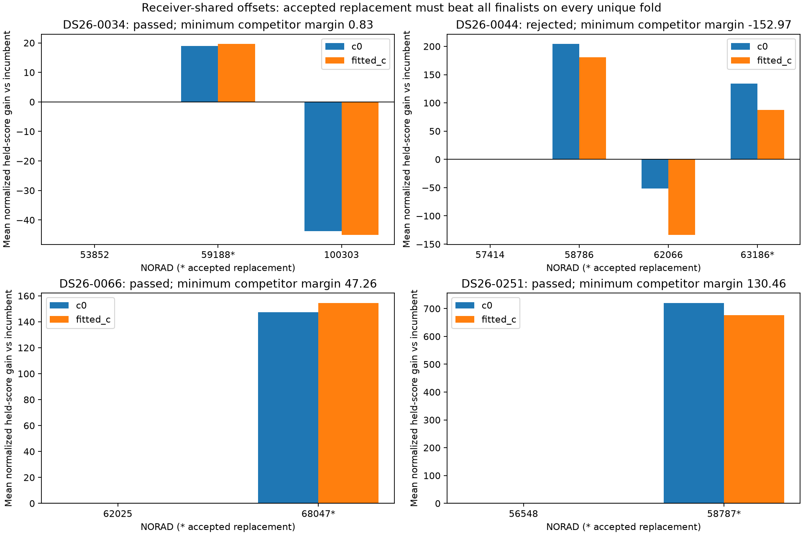
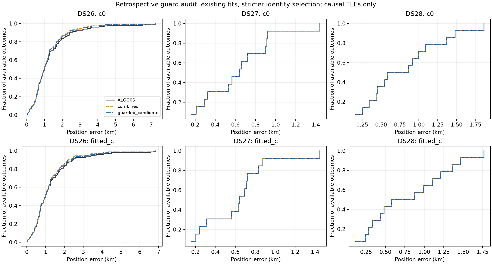
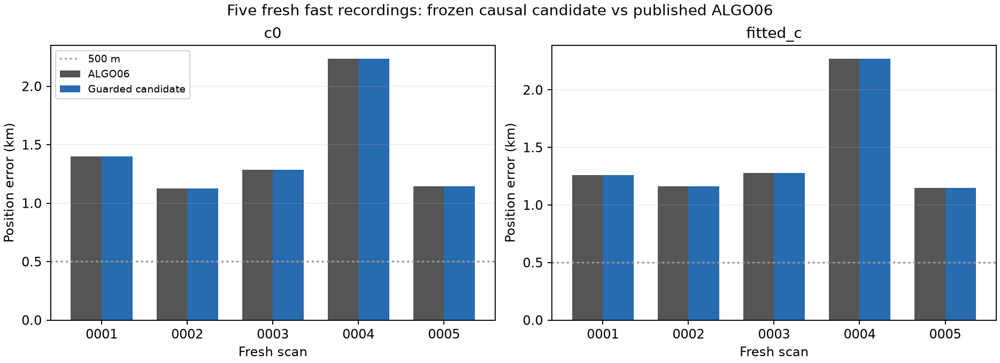

# Causal reassociation: promotion-readiness investigation

2026-11-01. Follow-up to the [175-outcome population study](../2026_11_01_reconsideration_population/README.md). **Production remains ALGO06.** This study implements and tests a bounded research candidate; it does not install a production worker, change a persisted contract, or mint a new ALGO version.

## Decision

Move forward with the guarded candidate for shadow qualification. The guard retains three large development repairs, withholds the model-ambiguous DS26-0044 replacement, and does not publish standalone prior changes. The existing-cohort analysis is a retrospective decision-layer audit over saved fits, not an independent rerun of the new implementation on all 175 scans. The five fresh fast scans were run through the frozen new implementation: **5/5 completed their searches; 0/5 changed their published endpoint**. Every other outcome retains its exact baseline, with incomplete searches distinguished from completed rejections.

The remaining prerequisites for a production default are an isolated production adapter/release with exact replay parity and shadow operation, plus more independent evidence for the changed cases and remaining model sensitivity. Small same-site validation with few or no accepted corrections cannot establish a population tail guarantee. Neither the current candidate nor this study achieves 500 m typical accuracy.

## What the three investigations found

1. **Association validation:** receiver-shared offsets and unique guarded time groups support 0034, 0066 and 0251 over every tested finalist in both c arms. Scan 0044 loses to 58786 in held prediction, although 58786 fails full joint curvature gates. NORAD 63186 is a qualified bounded full-model hypothesis, not a uniquely established identity. Scan 0034 has a small worst-fold margin and gate/position sensitivity; 0066 has no target RX2 transfer evidence. [Full evidence and figures](validation/report.md).
2. **Two-family replacements:** neither 0203 nor 0070 improves under the unchanged acceptance checks. Scan 0070's aggregate joint predictive gain hides one family's losses in all five folds; the pair subsequently fails physical/owner checks. Scan 0203's nominees already own other tracks, making shared-identity merging a separate unresolved problem. A pooled frozen-alias merge fails; this does not exhaust proper joint alias/phase discovery. [Full evidence and figures](joint/report.md).
3. **Prior regression:** the standalone 64938 predictive mixture, whose phase width expands from 1 to 15 s, explains most of 0058's regression. Phase-width-only changes in the calibration families are nearly null; physical radial tightening helps slightly. Relaxing 64938's prior reduces its normalized RF penalty and position-dependent pull, worsening error despite improving fit. This does not prove the old 1 s fallback physically correct or justify a scan-specific cap. [Full ablation and figures](prior/report.md).

## Retrospective population audit

| Dataset | Method | N | Mean c=0 / fitted-c km | Fitted-c median / P95 km | Improved / regressed >25m |
|---|---|---|---|---|---|
| DS26 | ALGO06 | 148 | 1.313 / 1.296 | 0.983 / 3.551 | 0 / 0 |
| DS26 | combined | 148 | 1.226 / 1.208 | 0.982 / 2.939 | 7 / 1 |
| DS26 | guarded_candidate | 148 | 1.242 / 1.223 | 0.977 / 3.276 | 3 / 0 |
| DS27 | ALGO06 | 13 | 0.638 / 0.619 | 0.641 / 1.106 | 0 / 0 |
| DS27 | combined | 13 | 0.638 / 0.619 | 0.641 / 1.106 | 0 / 0 |
| DS27 | guarded_candidate | 13 | 0.638 / 0.619 | 0.641 / 1.106 | 0 / 0 |
| DS28 | ALGO06 | 14 | 0.812 / 0.803 | 0.726 / 1.571 | 0 / 0 |
| DS28 | combined | 14 | 0.812 / 0.803 | 0.726 / 1.571 | 0 / 0 |
| DS28 | guarded_candidate | 14 | 0.812 / 0.803 | 0.726 / 1.571 | 0 / 0 |

The guarded candidate keeps 0034 (4.498→0.374 km), 0066 (2.370→1.218 km), and 0251 (6.561→1.162 km), fitted-c. The observed absence of regressions is development evidence because the guard was designed after reviewing the earlier population results. Both arms preserve every native owner count. Coverage remains 71.256% for DS26, 78.252% for DS27, and 74.969% for DS28. The 175 usable outcomes retain the earlier explicit compute fallback; 15 upstream unavailable acquisitions remain in the parent 190-acquisition accounting.

The guard cannot repair the two worst failures, whose fitted-c errors remain 6.858 and 6.716 km. Its smaller mean gain than the broad combined method is the cost of withholding ambiguous/prior-only outcomes. Missing fits, insufficient unique partitions, and failed rivals are explicitly distinguished; no GPS error selects a satellite or overrides a decision.

## Fresh fast-scan validation

The cohort contains all five whole fast acquisitions after the DS28 revision 2 cutoff found in the two canonical live fast-recording roots at the frozen inventory time. Raw-content duplicates are deduplicated, and all five have completed public ALGO06 baselines. This is a bounded live-root cohort, not a new DS-number or exhaustive all-storage census. The user confirmed the same evaluation site; it is used only for endpoint error reporting. No new RF collection or IQ reprocessing was initiated.

| Case | Recording UTC | c=0 before → after km | Fitted-c before → after km | GLRT associated | Search status |
|---|---|---|---|---|---|
| FRSH-0001 | 20261101 152415 | 1.398 → 1.398 | 1.258 → 1.258 | 81.57% | complete |
| FRSH-0002 | 20261101 164939 | 1.125 → 1.125 | 1.162 → 1.162 | 66.53% | complete |
| FRSH-0003 | 20261101 181502 | 1.284 → 1.284 | 1.279 → 1.279 | 64.09% | complete |
| FRSH-0004 | 20261101 193254 | 2.237 → 2.237 | 2.272 → 2.272 | 73.48% | complete |
| FRSH-0005 | 20261101 211322 | 1.145 → 1.145 | 1.149 → 1.149 | 75.14% | complete |

| Arm | Method | N | Mean km | Median km | Worst km | Below500m |
|---|---|---|---|---|---|---|
| c0 | ALGO06 | 5 | 1.438 | 1.284 | 2.237 | 0 |
| c0 | guarded_candidate | 5 | 1.438 | 1.284 | 2.237 | 0 |
| fitted_c | ALGO06 | 5 | 1.424 | 1.258 | 2.272 | 0 |
| fitted_c | guarded_candidate | 5 | 1.424 | 1.258 | 2.272 | 0 |

All five searches completed normally. Eight triggered families produced nine whole-family proposals. Only FRSH-0003's 48289→63926 passed the inherited predictive screen; its receiver-shared minimum competitor margin was −19.947, so the new guard withheld it. No proposal reached history completion or joint control/candidate fitting. These fresh scans validate nomination, screening and exact fallback behavior, **not successful replacement end-to-end or an accuracy improvement**. Median supervisor latency was 76.61 s; the maximum was 95.29 s, below the 1200 s cap. The [execution audit](execution-audit.json) verifies all 1971 source and 12339 input hashes after completion.

Inputs are private verified copies exported through the read-only ALGO05 port and the public ALGO06 terminal. None of the five has an ALGO06 additive recovery. Preflight reproduces all five published fitted-c positions with exactly 0° difference, both full owner maps, and normalized objectives. It does not substitute an earlier pipeline result. [Preflight](candidate/preflight.json), [compact fresh inventory and raw archive hash](fresh-inventory-compact.json), [fresh outcomes](fresh_summary.json), [per-scan metrics](fresh_positions.csv).

## Frozen guarded algorithm

The [runner](run_candidate.py) consumes the exact ALGO06 state and complete causal catalogue. It uses the prior RF-influence top-two-family trigger, at least 30 native points and two tracks, with at most two whole-family nominees each. It preserves original observation weights, aliases/graph evidence, inherited predictive gates, shared hardware and physical orbit priors, and the 25×25 km box centered at 37.906, −122.545. No recency penalty or later TLE enters inference.

Before expensive fitting, every proposed replacement must beat all common finalists, including the incumbent, on every distinct held-group partition in both c arms. New checks use up to 10 unique randomized 5 s time groups with 5 s guards, seed 20261111, requiring at least 5 valid distinct held sets. Offsets are shared per receiver with 300 Hz sigma, one shared rate uses 0.5 Hz/s sigma, phase sigma is 5 s on ±30 s, and noise is 150 Hz. The minimum normalized predictive margin must be strictly positive. This is an ordering guard, not a calibrated probability; overlapping training sets and full-data nomination prevent an independent-discovery interpretation.

Only admitted identity replacements cause causal history completion and full physical refits. Both arms, candidate and incumbent control, receive the same published fitted-c and family-omitted fitted-c starts, 15 phase rounds and 40 position iterations. Require original residual and exact-orbit gates, successful optimization, phase closure ≤0.01 s, interior mixture phase mass, matched native fit IDs, no lost owners, and no reassignment outside the target family. Destination identities already owning baseline points are excluded; merging remains a separate research problem. RF gain must beat both the matched-prior continuation and conservative published bounds, including the inherited shortlist penalty. At most one replacement is adopted. Prior-only changes, continuation-only changes and partial-track partitions cannot publish.

[Propagation eligibility](propagation_audit.md) explicitly separates uniform all-grid SGP4 model-invalid elements from incomplete propagation. The six historical failure instances are code 1 on all 381 knots; this is not a physical-decay diagnosis. Such elements lie outside the successfully propagatable model universe. Partial, mixed, unknown, or nonfinite-without-error failures block the run. All five fresh catalogues have zero failures. Candidate competition remains conditional on the bounded shortlist; it is not exhaustive exact fitting of every catalogue element.

Each scan runs in a separate supervised process with a 1200 s hard cap and exact ALGO06 fallback. Any incomplete candidate/control fit, worker failure or unmatched propagation failure prevents a partial winner from publishing. No renewed budget is silently granted after an incomplete attempt. Frozen inputs cover the complete exported tree, actual previous-TLE paths/receipts, numerical source files and runtime versions. Root boundaries prevent writes to sealed evidence or production. [Frozen candidate protocol](candidate/protocol.json), [policy](policy.py), [tests](candidate-tests.txt).

## Next promotion gates

1. Port this frozen candidate behind a versioned read-only ALGO06 export and isolated result namespace; keep production contracts immutable and verify exact scientific parity on both arms.
2. Exercise a successful replacement canary through the production adapter, then shadow it on future fast recordings with an explicit budget/fallback, retaining every unavailable or failed case. Check false replacement behavior as well as error and runtime; the five fresh scans alone are insufficient because no replacements activated.
3. Keep the unresolved pair/merge work outside this candidate. For the next joint test, require support for each affected family under joint calibration before allowing aggregate gains to select a pair, and jointly nominate aliases/phases for existing-family merges.
4. Review broad error and tail metrics before a new ALGO version/default. The 500 m objective needs improvements to typical scan information, not only a few outlier replacements.

All source, numerical receipts, figures and compact tables are local research outputs. The publication manifest distinguishes versioned artifacts from large local-only export/array archives and records their hashes. Source provenance and passed tests are recorded in each branch's manifest. No production files, golden fixtures, QNAP paths, RF settings or published observations were changed.
