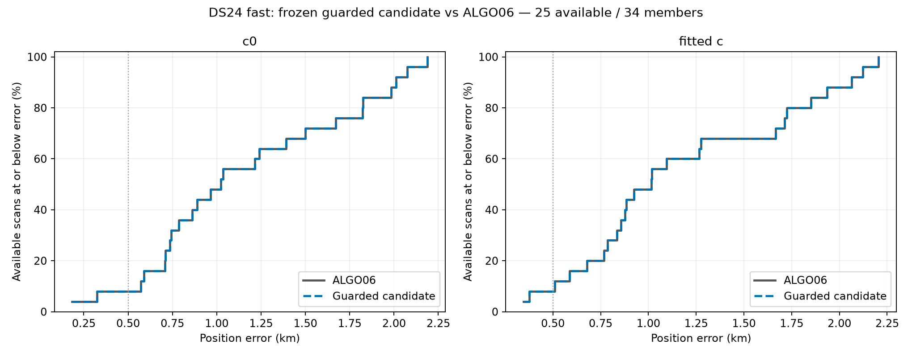
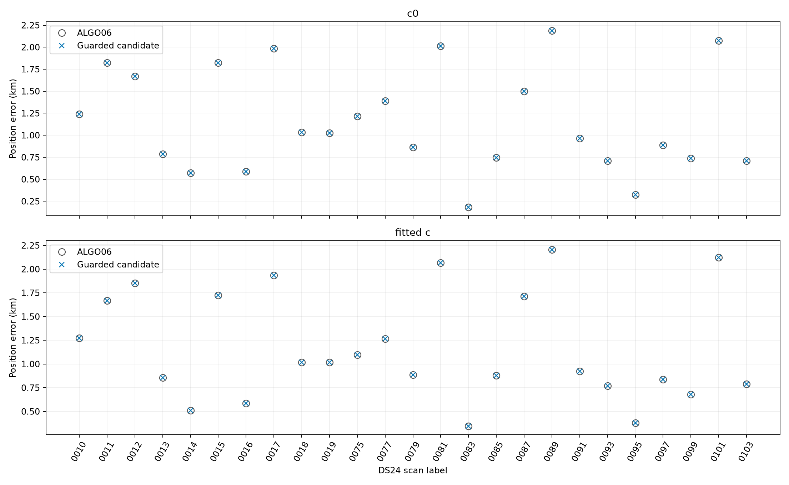

# DS24 fast: guarded reassociation versus ALGO06

This completes the requested DS24 comparison using the frozen guarded candidate from the [promotion-readiness report](../README.md). Production remains ALGO06. The candidate has no new ALGO number and this evaluation changes no production state.

## Cohort and result

All 34 fast comparison acquisitions remain accounted for: 25 have saved qualified ALGO06 baselines and nine lack the frozen GLRT inputs. No scan is selected by geographic error. Candidate selections: **0/25**. Execution statuses: `{'complete': 25}`. Missing baselines receive no invented position error.

| Arm | Method | N | Mean km | Median km | P95 km | Worst km | GLRT associated |
|---|---|---|---|---|---|---|---|
| c0 | ALGO06 | 25 | 1.162 | 1.024 | 2.063 | 2.188 | 72.78% |
| c0 | guarded_candidate | 25 | 1.162 | 1.024 | 2.063 | 2.188 | 72.78% |
| fitted_c | ALGO06 | 25 | 1.175 | 1.017 | 2.110 | 2.205 | 72.78% |
| fitted_c | guarded_candidate | 25 | 1.175 | 1.017 | 2.110 | 2.205 | 72.78% |

## Comparison across evaluated datasets

The table reports mean fitted-c error. DS24 and the five fresh scans execute the new frozen candidate. DS26–28 retain the earlier retrospective decision-layer audit; they are not newly rerun here. DS23 still lacks this comparison. DS25 is adaptive-only; its 34 fast comparison recordings are these same DS24 members.

| Cohort | Available scans | ALGO06 km | Guarded candidate km | Evidence |
|---|---|---|---|---|
| DS24 | 25 | 1.175 | 1.175 | New candidate execution |
| DS26 | 148 | 1.296 | 1.223 | Retrospective saved-fit audit |
| DS27 | 13 | 0.619 | 0.619 | Retrospective saved-fit audit |
| DS28 | 14 | 0.803 | 0.803 | Retrospective saved-fit audit |
| Five fresh scans | 5 | 1.424 | 1.424 | New candidate execution |

## What was executed

The unchanged [candidate runner](../run_candidate.py), [acceptance policy](../policy.py), receiver-shared predictive checks, seeds, causal 72-hour catalogue, ±30 s phase bound, 25×25 km regional box, two prescribed starts, 15 phase rounds, 40 position iterations and 1200-second per-scan cap were retained. Eight isolated subprocesses run in parallel, with one numerical thread each. Both c arms use the same observations, nominees, priors and budgets. The known GPS site is used only for reporting error, never satellite selection or acceptance.

The [DS24 adapter](evaluate_ds24.py) composes the exact saved 72h/±30s ALGO06 research outcome, including its accepted addition where present. These are the same outcomes used in the [ALGO06 comparison](../../2026_11_01_ds24_plus_error_comparison/README.md); they are not newly fetched live production terminals. Before candidate search, all 25 baselines must reproduce both endpoints, normalized frequency objectives and native owner maps. The frozen input tree and complete prepared dependency trees are hashed before execution. Candidate and original sources are pinned independently; no scientific function or acceptance threshold is changed.

This is a new conditional reassociation evaluation over saved GLRT/graph/ALGO06 states, not a raw-IQ or regional cold-start rerun. The additional adapter only selects the DS24 input root, verifies saved-baseline authority and supervises the unchanged worker. Its baseline receipts explicitly identify research provenance and do not claim public V5 verification.

## Search accounting and limits

The search triggered 40 families and saved 54 proposals. Of those, 6 were diagnostic partitions, which the frozen candidate excludes from acceptance. There were 3 subsequent admission decisions: 2 destinations already owned baseline points and were excluded; 1 passed the receiver-shared predictive guard. Causal-history preparations: 1; full-fit proposal decisions: 1. Completed searches: 25/25. The policy preserves the exact ALGO06 baseline for rejected or incomplete searches. See [complete decisions](summary.json) and [per-scan metrics](positions.csv).

Median supervised candidate latency was 83.20 seconds; maximum 608.78 seconds. These are additional candidate costs, not total acquisition/GLRT/ALGO06 pipeline runtime; they include the worker's frozen-input validation and baseline replay.

DS24-0079 exposes an expensive baseline case. It already contains recovered families 100192 (44 points, ±15 s at 0.025 s spacing) and 63045 (62 points, ±30 s at 0.05 s spacing). Each has 1,201 phase nodes, so the exact shared-calibration likelihood integrates 1,442,401 pairs per objective evaluation. Influence ranking repeatedly evaluates this likelihood while omitting calibration families. A [nonblocking live stack snapshot](0079-runtime-stack-privileged.txt) caught that numerical integration inside `rank_families`; this is a mechanism diagnostic, not a statistical runtime profile. [Derived grid receipt](0079-runtime-analysis.json). The evaluation preserves the exact baseline and budget instead of dropping a recovered family or coarsening its phase grid.

Full-fit decisions below use the unchanged RF criterion: penalized gain must be positive in both arms, in addition to the physical and predictive gates. Trial position errors never select the outcome and rejected trials are excluded from the headline accuracy distributions.

| Scan | Proposal | Arm | Physically qualified | Penalized RF gain | Accepted |
|---|---|---|---|---|---|
| DS24-0010 | 65480_to_47797 | c0 | True | -22.939 | False |
| DS24-0010 | 65480_to_47797 | fitted_c | True | -23.778 | False |

DS24 was already studied during earlier algorithm development; this is additional existing-cohort qualification, not untouched-site validation. Lower frequency loss is reported separately in the per-scan table and never treated as proof of better positioning. An unchanged result does not establish that its satellite assignments are correct: the search only considers the frozen top-two influential families and bounded nominees. No gate is retuned using this evaluation. An initial preflight invocation before input preparation finished stopped on a missing roster, before any candidate search; its log is retained separately.

## Reproduction and audit

Run `evaluate_ds24.py prepare`, then `preflight`, `freeze`, and `run --workers 8` using the pinned numerical environment. The published protocol and audit record exact file hashes and runtime versions. Large prepared inputs remain local. [Tests](tests.txt), [preflight](candidate/preflight.json), [frozen protocol](candidate/protocol.json), [roster](roster.json), and [execution audit](execution-audit.json) retain the evidence needed to distinguish missing input, screening rejection, incomplete fit and accepted replacement.

The [publication manifest](publication-manifest.json) hashes the published artifacts and locally retained detailed fit/worker archives. Complete prepared-input hashes remain in the frozen protocol; candidate screening and final decision records are published.
