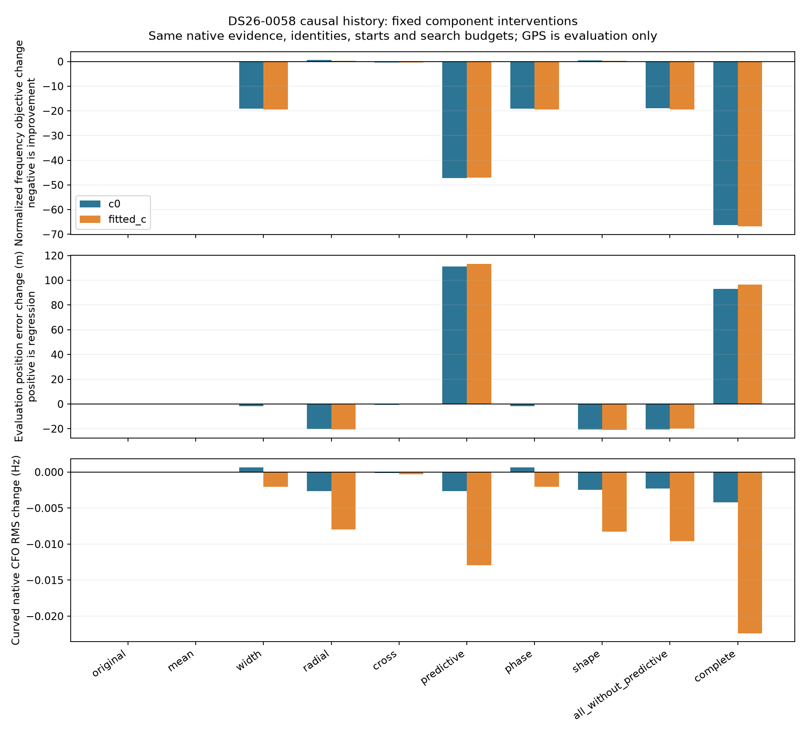
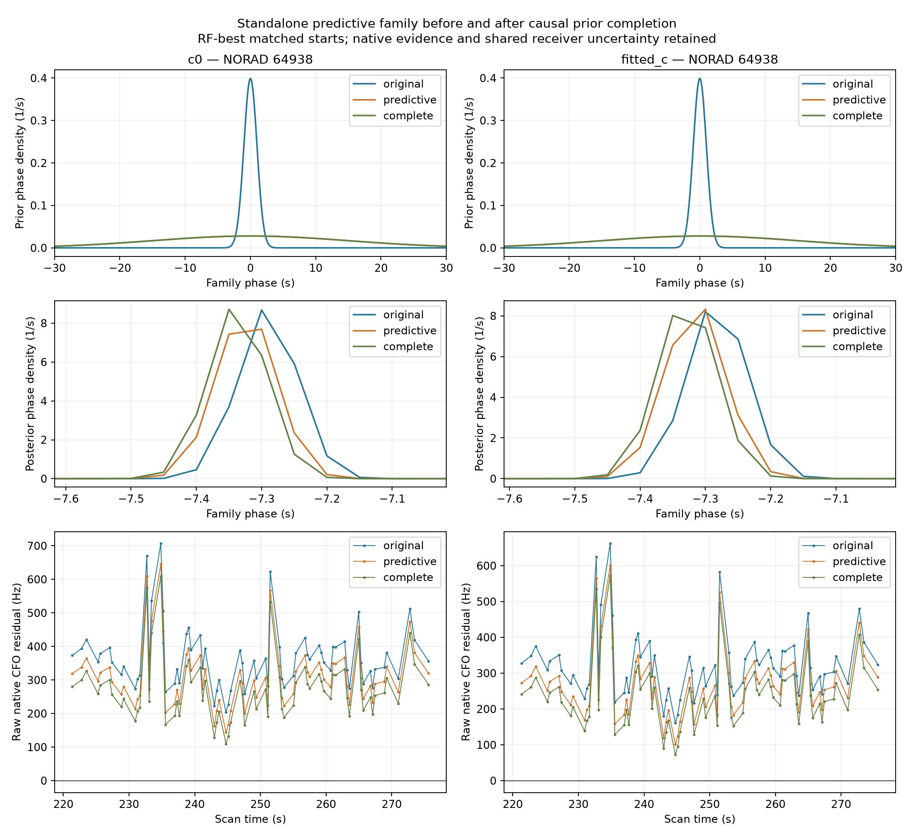

# DS26-0058 causal history component ablation

The 64938 predictive-family relaxation is the main isolated source of the location regression. Predictive-only changes fitted-c error from 977.261 to 1090.651 m; completing every prior gives 1073.727 m. Calibration phase-width changes alone give 976.769 m, and radial uncertainty alone 956.692 m. This is not explained by the calibration phase width alone.

This is a diagnostic of one known regression, not independent population validation. All ten component cells were fixed before fitting. Each cell used the exact original ALGO06 native observations and identities, the same two published RF starts in both c arms, the inherited 15 phase rounds / 40 SLSQP iterations, and unchanged gates. The best qualified start was selected by normalized RF objective only. No cross-cell model was selected or promoted.

The causal prior changes reach three distinct scopes: calibration phase widths, the physical radial/cross-track covariance, and the standalone 64938 predictive mixture. Phase means are exactly zero before and after because the learned shrinkage is zero; the mean-only intervention is an exact null. The original mechanism inventory omitted the 64938 mixture change: its phase prior standard deviation changes from 1 to 15 s. The mean/width cell concerns the calibration families; predictive-only changes the whole standalone mixture prior and orbital modes while retaining the shared receiver covariance once.

| Cell | c=0 error (m) | fitted-c error (m) | c=0 objective change | fitted-c objective change | c=0 RMS change (Hz) | fitted-c RMS change (Hz) |
|---|---:|---:|---:|---:|---:|---:|
| original | 1001.203 | 977.261 | 0.000 | 0.000 | 0.000 | 0.000 |
| mean | 1001.203 | 977.261 | 0.000 | 0.000 | 0.000 | 0.000 |
| width | 999.420 | 976.769 | -19.125 | -19.438 | 0.001 | -0.002 |
| radial | 981.043 | 956.692 | 0.574 | 0.312 | -0.003 | -0.008 |
| cross | 1000.644 | 976.971 | -0.413 | -0.420 | -0.000 | -0.000 |
| predictive | 1112.451 | 1090.651 | -47.208 | -47.097 | -0.003 | -0.013 |
| phase | 999.420 | 976.769 | -19.125 | -19.438 | 0.001 | -0.002 |
| shape | 980.713 | 956.428 | 0.483 | 0.213 | -0.002 | -0.008 |
| all_without_predictive | 980.486 | 957.547 | -18.867 | -19.407 | -0.002 | -0.010 |
| complete | 1094.314 | 1073.727 | -66.301 | -66.716 | -0.004 | -0.022 |

Objective differences include hierarchical likelihood and predictive-density normalization. A negative objective change is better frequency evidence under that cell; it does not establish improved position accuracy. RMS covers curved native calibration data, while the objective additionally scores predictive linear data and the standalone mixture. Endpoint changes are available in [comparisons.csv](comparisons.csv); every start, including failures, is preserved in `fits/`.

At the original fitted-c endpoint, the phase-width cell changes the objective by -19.419, radial by 0.322, cross by -0.416, and predictive mixture by -46.954. Those fixed-position shifts are density effects and cannot alone explain which component moves the position. The matched fits and [local sensitivity](local_sensitivity.json) separate them from changes in the spatial objective.

The intervention audit reconstructs the original and completed-history objectives to within 1e-5 at both published endpoints before any fitting. Component-owned checks verify unchanged native evidence, no unintended prior changes, matched starts, causal archive availability, and zero-mean null behavior. Causal export receipt epochs are strictly earlier than nominal; archive collection is within the original 72 h window and before the scan cutoff. Hybrid intervention mode metadata retains original provenance flags while numeric radial/cross scale fields and mode arrays take the declared sources; use `history/export.json` for the causal provenance of the supplied history.

General safety criteria supported for further testing: audit every prior consumer rather than only calibration families; assess history-derived prior distributions with strictly causal, randomized whole-group predictive validation; require RF improvement to transfer under both c arms and perturbations of orbital and receiver priors; evaluate localization changes separately on a frozen RF-defined population. A large in-sample normalized-score gain is insufficient as a localization safety certificate. This single regression does not validate a new width cap, radial floor, covariance weight, or history-age cutoff, and supplies no basis for scan-specific prior constants.

Limits: fixed associations and inherited graph/alias choices; no fresh catalogue discovery or RF collection. Local score stencils keep the saved phase reference fixed and are descriptive, not independent validation. Component effects can interact, so additive attribution is not assumed. No production files, public contracts, sealed results, or golden fixtures changed.

Reproduce with the Python environment and commands in the parent manifest: `ablate.py freeze`, `ablate.py run`, `local_sensitivity.py`, `test_ablate.py`, then `render.py`. `spec.json` retains the original frozen design; `execution_amendment.json` records a prefit implementation-only correction after a KeyError, with no fit outcomes available and no cell design change. Existing `fits/` are caches, so use a fresh copied output directory for a wholly new execution. Input and code hashes are in the frozen specification and amendment.

The fixed-position subablation of the 64938 mixture further isolates phase-width relaxation. Its normalized objective changes from 903.132 to 855.550 with width only; the full mixture-prior change gives 856.178. The mixture spatial gradient (east, north), in objective units/km, changes from [0.616, -2.416] to [0.128, -0.378]. The wider phase distribution gives much less positional pull from this family. This is a local model mechanism; it does not prove the original prior was physically correct or the completed orbit wrong.

Two additional contexts were selected by the largest minimum RF gain across c arms among accepted history-only scans, excluding DS26-0058; position errors were absent from that selection rule. Their endpoints reuse the exact saved matched fits, and the new component audit keeps each original RF position fixed. These are contextual checks, not fresh holdouts.

| RF-selected scan | c=0 position-error change (m) | fitted-c position-error change (m) | c=0 objective change | fitted-c objective change |
|---|---:|---:|---:|---:|
| DS26-0062 | -6.206 | -6.075 | -63.249 | -63.318 |
| DS26-0060 | -141.370 | -131.711 | -45.211 | -45.088 |

Their complete prior interventions and raw receipts are in [rf_comparisons](rf_comparisons/spec.json). Shared identities and nearby observations may make these contexts correlated; they do not establish independent generalization.

DS26-0062 has a different standalone family, 67821, whose phase width grows from 1 to 4.163 s; its predictive-mixture score accounts for about 54.3 of the 63.2-unit fixed-position score gain, yet localization improves only about 6 m. DS26-0060 has no standalone mixture; its calibration phase-width change supplies about 42.9 score units, and localization improves about 132–141 m. These contexts rule out treating every history-induced widening as the same numerical mechanism or applying a universal rejection based on the DS26-0058 outcome alone.

The family figure uses the saved RF-best qualified endpoint in each cell. It shows prior and posterior phase density and raw native CFO residuals, including every retained family point; the likelihood integrates a shared per-track bias, so raw residual means need not be zero. The phase posterior remains near -7.3 s with a roughly 0.045 s posterior standard deviation. That location is about 7.3 original-prior standard deviations from zero, versus about 0.49 after widening to 15 s. The normalized score gains largely reflect relief of this old phase-prior penalty, while its position-coupled pull also changes. This does not prove the 1 s fallback was physically right or the completed-history width physically wrong. No identity-confidence probability is inferred.
