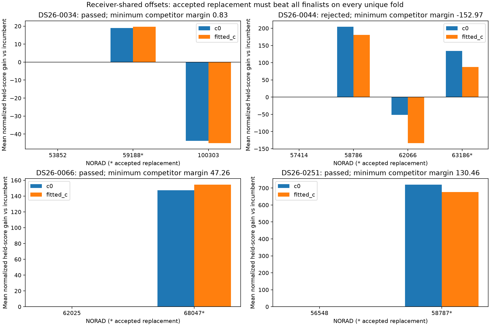
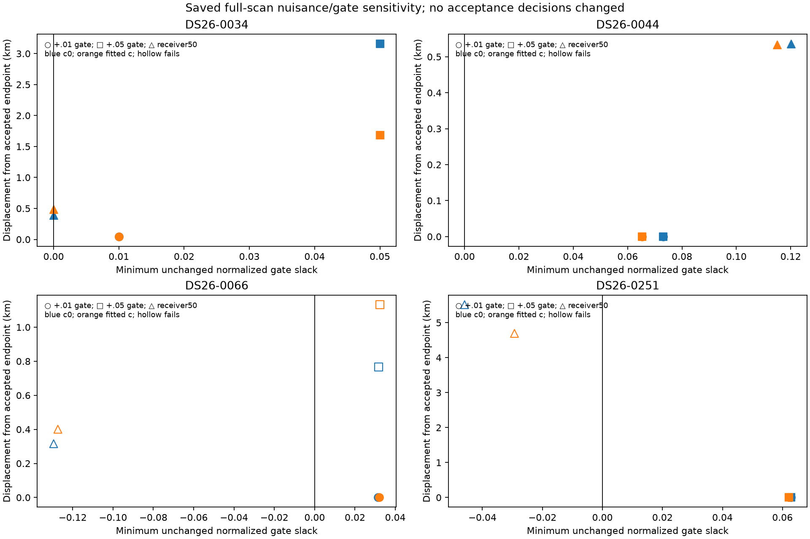

# Four causal replacement associations: promotion evidence

The four replacements reproduce the sealed joint RF acceptance, preserve native evidence, and improve held-track prediction against their incumbents. **They do not all establish a unique identity.** A conservative additional guard against every matched finalist passes 0034, 0066 and 0251, and rejects 0044. Keep exact ALGO06 fallback for rejected, missing or incomplete evidence. These are conditional diagnostics of already selected families, not a fresh catalogue-discovery or untouched-cohort validation.

| DS26 scan | Incumbent → selected | Target native points / tracks / receivers | Strict receiver-shared guard | Smallest predictive margin over every competitor/fold/arm | Decision limit |
|---|---|---|---|---|---|
| 0034 | 53852 → 59188 | 119 / 3 / 2 | Pass, 6 unique partitions | +0.828 | Model-sensitive: small predictive margin, large gate-margin displacement and orbital correction |
| 0044 | 57414 → 63186 | 241 / 7 / 2 | Reject, 10 partitions | −152.971 | Ambiguous: 58786 predicts better in the reduced models, despite failing joint residual gates |
| 0066 | 62025 → 68047 | 140 / 5 / 1 | Pass, 10 partitions | +47.257 | Supported within the two-finalist inventory; joint acceptance is nuisance/gate-sensitive and RX2 transfer is unavailable |
| 0251 | 56548 → 58787 | 219 / 6 / 2 | Pass, 10 partitions | +130.461 | Supported within the two-finalist inventory; receiver-prior perturbation fails joint gates |

The guard is an explicit **proposed RF-only promotion control**, not an acceptance rule prespecified in the sealed population study. It retains the original five-fold evidence requirement but requires five *distinct held-group assignments* and a strictly positive minimum margin, with no threshold fitted to GPS errors. It is now implemented as a reusable function for future frozen evaluation. The zero threshold is an ordering control, not a calibrated significance level or identity probability. Overlapping training sets and repeated held groups across otherwise distinct partitions remain correlated.



## Scope and matched comparisons

Revision `326c109601ef85007142dd6dcd22f13cba7f43c8`; source and observation evidence comes from the sealed [population study](../../2026_11_01_reconsideration_population/README.md). No production code, public contract, sealed numerical helper, ownership artifact, RF collection or QNAP path was changed. All new files are under this validation directory. Nominal element epochs and archive collection times satisfy the original causal cutoff and 72-hour catalogue policy. [TLE provenance](tle_inventory.csv) records the actual finalist element hashes and times. Retrospective TLE comparison is **not evaluated by request**, not failed.

The original full causal bank received a coarse two-longest-track, phase-grid nomination. Only the resulting common finalists received reduced predictive fits; eligible proposals received the bounded joint position fits. Exact fitting every eligible catalogue member, independent catalogue discovery, and a new cold regional solve were not run. In particular, two-finalist cases 0066 and 0251 establish superiority to their nominated incumbents, not exclusion of every feasible satellite. Competitor 100303 in 0034 and 62066 in 0044 were reduced-model fitted but not jointly fitted after predictive rejection; this missing joint work is separate from a measured gate failure.

Both c arms use the same native points, finalist inventory, folds, phase grid, nuisance priors and budgets. The additional fits freeze the existing RF-only family-omitted position and radio calibration. Alias integers are selected on training data for each intact graph track; one phase is shared across the satellite family. Training uses Gaussian 150 Hz noise, a 0.5 Hz/s satellite-shared rate discrepancy centered at scan time 150 s, and either per-track 300 Hz constants (legacy diagnostic), receiver-shared 300 Hz constants, or frozen radio with no extra constants. The rate term is a discrepancy model, not proof of an orbital error. Receiver-shared constants test a physical scope restriction but are not an independently learned receiver calibration across unrelated families.

Randomized folds use seed `20261111`, synchronized 5-second groups, a 5-second guard on either side of each held group, and approximately 20% held groups. Every intact source needs at least five training and two held points. Held assignments are unique. 0034 yields only six valid unique assignments within the bounded 10,000-attempt construction budget; it is not presented as ten independent folds. The original 0034 five nominal folds contain only three unique assignments. Other new cases have ten. Partitions and exact observation IDs are saved in each `additional_checks.json` and `native_predictive_arrays.npz`.

The primary guard requires at least five unique partitions, both c arms, complete normalized predictive scores for the entire common finalist universe, and `competitor_score − proposed_score > 0` on *every* retained fold against *every* competitor. A tie rejects. Missing matched fits or too few unique assignments return `not_evaluated`, distinct from `rejected`. A 15-second phase prior, compared with the primary 5-second prior under identical observations/budgets, gives the same four decisions. [Machine-readable guard results](uniqueness_guards.json) retain every margin.

## What the competitors show

0034: 59188 beats 53852 and 100303 on all six receiver-shared folds in both arms. Mean gains against the incumbent are 18.88 and 19.72 normalized predictive-score units for c0/fitted c. Free per-track constants give the same identity ordering. With no added constants, the c0 mean gain becomes −11.08 and only two of six folds prefer 59188; fitted c wins four of six. Thus some shared calibration adjustment matters. The joint accepted phase is approximately −15.69 s with causal phase SD 11.00 s, and its largest standardized orbital coefficient is 3.82/3.58 in c0/fitted c. This substantial orbital-mode use and the small worst-fold predictive margin warrant `model-sensitive`, despite predictive transfer.

0044: 58786 is the strongest reduced-model competitor. Under receiver-shared constants its mean gains against incumbent 57414 are 204.73/180.86, compared with 134.49/87.25 for accepted 63186. The generic strict guard therefore rejects 63186. This competitor was **actually jointly fitted** with the same two position starts, both c arms, causal-history policy and budget. Every run completed numerically but was unqualified: solver success was false and unchanged quadratic gates on RX1 CH8 failed, with worst normalized slacks approximately −0.126 to −0.137. Other receiver/channel slope gates also fail in some starts. The quadratic statistic reaches about 11.26–11.37 against threshold 10. The accepted 63186 is the sole qualified bounded joint proposal, not a uniformly dominant physical identity. Its native evidence should remain marked ambiguous until the discrepancy explaining why 58786 predicts better but fails curvature can be independently resolved. No gate is relaxed here.

0066: 68047 beats 62025 on all ten folds in both c arms with per-track constants, receiver-shared constants, and frozen radio. Receiver-shared mean gains are 147.31/154.36. It also wins every frozen-radio regional profile in the tested ±5 km offsets. All five saved whole-track holdouts improve, but every target track is RX1: cross-receiver identity validation is **unavailable**, not failed. The approximately −8.05 s phase uses the existing 15 s causal prior; the largest standardized orbital mode is about 1.01/0.92. This is the cleanest new reduced-model preference, subject to its limited finalist universe and joint nuisance sensitivity.

0251: 58787 beats 56548 on all ten folds in both arms and all three reduced nuisance models. Receiver-shared mean gains are 719.57/675.77. The causal-history phase prior SD is 2.65 s; accepted phase is −0.36/−0.34 s and largest standardized orbital mode 1.48/1.38. Saved held-receiver predictions improve strongly on both receivers. Both c arms and nuisance variants favor 58787 throughout the five fixed-radio regional profiles. The stronger receiver shrinkage prior nevertheless fails joint structure gates, so predictive superiority should not be described as model-independent physical adequacy.

Regional tests use the saved RF cavity position and its ±5 km corners, clipped to the original ±12.5 km box. They freeze radio parameters and profile phase/aliases; they are **not** full reassociation or independent regional localization starts. 0034 switches back to its incumbent at two of five positions; 0044 changes among 58786, 57414 and 62066 and never prefers 63186 in these reduced profiles. 0066 and 0251 retain their selected finalists at all five positions. Every cell is saved in `additional_checks.json`.

## Transfer, gates, starts and native ownership

Saved held-receiver transfer uses the same cavity position for both identities, training-only phase updates, closed phase to 0.01 s, and the physically shared full-scan design. RMS improves for 0034 from 499→416 and 257→161 Hz in c0, and 456→350 and 286→161 Hz with fitted c. For 0044 it improves 570→317 and 475→212 Hz in c0, and 499→356 and 438→169 Hz with fitted c. For 0251 it improves 1574→276 and 847→292 Hz in c0, and 1635→233 and 862→193 Hz with fitted c. Normalized predictive scores also improve. These are conditional transfer checks: graph construction, aliases, candidate nomination and cavity fitting were inherited from full data. Competitor 58786 was not included in those saved held-receiver transfer checks.

The original accepted joint fits use the same published fitted-c and family-omitted fitted-c starts in both arms. All four replacements converge to the same accepted endpoints from both tested starts. This is two-start stability, not exhaustive regional-basin coverage. Shared receiver terms, one satellite phase and physical orbital uncertainty modes are retained; no independent per-track slope, split, truncation or point exclusion was introduced.

Gate-margin sensitivity remains consequential. 0034 passes +0.01 and +0.05 normalized margins, but +0.05 moves its endpoint 3.16 km in c0 and 1.68 km with fitted c. For 0066, +0.01 passes but +0.05 fails the requested tightened margin; receiver shrinkage from 200 to 50 Hz fails original gates. 0044 and 0251 retain their endpoints under both margin tightenings. The receiver shrinkage perturbation passes for 0044 but fails for 0251 with approximately −0.046/−0.029 worst slacks. Those alternative endpoints are diagnostic rejected fits, not accepted better positions.



The fresh curved-evidence audit verifies exactly 119, 241, 140 and 219 unique native IDs remapped to the selected identities. Every other curved owner remains unchanged; none is lost, duplicated or moved to an unintended identity. Destination identities were absent from all baseline owners. Full published-owner preservation and predictive-family behavior are retained from the sealed receipts; the fresh audit does not mislabel its curved-only reconstruction as a new full native-output replay. The published owner counts are 2765, 2803, 2770 and 2693, and coverage is unchanged.

Original joint normalized RF gains after the shortlist penalty are respectively 19.99/28.80, 57.23/58.40, 55.54/56.99 and 134.80/136.79 in c0/fitted c. The accepted results pass original gates, exact-orbit re-evaluation, 0.01 s phase closure, optimizer success and owner checks. The frozen acceptance compares against the best qualified continuation under matched history priors and the conservative published baseline bound; merely improving a continuation does not count as a replacement.

Position accuracy is evaluation-only and did not select the added guards or model settings:

| Scan | c0 error: baseline → accepted (km) | Fitted-c error: baseline → accepted (km) |
|---|---|---|
| 0034 | 4.558 → 0.552 | 4.498 → 0.374 |
| 0044 | 3.594 → 1.455 | 3.715 → 1.580 |
| 0066 | 2.389 → 1.245 | 2.370 → 1.219 |
| 0251 | 6.507 → 1.126 | 6.561 → 1.162 |

These observed accuracy changes are separate from RF-fit gains and do not establish general localization improvement. The added strict guard would reject the 0044 accuracy improvement on RF ambiguity alone.

## Reuse and remaining evidence

`predictive_uniqueness.py` provides `conditional_uniqueness(rows, partitions, candidates, proposed)` for receiver-shared tables and `from_saved_screen(screen, proposed)` for the existing screen schema. The latter truthfully labels the per-track-offset discrepancy model; it cannot manufacture receiver-shared evidence absent from that schema. On existing screens, 0066/0251 pass, 0044 rejects, and 0034 is `not_evaluated` because only three assignments are unique. A caller must pass the complete matched finalist inventory, including incumbent and predictive-rejected competitors; filtering it to surviving proposals would overstate uniqueness. No scan whitelist is used by the guard.

`validate_replacements.receiver_shared_check(d, z, screen, old, new, ledger)` exposes the numerical check independently of the four-case diagnostic wrapper. Defaults execute just the primary receiver-shared model and 5-second phase prior at the cavity position, with no storage writes, history mutation or archive reads. It validates scan-causal finalist availability and 72-hour age before propagation. Its returned dictionary can be passed directly to `predictive_uniqueness.from_additional_checks`. Optional arguments enable the extra nuisance, phase-prior and regional diagnostic cells; the caller supplies the reconstructed baseline and complete causal ledger.

The bounded adapter itself intentionally scopes its new numerical execution to these four requested repairs. It does not alter production acceptance. For future promotion, freeze the generic rule before evaluating a new cohort, preserve exact fallback, and report both admitted and withheld cases. Passing this guard is an additional necessary control proposed here, not sufficient proof of satellite identity or localization utility.

Missing work is explicit: independently discovering nominees on training data, exact fitting the entire catalogue, a full new regional reassociation search, independent causal orbit-error attribution, a complete new polynomial/join audit, and validation of this guard on untouched scans were not run. Existing polynomial/track audits and [native/residual figures](../../2026_11_01_reconsideration_population/README.md) remain reused evidence, not freshly repeated work. The receiver-shared reduced model does not prove that a correction transfers across independent satellite families. A bounded next discriminator for 0044 is matched whole-receiver prediction of 63186 **and 58786** with training-only shared calibration and the unchanged quadratic gate; for 0034 it is independent cross-family support for the large orbital/radio correction.

New native/residual panels: [0034](figures/DS26-0034-native.png), [0044](figures/DS26-0044-native.png), [0066](figures/DS26-0066-native.png), [0251](figures/DS26-0251-native.png). These use original points on the selected alias branch and saved radio-adjusted predictions; they do not claim orbital-only or later-TLE curves. Gray shading denotes a ±150 Hz diagnostic scale, not unassociated observations.

[Run manifest](run_manifest.json), [association summary](association_summary.csv), [joint candidate fits](candidate_fits.csv), [predictive comparison](predictive_comparison.csv), [saved transfer](reused_transfer.csv), [saved sensitivity](reused_sensitivity.csv), and [saved native residual statistics](reused_native_residual_stats.csv) preserve exact values and status. All 102 selected-case raw JSON hashes and 15 sealed helper source hashes match the original manifest. Initial full wrappers cost approximately 5.5–5.7 seconds per case with one numerical thread each, including imports and baseline reconstruction. The final generic numerical checks take 0.25–0.54 seconds on an already reconstructed context; the manifest records this narrower timing explicitly through its check output.

Reproduction from the worktree:

```bash
export PYTHONDONTWRITEBYTECODE=1 OPENBLAS_NUM_THREADS=1 OMP_NUM_THREADS=1 PYTHONPATH=src:tools
/srv/bulk/leo-dev/fast-algo02-production-v1/.venv/bin/python reports/2026_11_01_promotion_readiness/validation/validate_replacements.py DS26-0034
# Repeat the bounded command for DS26-0044, DS26-0066 and DS26-0251.
/srv/bulk/leo-dev/fast-algo02-production-v1/.venv/bin/python reports/2026_11_01_promotion_readiness/validation/summarize_validation.py
/srv/bulk/leo-dev/fast-algo02-production-v1/.venv/bin/python -m pytest -q reports/2026_11_01_promotion_readiness/validation/test_validation.py
```

Tests: **6 passed in 2.03 s**. They cover numerical equivalence with the sealed normalized predictor, complete competitor comparison, strict ties, missing evidence, duplicate-partition accounting, synchronized guard leakage, generic execution on an unlisted synthetic context, and rejection of future-collected elements. No new campaign or RF collection was run.
