# Causal reconsideration across DS26, DS27 and DS28

2026-11-01. Frozen follow-up to the [causal-history and reconsideration prototype](../2026_11_01_ds26_reconsideration/README.md). Offline research; production remains ALGO06.

## Findings and recommendation

**The frozen combined candidate improves the DS26 tail, but does not solve typical accuracy or the worst failures. Keep ALGO06 in production for now.** Across 148 DS26 outcomes, fitted-c mean error falls from 1.296 to 1.208 km (6.7%), P90 from 2.424 to 2.176 km, and P95 from 3.551 to 2.939 km. Median error is essentially unchanged (0.983 to 0.982 km), and the number below 500 m rises only from 25 to 26. The matched c=0 mean also improves, from 1.313 to 1.226 km. All 13 DS27 and 14 DS28 outputs are unchanged. Of 175 usable outcomes, 174 searches completed and one retained ALGO06 after the fixed compute cap; 15 upstream unavailable acquisitions remain separately accounted.

The four whole-family identity corrections are supported by RF-only selection:

| DS26 scan | Incumbent → replacement NORAD | Fitted-c error, ALGO06 → combined | Interpretation |
|---|---|---|---|
| 0034 | 53852 → 59188 | 4.498 → 0.374 km | Reproduces the development repair; improves held-receiver prediction, but the endpoint remains gate-margin sensitive. |
| 0044 | 57414 → 63186 | 3.715 → 1.580 km | Additional scan; improves both held-receiver predictions and is stable under the tested gate-margin changes. |
| 0066 | 62025 → 68047 | 2.370 → 1.218 km | Additional scan; requires combined history and reassociation. All five whole-track holdouts improve in both c arms. Target evidence is RX1 only, so cross-receiver validation is unavailable. |
| 0251 | 56548 → 58787 | 6.561 → 1.162 km | Reproduces the development repair; reassociation alone reaches 1.949 km, and causal history improves physical-mode uncertainty and transfer. |

No accepted destination identity was already owned by another baseline family. These are replacements using the same native points, not increased coverage: DS26 stays at 71.256% associated, DS27 at 78.252%, and DS28 at 74.969%.

**Most aggregate improvement comes from already investigated cases.** Excluding four development and eight pilot scans, the remaining 149 DS26/DS27 outcomes improve from 1.139 to 1.116 km mean fitted-c error. The descriptive paired bootstrap interval for the mean change is −59.7 to +0.1 m, spanning zero. The two additional identity corrections are encouraging, but this is not yet strong evidence of broad accuracy gains across new sites or hardware.

**Completing history is not uniformly helpful.** History-only changes six scans and improves DS26 mean by just 3.4 m. DS26-0058 regresses from 0.977 to 1.074 km fitted-c and 1.001 to 1.094 km with c=0, despite passing RF selection. Causal completion broadens phase uncertainty for 59523 and 67521; for 67521 it also tightens radial uncertainty while broadening cross-track uncertainty. This is a mixed prior change, not evidence that phase width alone causes the regression. The detailed export is retained in [history_mechanism.json](DS26-0058/history_mechanism.json). GPS error was not used to override this accepted outcome.

**Predictive gains and stable localization are different requirements.** All reported held-receiver replacement comparisons improve RMS and normalized predictive score with closed training-only phase updates. DS26-0066 also improves every whole-track holdout, but some alternative gate/prior settings fail acceptance. Its approximately 0.422 km fitted-c result with the larger tested margin fails gates and is not an achieved valid correction. DS26-0034 is also margin-sensitive. DS26-0044 is the clearest additional repair under the tested margin changes. None of these tests supplies a calibrated probability of unique identity.

The worst fitted-c failures, DS26-0203 (6.858 km) and DS26-0070 (6.716 km), remain unchanged. A one-family conditional replacement cannot establish whether these need several simultaneous identity changes, different track ownership, or a better shared receiver/orbit model. This experiment also does not isolate hardware sample rate or pointing as a cause.

Recommended next steps are to implement a bounded production-shaped reassociation path with exact ALGO06 fallback; retain paired c controls and native-owner checks; examine the 0058 prior change with a component ablation; and debug the two unresolved worst scans using joint-family alternatives and receiver-versus-satellite residual structure. Evaluate that frozen implementation on new recordings before promotion. Avoid choosing a gate margin, receiver prior, or selective history policy from the evaluation GPS errors. The current four-variant research runtime is not an embedded or single-policy production benchmark. No new ALGO number or deployment follows from this report.

## Cohort results

| Dataset | Method | N | Mean km c=0 / fitted c | Median km fitted c | P90 km fitted c | Worst km fitted c | Changed | Better / worse >25m | GLRT associated |
|---|---|---|---|---|---|---|---|---|---|
| DS26 | ALGO06 | 148 | 1.313 / 1.296 | 0.983 | 2.424 | 6.858 | 0 | 0 / 0 | 71.256% |
| DS26 | History only | 148 | 1.309 / 1.292 | 0.994 | 2.424 | 6.858 | 6 | 4 / 1 | 71.256% |
| DS26 | Reassociation only | 148 | 1.241 / 1.222 | 0.977 | 2.254 | 6.858 | 3 | 3 / 0 | 71.256% |
| DS26 | Combined | 148 | 1.226 / 1.208 | 0.982 | 2.176 | 6.858 | 9 | 7 / 1 | 71.256% |
| DS27 | ALGO06 | 13 | 0.638 / 0.619 | 0.641 | 0.869 | 1.449 | 0 | 0 / 0 | 78.252% |
| DS27 | History only | 13 | 0.638 / 0.619 | 0.641 | 0.869 | 1.449 | 0 | 0 / 0 | 78.252% |
| DS27 | Reassociation only | 13 | 0.638 / 0.619 | 0.641 | 0.869 | 1.449 | 0 | 0 / 0 | 78.252% |
| DS27 | Combined | 13 | 0.638 / 0.619 | 0.641 | 0.869 | 1.449 | 0 | 0 / 0 | 78.252% |
| DS28 | ALGO06 | 14 | 0.812 / 0.803 | 0.726 | 1.434 | 1.770 | 0 | 0 / 0 | 74.969% |
| DS28 | History only | 14 | 0.812 / 0.803 | 0.726 | 1.434 | 1.770 | 0 | 0 / 0 | 74.969% |
| DS28 | Reassociation only | 14 | 0.812 / 0.803 | 0.726 | 1.434 | 1.770 | 0 | 0 / 0 | 74.969% |
| DS28 | Combined | 14 | 0.812 / 0.803 | 0.726 | 1.434 | 1.770 | 0 | 0 / 0 | 74.969% |

The evaluation includes every usable fast-scan baseline in the frozen DS26/DS27 inventories: 148 DS26 and 13 DS27 scans. DS28 revision 2 supplies 14 separate validation scans. Fifteen pre-existing unavailable scans remain in [availability.csv](availability.csv): 11 DS26, two DS27 and two DS28. They are not assigned zero error or zero GLRT coverage. The dataset rosters contain 190 acquisitions in total; the paired numerical comparison covers 175. DS28 was excluded from developing this candidate, but had already been studied for ALGO06; it is not a wholly untouched dataset.

There are **1 bounded-computation fallbacks**: DS26-0116. Their exact ALGO06 outcomes remain in every method's distribution. An incomplete search is explicitly marked `compute_fallback`, not counted as evidence against a replacement or relabeled as a successfully completed search. Any partially evaluated hypothesis remains diagnostic. The fixed process cap is 1,800 seconds per scan.

Completed atomic inference results saved before a wrapper shutdown timeout are accounted separately: DS26-0006. Those completed results are audited and retained; an operating-process timeout is not automatically an incomplete scientific result. [Execution accounting](compute_fallbacks.json) preserves both categories.

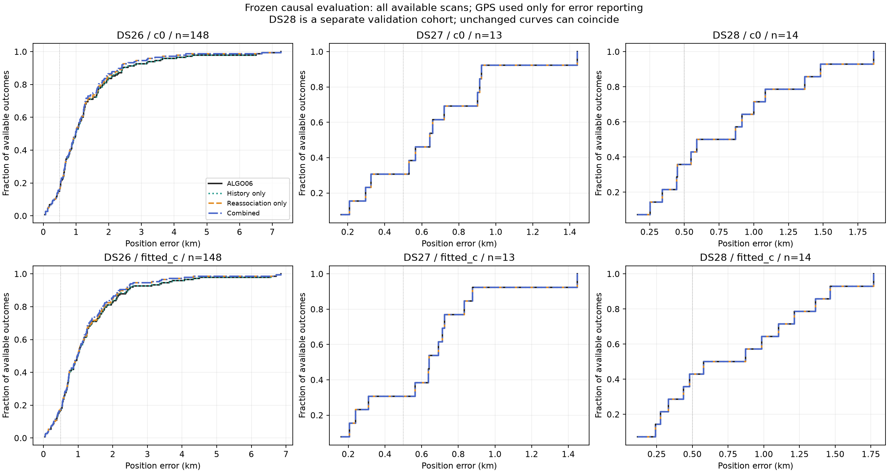

All GLRT percentages use unique native observation IDs and the full native GLRT denominator. They are unchanged by these variants: this experiment repairs identity and uncertainty on existing evidence, rather than recovering additional points. No curve is split, truncated, given a free independent slope, or dropped to improve position.

## Every accepted change

| Scan | Method | Accepted correction | Fitted-c error km | c=0 error km | Exposure |
|---|---|---|---|---|---|
| DS26-0034 | Reassociation only | 53852_to_59188 | 4.498 → 0.374 | 4.558 → 0.552 | Previously tested |
| DS26-0034 | Combined | 53852_to_59188 | 4.498 → 0.374 | 4.558 → 0.552 | Previously tested |
| DS26-0044 | Reassociation only | 57414_to_63186 | 3.715 → 1.580 | 3.594 → 1.455 | Additional scan |
| DS26-0044 | Combined | 57414_to_63186 | 3.715 → 1.580 | 3.594 → 1.455 | Additional scan |
| DS26-0046 | History only | complete_history | 1.261 → 1.236 | 1.307 → 1.281 | Additional scan |
| DS26-0046 | Combined | complete_history | 1.261 → 1.236 | 1.307 → 1.281 | Additional scan |
| DS26-0058 | History only | complete_history | 0.977 → 1.074 | 1.001 → 1.094 | Additional scan |
| DS26-0058 | Combined | complete_history | 0.977 → 1.074 | 1.001 → 1.094 | Additional scan |
| DS26-0060 | History only | complete_history | 0.379 → 0.275 | 0.576 → 0.435 | Additional scan |
| DS26-0060 | Combined | complete_history | 0.379 → 0.275 | 0.576 → 0.435 | Additional scan |
| DS26-0062 | History only | complete_history | 0.615 → 0.608 | 0.635 → 0.628 | Additional scan |
| DS26-0062 | Combined | complete_history | 0.615 → 0.608 | 0.635 → 0.628 | Additional scan |
| DS26-0064 | History only | complete_history | 1.534 → 1.465 | 1.516 → 1.444 | Additional scan |
| DS26-0064 | Combined | complete_history | 1.534 → 1.465 | 1.516 → 1.444 | Additional scan |
| DS26-0066 | History only | complete_history | 2.370 → 1.971 | 2.389 → 1.996 | Additional scan |
| DS26-0066 | Combined | 62025_to_68047 | 2.370 → 1.219 | 2.389 → 1.245 | Additional scan |
| DS26-0251 | Reassociation only | 56548_to_58787 | 6.561 → 1.949 | 6.507 → 1.957 | Previously tested |
| DS26-0251 | Combined | 56548_to_58787 | 6.561 → 1.162 | 6.507 → 1.126 | Previously tested |

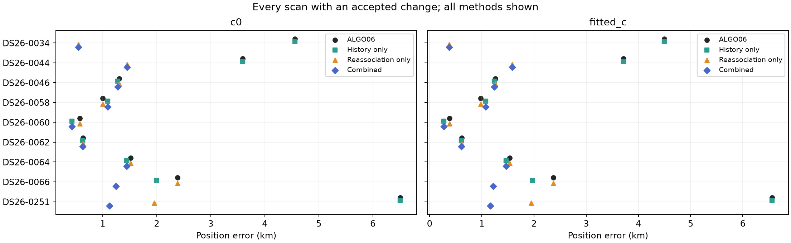

These are decisions from a frozen RF-only rule. No satellite, prior scale, starting point or acceptance setting is selected using position error. The shared candidate set and two starts are matched between c=0 and fitted-c arms.

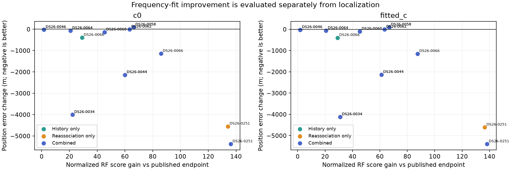

RF score and position accuracy are separate outcomes. A better normalized fit can still move the estimate away from the evaluation site. [positions.csv](positions.csv) retains both objectives, RMS, errors, coverage and paired changes for every method and scan.

## What generalizes beyond the earlier prototype

The four development outliers and eight earlier randomized pilot scans are marked as previously exposed. Removing all twelve leaves the following DS26/DS27 results:

| Method | N | Mean km | Changed | Better >25m | Worse >25m | Mean change m | Descriptive bootstrap interval m |
|---|---|---|---|---|---|---|---|
| ALGO06 | 149 | 1.139 | 0 | 0 | 0 | +0.0 | [+0.0, +0.0] |
| History only | 149 | 1.135 | 6 | 4 | 1 | -3.4 | [-10.0, +0.9] |
| Reassociation only | 149 | 1.125 | 1 | 1 | 0 | -14.3 | [-43.0, +0.0] |
| Combined | 149 | 1.116 | 7 | 5 | 1 | -22.8 | [-59.7, +0.1] |

Intervals use 5,000 paired scan resamples with seed 20261104 and summarize the mean error change. They are descriptive: scans share a site, hardware and sometimes nearby orbital conditions; these are not independence-calibrated noninferiority bounds. Zero change on a finite validation cohort does not establish a population tail guarantee.

## Four controlled variants

1. **ALGO06:** exact frozen 72-hour / ±30-second recovery outputs, with no recency penalty.
2. **Complete history only:** retain identities and native evidence; fill absent or invalid earlier causal history for active families, then apply the existing phase and physical-mode uncertainty machinery. Preserve valid incumbent history. Change the output only if both c arms qualify and improve normalized RF score against the original-prior matched continuation and published endpoint. If no history is missing, return ALGO06 exactly.
3. **Reassociation only:** RF-triggered whole-family catalogue search with existing history/fallback priors.
4. **Combined:** same search and candidate universe, with complete causal history for current and proposed identities. An accepted history-only correction is retained when no replacement qualifies. No greedy sequence of replacements is performed.

The primary validation candidate was prespecified as **combined**. All four cells were evaluated on DS28 under the same frozen rules; DS28 results did not alter any setting. DS28-0002 was used for a baseline-replay integration test before launching the batch, not for fitting or tuning a replacement. Within a scan, a replacement can change at most one family. Partial-track partitions from earlier exploration remain diagnostic-only and are not eligible here.

### Exact baseline restoration

The original research inputs describe the state before ALGO06's extra recovery. We explicitly restore every accepted 72-hour/30-second predictive family, its native ownership, phase reference and saved endpoint before this study. We require full likelihood agreement within 1e-4. Conditional attachments for both shared-family and gap-fragment recoveries are retained. The tests include DS28-0002, where omitting this step would incorrectly lose 28 accepted points. No nominally ALGO06 row silently uses an earlier algorithm's ownership.

### Causal history

Both nominal element epoch and archive collection precede the scan cutoff. Discovery uses the frozen full 72-hour causal regional catalogue. Missing-history completion takes the newest genuinely earlier element available in the prior 72-hour archive collection window, separated from the nominal epoch by at least one second. Sub-second formatting duplicates do not count as history. No future TLE is used for discovery, priors, fitting, selection or these validation diagnostics. The nominal TLE is not selected by best fit.

History-only completion found missing or invalid history in **7 scans**, with **21 requested satellite histories** across the 175 scans; available and missing counts are in [history_inventory.csv](history_inventory.csv). Additional exports for proposed replacement identities are recorded in the manifest. Prior uncertainty can legitimately become larger or smaller; filling history is not a blanket tightening of nuisance freedom.

### Trigger, search and acceptance

| Dataset | Triggered scans | Family screens | Whole-family proposals | Predictive pass | Reassociation accepted | Combined identity changes | History-only accepted |
|---|---|---|---|---|---|---|---|
| DS26 | 139 | 251 | 312 | 32 | 3 | 4 | 6 |
| DS27 | 9 | 12 | 14 | 0 | 0 | 0 | 0 |
| DS28 | 9 | 18 | 22 | 1 | 0 | 0 | 0 |

The funnel counts whole-family proposals before and after conditional predictive checks. Partition diagnostics cannot be accepted. A scan can nominate two target families; both c arms must pass the predictive screen before final fitting. Full counts and incomplete screen statuses are retained in [search_funnel.csv](search_funnel.csv).

The trigger is the preceding prototype's summed local omission displacement across both c arms, requiring at least 30 fitted points and two curved tracks. Search at most two families above 0.5 km. Nominate from the complete eligible causal bank on the two longest target curves, then compare at most two whole-family replacement hypotheses. Use the same reduced phase/offset/shared-rate screening model and five randomized synchronized five-second block holdouts with five-second guards. Require positive mean predictive gain and at least four winning folds in both arms.

Candidate discovery and graph/alias preprocessing use the full source. Predictive checks are therefore conditional, not independent evidence of catalogue discovery; repeated or overlapping folds are not independent trials. They do not yield calibrated satellite-identity probabilities.

Fit candidate and incumbent continuation from the same published fitted-c and family-omitted fitted-c RF endpoints, with 15 phase rounds, 40 constrained position iterations and the original 25×25 km box centered at 37.906, −122.545. Enforce existing residual gates, exact-orbit checks, optimizer success, phase closure ≤0.01 s, mixture phase interior, native owner retention and no unintended reassignment. Require positive paired RF gain beyond `2 log(shortlist size)` against the best qualified incumbent continuation; also retain the incumbent score at its published endpoint under the matched priors as a conservative bound. That extra bound is a frozen-reference score, not a newly converged incumbent solution. This matched-control requirement is stricter than comparing only with the published endpoint in the preceding small prototype. Continuation-only gains are not credited as satellite reassociation.

All satellite and hardware priors, native masks, weights and candidate nomination rules remain fixed across paired arms. The known site (37.849061591561885, −122.48574968092912) is used by the endpoint error reporter, never by nomination, optimization or acceptance.

## Predictive and sensitivity review

For every accepted replacement we fit the physical-feature Gaussian model on the remaining curved evidence and predict the target tracks on one held receiver. Both hypotheses use the same whole-family-omitted RF position. Phase is refreshed from training evidence only, with a 20-iteration/0.01-second closure check. This conditional diagnostic inherits graph/alias choices and uses 150 Hz noise; it is not an independently calibrated identity probability or a fresh geolocation estimate. Any unclosed transfer cell is marked and cannot count as supporting predictive evidence.

| Scan | Method | Arm | Held RX | RMS before → after Hz | Predictive score gain | Phase closed |
|---|---|---|---|---|---|---|
| DS26-0034 | Reassociation only | c0 | 1 | 499.5 → 416.0 | +5.90 | True |
| DS26-0034 | Reassociation only | c0 | 2 | 256.9 → 161.1 | +13.62 | True |
| DS26-0034 | Reassociation only | fitted_c | 1 | 456.0 → 350.1 | +6.39 | True |
| DS26-0034 | Reassociation only | fitted_c | 2 | 286.3 → 161.1 | +15.59 | True |
| DS26-0034 | Combined | c0 | 1 | 499.5 → 416.0 | +5.90 | True |
| DS26-0034 | Combined | c0 | 2 | 256.9 → 161.1 | +13.62 | True |
| DS26-0034 | Combined | fitted_c | 1 | 456.0 → 350.1 | +6.39 | True |
| DS26-0034 | Combined | fitted_c | 2 | 286.3 → 161.1 | +15.59 | True |
| DS26-0044 | Reassociation only | c0 | 1 | 570.5 → 317.0 | +49.69 | True |
| DS26-0044 | Reassociation only | c0 | 2 | 474.6 → 212.1 | +8.46 | True |
| DS26-0044 | Reassociation only | fitted_c | 1 | 499.0 → 356.3 | +50.91 | True |
| DS26-0044 | Reassociation only | fitted_c | 2 | 438.2 → 169.1 | +7.72 | True |
| DS26-0044 | Combined | c0 | 1 | 570.5 → 317.0 | +49.69 | True |
| DS26-0044 | Combined | c0 | 2 | 474.6 → 212.1 | +8.46 | True |
| DS26-0044 | Combined | fitted_c | 1 | 499.0 → 356.3 | +50.91 | True |
| DS26-0044 | Combined | fitted_c | 2 | 438.2 → 169.1 | +7.72 | True |
| DS26-0251 | Reassociation only | c0 | 1 | 1574.3 → 431.0 | +29.82 | True |
| DS26-0251 | Reassociation only | c0 | 2 | 846.8 → 342.1 | +68.55 | True |
| DS26-0251 | Reassociation only | fitted_c | 1 | 1634.9 → 369.3 | +31.08 | True |
| DS26-0251 | Reassociation only | fitted_c | 2 | 861.7 → 252.3 | +72.11 | True |
| DS26-0251 | Combined | c0 | 1 | 1574.3 → 276.4 | +30.67 | True |
| DS26-0251 | Combined | c0 | 2 | 846.8 → 292.3 | +71.08 | True |
| DS26-0251 | Combined | fitted_c | 1 | 1634.9 → 233.4 | +31.78 | True |
| DS26-0251 | Combined | fitted_c | 2 | 861.7 → 192.7 | +74.25 | True |

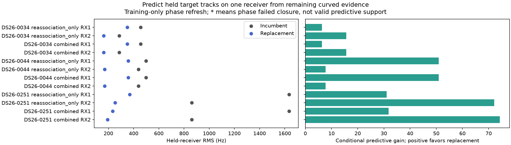

When target evidence is confined to one receiver, cross-receiver transfer is unavailable, not a passing check. We additionally hold out entire target tracks and predict them from the remaining curved evidence. These checks retain the same conditional-discovery limitations. Full results are in [whole_track_transfer.csv](whole_track_transfer.csv).

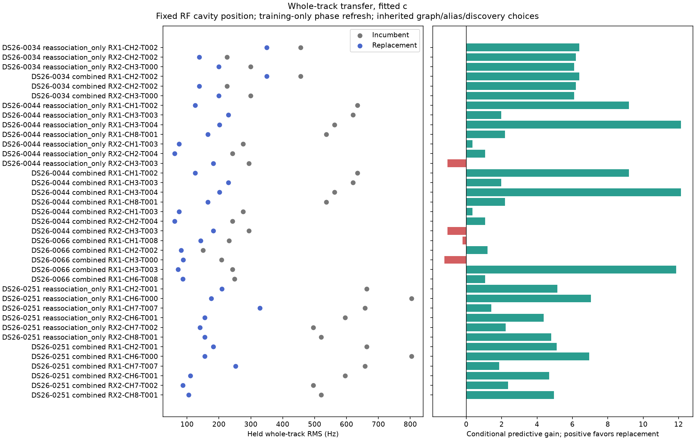

We separately perturb the normalized residual-gate margin by 0.01 and 0.05 and reduce the nonlinear receiver prior from 200 to 50 Hz. Each uses the same selected fitted-c starting position for both c arms, with unchanged fit budgets. These settings cannot modify the frozen output and are not selected by GPS error.

| Scan | Variant | Diagnostic | Arm | Error km | Endpoint shift km | Qualified / margin passed |
|---|---|---|---|---|---|---|
| DS26-0034 | Reassociation only | margin_001 | c0 | 0.597 | 0.046 | True / True |
| DS26-0034 | Reassociation only | margin_001 | fitted_c | 0.420 | 0.046 | True / True |
| DS26-0034 | Reassociation only | margin_005 | c0 | 3.676 | 3.159 | True / True |
| DS26-0034 | Reassociation only | margin_005 | fitted_c | 2.041 | 1.681 | True / True |
| DS26-0034 | Reassociation only | receiver50 | c0 | 0.268 | 0.389 | True / True |
| DS26-0034 | Reassociation only | receiver50 | fitted_c | 0.176 | 0.486 | True / True |
| DS26-0034 | Combined | margin_001 | c0 | 0.597 | 0.046 | True / True |
| DS26-0034 | Combined | margin_001 | fitted_c | 0.420 | 0.046 | True / True |
| DS26-0034 | Combined | margin_005 | c0 | 3.676 | 3.159 | True / True |
| DS26-0034 | Combined | margin_005 | fitted_c | 2.041 | 1.681 | True / True |
| DS26-0034 | Combined | receiver50 | c0 | 0.268 | 0.389 | True / True |
| DS26-0034 | Combined | receiver50 | fitted_c | 0.176 | 0.486 | True / True |
| DS26-0044 | Reassociation only | margin_001 | c0 | 1.455 | 0.000 | True / True |
| DS26-0044 | Reassociation only | margin_001 | fitted_c | 1.580 | 0.000 | True / True |
| DS26-0044 | Reassociation only | margin_005 | c0 | 1.455 | 0.000 | True / True |
| DS26-0044 | Reassociation only | margin_005 | fitted_c | 1.580 | 0.000 | True / True |
| DS26-0044 | Reassociation only | receiver50 | c0 | 0.940 | 0.536 | True / True |
| DS26-0044 | Reassociation only | receiver50 | fitted_c | 1.068 | 0.533 | True / True |
| DS26-0044 | Combined | margin_001 | c0 | 1.455 | 0.000 | True / True |
| DS26-0044 | Combined | margin_001 | fitted_c | 1.580 | 0.000 | True / True |
| DS26-0044 | Combined | margin_005 | c0 | 1.455 | 0.000 | True / True |
| DS26-0044 | Combined | margin_005 | fitted_c | 1.580 | 0.000 | True / True |
| DS26-0044 | Combined | receiver50 | c0 | 0.940 | 0.536 | True / True |
| DS26-0044 | Combined | receiver50 | fitted_c | 1.068 | 0.533 | True / True |
| DS26-0046 | History only | margin_001 | c0 | 1.281 | 0.001 | True / True |
| DS26-0046 | History only | margin_001 | fitted_c | 1.237 | 0.001 | True / True |
| DS26-0046 | History only | margin_005 | c0 | 1.281 | 0.000 | True / True |
| DS26-0046 | History only | margin_005 | fitted_c | 1.237 | 0.001 | True / True |
| DS26-0046 | History only | receiver50 | c0 | 1.297 | 0.169 | True / True |
| DS26-0046 | History only | receiver50 | fitted_c | 1.280 | 0.207 | True / True |
| DS26-0046 | Combined | margin_001 | c0 | 1.281 | 0.001 | True / True |
| DS26-0046 | Combined | margin_001 | fitted_c | 1.237 | 0.001 | True / True |
| DS26-0046 | Combined | margin_005 | c0 | 1.281 | 0.000 | True / True |
| DS26-0046 | Combined | margin_005 | fitted_c | 1.237 | 0.001 | True / True |
| DS26-0046 | Combined | receiver50 | c0 | 1.297 | 0.169 | True / True |
| DS26-0046 | Combined | receiver50 | fitted_c | 1.280 | 0.207 | True / True |
| DS26-0058 | History only | margin_001 | c0 | 1.094 | 0.000 | True / True |
| DS26-0058 | History only | margin_001 | fitted_c | 1.074 | 0.000 | True / True |
| DS26-0058 | History only | margin_005 | c0 | 1.610 | 1.613 | False / False |
| DS26-0058 | History only | margin_005 | fitted_c | 0.966 | 1.172 | False / False |
| DS26-0058 | History only | receiver50 | c0 | 1.619 | 0.700 | False / True |
| DS26-0058 | History only | receiver50 | fitted_c | 1.361 | 0.716 | False / False |
| DS26-0058 | Combined | margin_001 | c0 | 1.094 | 0.000 | True / True |
| DS26-0058 | Combined | margin_001 | fitted_c | 1.074 | 0.000 | True / True |
| DS26-0058 | Combined | margin_005 | c0 | 1.610 | 1.613 | False / False |
| DS26-0058 | Combined | margin_005 | fitted_c | 0.966 | 1.172 | False / False |
| DS26-0058 | Combined | receiver50 | c0 | 1.619 | 0.700 | False / True |
| DS26-0058 | Combined | receiver50 | fitted_c | 1.361 | 0.716 | False / False |
| DS26-0060 | History only | margin_001 | c0 | 0.435 | 0.000 | True / True |
| DS26-0060 | History only | margin_001 | fitted_c | 0.271 | 0.101 | True / True |
| DS26-0060 | History only | margin_005 | c0 | 0.435 | 0.000 | True / True |
| DS26-0060 | History only | margin_005 | fitted_c | 0.589 | 0.576 | True / True |
| DS26-0060 | History only | receiver50 | c0 | 3.480 | 3.051 | False / False |
| DS26-0060 | History only | receiver50 | fitted_c | 3.341 | 3.062 | False / False |
| DS26-0060 | Combined | margin_001 | c0 | 0.435 | 0.000 | True / True |
| DS26-0060 | Combined | margin_001 | fitted_c | 0.271 | 0.101 | True / True |
| DS26-0060 | Combined | margin_005 | c0 | 0.435 | 0.000 | True / True |
| DS26-0060 | Combined | margin_005 | fitted_c | 0.589 | 0.576 | True / True |
| DS26-0060 | Combined | receiver50 | c0 | 3.480 | 3.051 | False / False |
| DS26-0060 | Combined | receiver50 | fitted_c | 3.341 | 3.062 | False / False |
| DS26-0062 | History only | margin_001 | c0 | 0.629 | 0.001 | True / True |
| DS26-0062 | History only | margin_001 | fitted_c | 0.608 | 0.001 | True / True |
| DS26-0062 | History only | margin_005 | c0 | 0.592 | 1.062 | False / False |
| DS26-0062 | History only | margin_005 | fitted_c | 0.576 | 1.002 | False / False |
| DS26-0062 | History only | receiver50 | c0 | 0.615 | 0.648 | False / False |
| DS26-0062 | History only | receiver50 | fitted_c | 0.611 | 0.651 | False / False |
| DS26-0062 | Combined | margin_001 | c0 | 0.629 | 0.001 | True / True |
| DS26-0062 | Combined | margin_001 | fitted_c | 0.608 | 0.001 | True / True |
| DS26-0062 | Combined | margin_005 | c0 | 0.592 | 1.062 | False / False |
| DS26-0062 | Combined | margin_005 | fitted_c | 0.576 | 1.002 | False / False |
| DS26-0062 | Combined | receiver50 | c0 | 0.615 | 0.648 | False / False |
| DS26-0062 | Combined | receiver50 | fitted_c | 0.611 | 0.651 | False / False |
| DS26-0064 | History only | margin_001 | c0 | 1.445 | 0.001 | True / True |
| DS26-0064 | History only | margin_001 | fitted_c | 1.465 | 0.000 | True / True |
| DS26-0064 | History only | margin_005 | c0 | 2.217 | 1.957 | False / False |
| DS26-0064 | History only | margin_005 | fitted_c | 2.195 | 2.125 | False / False |
| DS26-0064 | History only | receiver50 | c0 | 1.465 | 0.032 | False / False |
| DS26-0064 | History only | receiver50 | fitted_c | 1.465 | 0.000 | False / False |
| DS26-0064 | Combined | margin_001 | c0 | 1.445 | 0.001 | True / True |
| DS26-0064 | Combined | margin_001 | fitted_c | 1.465 | 0.000 | True / True |
| DS26-0064 | Combined | margin_005 | c0 | 2.217 | 1.957 | False / False |
| DS26-0064 | Combined | margin_005 | fitted_c | 2.195 | 2.125 | False / False |
| DS26-0064 | Combined | receiver50 | c0 | 1.465 | 0.032 | False / False |
| DS26-0064 | Combined | receiver50 | fitted_c | 1.465 | 0.000 | False / False |
| DS26-0066 | History only | margin_001 | c0 | 1.996 | 0.000 | True / True |
| DS26-0066 | History only | margin_001 | fitted_c | 1.971 | 0.000 | True / True |
| DS26-0066 | History only | margin_005 | c0 | 0.514 | 1.529 | False / False |
| DS26-0066 | History only | margin_005 | fitted_c | 0.484 | 1.553 | False / False |
| DS26-0066 | History only | receiver50 | c0 | 1.971 | 0.028 | False / False |
| DS26-0066 | History only | receiver50 | fitted_c | 1.971 | 0.000 | False / False |
| DS26-0066 | Combined | margin_001 | c0 | 1.245 | 0.000 | True / True |
| DS26-0066 | Combined | margin_001 | fitted_c | 1.218 | 0.001 | True / True |
| DS26-0066 | Combined | margin_005 | c0 | 0.481 | 0.766 | False / False |
| DS26-0066 | Combined | margin_005 | fitted_c | 0.422 | 1.132 | False / False |
| DS26-0066 | Combined | receiver50 | c0 | 1.561 | 0.316 | False / False |
| DS26-0066 | Combined | receiver50 | fitted_c | 1.615 | 0.401 | False / False |
| DS26-0251 | Reassociation only | margin_001 | c0 | 1.957 | 0.000 | True / True |
| DS26-0251 | Reassociation only | margin_001 | fitted_c | 1.949 | 0.000 | True / True |
| DS26-0251 | Reassociation only | margin_005 | c0 | 1.957 | 0.000 | True / True |
| DS26-0251 | Reassociation only | margin_005 | fitted_c | 1.949 | 0.000 | True / True |
| DS26-0251 | Reassociation only | receiver50 | c0 | 4.597 | 6.458 | False / False |
| DS26-0251 | Reassociation only | receiver50 | fitted_c | 3.653 | 5.498 | False / False |
| DS26-0251 | Combined | margin_001 | c0 | 1.126 | 0.000 | True / True |
| DS26-0251 | Combined | margin_001 | fitted_c | 1.162 | 0.000 | True / True |
| DS26-0251 | Combined | margin_005 | c0 | 1.126 | 0.000 | True / True |
| DS26-0251 | Combined | margin_005 | fitted_c | 1.162 | 0.000 | True / True |
| DS26-0251 | Combined | receiver50 | c0 | 4.451 | 5.515 | False / False |
| DS26-0251 | Combined | receiver50 | fitted_c | 3.629 | 4.693 | False / False |

Native orbit/residual panels below use the candidate's alias branch. Curves include fitted receiver and orbital terms; residuals are in-sample diagnostics. Numerical residual means, slopes, lag correlation and structure gates are retained in the hashed diagnostic artifacts. Earlier detailed polynomial/track-join audits are not relabeled as freshly repeated here.

### DS26-0034-combined-curves

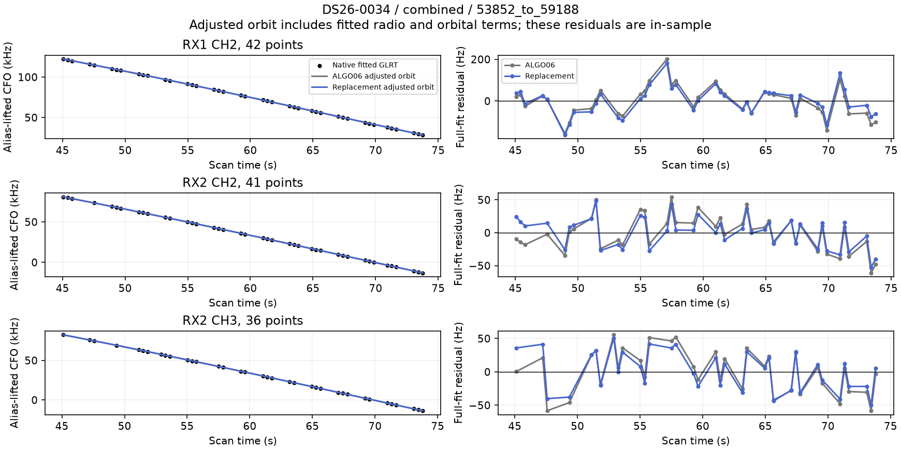
### DS26-0034-reassociation_only-curves

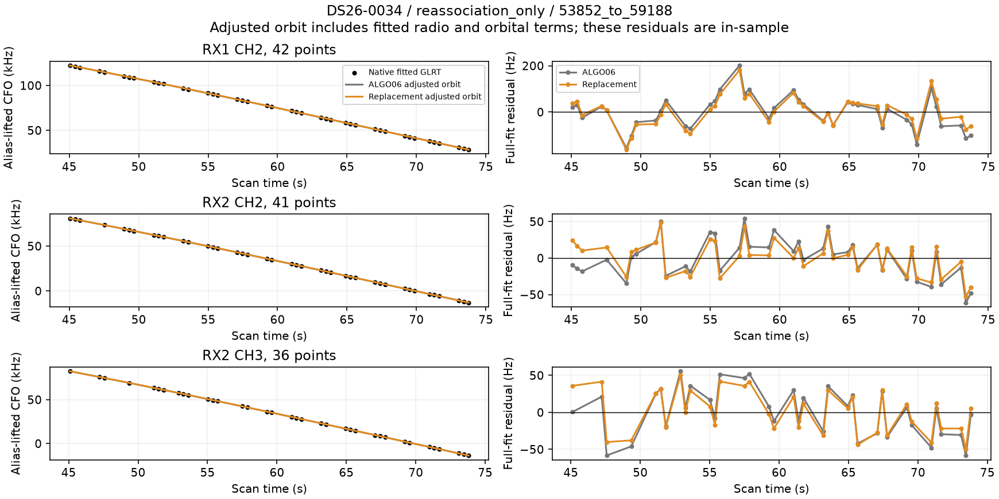
### DS26-0044-combined-curves

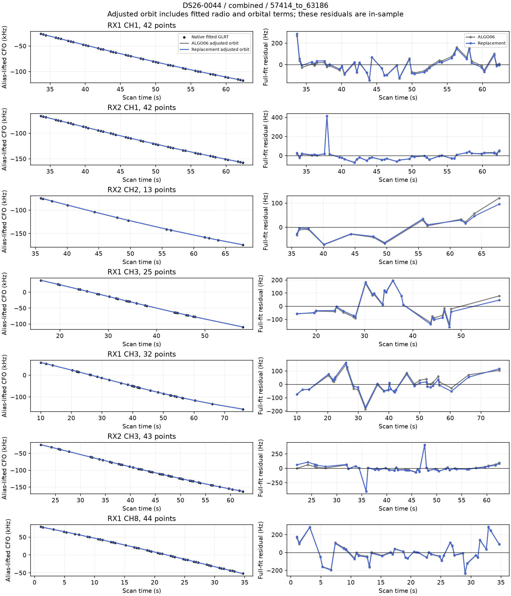
### DS26-0044-reassociation_only-curves

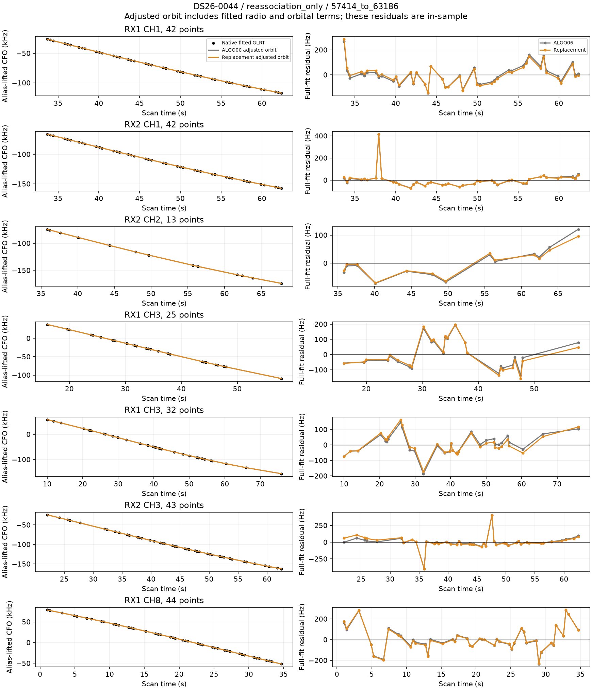
### DS26-0066-combined-curves

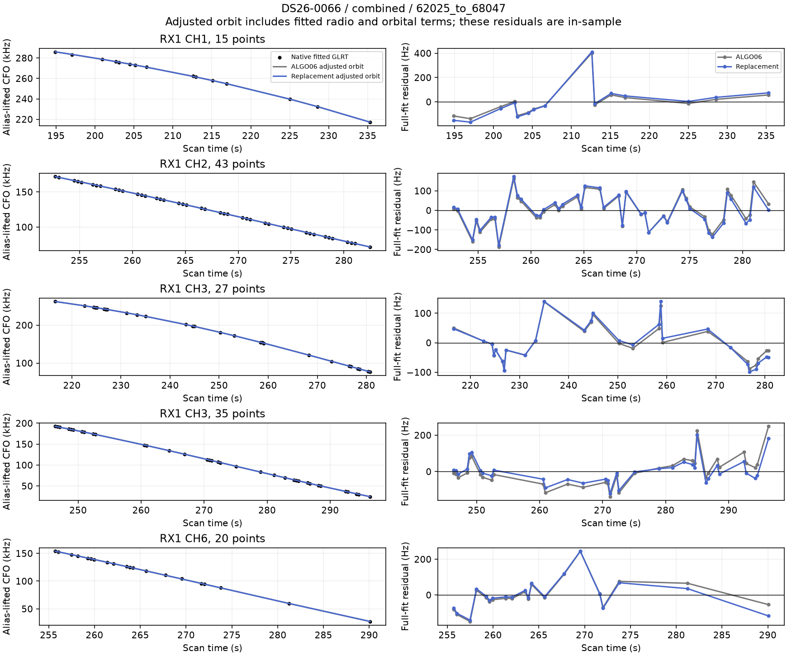
### DS26-0251-combined-curves

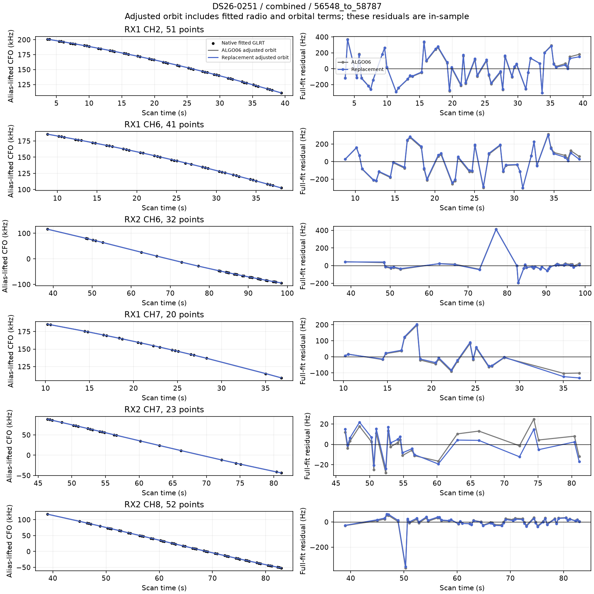
### DS26-0251-reassociation_only-curves

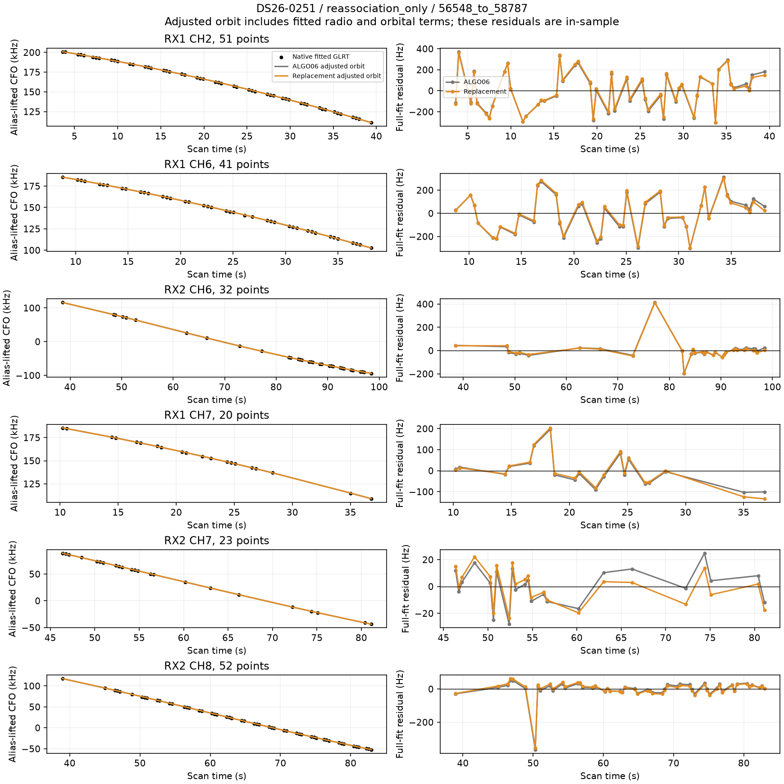

## Completion, cost and limits

There are 440 recorded primary candidate/control position attempts, of which 384 completed numerically; incomplete attempts and rejected fits are distinct in [attempts.csv](attempts.csv). Cases use bounded processes with explicit failure records. Median completed whole-scan research time was 89.6 seconds and maximum 1796.8 seconds, including reconstruction and search; bounded failures are listed separately. Ten evaluation workers and two validation workers initially ran with single-thread numerical libraries on shared hardware. Three additional tail-roster workers and subsequently three DS27 workers used freed capacity, with per-case locks and attempt receipts preventing duplicate fits or silently renewed budgets. Workers that encounter an active case wait for its existing outcome. These timings evaluate all four variants and are not a single-policy production or embedded benchmark.

The family-influence implementation was optimized to avoid calculating unused omission Hessians; the gradient, baseline Hessian and ordering are unchanged, and exact ranking equality was tested. Early workers used the original arithmetic. Frozen and final code hashes are both retained.

This is a downstream conditional reassociation evaluation on saved ALGO06 evidence. It does not rerun IQ extraction, acquisition, graph construction or the cold regional search. It tests neither sample-rate changes nor receiver pointing changes. It does not justify attributing remaining error to those hardware factors. Scans that fail to improve remain valid unresolved cases; the experiment does not force an association to reach a coverage target.

## Reproduction and evidence

- [Frozen protocol](protocol.json), [diagnostic protocol](diagnostic_protocol.json), [manifest and raw hashes](manifest.json).
- [Summary](summary.csv), [positions and coverage](positions.csv), [decision ledger](decisions.csv), [attempts](attempts.csv), [availability](availability.csv), [history inventory](history_inventory.csv).
- [Predictive transfer](transfer.csv), [sensitivity](sensitivity.csv), [compact per-scan receipts](receipts/).
- [Evaluation adapter](evaluate.py), [diagnostics](diagnostics.py), [renderer](render.py), [seal/audit](seal.py), [report generator](write_report.py), [tests](test_evaluate.py), [test output](tests.txt).

Use `/srv/bulk/leo-dev/fast-algo02-production-v1/.venv/bin/python`, `PYTHONDONTWRITEBYTECODE=1 OPENBLAS_NUM_THREADS=1 OMP_NUM_THREADS=1 PYTHONPATH=src:tools`, from the recorded worktree. Commands: `evaluate.py evaluation --workers 10`, `evaluate.py validation --workers 2`, `diagnostics.py CASE` for accepted changes, `render.py`, then `seal.py` and `write_report.py`. Do not rerun `freeze` over the frozen protocol. Raw predictions and complete fits remain in the manifest's local archive; compact receipts, figures and scripts are versioned.

No production component, public contract, golden fixture, QNAP file or RF collection setting was modified.
