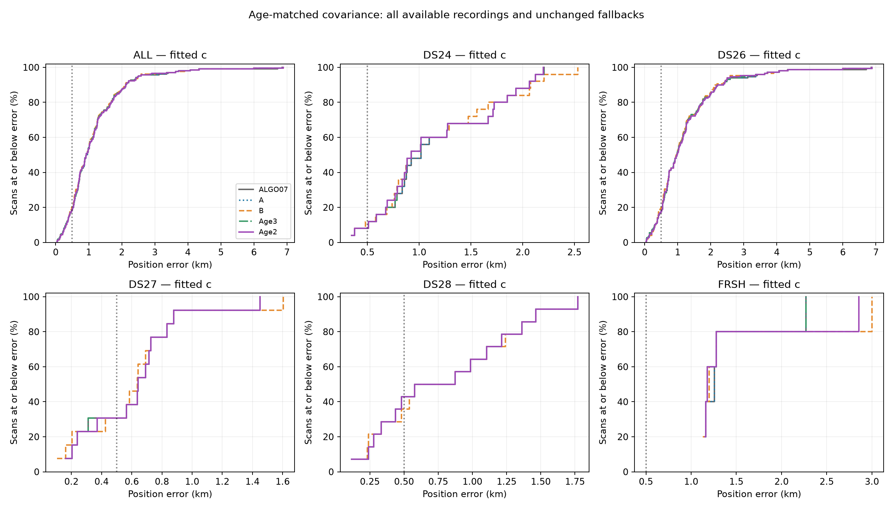
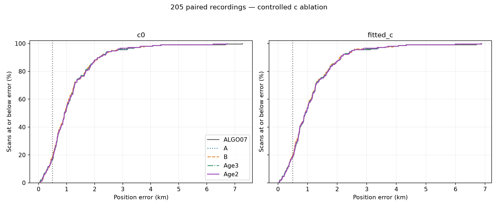
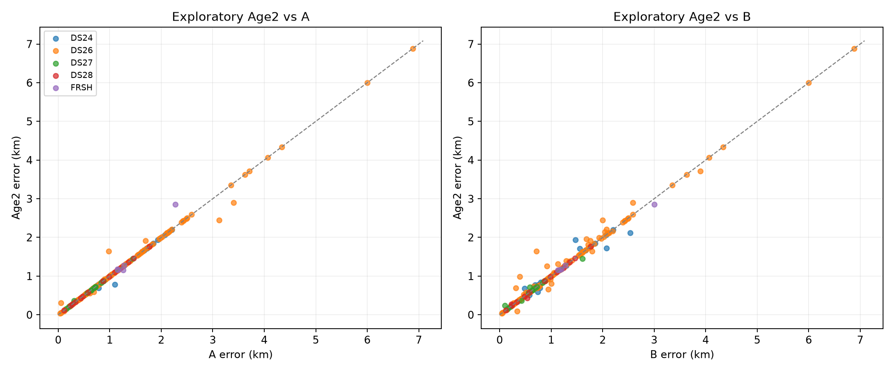
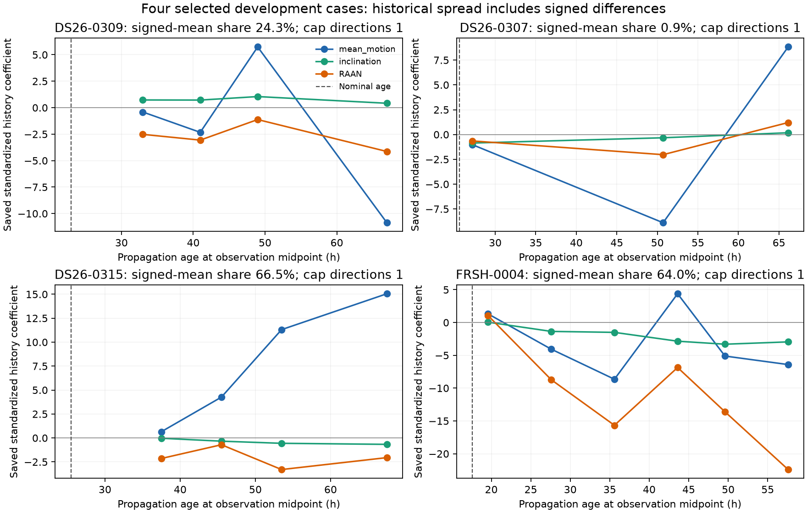
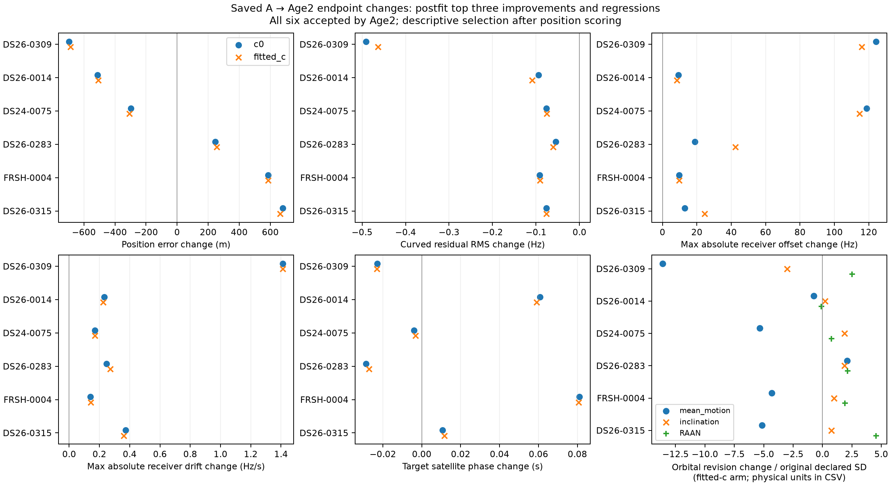
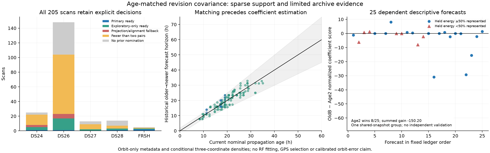
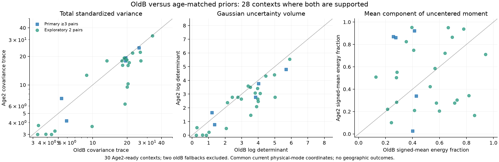

# Age-matched causal orbital uncertainty: completed experiment

**Matching historical TLE forecast ages does not resolve the harmful-correction problem.** The conservative three-pair policy improves pooled fitted-c mean error from 1.155 km with ALGO07 to 1.148 km, but changes only five of 205 available recordings. The exploratory two-pair policy changes 27 recordings, gives 1.152 km mean error, and still introduces a 664 m worst regression. Neither increases the fitted-c count below 500 m. ALGO07 remains deployed; this is a completed research experiment, not a new algorithm release.

Three SOL xhigh workers handled the covariance implementation, paired numerical evaluation and independent audit. The experiment uses only causal TLEs for inference, preserves satellite identities and native point ownership, and evaluates geographic error only after the RF decisions and audit were sealed. The [prospective design](DESIGN.md) and [frozen protocol](protocol.json) precede the new fits.

## Compared policies and scope

| Label | Intervention | Fallback |
| --- | --- | --- |
| ALGO07 | Exact saved production-policy comparator | — |
| A | Previous half-damped phase refresh and central-gradient solver repair | ALGO07 |
| B | Previous A plus causal, directional orbital covariance | A |
| Age3 | New age-matched orbital covariance, at least three non-reused historical pairs | A |
| Age2 | Same new endpoint and gates, at least two non-reused historical pairs | A |

B is the policy called **A+B** in the [preceding report](../2026_11_02_generalized_corrections/README.md). The new policies replace that covariance construction; they do not stack another covariance on B or choose between outputs using geographic error. Age3 is a prospective support subset of Age2, not a separate fit. The two-pair tier was declared from metadata coverage before any new RF outcome was observed.

These are local refinements of saved ALGO07 models within the existing 25 × 25 km region, not raw-IQ reruns, new satellite searches or cold-start regional convergence tests. The original generic family nominations, both calibration arms, observation sets, priors other than the declared covariance intervention, and shared starts remain matched. Old capped preparation, ranking and solver attempts were not retried.

## Position results

Fitted-c **mean position error, km**, including every unchanged fallback:

| Cohort | Available / source | ALGO07 | A | B | Age3 | Age2 |
| --- | ---: | ---: | ---: | ---: | ---: | ---: |
| DS24 fast | 25 / 34 | 1.175 | 1.175 | 1.165 | 1.163 | 1.159 |
| DS26 fast | 148 / 159 | 1.223 | 1.219 | 1.196 | 1.215 | 1.217 |
| DS27 fast | 13 / 15 | 0.619 | 0.619 | 0.620 | 0.619 | 0.624 |
| DS28 fast | 14 / 16 | 0.803 | 0.803 | 0.809 | 0.803 | 0.803 |
| Five recent controls | 5 / 5 | 1.424 | 1.424 | 1.555 | 1.409 | 1.527 |
| **All available** | **205 / 229** | **1.155** | **1.152** | **1.138** | **1.148** | **1.152** |

The 24 unavailable source recordings are retained as unavailable, not counted as successful evaluations. DS25's adaptive scans and DS23 are outside this experiment. DS25's earlier fast comparison subset is not counted again. The five recent controls have already influenced development and are not independent validation.

| Arm | Policy | Mean km | Median km | p90 km | p95 km | Below 500 m | Improve / regress >50 m versus ALGO07 |
| --- | --- | ---: | ---: | ---: | ---: | ---: | ---: |
| c=0 | ALGO07 | 1.169 | 0.926 | 2.152 | 2.742 | 35 / 205 | — |
| c=0 | A | 1.164 | 0.926 | 2.152 | 2.742 | 35 / 205 | 1 / 0 |
| c=0 | B | 1.152 | 0.940 | 2.154 | 2.603 | 39 / 205 | 27 / 17 |
| c=0 | Age3 | 1.160 | 0.923 | 2.152 | 2.742 | 35 / 205 | 4 / 0 |
| c=0 | Age2 | 1.165 | 0.926 | 2.150 | 2.742 | 37 / 205 | 8 / 5 |
| fitted c | ALGO07 | 1.155 | 0.923 | 2.122 | 2.497 | 38 / 205 | — |
| fitted c | A | 1.152 | 0.923 | 2.122 | 2.497 | 38 / 205 | 1 / 0 |
| fitted c | B | 1.138 | 0.923 | 2.086 | 2.525 | 41 / 205 | 27 / 16 |
| fitted c | Age3 | 1.148 | 0.918 | 2.122 | 2.497 | 38 / 205 | 4 / 0 |
| fitted c | Age2 | 1.152 | 0.921 | 2.122 | 2.497 | 38 / 205 | 8 / 5 |

Age3 adds a 4.34 m pooled fitted-c mean gain beyond A. Its five changed cases improve by 508 m, 307 m and 102 m, and worsen by approximately 0.1 m and 29 m. This small supported sample does not establish a reliable safety rule. Age2 adds only 0.23 m mean gain beyond A, and slightly worsens the c=0 mean. The previous B has the best pooled mean among these policies but retains significant regressions and a worse fitted-c p95. None is a convincing route to broad 500 m accuracy yet.

[Complete statistics](RESULTS.md) · [Exact metrics](statistics.csv) · [Every scan, arm and policy](positions.csv) · [Postdecision evaluation binding](position_binding.json)

## What the difficult cases show

Fitted-c position error, km. These selected examples explain behavior; they are not a validation set or a rule for selecting outputs.

| Scan | ALGO07 | A | B | Age3 | Age2 | Interpretation |
| --- | ---: | ---: | ---: | ---: | ---: | --- |
| DS26-0070 | 6.716 | 5.996 | 5.996 | 5.996 | 5.996 | Numerical repair helps, but no usable age-matched pairs support another change. |
| DS26-0309 | 3.127 | 3.127 | 1.997 | 3.127 | 2.441 | Two-pair covariance retains part of B's benefit; tighter uncertainty also loses some useful movement. |
| DS26-0307 | 1.640 | 1.640 | 0.712 | 1.640 | 1.640 | Only one matching pair: the new policies must abstain, losing B's previous improvement. |
| DS26-0315 | 0.976 | 0.976 | 1.796 | 0.976 | 1.641 | Reduced flexibility reduces the harm, but does not eliminate it. |
| FRSH-0004 | 2.272 | 2.271 | 3.003 | 2.271 | 2.857 | A large harmful displacement persists with age matching. |

The new support policy is not simply a more precise version of B over the same cases. It changes which cases are eligible, including excluding the useful DS26-0307 correction. Comparisons must retain those abstentions in the denominator.

The earlier four-case history diagnostic also found that DS26-0307 and DS26-0315 have nearly the same nominal age and dominant mean-motion uncertainty direction, but opposite position outcomes. Age, eigenvalue capping or dominant orbital mode alone cannot distinguish them. Persistent signed history differences appear in some harmful cases, but the panel was selected after seeing outcomes and cannot justify a learned bias correction. Its signed-mean statistic is standardized parameter energy, not physical state energy or proof of present orbital error.

[Four-case findings](diagnostics/FINDINGS.md)

The new saved coefficient snapshots expose the coupled response. On DS26-0309, the beneficial 686 m correction accompanies a 0.464 Hz RMS reduction, a maximum receiver-offset change of 116 Hz and a maximum drift change of 1.41 Hz/s. On DS26-0315, the harmful 664 m change still reduces RMS by 0.076 Hz while the target RAAN correction grows from approximately 0.000181 to 0.006241 degrees. FRSH-0004 also improves RMS while worsening position. These are model coefficient changes, not independently measured hardware or orbit errors.

Both beneficial and harmful corrections expand the target orbital revision and adjust shared receiver/phase terms. That is consistent with coupled parameter sensitivity; the saved endpoints alone cannot tell which physical estimate is correct. The figure uses the three largest improvements and three largest regressions selected after scoring, so it must not train an acceptance rule. Orbital values are mapped back to common physical coordinates before comparison; the normalized axis is not a posterior z score.

[All 60 candidate-arm coefficient diagnostics and physical units](evaluation/NUISANCE_DIAGNOSTICS.md)

## How the age-matched prior is constructed

For each previously nominated satellite, let H be the nominal TLE age at the native-observation midpoint. Compare an older causal TLE forecast with a newer causal TLE at the latter's epoch, retaining horizons h within `max(2 hours, 0.25 H)` of H. Both elements must satisfy the existing 72-hour causal eligibility checks; the older element must actually have been available by the historical target epoch.

An exact maximum matching selects pairs without reusing elements. Ties minimize horizon mismatch, then use deterministic epoch/hash ordering. Neither RF residuals nor geographic outcomes select pairs. Non-reuse does not make catalog revisions statistically independent.

At each historical epoch, construct physical mean-motion, inclination and RAAN derivatives over the matching short arc. Align phase using orbital states alone, remove its tangent, and resolve the discrepancy in physical units before mapping into the current model's declared standard deviations. Reject poorly represented discrepancies rather than silently treating all state error as those three coefficients.

Use a zero-mean covariance `0.5 I + 0.5 E[a aᵀ]`, clip variance eigenvalues to [1, 16], and retain Gaussian normalization in the existing inference. Only the nominated family's three columns change. This is a catalog-revision uncertainty proxy, not orbit truth; two or three correlated pairs cannot calibrate a full three-dimensional distribution. The shrinkage strength was fixed, not selected using these geographic outcomes.

The construction changes horizon matching, pair selection and the historical physical-coordinate calculation together. This comparison therefore does not isolate the causal effect of TLE age alone.

Of 146 saved nominations, 39 have at least two eligible pairs; physical representation/alignment checks leave 30 candidate cases, five with three pairs. All 30 were attempted once. Age3 adopts five and Age2 adopts 27 after paired scientific qualification. All remaining outputs are exact A fallbacks.

The prior changes both scale and direction. Among 28 candidates with a supported previous B prior, 22 have smaller trace and log determinant under age matching; the median trace ratio is 0.919. Where the leading direction is unique, its median rotation is 27.1 degrees. Three clipped covariances have a degenerate leading eigenspace, so their axis angles are undefined. This is not equivalent to uniformly tightening one scalar prior.

[Implementation and inventory](covariance/README.md) · [Prior-shape comparison](covariance/PRIOR_SHAPES.md)

## Historical forecast check

A separate strict-issuance diagnostic scores 25 historical forecasts across 20 families. Every predictor's history, basis and scales use only material available at issuance; the held newer TLE supplies only the diagnostic outcome. All observations connect through one shared-snapshot dependency group, so a reproducible random split of whole independent groups cannot provide both training and validation sets. No independent calibration or shrinkage tuning is claimed.

On this dependent diagnostic, summed Gaussian negative twice log density is **440.72 for B versus 590.93 for Age2**; lower is better. Age2 wins only 8 of 25 forecasts. These are densities for the represented three coefficients, including covariance volume, not full-state forecast likelihoods. Unrepresented state error is recorded separately. The negative result did not change the frozen policy or fitting thresholds.

[Causal forecast diagnostic](covariance/causal_density_diagnostic.json) · [Independent review](review/FINAL_REVIEW.md)

## Frequency fit, execution and validation

Association is unchanged: **642,355 GLRT points in each calibration arm under every policy**. This intervention recovers no new tracks. Among the 27 adopted Age2 pairs, mean curved-point RMS changes by only −0.0398 Hz at c=0 and −0.0394 Hz with fitted c versus A. These small frequency-fit gains coexist with large changes in some position estimates; better in-sample frequency fit does not establish better localization.

The single bounded run took 218.96 seconds with eight workers and one BLAS thread each. All 60 arm fits completed; 56 qualified individually and 27 qualified as pairs. Three cases retain A after gate failures: DS26-0024, DS26-0219 and DS28-0003. No candidate hit a time limit or received a retry. The full 205-case ledger preserves 116 unsupported cases and 59 without an old generic nomination as fallbacks. Those inherited limits are not exhaustive new searches.

All 402 frozen source hashes remained unchanged. Independent audit verifies all 205 rows, causal provenance, matching, covariance arithmetic, native ownership, paired decisions and fallbacks. A bounded two-arm saved-endpoint replay reproduces objective, conditional nuisance coefficients, residual reconstruction and physical coefficient mapping exactly; unrelated model columns are unchanged. The target feature transformation agrees within 2.14 × 10⁻¹⁴. Before fitting, poisoning RF values and inaccessible endpoint/GPS fields left the prior receipt identical.

**33 component/report tests pass**, including nine archive-preservation tests. A separate geographic reporting audit independently recomputes all 2,050 scan/arm/policy rows and all 60 aggregate rows, agreeing within 10⁻¹² m. It traces the actual published ALGO07 outputs: some raw input endpoints precede guarded recovery and must not be substituted for the saved production-policy comparator. All A fallbacks and accepted new endpoints match their intended authority. [Position reporting audit](review/position_reporting_audit.json).

[Execution accounting](evaluation/EXECUTION.md) · [Final audit](review/final_audit.json) · [Saved-endpoint replay](review/saved_endpoint_replay.json) · [Archive and reconstruction](ARCHIVE.md)

## Recommendation and next investigation

Keep ALGO07 in production. Preserve A as a useful numerical diagnostic. Do not promote Age2, and do not interpret five supported Age3 cases as sufficient evidence for a production change. The dominant unresolved issue in this experiment is how position trades against imperfect orbital and receiver corrections under uncertain priors. This experiment supplies no new evidence that sample rate or receiver pointing separation is the cause.

The next bounded investigation should measure **position sensitivity under finite physical priors**, preserving the same native evidence and satellite identities. For corrections such as DS26-0309 and DS26-0315, compare support from other complete satellite families while re-estimating shared receiver terms. Report the range of supported positions and frequency predictions rather than projecting out all nuisance directions or selecting a prior from GPS error. The earlier unrestricted projection removed nearly all position information and was too conservative to act as a useful guard.

Separately, test whether signed historical orbital innovations predict the next catalog revision before considering a nonzero prior mean. This archive does not yet offer enough independent groups to validate that rule. A signed correction learned from these known geographic failures would not establish transfer. A meaningful next promotion requires a frozen decision rule with better tails and replication on untouched recordings, not only a lower pooled development mean.

The authorized evaluation site is used only for final error reporting. These are retrospective, same-site development results; they do not establish new-location or moving-receiver accuracy. No production change, new RF collection or ALGO version promotion was performed.
