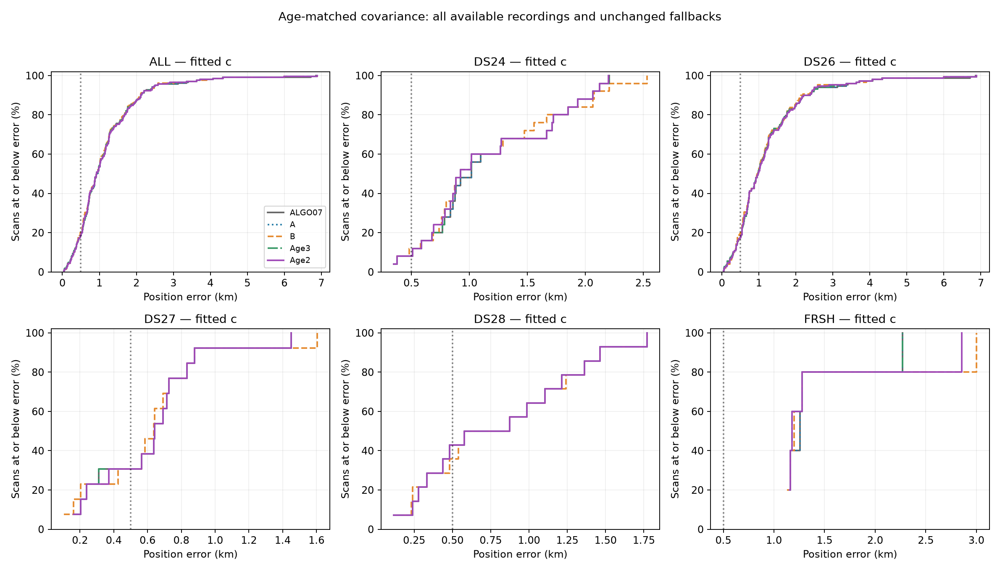
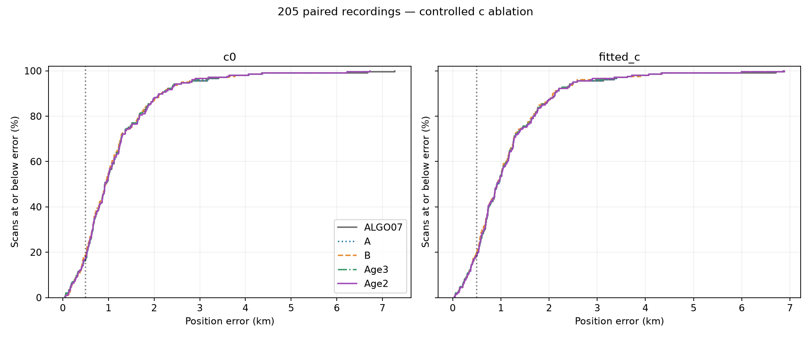
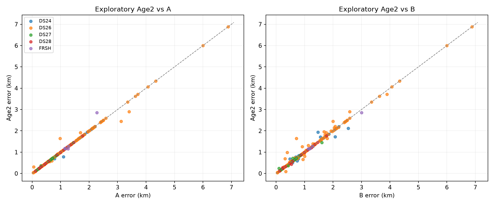

# Complete position statistics

ALGO07, A and B are immutable previous results. Age3 is the primary three-pair policy; Age2 is the exploratory two-pair policy. All unchanged fallbacks remain in each denominator.

| Cohort | Arm | Policy | n | Mean km | Median km | p90 km | p95 km | Below 500 m | Improve/regress >50 m |
| --- | --- | --- | ---: | ---: | ---: | ---: | ---: | ---: | ---: |
| ALL | c0 | ALGO07 | 205 | 1.169 | 0.926 | 2.152 | 2.742 | 35 | 0/0 |
| ALL | c0 | A | 205 | 1.164 | 0.926 | 2.152 | 2.742 | 35 | 1/0 |
| ALL | c0 | B | 205 | 1.152 | 0.940 | 2.154 | 2.603 | 39 | 27/17 |
| ALL | c0 | Age3 | 205 | 1.160 | 0.923 | 2.152 | 2.742 | 35 | 4/0 |
| ALL | c0 | Age2 | 205 | 1.165 | 0.926 | 2.150 | 2.742 | 37 | 8/5 |
| ALL | fitted_c | ALGO07 | 205 | 1.155 | 0.923 | 2.122 | 2.497 | 38 | 0/0 |
| ALL | fitted_c | A | 205 | 1.152 | 0.923 | 2.122 | 2.497 | 38 | 1/0 |
| ALL | fitted_c | B | 205 | 1.138 | 0.923 | 2.086 | 2.525 | 41 | 27/16 |
| ALL | fitted_c | Age3 | 205 | 1.148 | 0.918 | 2.122 | 2.497 | 38 | 4/0 |
| ALL | fitted_c | Age2 | 205 | 1.152 | 0.921 | 2.122 | 2.497 | 38 | 8/5 |
| DS24 | c0 | ALGO07 | 25 | 1.162 | 1.024 | 2.000 | 2.063 | 2 | 0/0 |
| DS24 | c0 | A | 25 | 1.162 | 1.024 | 2.000 | 2.063 | 2 | 0/0 |
| DS24 | c0 | B | 25 | 1.159 | 0.966 | 2.082 | 2.177 | 2 | 4/5 |
| DS24 | c0 | Age3 | 25 | 1.150 | 0.966 | 2.000 | 2.063 | 2 | 1/0 |
| DS24 | c0 | Age2 | 25 | 1.146 | 0.966 | 2.000 | 2.063 | 2 | 2/0 |
| DS24 | fitted_c | ALGO07 | 25 | 1.175 | 1.017 | 2.013 | 2.110 | 2 | 0/0 |
| DS24 | fitted_c | A | 25 | 1.175 | 1.017 | 2.013 | 2.110 | 2 | 0/0 |
| DS24 | fitted_c | B | 25 | 1.165 | 0.923 | 2.072 | 2.180 | 3 | 5/4 |
| DS24 | fitted_c | Age3 | 25 | 1.163 | 0.923 | 2.013 | 2.110 | 2 | 1/0 |
| DS24 | fitted_c | Age2 | 25 | 1.159 | 0.923 | 2.013 | 2.110 | 2 | 2/0 |
| DS26 | c0 | ALGO07 | 148 | 1.242 | 0.991 | 2.396 | 3.181 | 24 | 0/0 |
| DS26 | c0 | A | 148 | 1.235 | 0.991 | 2.396 | 3.181 | 24 | 1/0 |
| DS26 | c0 | B | 148 | 1.213 | 0.963 | 2.279 | 2.814 | 28 | 19/8 |
| DS26 | c0 | Age3 | 148 | 1.231 | 0.991 | 2.396 | 3.071 | 24 | 2/0 |
| DS26 | c0 | Age2 | 148 | 1.234 | 0.991 | 2.396 | 2.878 | 26 | 5/3 |
| DS26 | fitted_c | ALGO07 | 148 | 1.223 | 0.977 | 2.260 | 3.276 | 26 | 0/0 |
| DS26 | fitted_c | A | 148 | 1.219 | 0.977 | 2.260 | 3.276 | 26 | 1/0 |
| DS26 | fitted_c | B | 148 | 1.196 | 0.967 | 2.149 | 2.589 | 29 | 19/8 |
| DS26 | fitted_c | Age3 | 148 | 1.215 | 0.977 | 2.260 | 3.046 | 26 | 2/0 |
| DS26 | fitted_c | Age2 | 148 | 1.217 | 0.983 | 2.260 | 2.789 | 26 | 5/3 |
| DS27 | c0 | ALGO07 | 13 | 0.638 | 0.643 | 0.921 | 1.130 | 4 | 0/0 |
| DS27 | c0 | A | 13 | 0.638 | 0.643 | 0.921 | 1.130 | 4 | 0/0 |
| DS27 | c0 | B | 13 | 0.639 | 0.596 | 0.921 | 1.182 | 4 | 2/2 |
| DS27 | c0 | Age3 | 13 | 0.638 | 0.643 | 0.921 | 1.130 | 4 | 0/0 |
| DS27 | c0 | Age2 | 13 | 0.643 | 0.644 | 0.921 | 1.130 | 4 | 0/1 |
| DS27 | fitted_c | ALGO07 | 13 | 0.619 | 0.641 | 0.869 | 1.106 | 4 | 0/0 |
| DS27 | fitted_c | A | 13 | 0.619 | 0.641 | 0.869 | 1.106 | 4 | 0/0 |
| DS27 | fitted_c | B | 13 | 0.620 | 0.637 | 0.869 | 1.168 | 4 | 2/2 |
| DS27 | fitted_c | Age3 | 13 | 0.619 | 0.641 | 0.869 | 1.106 | 4 | 0/0 |
| DS27 | fitted_c | Age2 | 13 | 0.624 | 0.641 | 0.869 | 1.106 | 4 | 0/1 |
| DS28 | c0 | ALGO07 | 14 | 0.812 | 0.729 | 1.447 | 1.615 | 5 | 0/0 |
| DS28 | c0 | A | 14 | 0.812 | 0.729 | 1.447 | 1.615 | 5 | 0/0 |
| DS28 | c0 | B | 14 | 0.817 | 0.754 | 1.448 | 1.615 | 5 | 1/1 |
| DS28 | c0 | Age3 | 14 | 0.812 | 0.729 | 1.447 | 1.615 | 5 | 0/0 |
| DS28 | c0 | Age2 | 14 | 0.812 | 0.729 | 1.447 | 1.615 | 5 | 0/0 |
| DS28 | fitted_c | ALGO07 | 14 | 0.803 | 0.726 | 1.434 | 1.571 | 6 | 0/0 |
| DS28 | fitted_c | A | 14 | 0.803 | 0.726 | 1.434 | 1.571 | 6 | 0/0 |
| DS28 | fitted_c | B | 14 | 0.809 | 0.726 | 1.434 | 1.572 | 5 | 0/1 |
| DS28 | fitted_c | Age3 | 14 | 0.803 | 0.726 | 1.434 | 1.571 | 6 | 0/0 |
| DS28 | fitted_c | Age2 | 14 | 0.803 | 0.726 | 1.434 | 1.571 | 6 | 0/0 |
| FRSH | c0 | ALGO07 | 5 | 1.438 | 1.284 | 1.901 | 2.069 | 0 | 0/0 |
| FRSH | c0 | A | 5 | 1.438 | 1.283 | 1.902 | 2.070 | 0 | 0/0 |
| FRSH | c0 | B | 5 | 1.569 | 1.274 | 2.297 | 2.635 | 0 | 1/1 |
| FRSH | c0 | Age3 | 5 | 1.423 | 1.283 | 1.862 | 2.050 | 0 | 1/0 |
| FRSH | c0 | Age2 | 5 | 1.541 | 1.283 | 2.214 | 2.519 | 0 | 1/1 |
| FRSH | fitted_c | ALGO07 | 5 | 1.424 | 1.258 | 1.875 | 2.073 | 0 | 0/0 |
| FRSH | fitted_c | A | 5 | 1.424 | 1.258 | 1.875 | 2.073 | 0 | 0/0 |
| FRSH | fitted_c | B | 5 | 1.555 | 1.198 | 2.313 | 2.658 | 0 | 1/1 |
| FRSH | fitted_c | Age3 | 5 | 1.409 | 1.178 | 1.875 | 2.073 | 0 | 1/0 |
| FRSH | fitted_c | Age2 | 5 | 1.527 | 1.178 | 2.226 | 2.542 | 0 | 1/1 |

[All rows](positions.csv) · [Exact statistics](statistics.csv) · [Postdecision binding](position_binding.json)
