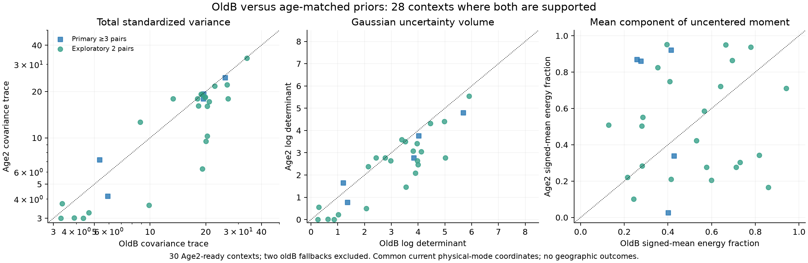
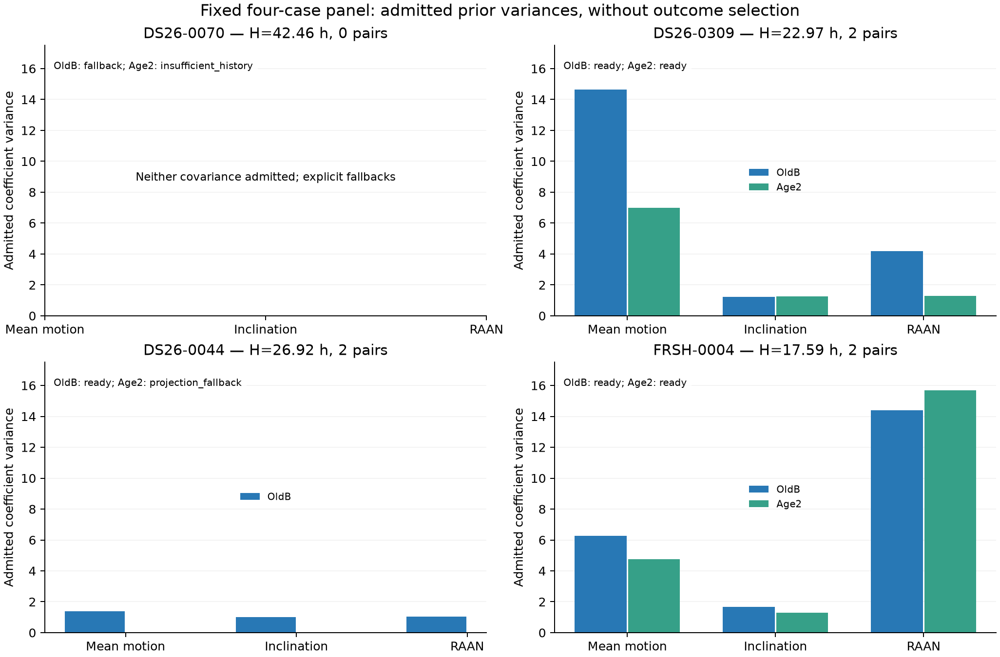

# Sealed oldB versus Age2 prior shapes

This read-only appendix compares saved prior receipts, without reading new RF endpoints, fitting a model or using geographic outcomes. The comparison script hashes its three JSON inputs and itself in `prior_shape_summary.json`. Scientific source and frozen inventory files are unchanged.

**The overlap denominator is 28 of the 30 Age2-ready contexts.** DS24-0103 and DS26-0219 have oldB fallback receipts, so they are excluded rather than silently represented by fitted oldB covariances. All five primary three-pair contexts are in the overlap; the other 23 are exploratory two-pair contexts. Nominal-element, history and native-input hashes agree for each paired context.

| Descriptive quantity | Paired result |
|---|---:|
| Age2 / oldB covariance trace, median | 0.919 |
| Contexts with lower trace | 22 / 28 |
| Age2 − oldB log determinant, median | −0.580 |
| Contexts with lower log determinant | 22 / 28 |
| Covariance dominant-axis angle, median where unique | 27.1° in 25 contexts |
| Covariance axis comparisons undefined by degeneracy | 3 / 28 |
| Uncentered-second-moment dominant-axis angle, median | 31.5° in 28 contexts |
| Squared signed-mean fraction, median oldB → Age2 | 0.421 → 0.506 |
| Current nominal forecast age, median | 19.01 h |
| Age2 mean matched historical horizon, median | 19.04 h |
| OldB mean historical propagation age, median | 48.64 h |

Log determinant is twice log Gaussian volume. A median change of −0.580 corresponds to a median volume ratio of about 0.748. The coefficient covariances refer to the same incumbent standardized physical coordinates; these are not position-confidence volumes. Age2 changes uncertainty orientation as well as magnitude, so it is not simply a uniformly narrower version of oldB. A smaller volume or trace does not imply better RF predictions or geographic accuracy.

Direction angles use the absolute eigenvector dot product, removing arbitrary sign. They are angles **in the three coefficient coordinates**, not geographic or orbital-plane rotation angles. A dominant axis is declared nonunique when its relative top-eigenvalue gap is at most `1e-6`; this is a numerical diagnostic rule, not a model-selection threshold. DS26-0036, DS26-0040 and DS26-0197 have undefined covariance-axis comparisons after floor/ceiling degeneracy. Unclipped second moments remain separately reported so clipping cannot manufacture a unique direction.

For historical coefficients `a`, the signed-mean fraction is `||mean(a)||² / mean(||a||²)`. Both models preserve a zero prior mean; this fraction quantifies how much of their uncentered second moment comes from a coherent signed catalog revision. It does **not** identify true orbit bias. Short correlated histories and different sample counts also affect it, especially with only two Age2 pairs. Signed mean vectors, all eigenvalues, trace, log determinant, log volume, angle/gap diagnostics and horizons are preserved per context in `prior_shape_comparison.csv`.

The four-case panel was fixed before this comparison. DS26-0070 has no eligible age-matched pair and neither prior is admitted. DS26-0044 has two pairs but fails Age2 representation, so only its admitted oldB covariance appears. DS26-0309 changes eigenvalues from `(1, 3.074, 16)` to `(1, 1.084, 7.419)`. FRSH-0004 changes from `(1, 5.365, 16)` to `(1, 4.714, 16)`, retaining the ceiling while redistributing directional variance. None of these four cases is eligible for the primary three-pair policy. Unsupported covariances are shown as absent, not reconstructed from rejected proposals.

Reproduce with `python covariance/compare_prior_shapes.py` from this report root. The script asserts the second-moment decomposition and reconstructs every admitted covariance from the frozen shrinkage/floor/ceiling rule before plotting. No policy is selected by this appendix.
