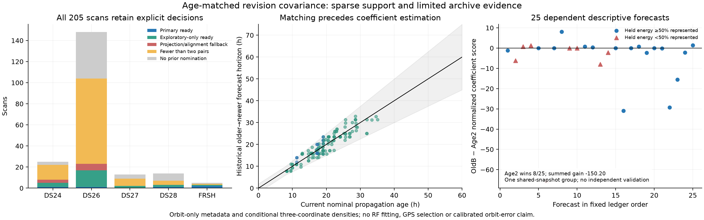

# Age-matched causal revision covariance

This prototype retains the incumbent three physical orbital modes and zero-mean Gaussian prior. It replaces the previous old-versus-current catalog spread with age-matched, nonreused historical forecast revisions. This is an engineering uncertainty proxy, not a calibrated covariance of current orbit error. ALGO07 remains the production default; the RF experiment compares against immutable previously selected A outputs.

## Frozen construction

The target is the same generic RF-nominated family sealed in the preceding 205-scan ledger: 146 nominations, 145 distinct satellites. No satellite is added or nominated again.

The current nominal forecast age `H` runs from its TLE epoch to the midpoint of all native observation timestamps. An older→newer historical pair has horizon `h = newer_epoch − older_epoch`. Require `abs(h−H) <= max(2 hours, 0.25 H)`. Both elements' epochs and archive collections must be in the pre-scan 72-hour window and no later than the nominal epoch/cutoff, respectively. The older element must actually have been collected by the newer element's epoch. TLE-byte epoch/identity, availability/source hashes and native nominal-file bindings are verified.

Pair selection maximizes the number of pairs without reusing an element, then minimizes total absolute horizon mismatch, then uses a stable epoch/hash tie. It never examines a coefficient or score. The prospective primary policy requires three pairs; the exploratory policy requires two and uses exactly the same covariance and fit. Two-pair support is deliberately labeled weak. Disjoint elements do not make catalog revisions independent truth.

At the newer element's historical epoch, propagate both elements over an arc with the native scan's duration, sampled at its beginning, midpoint and end. Align the older orbital phase with an eight-step, `1e-7` second convergence requirement and 120-second bound. Remove the residual phase tangent from the state discrepancy and physical design. Position is combined with velocity scaled by orbital radius/inertial speed.

Historical derivatives are rebuilt around the **newer historical TLE at that epoch**, using mean motion in rev/day, inclination in degrees and RAAN in degrees. The mean-motion derivative holds mean longitude at that historical midpoint. Column-normalized least squares estimates a physical parameter revision. Dividing by the current model's declared physical SDs maps it into the current three Gaussian coefficient coordinates. Historical state geometry is never directly projected onto the current state bank. This coordinate mapping does not propagate a fitted historical error through time or infer a new orbit.

The current bank retains its original mean-motion phase anchor at scan origin +150 seconds. Direct perturbations must reproduce all three current mode directions to `1e-10` before adjustment is permitted. Phase-anchor equivalence is a first-order statement, and rank/representation diagnostics remain explicit.

With mapped coefficients `a`, form `S = mean(a a^T)`, then `C_raw = 0.5 I + 0.5 S` and clip eigenvalues to `[1,16]`. Zero mean, the incumbent uncertainty floor, SD ×4 ceiling and Gaussian determinant remain. Less than 50% represented historical state energy causes fallback. No shrinkage parameter is fitted.

## Pre-RF support inventory

Before enforcing historical forecast availability, at least one/two/three disjoint pairs existed in 98/43/6 nominated contexts. Requiring the older element to be available by the historical target epoch reduces these to **95/39/5**. This requirement was imposed before RF fitting.

| Cohort | Available scans | Prior targets | At least two pairs | Ready after numerical/projection checks | Primary three-pair ready |
|---|---:|---:|---:|---:|---:|
| DS24 fast | 25 | 22 | 8 | 5 | 1 |
| DS26 fast | 148 | 104 | 23 | 17 | 1 |
| DS27 fast | 13 | 9 | 2 | 2 | 0 |
| DS28 fast | 14 | 7 | 3 | 3 | 1 |
| FRSH control | 5 | 4 | 3 | 3 | 2 |
| Total | 205 | 146 | 39 | 30 | 5 |

Eight contexts fail representation and DS24-0013 exceeds the phase-alignment bound. The other 107 nominated contexts lack two eligible pairs; 59 scans have no prior nomination. All retain explicit fallbacks. The five primary contexts are DS24-0075, DS26-0014, DS28-0011, FRSH-0001 and FRSH-0005. Among 30 ready contexts, 12 hit the covariance ceiling and two retain identity covariance.

`derived_inventory.json` retains all 205 cases, exact pair counts, histories, element/collection receipts, physical SDs, alignment/rank diagnostics and covariance matrices. The runner verifies rebuilt pair count and history hash against this pre-RF inventory.

## Verification and independence limits

Seven component tests pass: optimal disjoint matching and tie order, fixed age tolerance, actual historical availability, physical parameter recovery, SD-coordinate invariance, phase-anchor scope and normalized Gaussian covariance. The actual FRSH-0001 audit changes only target columns 93–95 in c=0 and 94–96 in fitted-c. All unrelated features, observations, masks, aliases, receiver terms, constants, phase priors and references are identical. No position optimization is used in that audit.

An independent construction audit also poisons CFO arrays with NaNs, makes RF calculation/state methods fail, and makes endpoint/GPS-like/ownership fields inaccessible. The covariance and receipt remain bitwise identical. The pre-RF construction therefore does not depend on those fields.

The archive validation audit sets forecast issuance to the older element's first collection. All preprocessing must precede issuance; the later newer TLE is a held outcome only. Of 227 eligible forecasts in the cached banks, 25 support both oldB and Age2 priors under that rule; only one supports Age3. However, connecting whole satellite families that share any catalog snapshot leaves **one connected group across all 145 families**. Seed 20261102 cannot produce independent training/held groups. `archive_validation_support.json` therefore reports **unsupported independent validation**, with no numerical independent-holdout score claimed. The cached banks also omit some earlier archive history outside their original pre-RF windows.

## Descriptive strict-issuance density comparison

A separate 2.46-second auxiliary calculation evaluates all 25 prefix-supported forecasts across 20 satellite families, without fitting or selecting any parameter. The nominal forecast basis, its three physical SDs, previous-element scales and both covariance priors use only TLEs available by forecast issuance. The later newer TLE enters only the scored innovation, projected into that **known older-forecast basis**. Thus held-state geometry cannot define a prior scale or mode. All calculations belong to the same dependent snapshot group.

| Prior | Sum of normalized negative twice coefficient log density | Median per forecast |
|---|---:|---:|
| Identity covariance | 1151.85 | 10.769 |
| OldB | 440.72 | 10.839 |
| Age2 | 590.93 | 10.822 |

Lower is better. Age2 improves over oldB in only eight of 25 forecasts and worsens the summed score by **150.20**. Both broad priors improve the aggregate over identity, while their medians are slightly worse. Each covariance construction is supported in 19 forecasts and explicitly falls back to identity in six.

These are properly normalized densities of the three projected coefficient coordinates, conditional on the known basis. They are not full-state densities: held represented state energy ranges from 4.83% to almost 100%, with median 88.88%. Unrepresented residuals remain reported, and difficult held outcomes are not discarded. The dependent descriptive comparison supplies no independent validation or localization conclusion. Its result does not change the frozen construction or adoption policies. Full receipts are in `causal_density_diagnostic.json`.

The age-matched construction changes horizon matching, pairing and the historical physical-coordinate calculation together. It should not be described as isolating a pure causal effect of age. Two-pair support, shared catalog sources, zero-mean bias absorption and same-site RF evaluation remain limitations. Location and RF performance are measured separately in the parent report; archive revision prediction does not establish geographic accuracy.
