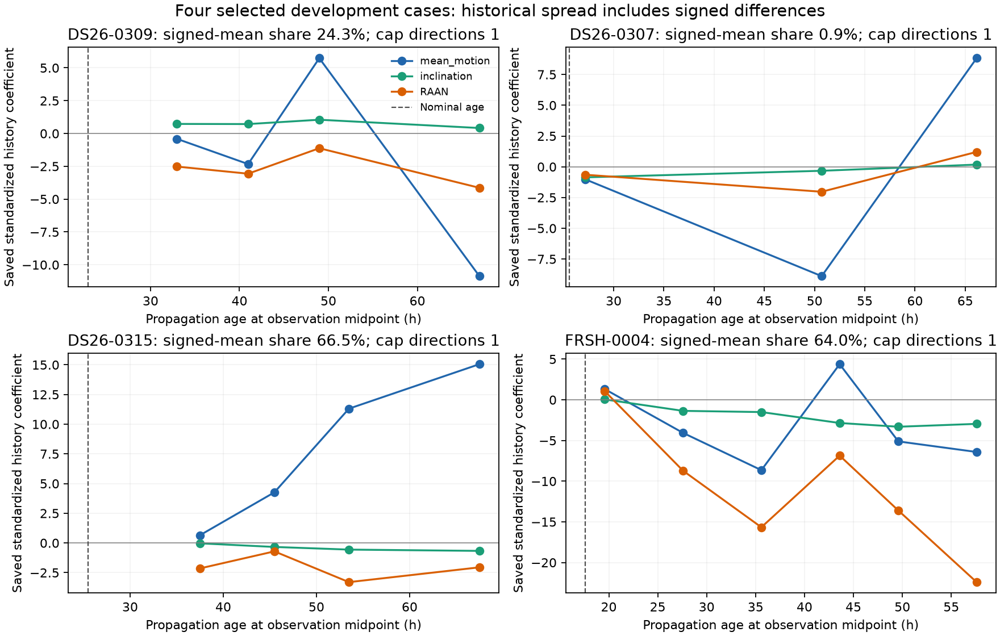

# Four selected old-B cases

These are posthoc development comparisons of the already sealed B experiment.
No RF model, position, covariance or acceptance rule was fitted or selected.
Published position outcomes identify the panel and describe its behavior; they
do not enter the new age-matched covariance construction.

| Case | Nominal / mean history age, h | Squared-mean share of second moment | Dominant coefficient direction | Largest covariance eigenvalue before → after cap | Fitted-c B minus selected-A error, m |
|---|---:|---:|---|---:|---:|
| DS26-0309 | 22.97 / 47.47 | 24.3% | Mean motion, 81.1% | 22.04 → 16 | −1129.9 |
| DS26-0307 | 25.60 / 48.00 | 0.9% | Mean motion, 95.8% | 27.76 → 16 | −927.8 |
| DS26-0315 | 25.48 / 50.98 | 66.5% | Mean motion, 94.7% | 49.03 → 16 | +819.5 |
| FRSH-0004 | 17.59 / 38.92 | 64.0% | RAAN, 83.3% | 101.14 → 16 | +731.2 |

All four have exactly one upper-capped direction. Age or capping alone does not
separate their outcomes: DS26-0307 and DS26-0315 have nearly equal nominal ages
and mean-motion-dominated expansion, with opposite localization effects.
The two regressions have larger squared signed-mean components in this selected
panel. That is a useful mechanism hypothesis, not a validated classifier or a
reason to add an orbit mean correction. Historical revisions are correlated,
age mismatched and relative to another estimated orbit.

The decomposition is the exact population identity
`E[a a.T] = E[(a-mean)(a-mean).T] + mean mean.T` over the saved historical
coefficients. Trace fractions refer to the incumbent standardized parameter
coordinates; the three state directions are not orthogonal, so these fractions
are not physical state-energy fractions. Signed means and centered SDs are
retained separately, together with the incumbent physical mode scales and
corresponding physical-unit signed means. Each historical prediction was
propagated roughly another 21–26 h beyond the nominal forecast on average.

The signed mean-motion coefficient changes sign across the three DS26-0307
histories, leaving a small mean but large spread. DS26-0315's mean-motion
coefficients stay positive and increase with historical age. FRSH-0004's RAAN
coefficients have a large persistent negative component. These are descriptions
of the saved projections, not forecasts of actual orbit error.

| Case | Target phase change A→B, fitted c, s | Largest phase-vector change, s | Curved RMS change, Hz |
|---|---:|---:|---:|
| DS26-0309 | +0.0659 | 0.2793 | −0.6531 |
| DS26-0307 | +0.0674 | 0.1867 | +0.0348 |
| DS26-0315 | +0.0759 | 0.1399 | −0.0853 |
| FRSH-0004 | +0.1213 | 0.1213 | −0.1045 |

The first three largest phase changes occur outside the nominated family's
phase. This shows that the nuisance response is shared, but cannot identify a
receiver-versus-orbit cause. The old numerical receipts did not save physical
mode or receiver posterior coefficients; these fields remain explicitly null.
No nuisance posterior was reconstructed here. Phase labels were recovered from
the saved graph's sorted candidate-index order, with source hashes recorded.
Both c arms appear in the full tables.

Frequency residual changes again do not identify better positions: DS26-0307
improves while its curved RMS slightly worsens; the two regressions have lower
curved RMS. No diagnostic threshold is created from those outcomes.

[Complete JSON](old_b_panel.json), [case summary](old_b_panel_summary.csv),
[historical signed coefficients](old_b_panel_history.csv) and
[both-arm saved-endpoint diagnostics](old_b_panel_arms.csv) preserve the inputs,
hashes and unavailable fields. Two tests verify the mean/spread decomposition.
