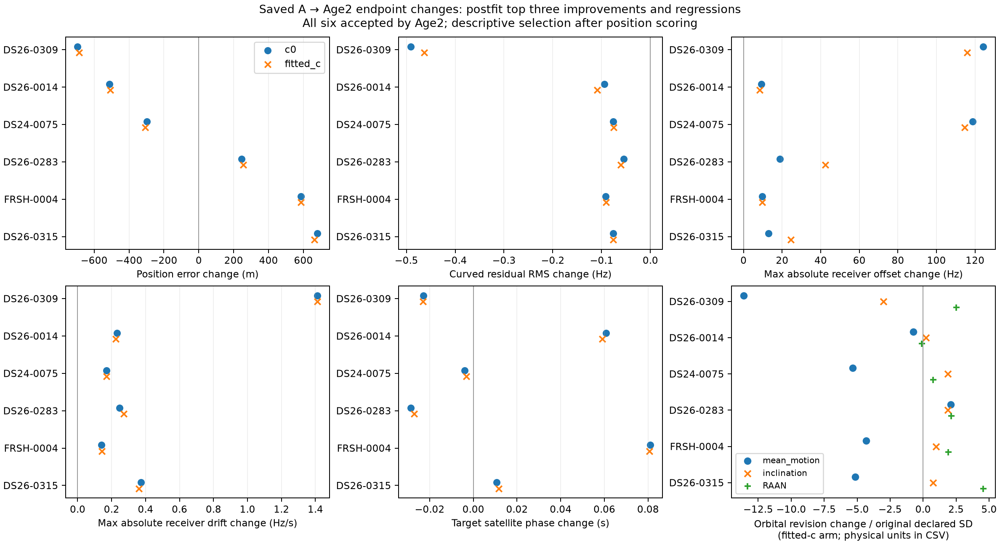

# Saved nuisance parameter changes

These are postfit descriptions of the immutable selected-A control and the one fresh age-covariance endpoint. No models were reconstructed and no optimization was run. The panel selects the three largest fitted-c Age2 improvements and three largest regressions after position scoring. All 30 candidate pairs, including rejected raw endpoints, remain in the CSVs.

| Case | Arm | Error Δ m | RMS Δ Hz | Max offset Δ Hz | Max drift Δ Hz/s | Target phase Δ s | Orbit Δ mean motion rev/day / inclination deg / RAAN deg |
| --- | --- | ---: | ---: | ---: | ---: | ---: | --- |
| DS26-0309 | c0 | -694.6 | -0.49137 | 124.30 | 1.4119 | -0.02285 | -0.0022944 / -0.002016 / +0.0021007 |
| DS26-0309 | fitted_c | -685.6 | -0.46366 | 115.86 | 1.4102 | -0.02303 | -0.0022846 / -0.002008 / +0.0020918 |
| DS26-0014 | c0 | -513.5 | -0.09468 | 9.29 | 0.2309 | +0.06068 | -0.00054064 / +0.00059557 / -0.00033916 |
| DS26-0014 | fitted_c | -508.4 | -0.10896 | 8.40 | 0.2245 | +0.05897 | -0.0005366 / +0.00058712 / -0.00033994 |
| DS24-0075 | c0 | -297.4 | -0.07590 | 118.74 | 0.1706 | -0.00391 | -0.0012435 / +0.00084856 / +0.00042736 |
| DS24-0075 | fitted_c | -307.4 | -0.07560 | 114.54 | 0.1707 | -0.00323 | -0.0012617 / +0.0008619 / +0.00043286 |
| DS26-0283 | c0 | +245.0 | -0.05448 | 18.89 | 0.2475 | -0.02874 | +0.0020012 / +0.0025115 / +0.0035629 |
| DS26-0283 | fitted_c | +256.0 | -0.06057 | 42.49 | 0.2720 | -0.02709 | +0.0020019 / +0.0024713 / +0.0035245 |
| FRSH-0004 | c0 | +586.2 | -0.09181 | 9.68 | 0.1411 | +0.08107 | -0.0007859 / +0.00020342 / +0.00058067 |
| FRSH-0004 | fitted_c | +586.0 | -0.09049 | 9.76 | 0.1413 | +0.08068 | -0.00078654 / +0.00020379 / +0.00058154 |
| DS26-0315 | c0 | +680.5 | -0.07612 | 12.91 | 0.3726 | +0.01067 | -0.00089154 / +0.00072142 / +0.0063019 |
| DS26-0315 | fitted_c | +664.1 | -0.07643 | 24.52 | 0.3600 | +0.01153 | -0.00085785 / +0.00069343 / +0.0060597 |

Receiver beta has four RX/band offsets in Hz. Its next four stored coordinates are 150 times the physical drift in Hz/s; the tables divide by 150. The optional ninth coordinate c is Hz/GHz about 11.5 GHz and is fixed to zero in the c0 arm. Beta amplitudes are coefficients, not independent measurements of receiver hardware error.

Phase entries are absolute posterior phase in seconds, matched by saved NORAD. Their declared phase SDs are retained in the parameter CSV; the heavy-tailed hierarchy can alter conditional prior precision, so these SDs are coordinate scales rather than posterior uncertainty. Smooth-coefficient norm changes are in Hz times the unchanged receiver basis, not the RMS of a reconstructed receiver curve.

The three target orbital coefficients represent mean-motion, inclination and RAAN revisions in rev/day, degrees and degrees. Raw transformed coefficients have different bases between A and age covariance: this report first maps age coefficients back with L @ z and multiplies by the original physical SD. Original and age marginal declared SDs (original SD × sqrt(diag(C))) are in both CSVs. The figure divides physical revisions by the original SD only for a common plotting scale; it is not a posterior z score. Non-target orbital coefficients may also adapt at a new endpoint; this panel isolates the changed target prior and receiver/phase response.

Both the largest improvement (DS26-0309) and largest regression (DS26-0315), and the FRSH-0004 regression, use larger target-orbit corrections alongside receiver and phase changes. This shows a coupled response to the changed covariance. Saved endpoint coefficients cannot identify a unique physical cause or establish that an orbital or receiver estimate is correct. A better in-sample RMS is separately reported from position error and does not establish better localization. Ancillary phase-mixture families are separately scored; these snapshots are the conditional curved-model coefficient representation, not a joint posterior for all evidence.

[Case/arm deltas](nuisance_case_deltas.csv) · [Physical parameter values, scales and deltas](nuisance_parameter_deltas.csv)

Input bindings: results `360bd3c179aedc997d50016eb986312677e5ff615f8f4aa84fc81e6e5bd56d2f`; positions `baf83bb7c2ebdfbfbab059c99eaf9336b1b7485d19fd966fe7859855bafc4365`. All 60 saved endpoint/control pairs passed coefficient-coordinate mapping checks. Input bytes are unchanged after this description.
