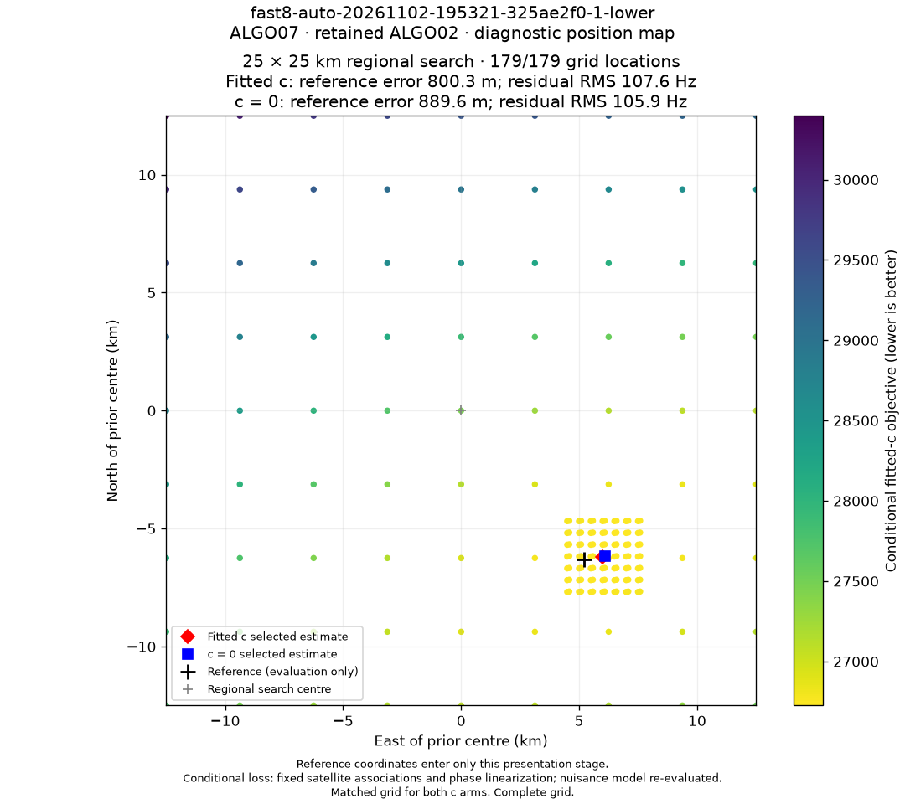

# ALGO07 conditional localization grid

The ALGO07 position PNG now reuses the historical B7/Hard60 coloured-grid drawing function, `draw_position_grid`, with scores from the published ALGO07 model. It retains the black evaluation cross, red fitted-c diamond, blue c=0 square, error/RMS summaries and colour bar. The example is `fast8-auto-20261102-195321-325ae2f0-1-lower`; ALGO07 retained the ALGO02 solution on this scan.

## What each point means

Each dot is a scored receiver location in the original 25 × 25 km box centred at **37.906, −122.545**. A 9 × 9 coarse grid is combined with 7 × 7 samples within ±1.5 km of each published c-arm endpoint. Duplicate locations are removed, and both calibration arms score exactly the same locations. The grid is constructed without evaluation GPS coordinates.

The colours show the fitted-c conditional objective, with yellow indicating lower loss. The published satellite ownership and phase linearization are held fixed; the original receiver/orbit nuisance likelihood is re-evaluated at each position. Existing predictive-family phase mixtures remain part of that likelihood. This is a conditional loss diagnostic rather than a full acquisition/association rerun, an optimizer trajectory or a calibrated probability map. No global optimum is certified.

Sampling has a 30-second budget. A location is attempted in both c arms before moving to the next one. Incomplete grids are labelled partial, and non-finite or failed scores are shown as unscored points rather than zero loss. The PNG uses the solver's local coordinate frame consistently for grid samples, fitted positions and the evaluation cross.

## Verified example

The example scored **179/179 locations in both arms**, with **zero failed pairs**, in **24.07 seconds**. Both saved endpoint objectives replayed with difference **0.0**. The lowest sampled objective for each arm was its published endpoint, which was included among the samples.

| Saved fit | Associated GLRT | Horizontal evaluation error | Conditional residual RMS |
|---|---:|---:|---:|
| c = 0 | 2,745 / 4,084 (67.21%) | 889.6 m | 105.94 Hz |
| Fitted c | 2,745 / 4,084 (67.21%) | 800.3 m | 107.64 Hz |

These are unchanged results from the published inference. The evaluation site, **37.849061591561885, −122.48574968092912**, enters only the post-fit annotation and error calculation. The new visualization does not establish a localization or frequency-fit improvement.

## Publication and reproduction

The independent presentation revision is `conditional-grid-v5`. The position PNG changes; the other seven PNGs retain their bytes. Scientific terminal, input, observation, track and ownership hashes remain unchanged. Existing digest-qualified image URLs retain their original bytes.

The [grid data](position-grid.json) contains paired raw objectives, sampled coordinates, endpoint replay checks, completeness and timing. Its binding identifies the scientific terminal, input, ownership maps and position PNG. The live API exposes the verified data at `/api/v2/fast-scans/{run_id}/standard-analysis/position-grid.json`.

Newly generated standard ALGO07 figures use this grid. Existing completed endpoint-only maps remain available; a specific historical scan can be upgraded with `tools/render_standard_fast.py --bulk-root /srv/bulk/leo --run-id RUN_ID`. This replays the saved model and samples the diagnostic grid without changing the published solution.

The implementation passed **32 component tests**, covering the shared historical renderer, paired sampling, time limits, unscored points, provenance/integrity checks, previous image URLs, rolling compatibility with the native completion reader and API access.

Production presentation code is deployed at commit `9eaad806672699da46b061a54a0716ba95d7e7ec`. The [HTTP check](http-check.json) verified all eight current PNGs, sixteen prior digest-qualified URLs, the grid JSON binding and unchanged scientific hashes. The [live browser check](browser-check.json) verified the new position image and both evaluation errors with no page exceptions or HTTP failures. The scientific workers were left running unchanged.
