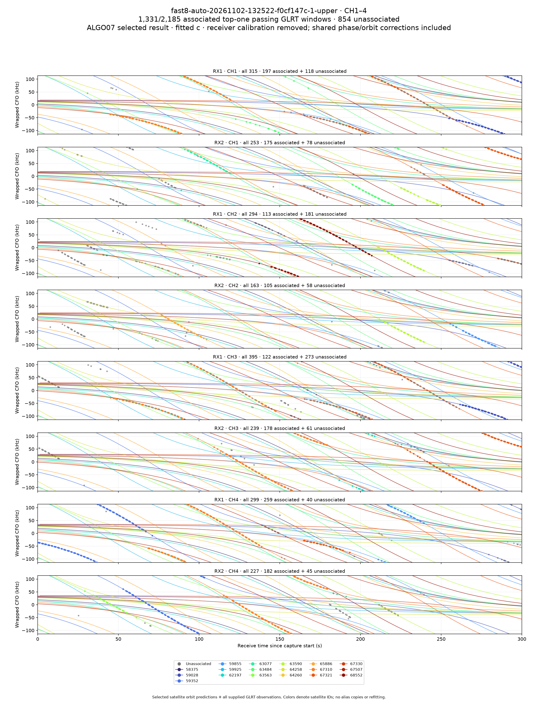
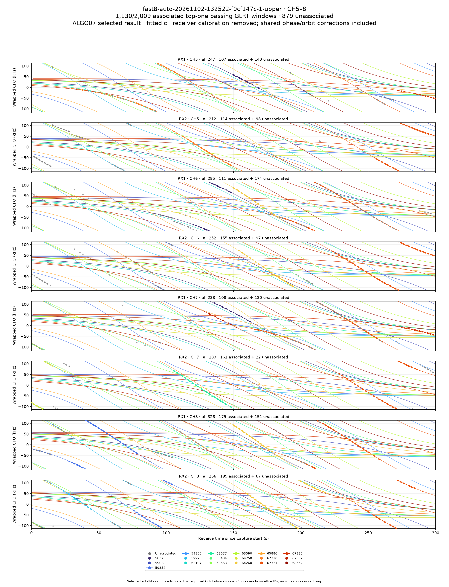
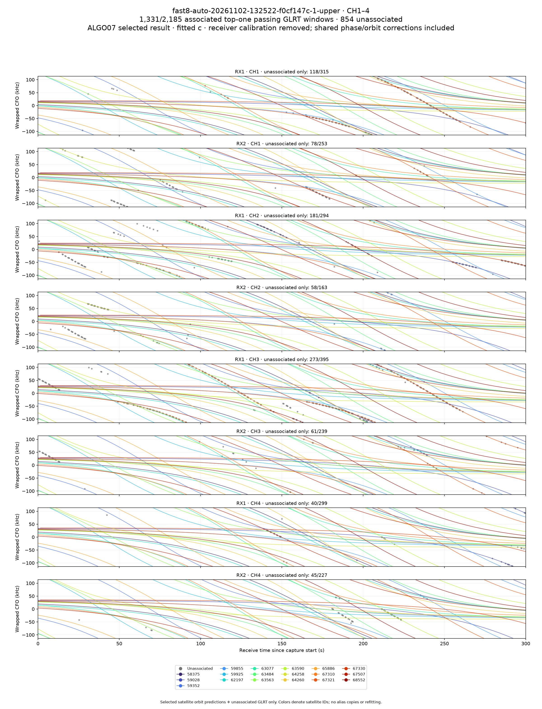
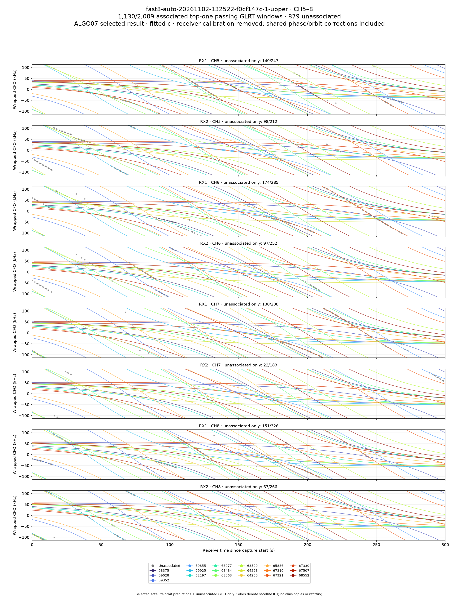

# Standard ALGO07 fast analysis and acquisition cadence

ALGO07 is the standard fast-scan localization and figure source. Older B7/Hard60, shared-model and experimental outputs remain available in a collapsed historical section, with their original contracts and artifacts intact.

The standard card reports the actual selected endpoint, retained model on fallback, both calibration arms, native point coverage, track/family counts and conditional residual RMS. A separately attached user-confirmed evaluation reference can report geographic error after fitting. Missing references remain explicitly unavailable; no reference is supplied to numerical inference.

Eight new PNGs are published atomically for each completed ALGO07 result: CH1–4 and CH5–8 GLRT/selected owners/orbital predictions; both bands' unassociated GLRT with orbital predictions; both bands' residuals; RMS for every associated fragment; and both published positions in the 25 × 25 km region. The four main figures reuse the previous `fast_scan_orbits` renderer: eight stacked receiver/channel lanes per band, 0–300 s, wrapped CFO at ±113.636 kHz, satellite colors and a NORAD legend, with gray unassociated points. They use ALGO07's ownership and calibrated frequency frame. The immutable manifest binds all image digests to the scientific terminal, input, native observations, tracks and both ownership maps. The browser requests digest-qualified PNG URLs, so a previous algorithm's cached image cannot silently appear as the current one. Older published manifests and digest-qualified image URLs retain their original bytes.

The rendering process reconstructs the published model, checks both endpoints and RF objectives, and reports every published owner. It performs no position or satellite search. Main figure points subtract the saved receiver/band offsets, drifts, RF-dependent coefficient and smooth receiver term. Full-scan orbit curves use the saved absolute-phase linearization and physical orbital-mode coefficients, with horizon masking and breaks at alias wraps. Predictive new families use their conditional phase-grid MAP and physical-mode posterior. These diagnostic curves do not claim an independent identity confidence or a joint measurement posterior. Evaluation metadata stays outside the scientific terminal.

For `fast8-auto-20261102-132522-f0cf147c-1-upper`, ALGO07 retains the ALGO04 solution: 2,461/4,194 qualified native GLRT points (58.679%), 61 associated fragments and 18 satellite families. At the user-confirmed evaluation site, fitted-c error is 883.505 m and c=0 error is 911.962 m. Their conditional residual RMS values are 59.672 Hz and 59.739 Hz respectively; both replayed RF objective differences are exactly zero. The old B7/Hard60 endpoint, around 83–87 km away, remains historical and is no longer the standard result.

The automatic fast pipeline now finishes when the ALGO07 publication is complete. It exports the same qualified GLRT evidence and lets the existing ALGO02→ALGO07 workers consume their existing public ports. It does not run the older full diagnostic pipeline by default. The installed native-rate GLRT source is preserved byte-for-byte except for the orchestration overlay and its new presentation/reconciliation dependencies.

The scheduler retains the existing five-minute capture and 7.5-minute inactive gap. Analysis backlog no longer gates acquisition. Capture still requires the acquisition authority, its pause/ownership locks, the pipeline lock and a 30 GB recording-filesystem reserve; the recorder retains its own native-rate full-capture reserve checks. No manual or extended RF campaign is introduced.

Abandoned operational recording states are reconciled only while the acquisition authority can be exclusively claimed and the real checkpoint is at least 30 minutes old. Discovery timestamps do not establish capture liveness. Invalid old checkpoints remain evidence of interruption; their IQ and checkpoint bytes are never changed or fabricated as sealed captures. Live acquisition ownership and recent checkpoints prevent reconciliation.

Deployment verification, exact runtime paths, all PNG checks and observed normal timer starts are recorded in the accompanying verification receipt. Rollback removes only the newly installed API, watcher and capture-orchestration overrides, stops the standard-figure worker, and restores the preceding service commands. Existing scientific terminals and image namespaces are preserved.

## Verified publication

The live API, figure worker and automatic fast-analysis watcher use release `17bf8ccfa3dd495f040fcb05fbcffcb1e11c42e3` under `/opt/leo-standard-fast/`. Commit `17bf8ccfa` is on remote main. The staging receipt verifies that 351 native GLRT source files remain byte-identical to the preceding native-rate release; only the orchestration and publication overlay differs. Acquisition uses the independently deployed `c1537511d` cadence script. The recording timer remains unchanged.

The [PNG audit](png-audit.json) verified every completed ALGO07 result available at the audit: **13 scans and 104 PNGs**. It checked the live HTTP image bytes, SHA-256, byte count, image decoding, immutable cache headers, exact terminal/input/native-observation/track hashes, both ownership-map hashes, both endpoints and the replayed RF objective. Both c arms matched their saved objectives to the declared 0.0001 tolerance. No post-observation TLE was used. An additional storage test confirms old digest-qualified URLs retain their prior bytes after the layout revision.

The [live browser receipt](browser-verification.json) confirms all eight standard figures decoded, fitted-c error was 883.5 m, c=0 error was 912.0 m, the legacy result was collapsed, and there were no page exceptions, HTTP errors or requests to the obsolete recording-detail endpoint. The change passed 47 Python component checks and 266 UI tests; the web production build passed. The same live browser check passed again after the final release cutover.

Normal capture starts at 15:03:22, 15:15:57, 15:28:35 and 15:41:11 UTC on November 2 correspond to 07:03:22, 07:15:57, 07:28:35 and 07:41:11 PST. The observed spacings were 12m35s, 12m38s and 12m36s, consistent with five-minute captures, normal overhead and the retained 7.5-minute inactive gap. The last fast capture finished at 15:46:18 UTC: all 6,773 planned windows were delivered and durable, with zero skipped or invalid windows and verified hardware restoration. This succeeded while catch-up work occupied the CPU queue. The next normal adaptive capture started at 15:53:48 UTC. No additional manual capture was launched.

The deployment also exposed a separate throughput constraint: PostgreSQL admitted only eight CPU jobs. Additional recovery workers could not claim queued work while the current fast scan occupied those slots. The queue was temporarily increased to 24 for catch-up, then set to **20** on the verified **24-logical-CPU** host. Normal fast GLRT now requests **16 workers**, with the same scientific implementation and per-window computations. The worker budget is explicit and bounded to 1–32; the installed service requests 16. Resource capacity is an operational PostgreSQL setting, not a change to scientific priors or the RF acquisition schedule.

The 14:50 capture was resumed under its exact original GLRT code/environment identity, retaining completed jobs; all 6,772 windows were published and exported. The 15:15 capture also finished and exported all 6,772 windows under its original identity. The old watcher drained normally before the new watcher started at 15:52:07 UTC. Its ordinary restart policy was restored, and no temporary drain override remains. The new watcher has been observed holding 16 GLRT job leases for the 15:41 fast capture, while both recovered scans are automatically marked `standard_algorithm=ALGO07` and await localization. No IQ or completed scientific product was deleted or changed.

The wider rollout audit remains active until a recovered recording reaches automatic ALGO07 completion and its eight figures pass the live source/digest audit. A healthy pending localization is not claimed as completed merely because GLRT finished. The extended audit accepts `--recording` and verifies that automatic completion, GLRT recording/session identity, ALGO07 terminal hash and standard figures agree.

## Matched-format figures

These figures are from the same ALGO07 result described above. The layout matches the previous main PNGs; ownership, receiver calibration and orbital corrections come from ALGO07.

Additional diagnostics: [CH1–4 residuals](figures/ch1-4-residuals.png), [CH5–8 residuals](figures/ch5-8-residuals.png), [fragment RMS](figures/track-rms.png), [both positions](figures/position.png), and the [live Web UI](figures/webui.png).
