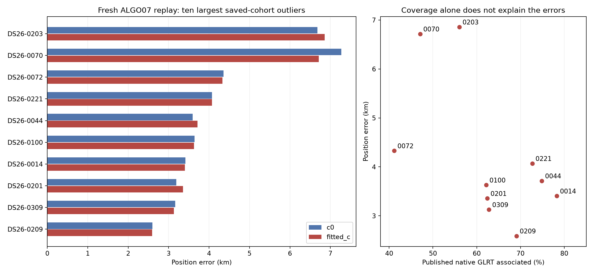
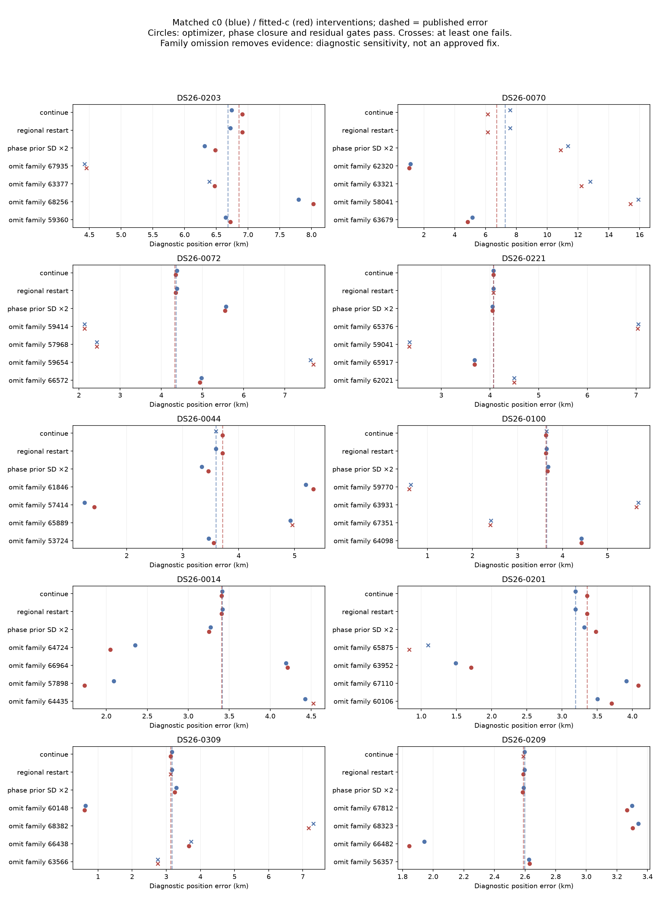

# Ten largest recent fast-scan localization outliers: ALGO07 audit

## Scope and conclusion

This investigation ranks 205 available fast-scan results from DS24 (25), DS26 (148), DS27 (13), DS28 revision 2 (14), and five fresh validation recordings. Twenty-four cohort members lack comparable results and are not silently assigned zero error. DS25 is adaptive-only; its fast comparison recordings are already in DS24. DS23 is the older cohort and is outside this recent, comparable ranking. There are no duplicate native recording identity tuples among these 205 results.

All ten largest saved guarded-policy errors are in DS26. We freshly execute the promoted ALGO07 numerical runner on those ten, plus two previously repaired ranking controls, using the complete causal history and exact saved graph/GLRT inputs. This is an offline research replay, not a new raw-IQ processing campaign or a claim about a historical public production terminal. The full cohort ranking otherwise retains its source authority: retrospective guarded-policy audits for DS26/27/28, and executed frozen-candidate results for DS24 and the fresh cohort. See [initial inventory](run_manifest.json), [fresh evaluation](eval/diagnostics.json), [verified ranking](verified_ranking.json), and [paired results](top10_results.csv).

All twelve fresh executions completed and passed replay/provenance validation. The ten outliers retain their exact incumbent outcomes after the guarded reassociation search. The controls reproduce the accepted repairs: 0034, 4.498→0.374 km; 0251, 6.561→1.162 km. Thus neither repaired case reenters the top ten. Reporting-only Earth-radius conventions cause less than 0.02 m difference between some archived and fresh errors. No proposed fix in this report was applied to production.

The evidence does **not** support one universal cause or ten proven wrong satellite IDs. There are three distinct problems:

1. **Ambiguous association and incomplete phase convergence:** most clearly 0070, with 0072 and 0100 showing important rival-identity/model conflicts.
2. **Influential families whose published identities remain plausible:** most clearly 0309, 0044, 0014 and 0201. Their influence can be large even when a curve looks clean. Removing a family identifies sensitivity, not a scientifically justified deletion.
3. **Conflicting evidence across several families:** 0203 and 0221 do not admit a simple tested single-family repair that both approaches the site and passes the remaining evidence gates. Scan 0209 has a smaller, distributed bias.

The regional-center restart returns essentially the same biased solution in the phase-closed cases. Extra iterations do not generally solve the problem. Doubling the phase-prior standard deviation is not a consistent remedy either. The current objective can favor a geographically wrong position while fitting the selected observations well.

## Per-scan findings

Errors below use the fitted-c arm. Every intervention also has a matched c=0 result in the next section and case reports. “Pass” for an omission refers to optimizer convergence, phase-reference closure and residual gates on **remaining evidence**, not the full ALGO07 acceptance policy or permission to delete the family. Association percentages count only published native winners; unadopted membership proposals are excluded.

| Scan | Error, km | GLRT associated | Finding and measured evidence | What remains unresolved / next discriminator |
|---|---:|---:|---|---|
| DS26-0203 | 6.858 | 56.03% | Repeated descent returns to the same wrong basin. Family 67935 is influential, but stays preferred in causal and later curve/family searches. Omitting it gives 4.453 km and fails remaining-data gates. | A single wrong ID is not established. Test shared receiver/band calibration against family-specific orbit discrepancy using held whole time groups; preserve the evidence that rejects the omission. |
| DS26-0070 | 6.716 | 47.07% | Phase reference does not close after 15 rounds; local curvature condition ratio is about 31. Family 62320 carries phase/orbit coefficients about 9.35/11.60 original prior units. Omitting it gives 1.060 km and passes the remaining-data checks. Rivals 67047 and 63571 depend on TLE/model assumptions; the deployed uniqueness guard rejects ambiguity. | Strong localization of the conflict to this family, but no unique replacement established. Compare all three with a joint phase-position solve and independent receiver/time prediction. |
| DS26-0072 | 4.329 | 41.17% | Family 59414 needs an orbital coefficient about 18.24 prior units. A single curve favors 68026 while the whole-family restricted fit favors 65829. ALGO07 admits 65829 through its identity guard but rejects the final paired fit. Omitting 59414 gives 2.133 km with failed remaining-data gates. | Association and shared-model conflict. Inspect family consistency across receivers and the specific residual slopes/steps blocking 65829; do not accept a single-curve winner. |
| DS26-0221 | 4.070 | 72.70% | Both leading audited identities (65376 and 59041) remain preferred with causal and later elements. Removing 65376 worsens error to 7.036 km. Removing 59041 gives 2.344 km but fails residual gates. | Several families constrain incompatible directions under the current model. Family 59041 has a large orbital nuisance coefficient; assess shared versus family-specific discrepancy on retained witnesses. |
| DS26-0044 | 3.715 | 74.89% | Family 57414 removal gives 1.424 km with remaining-data checks passing. Rival 58786 competes under causal elements, but the later whole-family comparison returns to 57414. The largest local influence, 61846, is useful: deleting it worsens error. | 57414 is model-sensitive, not a proven bad ID. Test 57414/58786 with the full physical nuisance model and whole-group prediction. |
| DS26-0100 | 3.629 | 62.19% | Family 59770 has phase/orbit coefficients about 12.67/12.93 prior units. Rival 63315 wins restricted curve/family comparisons in both TLE regimes, but needs substantial corrections and fails the diagnostic noise screen. Removing 59770 gives 0.597 km but violates remaining-data gates. | A promising rival exists, but its physical adequacy and compatibility with other families are unproven. Test a shared correction for 63315 before any reassignment. |
| DS26-0014 | 3.405 | 78.29% | High coverage and closed descent still give a biased solution. Removing 64724 gives 2.048 km; removing 57898 gives 1.733 km; both pass remaining-data checks. Initial leading identities 64724/66964 remain preferred across TLE regimes. | More than one family influences the bias; high point coverage is not enough. Compare independent family predictions and uncertainty calibration rather than forcing more points into the fit. |
| DS26-0201 | 3.356 | 62.43% | Removing 65875 gives 0.831 km but fails remaining-data gates. Removing 63952 gives 1.707 km and passes. Causal searches retain 65875/63952; later data make 67432 competitive with 65875. | Two interacting families, with retrospective identity sensitivity. A later winner alone cannot authorize a causal reassignment. |
| DS26-0309 | 3.127 | 62.81% | Removing family 60148 gives 0.602 km with remaining-data checks passing. Yet 60148 stays preferred with causal and later elements, and its audited curve passes the restricted residual-noise screen. | Strong family influence without evidence of an obvious wrong ID. Prioritize whole-family predictive weighting and orbit/calibration discrepancy; a clean in-sample curve can still pull the position incorrectly. |
| DS26-0209 | 2.589 | 69.10% | Regional restart and a wider phase prior barely change the result. Removing either leading family 67812 or 68323 worsens error; removing 66482 gives 1.845 km and passes remaining-data checks. | A smaller distributed bias, not a demonstrated catastrophic mismatch. Validate 66482 across independent groups and retain the useful dominant families. |

These mechanisms have different levels of certainty. Numerical influence, phase nonclosure, guard decisions and gate failures are directly observed. Attribution to incorrect identity, receiver calibration, TLE error or noise weighting remains a hypothesis unless separately tested. Supplemental post-hoc catalogue tests for 57898 in 0014 and 66482 in 0209 retain both incumbent identities as whole-family winners in both TLE regimes. These tests are preserved separately from the original RF-ranked nominations in their orbit reports; they reinforce the distinction between influence and wrong identity.

## Controlled interventions and what they do not prove

Each scan receives an all-family local RF influence audit. Four families are chosen for full omission refits by summed local RF influence over the two c arms, before examining omission position errors. The same observations (except the explicitly omitted family), identities, remaining priors, regional bounds, and optimization budgets are used across c arms. Continuation begins at each arm's own saved endpoint; the regional restart begins both at the same regional center. These starts are explicitly distinguished from identical-start controls. Each refit allows up to 15 phase rounds, 35 optimizer iterations and 140 objective calls per round. Exact-orbit, base residual and mixture gates are evaluated separately from phase closure and optimizer status.

Additional identical-position-and-phase-reference continuation controls cover all ten scans. The 0221 c0 and 0209 fitted-c controls return optimizer failure despite phase closure and residual gates passing; those controls are unqualified and their errors barely move. The three headline omissions (62320/0070, 57414/0044 and 60148/0309) also pass the identical-start controls in both arms. These controls reuse the corresponding fitted-c fits; they are not independent repeat observations. See [common-start results](diagnostics/common_start_controls.csv) and [validation](diagnostics/validation.json).

| Diagnostic family omission | c0 error before → after, km | Fitted-c before → after, km | Both arms close / converge / pass remaining-data gates? |
|---|---:|---:|---|
| 0203: 67935 | 6.681 → 4.422 | 6.858 → 4.453 | No: residual gates |
| 0070: 62320 | 7.269 → 1.133 | 6.716 → 1.060 | Yes |
| 0072: 59414 | 4.355 → 2.137 | 4.329 → 2.133 | No: residual gates |
| 0221: 59041 | 4.071 → 2.345 | 4.070 → 2.344 | No: residual gates |
| 0044: 57414 | 3.594 → 1.244 | 3.715 → 1.424 | Yes |
| 0100: 59770 | 3.642 → 0.631 | 3.629 → 0.597 | No: residual gates |
| 0014: 57898 | 3.415 → 2.090 | 3.405 → 1.733 | Yes |
| 0201: 63952 | 3.191 → 1.488 | 3.356 → 1.707 | Yes |
| 0309: 60148 | 3.162 → 0.634 | 3.127 → 0.602 | Yes |
| 0209: 66482 | 2.597 → 1.942 | 2.589 → 1.845 | Yes |

The table highlights informative interventions after the experiment; it is **not** a GPS-selected algorithm proposal. All tests, including worse outcomes, appear below and in the machine-readable diagnostic ledger. An omission changes data and may change nuisance calibration, so lower objective/RMS on its reduced evidence cannot establish an improvement. No omission has been deployed.

## Orbit, graph and unassociated evidence

For each scan, the initial targets are the longest audited curve from the two leading RF-influence families plus a long unassociated graph source. The orbital search uses the complete propagation-valid causal catalogue with age ≤72 h, and separately the first valid post-observation epoch within a 48 h horizon. Later TLEs are retrospective diagnostic evidence only. Coarse searches cover the eligible catalogue; exact refinements use pooled c-arm nominees with equal budgets and preserve the incumbent. This is a bounded search, not a proof of global uniqueness.

The nuisance ladder compares offset-only, small-rate, phase-adjusted and larger-rate diagnostic fits. The restricted whole-family model shares phase/rate across the family's tracks, but retains per-track constants as diagnostic flexibility. It replaces the production marginalized orbital correction block, so its RMS must not be confused with the production residual RMS. A better single-curve or restricted-family score does not itself validate a replacement.

Each case includes native GLRT context with association colors, GLRT scores, wrapped and unwrapped orbital overlays, residuals, degree-0–4 polynomial diagnostics, endpoint leverage, consecutive 20-second views, causal/later comparisons and nuisance-model heatmaps. Polynomial complexity scores assume independent noise and are descriptive where residual correlation is present. No blanket bad-join or high-degree-polynomial explanation is established by these tests.

The ten long unassociated targets produce useful satellite leads, but none has been promoted by this audit. See each orbit report for winner/runner-up margins and noise-screen failures. In particular, a visually convincing curve or later TLE match is insufficient to establish unique causal identity or useful positional information.

## Per-scan evidence galleries

| Scan | Position, residuals, GLRT and ablations | Orbital identities, polynomial audit and 20-second views |
|---|---|---|
| 0203 | [Diagnostics](diagnostics/DS26-0203/report.md) | [Orbit investigation](orbits/DS26-0203/report.md) |
| 0070 | [Diagnostics](diagnostics/DS26-0070/report.md) | [Orbit investigation](orbits/DS26-0070/report.md) |
| 0072 | [Diagnostics](diagnostics/DS26-0072/report.md) | [Orbit investigation](orbits/DS26-0072/report.md) |
| 0221 | [Diagnostics](diagnostics/DS26-0221/report.md) | [Orbit investigation](orbits/DS26-0221/report.md) |
| 0044 | [Diagnostics](diagnostics/DS26-0044/report.md) | [Orbit investigation](orbits/DS26-0044/report.md) |
| 0100 | [Diagnostics](diagnostics/DS26-0100/report.md) | [Orbit investigation](orbits/DS26-0100/report.md) |
| 0014 | [Diagnostics](diagnostics/DS26-0014/report.md) | [Orbit investigation](orbits/DS26-0014/report.md) |
| 0201 | [Diagnostics](diagnostics/DS26-0201/report.md) | [Orbit investigation](orbits/DS26-0201/report.md) |
| 0309 | [Diagnostics](diagnostics/DS26-0309/report.md) | [Orbit investigation](orbits/DS26-0309/report.md) |
| 0209 | [Diagnostics](diagnostics/DS26-0209/report.md) | [Orbit investigation](orbits/DS26-0209/report.md) |

The 10 km maps in the diagnostic galleries are coarse 7×7 **oracle diagnostic grids** centered at the evaluation site with fixed identities and phase references. They profile the existing objective, not the full acquisition/association pipeline at every point. They cannot certify a global optimum or exclude a different association basin.

## Recommended next experiments

1. **60148 in 0309:** keep its plausible identity and test a shared family discrepancy/uncertainty model on whole held time or receiver groups. This is a cleaner test of useful-but-biased evidence than forcing an identity swap.
2. **62320 in 0070:** resolve phase-position convergence and compare 62320/67047/63571 under the same full physical nuisance model. Require held-group support and both c arms; preserve ambiguity if no candidate separates.
3. **57414 in 0044 and 59770 in 0100:** test their concrete rivals with shared corrections, then verify the other families that currently reject the attractive low-error solutions.
4. **0203/0221:** test receiver/band corrections shared across independently identified families against family-specific orbital corrections. Do not add independent per-track slopes that can explain away any association.

Keep all observations in evaluation ledgers; fit and score common held evidence. Freeze RF-based selection before inspecting GPS error, then evaluate the unchanged policy across the whole cohort with c=0/fitted-c controls. These are development diagnostics from a known site, not independent geographic validation. Sample rate and receiver separation were not experimentally varied here, so this audit cannot identify a hardware cause or justify a hardware change.

## Reproduction and provenance

The numerical source is the promoted ALGO07 release (`7cafccaced18e6b0fa9266bd18339d61f0f9c1f4`); the worktree is its documentation successor `af21461ea5d9af7a34dcc8e067d021951b170d3d`. Source/input hashes, exact causal-history receipts, per-process status and timing are retained in the evaluation and case manifests. Each analysis branch used at most six single-BLAS-thread workers and bounded per-case budgets. No new RF recording or production mutation was performed.

The user-confirmed evaluation site is 37.849061591561885, −122.48574968092912. It is used only for postfit errors, outlier selection and explicitly labeled oracle figures. Fitting retains the 25×25 km regional box centered at 37.906, −122.545; this is not recentered on GPS truth. Archives remain read-only.

Publication retains compact numerical tables, figures and hashes. Large duplicated raw TLE ledgers and dense local working arrays remain at the paths recorded in the manifests rather than being duplicated into Git. Reproduce the inventory with `python3 inventory.py`; use the branch-specific run scripts/manifests for numerical execution; run `aggregate.py` after all twelve ALGO07 executions and ten diagnostics complete. The aggregation asserts exact published coverage and stable top-ten ranking.
