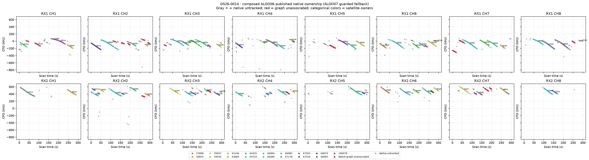
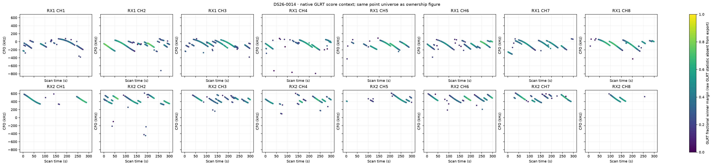
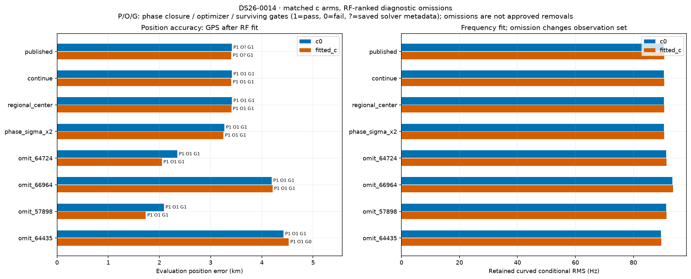
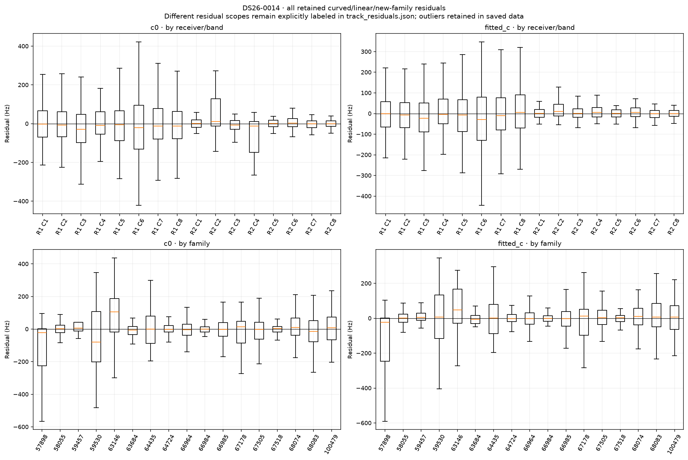
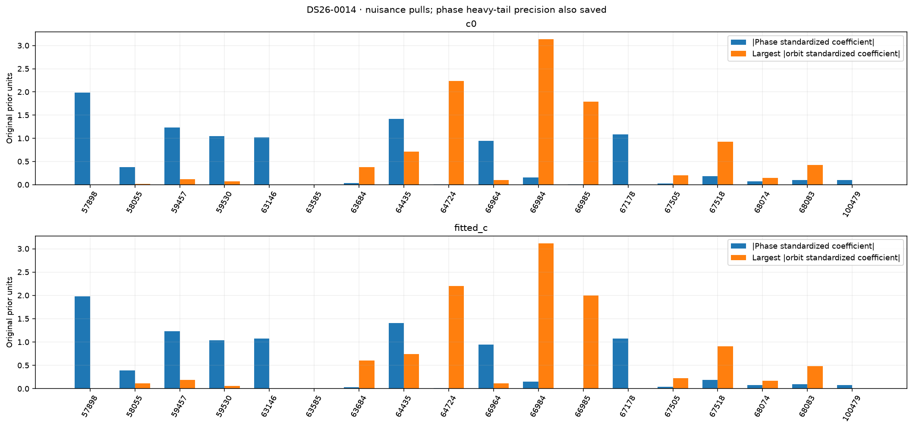
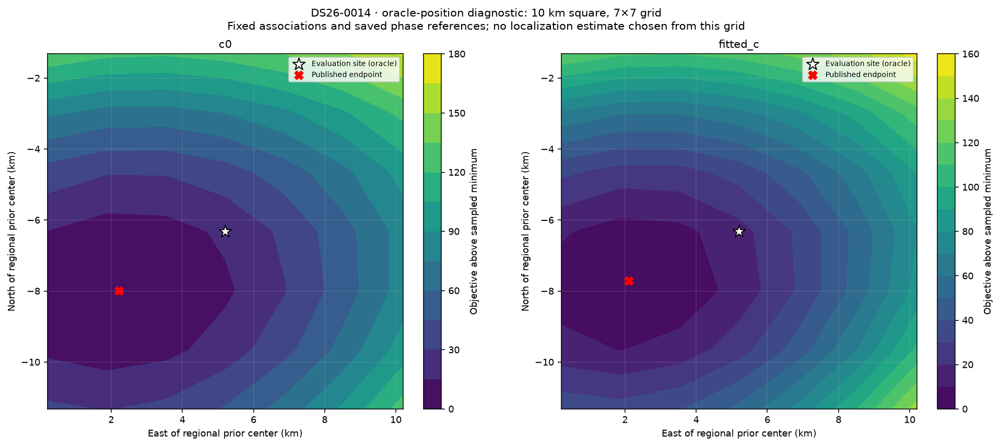

# DS26-0014: composed ALGO06 / ALGO07 fallback diagnostics

These are bounded offline RF diagnostics. Published satellite identities and ownership were not changed. Every family was audited; the four largest summed c-arm local RF omission sensitivities received full position/phase refits. Evaluation GPS was used only after fitting and to draw the explicitly labeled oracle loss grid. Family omission is a diagnostic control, not an approved removal.

| Arm | Published position error (m) | Curved residual RMS (Hz) | Native GLRT associated | Phase-reference movement (s) | Base/exact/mixture gates |
|---|---:|---:|---:|---:|---|
| c0 | 3415.1 | 90.54 | 2979/3805 (78.29%) | 0.00260 | True |
| fitted_c | 3405.0 | 90.65 | 2979/3805 (78.29%) | 0.00283 | True |

Matched tests use the same regional bounds, candidate identities, other priors and 15-round / 140 objective-evaluation-per-round budgets in both c arms. Each arm starts at its own saved endpoint; the regional-center test starts both at (0, 0). The phase-SD test doubles the shared prior multiplier. Omission objectives/RMS use reduced observations, so their raw likelihoods are not comparable evidence for deleting a family.

| Diagnostic (own published RF start unless center) | c0 error (m) | fitted-c error (m) | c0 / fitted-c RMS (Hz) | Phase closed | Optimizer success | All gates pass |
|---|---:|---:|---|---|---|---|
| continue | 3415.1 | 3405.0 | 90.54 / 90.65 | True / True | True / True | True / True |
| regional_center | 3415.9 | 3405.7 | 90.54 / 90.65 | True / True | True / True | True / True |
| phase_sigma_x2 | 3270.3 | 3251.3 | 90.51 / 90.62 | True / True | True / True | True / True |
| omit_64724 | 2350.7 | 2048.5 | 91.33 / 91.40 | True / True | True / True | True / True |
| omit_66964 | 4193.8 | 4210.0 | 93.48 / 93.65 | True / True | True / True | True / True |
| omit_57898 | 2089.7 | 1733.1 | 91.32 / 91.37 | True / True | True / True | True / True |
| omit_64435 | 4425.8 | 4527.5 | 89.47 / 89.61 | True / True | True / True | True / False |

Only the frozen fitted IDs enter each RMS/objective. The post-fit membership helper also screens graph extensions; those proposals are never adopted in these diagnostics or counted as published coverage. Delta references are the exact composed published incumbent, including accepted ALGO06 additions.

| Trial / arm | Fixed fitted native IDs | Intentional omitted family IDs | Proposed unrelated losses | Proposed additions | Proposed non-omitted reassignments |
|---|---:|---:|---:|---:|---:|
| continue / c0 | 2979 | 0 | 0 | 0 | 0 |
| continue / fitted_c | 2979 | 0 | 0 | 0 | 0 |
| regional_center / c0 | 2979 | 0 | 0 | 0 | 0 |
| regional_center / fitted_c | 2979 | 0 | 0 | 0 | 0 |
| phase_sigma_x2 / c0 | 2979 | 0 | 0 | 0 | 0 |
| phase_sigma_x2 / fitted_c | 2979 | 0 | 0 | 0 | 0 |
| omit_64724 / c0 | 2884 | 95 | 0 | 0 | 0 |
| omit_64724 / fitted_c | 2884 | 95 | 0 | 0 | 0 |
| omit_66964 / c0 | 2440 | 539 | 0 | 0 | 0 |
| omit_66964 / fitted_c | 2440 | 539 | 0 | 0 | 0 |
| omit_57898 / c0 | 2888 | 91 | 0 | 0 | 0 |
| omit_57898 / fitted_c | 2888 | 91 | 0 | 0 | 0 |
| omit_64435 / c0 | 2831 | 148 | 0 | 0 | 0 |
| omit_64435 / fitted_c | 2831 | 148 | 24 | 0 | 0 |

A separate paired control starts both arms at the same published fitted-c RF position and phase reference. Continuation is checked for all ten cases; only three predeclared headline omissions receive this extra start control. This is one shared RF start, not an independent random-start study.

| Shared-start diagnostic | c0 / fitted-c error (m) | c0 / fitted-c RMS (Hz) | Phase closed | Optimizer success | Surviving gates pass |
|---|---|---|---|---|---|
| matched_continue | 3415.6 / 3405.0 | 90.54 / 90.65 | True / True | True / True | True / True |

RF influence is local position sensitivity at the saved solution. It does not establish a wrong satellite identity. Full omission refits provide a nonlinear control; any apparent position gain with failed phase closure, optimizer or gates remains unqualified.

| Family | c0 local displacement (km) | fitted-c local displacement (km) | Native associated points (fitted-c) |
|---|---:|---:|---:|
| 64724 | 0.858 | 1.089 | 95 |
| 66964 | 0.909 | 0.876 | 539 |
| 57898 | 0.782 | 0.978 | 91 |
| 64435 | 0.804 | 0.884 | 148 |
| 63146 | 0.411 | 0.358 | 53 |
| 59457 | 0.343 | 0.410 | 141 |
| 67178 | 0.295 | 0.313 | 24 |
| 67505 | 0.326 | 0.276 | 219 |
| 66985 | 0.256 | 0.239 | 655 |
| 63684 | 0.186 | 0.219 | 70 |
| 58055 | 0.164 | 0.150 | 198 |
| 68083 | 0.128 | 0.142 | 181 |
| 59530 | 0.080 | 0.097 | 222 |
| 66984 | 0.091 | 0.070 | 89 |
| 100479 | 0.067 | 0.093 | 58 |
| 67518 | 0.080 | 0.050 | 63 |
| 68074 | 0.031 | 0.028 | 133 |

c0: the largest phase standardized coefficient is family 57898 (-1.983 in original prior units; adaptive precision 0.811). The largest orbital coefficient magnitude is family 66984 (3.138). The highest-RMS retained track is SCAN-RX1-CH6-T005-RF12190312500.000000 (linear_raw_prediction, 323.39 Hz, mean 304.27 Hz, slope 21.63 Hz/s). These fitted nuisance quantities are not independent orbit-error measurements.

fitted_c: the largest phase standardized coefficient is family 57898 (-1.985 in original prior units; adaptive precision 0.81). The largest orbital coefficient magnitude is family 66984 (3.120). The highest-RMS retained track is SCAN-RX1-CH6-T004-RF12190312500.000000 (linear_raw_prediction, 310.65 Hz, mean -292.09 Hz, slope -5.37 Hz/s). These fitted nuisance quantities are not independent orbit-error measurements.

Longest native graph unassociated source after splitting gaps >5 s: SCAN-RX1-CH5-T003-RF11940312500.000000, RX1 CH5, 43 unique points spanning 28.36 s. This duration rank is independent of fit-error ranking.

Receiver/band residual structure is tabulated numerically in summary.json and visualized below. Attribution to receiver calibration versus satellite orbit remains unresolved by these same-data diagnostics; independent family/receiver transfer and causal-versus-later TLE comparisons are required. Candidate search and identity conclusions are reported separately by the orbit investigation.

Exact per-gate dimensionless margins, exact-orbit linearization differences, native owner changes and mixture gate witnesses are saved in published_gates_*.json and each trial arm JSON. Track residual arrays and native observation IDs are saved in track_residuals.json. No identities, priors or model complexity were selected using the evaluation site.
