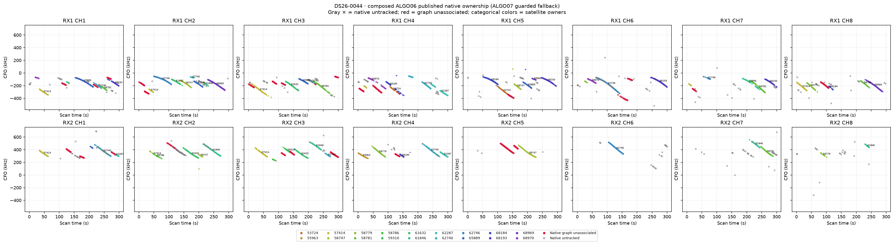
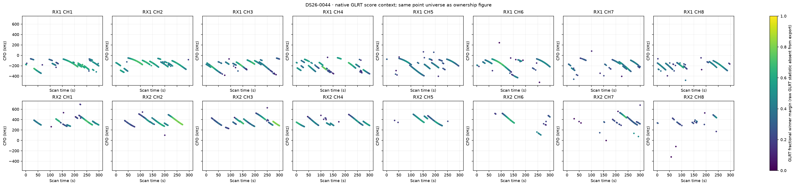
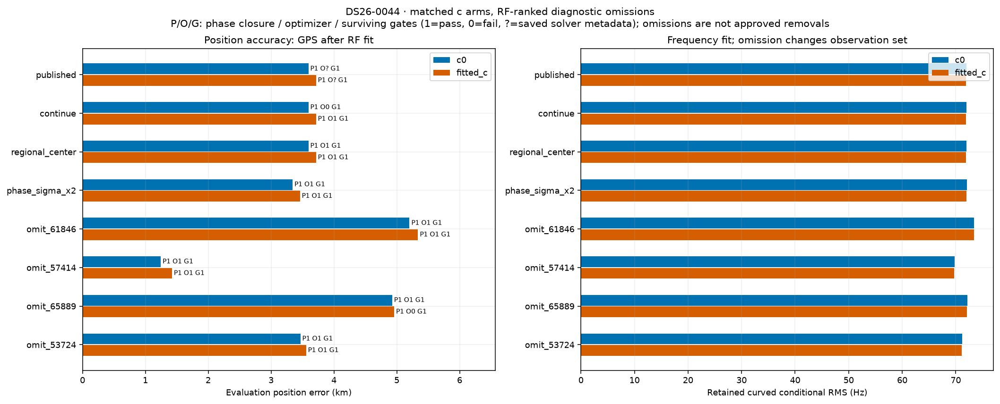
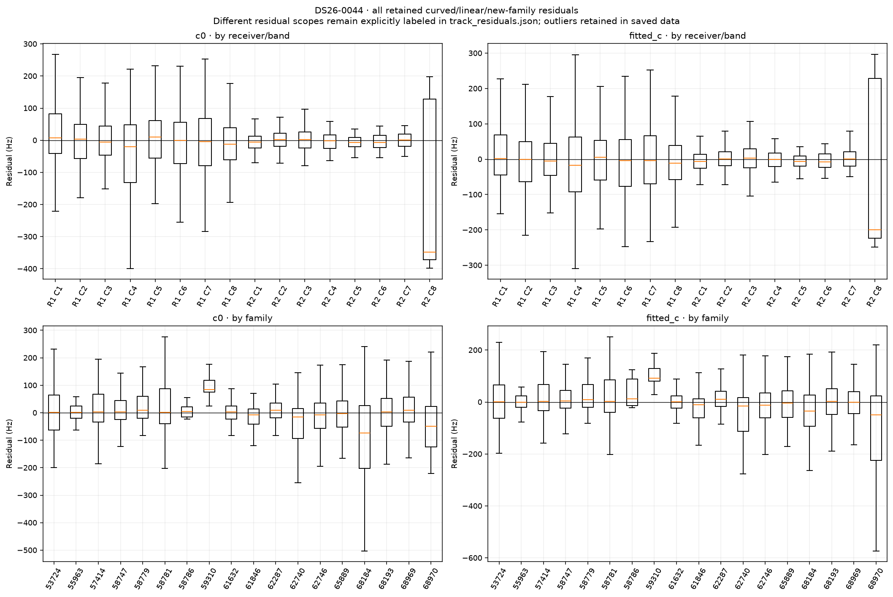
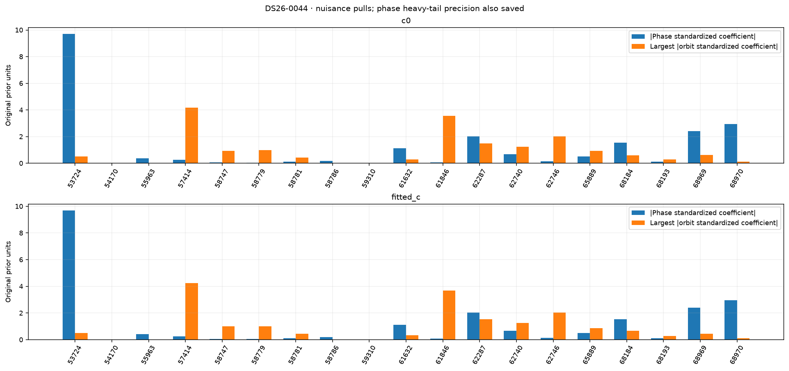
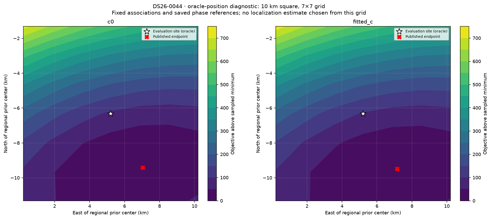

# DS26-0044: composed ALGO06 / ALGO07 fallback diagnostics

These are bounded offline RF diagnostics. Published satellite identities and ownership were not changed. Every family was audited; the four largest summed c-arm local RF omission sensitivities received full position/phase refits. Evaluation GPS was used only after fitting and to draw the explicitly labeled oracle loss grid. Family omission is a diagnostic control, not an approved removal.

| Arm | Published position error (m) | Curved residual RMS (Hz) | Native GLRT associated | Phase-reference movement (s) | Base/exact/mixture gates |
|---|---:|---:|---:|---:|---|
| c0 | 3593.6 | 71.99 | 2803/3743 (74.89%) | 0.00004 | True |
| fitted_c | 3714.6 | 71.94 | 2803/3743 (74.89%) | 0.00003 | True |

Matched tests use the same regional bounds, candidate identities, other priors and 15-round / 140 objective-evaluation-per-round budgets in both c arms. Each arm starts at its own saved endpoint; the regional-center test starts both at (0, 0). The phase-SD test doubles the shared prior multiplier. Omission objectives/RMS use reduced observations, so their raw likelihoods are not comparable evidence for deleting a family.

| Diagnostic (own published RF start unless center) | c0 error (m) | fitted-c error (m) | c0 / fitted-c RMS (Hz) | Phase closed | Optimizer success | All gates pass |
|---|---:|---:|---|---|---|---|
| continue | 3593.6 | 3714.6 | 71.99 / 71.94 | True / True | False / True | True / True |
| regional_center | 3593.6 | 3714.7 | 71.99 / 71.94 | True / True | True / True | True / True |
| phase_sigma_x2 | 3341.8 | 3459.1 | 72.06 / 72.00 | True / True | True / True | True / True |
| omit_61846 | 5202.3 | 5337.4 | 73.38 / 73.37 | True / True | True / True | True / True |
| omit_57414 | 1244.1 | 1423.5 | 69.75 / 69.71 | True / True | True / True | True / True |
| omit_65889 | 4926.6 | 4958.5 | 72.13 / 72.10 | True / True | True / False | True / True |
| omit_53724 | 3465.7 | 3557.5 | 71.17 / 71.14 | True / True | True / True | True / True |

Only the frozen fitted IDs enter each RMS/objective. The post-fit membership helper also screens graph extensions; those proposals are never adopted in these diagnostics or counted as published coverage. Delta references are the exact composed published incumbent, including accepted ALGO06 additions.

| Trial / arm | Fixed fitted native IDs | Intentional omitted family IDs | Proposed unrelated losses | Proposed additions | Proposed non-omitted reassignments |
|---|---:|---:|---:|---:|---:|
| continue / c0 | 2803 | 0 | 0 | 0 | 0 |
| continue / fitted_c | 2803 | 0 | 0 | 0 | 0 |
| regional_center / c0 | 2803 | 0 | 0 | 0 | 0 |
| regional_center / fitted_c | 2803 | 0 | 0 | 0 | 0 |
| phase_sigma_x2 / c0 | 2803 | 0 | 0 | 0 | 0 |
| phase_sigma_x2 / fitted_c | 2803 | 0 | 0 | 0 | 0 |
| omit_61846 / c0 | 2568 | 235 | 0 | 0 | 0 |
| omit_61846 / fitted_c | 2568 | 235 | 0 | 0 | 0 |
| omit_57414 / c0 | 2528 | 275 | 0 | 0 | 0 |
| omit_57414 / fitted_c | 2528 | 275 | 0 | 0 | 0 |
| omit_65889 / c0 | 2595 | 208 | 0 | 0 | 0 |
| omit_65889 / fitted_c | 2595 | 208 | 0 | 0 | 0 |
| omit_53724 / c0 | 2730 | 73 | 0 | 0 | 0 |
| omit_53724 / fitted_c | 2730 | 73 | 0 | 0 | 0 |

A separate paired control starts both arms at the same published fitted-c RF position and phase reference. Continuation is checked for all ten cases; only three predeclared headline omissions receive this extra start control. This is one shared RF start, not an independent random-start study.

| Shared-start diagnostic | c0 / fitted-c error (m) | c0 / fitted-c RMS (Hz) | Phase closed | Optimizer success | Surviving gates pass |
|---|---|---|---|---|---|
| matched_continue | 3594.2 / 3714.6 | 71.99 / 71.94 | True / True | True / True | True / True |
| matched_omit_57414 | 1244.1 / 1423.5 | 69.75 / 69.71 | True / True | True / True | True / True |

RF influence is local position sensitivity at the saved solution. It does not establish a wrong satellite identity. Full omission refits provide a nonlinear control; any apparent position gain with failed phase closure, optimizer or gates remains unqualified.

| Family | c0 local displacement (km) | fitted-c local displacement (km) | Native associated points (fitted-c) |
|---|---:|---:|---:|
| 61846 | 1.442 | 1.442 | 235 |
| 57414 | 1.430 | 1.423 | 275 |
| 65889 | 1.078 | 1.008 | 208 |
| 53724 | 0.830 | 0.822 | 73 |
| 68970 | 0.684 | 0.710 | 85 |
| 62746 | 0.530 | 0.493 | 254 |
| 58779 | 0.339 | 0.345 | 109 |
| 68969 | 0.268 | 0.225 | 161 |
| 58747 | 0.234 | 0.229 | 168 |
| 62287 | 0.176 | 0.179 | 125 |
| 68184 | 0.122 | 0.082 | 125 |
| 58781 | 0.102 | 0.100 | 208 |
| 59310 | 0.064 | 0.074 | 26 |
| 62740 | 0.068 | 0.070 | 265 |
| 68193 | 0.065 | 0.048 | 208 |
| 61632 | 0.060 | 0.053 | 216 |
| 55963 | 0.029 | 0.021 | 42 |
| 58786 | 0.014 | 0.012 | 20 |

c0: the largest phase standardized coefficient is family 53724 (-9.698 in original prior units; adaptive precision 1). The largest orbital coefficient magnitude is family 57414 (4.170). The highest-RMS retained track is SCAN-RX1-CH6-T010-RF11959687500.000000 (linear_raw_prediction, 592.34 Hz, mean 565.23 Hz, slope 37.62 Hz/s). These fitted nuisance quantities are not independent orbit-error measurements.

fitted_c: the largest phase standardized coefficient is family 53724 (-9.689 in original prior units; adaptive precision 1). The largest orbital coefficient magnitude is family 57414 (4.234). The highest-RMS retained track is SCAN-RX1-CH4-T011-RF11459687500.000000 (linear_raw_prediction, 580.09 Hz, mean 570.67 Hz, slope -1.19 Hz/s). These fitted nuisance quantities are not independent orbit-error measurements.

Longest native graph unassociated source after splitting gaps >5 s: SCAN-RX2-CH5-T001-RF11709687500.000000, RX2 CH5, 62 unique points spanning 43.96 s. This duration rank is independent of fit-error ranking.

Receiver/band residual structure is tabulated numerically in summary.json and visualized below. Attribution to receiver calibration versus satellite orbit remains unresolved by these same-data diagnostics; independent family/receiver transfer and causal-versus-later TLE comparisons are required. Candidate search and identity conclusions are reported separately by the orbit investigation.

Exact per-gate dimensionless margins, exact-orbit linearization differences, native owner changes and mixture gate witnesses are saved in published_gates_*.json and each trial arm JSON. Track residual arrays and native observation IDs are saved in track_residuals.json. No identities, priors or model complexity were selected using the evaluation site.
