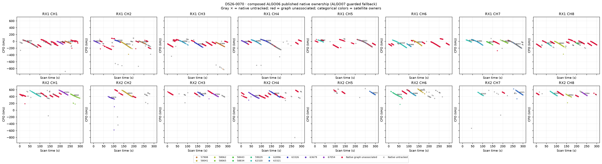
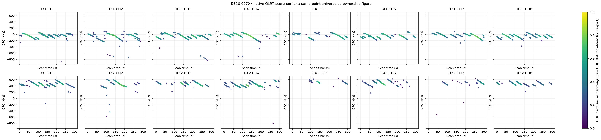
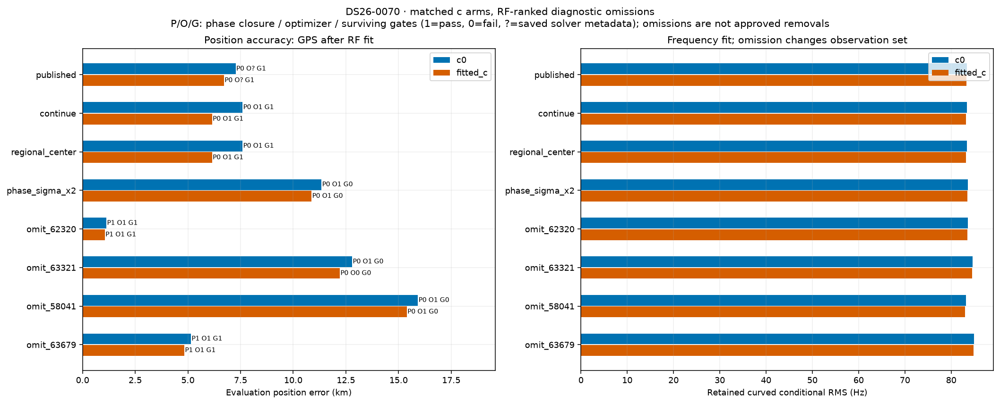
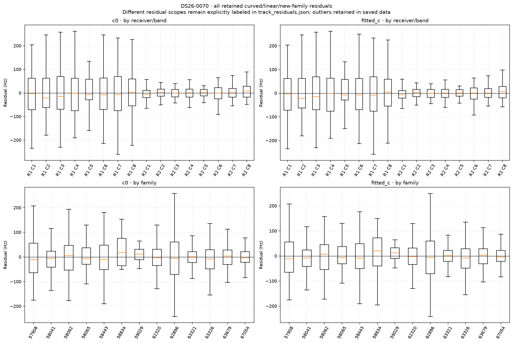
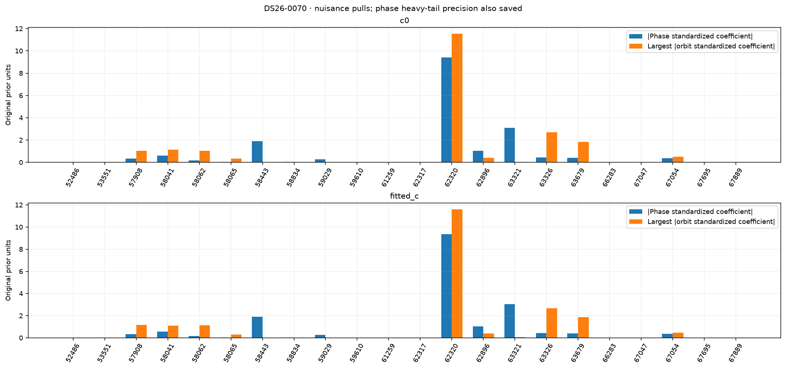
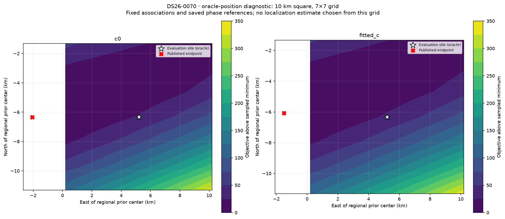

# DS26-0070: composed ALGO06 / ALGO07 fallback diagnostics

These are bounded offline RF diagnostics. Published satellite identities and ownership were not changed. Every family was audited; the four largest summed c-arm local RF omission sensitivities received full position/phase refits. Evaluation GPS was used only after fitting and to draw the explicitly labeled oracle loss grid. Family omission is a diagnostic control, not an approved removal.

| Arm | Published position error (m) | Curved residual RMS (Hz) | Native GLRT associated | Phase-reference movement (s) | Base/exact/mixture gates |
|---|---:|---:|---:|---:|---|
| c0 | 7269.0 | 83.38 | 2023/4298 (47.07%) | 0.30947 | True |
| fitted_c | 6715.7 | 83.27 | 2023/4298 (47.07%) | 0.20482 | True |

Matched tests use the same regional bounds, candidate identities, other priors and 15-round / 140 objective-evaluation-per-round budgets in both c arms. Each arm starts at its own saved endpoint; the regional-center test starts both at (0, 0). The phase-SD test doubles the shared prior multiplier. Omission objectives/RMS use reduced observations, so their raw likelihoods are not comparable evidence for deleting a family.

| Diagnostic (own published RF start unless center) | c0 error (m) | fitted-c error (m) | c0 / fitted-c RMS (Hz) | Phase closed | Optimizer success | All gates pass |
|---|---:|---:|---|---|---|---|
| continue | 7597.2 | 6151.8 | 83.40 / 83.23 | False / False | True / True | True / True |
| regional_center | 7597.2 | 6150.9 | 83.40 / 83.23 | False / False | True / True | True / True |
| phase_sigma_x2 | 11344.7 | 10872.6 | 83.66 / 83.53 | False / False | True / True | False / False |
| omit_62320 | 1133.4 | 1059.6 | 83.57 / 83.54 | True / True | True / True | True / True |
| omit_63321 | 12798.1 | 12213.1 | 84.64 / 84.54 | False / False | True / False | False / False |
| omit_58041 | 15921.3 | 15394.8 | 83.16 / 82.98 | False / False | True / True | False / False |
| omit_63679 | 5148.3 | 4833.0 | 84.91 / 84.81 | True / True | True / True | True / True |

Only the frozen fitted IDs enter each RMS/objective. The post-fit membership helper also screens graph extensions; those proposals are never adopted in these diagnostics or counted as published coverage. Delta references are the exact composed published incumbent, including accepted ALGO06 additions.

| Trial / arm | Fixed fitted native IDs | Intentional omitted family IDs | Proposed unrelated losses | Proposed additions | Proposed non-omitted reassignments |
|---|---:|---:|---:|---:|---:|
| continue / c0 | 2023 | 0 | 0 | 485 | 0 |
| continue / fitted_c | 2023 | 0 | 0 | 485 | 0 |
| regional_center / c0 | 2023 | 0 | 0 | 485 | 0 |
| regional_center / fitted_c | 2023 | 0 | 0 | 485 | 0 |
| phase_sigma_x2 / c0 | 2023 | 0 | 21 | 485 | 0 |
| phase_sigma_x2 / fitted_c | 2023 | 0 | 21 | 485 | 0 |
| omit_62320 / c0 | 1657 | 366 | 0 | 384 | 0 |
| omit_62320 / fitted_c | 1657 | 366 | 0 | 384 | 0 |
| omit_63321 / c0 | 1882 | 141 | 47 | 464 | 0 |
| omit_63321 / fitted_c | 1882 | 141 | 47 | 464 | 0 |
| omit_58041 / c0 | 1786 | 237 | 101 | 217 | 0 |
| omit_58041 / fitted_c | 1786 | 237 | 101 | 217 | 0 |
| omit_63679 / c0 | 1843 | 180 | 0 | 423 | 0 |
| omit_63679 / fitted_c | 1843 | 180 | 0 | 423 | 0 |

A separate paired control starts both arms at the same published fitted-c RF position and phase reference. Continuation is checked for all ten cases; only three predeclared headline omissions receive this extra start control. This is one shared RF start, not an independent random-start study.

| Shared-start diagnostic | c0 / fitted-c error (m) | c0 / fitted-c RMS (Hz) | Phase closed | Optimizer success | Surviving gates pass |
|---|---|---|---|---|---|
| matched_continue | 7597.2 / 6151.8 | 83.40 / 83.23 | False / False | True / True | True / True |
| matched_omit_62320 | 1133.4 / 1059.6 | 83.57 / 83.54 | True / True | True / True | True / True |

RF influence is local position sensitivity at the saved solution. It does not establish a wrong satellite identity. Full omission refits provide a nonlinear control; any apparent position gain with failed phase closure, optimizer or gates remains unqualified.

| Family | c0 local displacement (km) | fitted-c local displacement (km) | Native associated points (fitted-c) |
|---|---:|---:|---:|
| 62320 | 9.157 | 8.654 | 366 |
| 63321 | 8.000 | 7.616 | 141 |
| 58041 | 7.582 | 7.314 | 237 |
| 63679 | 3.509 | 3.514 | 180 |
| 62896 | 3.416 | 3.473 | 264 |
| 63326 | 2.646 | 2.750 | 250 |
| 57908 | 2.107 | 2.461 | 139 |
| 67054 | 1.260 | 1.222 | 169 |
| 58834 | 1.201 | 1.115 | 21 |
| 58065 | 0.604 | 0.736 | 86 |
| 58062 | 0.421 | 0.702 | 90 |
| 58443 | 0.460 | 0.480 | 28 |
| 59029 | 0.445 | 0.424 | 52 |

c0: the largest phase standardized coefficient is family 62320 (-9.406 in original prior units; adaptive precision 1). The largest orbital coefficient magnitude is family 62320 (11.532). The highest-RMS retained track is SCAN-RX1-CH4-T002-RF11690312500.000000 (curved_conditional, 141.09 Hz, mean -1.25 Hz, slope -2.16 Hz/s). These fitted nuisance quantities are not independent orbit-error measurements.

fitted_c: the largest phase standardized coefficient is family 62320 (-9.351 in original prior units; adaptive precision 1). The largest orbital coefficient magnitude is family 62320 (11.604). The highest-RMS retained track is SCAN-RX1-CH4-T002-RF11690312500.000000 (curved_conditional, 141.02 Hz, mean -0.40 Hz, slope -2.16 Hz/s). These fitted nuisance quantities are not independent orbit-error measurements.

Longest native graph unassociated source after splitting gaps >5 s: SCAN-RX1-CH6-T003-RF12190312500.000000, RX1 CH6, 65 unique points spanning 44.67 s. This duration rank is independent of fit-error ranking.

Receiver/band residual structure is tabulated numerically in summary.json and visualized below. Attribution to receiver calibration versus satellite orbit remains unresolved by these same-data diagnostics; independent family/receiver transfer and causal-versus-later TLE comparisons are required. Candidate search and identity conclusions are reported separately by the orbit investigation.

Exact per-gate dimensionless margins, exact-orbit linearization differences, native owner changes and mixture gate witnesses are saved in published_gates_*.json and each trial arm JSON. Track residual arrays and native observation IDs are saved in track_residuals.json. No identities, priors or model complexity were selected using the evaluation site.
