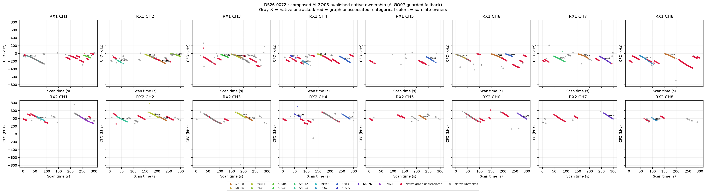
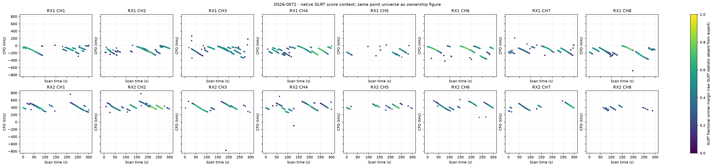
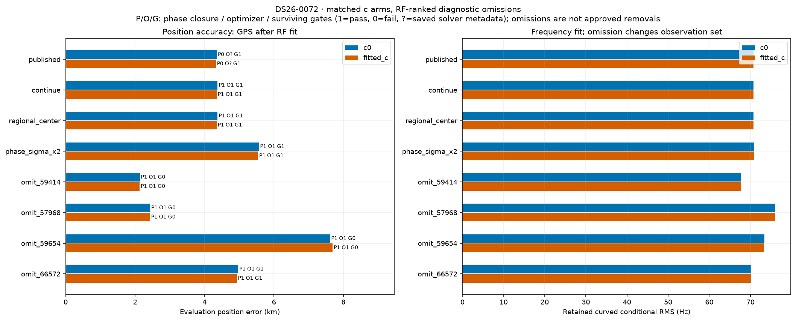
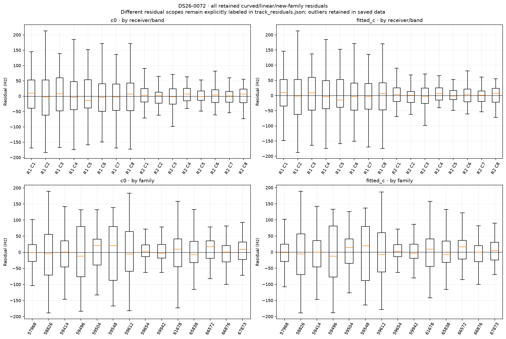
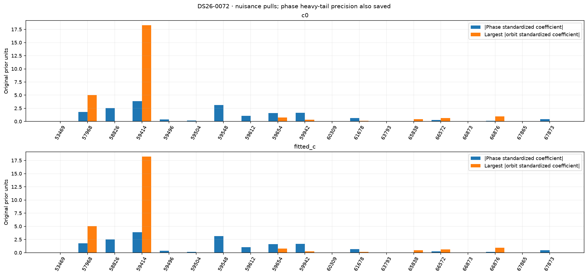
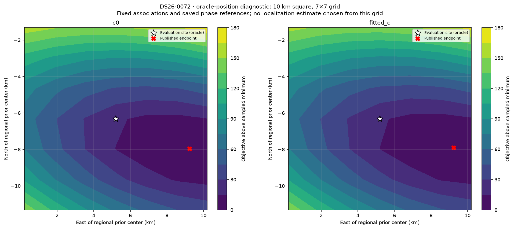

# DS26-0072: composed ALGO06 / ALGO07 fallback diagnostics

These are bounded offline RF diagnostics. Published satellite identities and ownership were not changed. Every family was audited; the four largest summed c-arm local RF omission sensitivities received full position/phase refits. Evaluation GPS was used only after fitting and to draw the explicitly labeled oracle loss grid. Family omission is a diagnostic control, not an approved removal.

| Arm | Published position error (m) | Curved residual RMS (Hz) | Native GLRT associated | Phase-reference movement (s) | Base/exact/mixture gates |
|---|---:|---:|---:|---:|---|
| c0 | 4354.6 | 70.75 | 1526/3707 (41.17%) | 0.01658 | True |
| fitted_c | 4329.1 | 70.72 | 1526/3707 (41.17%) | 0.01734 | True |

Matched tests use the same regional bounds, candidate identities, other priors and 15-round / 140 objective-evaluation-per-round budgets in both c arms. Each arm starts at its own saved endpoint; the regional-center test starts both at (0, 0). The phase-SD test doubles the shared prior multiplier. Omission objectives/RMS use reduced observations, so their raw likelihoods are not comparable evidence for deleting a family.

| Diagnostic (own published RF start unless center) | c0 error (m) | fitted-c error (m) | c0 / fitted-c RMS (Hz) | Phase closed | Optimizer success | All gates pass |
|---|---:|---:|---|---|---|---|
| continue | 4376.7 | 4350.8 | 70.76 / 70.73 | True / True | True / True | True / True |
| regional_center | 4376.8 | 4350.9 | 70.76 / 70.73 | True / True | True / True | True / True |
| phase_sigma_x2 | 5571.9 | 5545.8 | 70.98 / 70.95 | True / True | True / True | True / True |
| omit_59414 | 2136.8 | 2133.0 | 67.60 / 67.60 | True / True | True / True | False / False |
| omit_57968 | 2435.0 | 2432.3 | 76.03 / 75.96 | True / True | True / True | False / False |
| omit_59654 | 7620.4 | 7694.0 | 73.38 / 73.30 | True / True | True / True | False / False |
| omit_66572 | 4972.6 | 4933.2 | 70.16 / 70.15 | True / True | True / True | True / True |

Only the frozen fitted IDs enter each RMS/objective. The post-fit membership helper also screens graph extensions; those proposals are never adopted in these diagnostics or counted as published coverage. Delta references are the exact composed published incumbent, including accepted ALGO06 additions.

| Trial / arm | Fixed fitted native IDs | Intentional omitted family IDs | Proposed unrelated losses | Proposed additions | Proposed non-omitted reassignments |
|---|---:|---:|---:|---:|---:|
| continue / c0 | 1526 | 0 | 0 | 215 | 0 |
| continue / fitted_c | 1526 | 0 | 0 | 215 | 0 |
| regional_center / c0 | 1526 | 0 | 0 | 215 | 0 |
| regional_center / fitted_c | 1526 | 0 | 0 | 215 | 0 |
| phase_sigma_x2 / c0 | 1526 | 0 | 0 | 215 | 0 |
| phase_sigma_x2 / fitted_c | 1526 | 0 | 0 | 215 | 0 |
| omit_59414 / c0 | 1311 | 215 | 0 | 213 | 13 |
| omit_59414 / fitted_c | 1311 | 215 | 0 | 213 | 13 |
| omit_57968 / c0 | 1159 | 367 | 160 | 155 | 0 |
| omit_57968 / fitted_c | 1159 | 367 | 160 | 155 | 0 |
| omit_59654 / c0 | 1440 | 86 | 89 | 165 | 0 |
| omit_59654 / fitted_c | 1440 | 86 | 48 | 183 | 0 |
| omit_66572 / c0 | 1486 | 40 | 0 | 215 | 0 |
| omit_66572 / fitted_c | 1486 | 40 | 0 | 215 | 0 |

A separate paired control starts both arms at the same published fitted-c RF position and phase reference. Continuation is checked for all ten cases; only three predeclared headline omissions receive this extra start control. This is one shared RF start, not an independent random-start study.

| Shared-start diagnostic | c0 / fitted-c error (m) | c0 / fitted-c RMS (Hz) | Phase closed | Optimizer success | Surviving gates pass |
|---|---|---|---|---|---|
| matched_continue | 4377.7 / 4350.8 | 70.76 / 70.73 | True / True | True / True | True / True |

RF influence is local position sensitivity at the saved solution. It does not establish a wrong satellite identity. Full omission refits provide a nonlinear control; any apparent position gain with failed phase closure, optimizer or gates remains unqualified.

| Family | c0 local displacement (km) | fitted-c local displacement (km) | Native associated points (fitted-c) |
|---|---:|---:|---:|
| 59414 | 2.420 | 2.399 | 215 |
| 57968 | 2.115 | 2.097 | 367 |
| 59654 | 1.706 | 1.797 | 86 |
| 66572 | 0.687 | 0.674 | 40 |
| 65838 | 0.583 | 0.603 | 178 |
| 59612 | 0.582 | 0.546 | 48 |
| 59548 | 0.551 | 0.566 | 41 |
| 67873 | 0.553 | 0.539 | 76 |
| 59504 | 0.291 | 0.279 | 32 |
| 59942 | 0.196 | 0.291 | 86 |
| 66876 | 0.249 | 0.185 | 164 |
| 58826 | 0.204 | 0.217 | 47 |
| 61678 | 0.127 | 0.144 | 96 |
| 59496 | 0.045 | 0.044 | 50 |

c0: the largest phase standardized coefficient is family 59414 (3.874 in original prior units; adaptive precision 1). The largest orbital coefficient magnitude is family 59414 (18.279). The highest-RMS retained track is SCAN-RX1-CH1-T001-RF10709687500.000000 (curved_conditional, 116.97 Hz, mean -0.63 Hz, slope -11.29 Hz/s). These fitted nuisance quantities are not independent orbit-error measurements.

fitted_c: the largest phase standardized coefficient is family 59414 (3.875 in original prior units; adaptive precision 1). The largest orbital coefficient magnitude is family 59414 (18.238). The highest-RMS retained track is SCAN-RX1-CH1-T001-RF10709687500.000000 (curved_conditional, 118.56 Hz, mean -1.38 Hz, slope -11.49 Hz/s). These fitted nuisance quantities are not independent orbit-error measurements.

Longest native graph unassociated source after splitting gaps >5 s: SCAN-RX1-CH8-T000-RF12459687500.000000, RX1 CH8, 80 unique points spanning 57.78 s. This duration rank is independent of fit-error ranking.

Receiver/band residual structure is tabulated numerically in summary.json and visualized below. Attribution to receiver calibration versus satellite orbit remains unresolved by these same-data diagnostics; independent family/receiver transfer and causal-versus-later TLE comparisons are required. Candidate search and identity conclusions are reported separately by the orbit investigation.

Exact per-gate dimensionless margins, exact-orbit linearization differences, native owner changes and mixture gate witnesses are saved in published_gates_*.json and each trial arm JSON. Track residual arrays and native observation IDs are saved in track_residuals.json. No identities, priors or model complexity were selected using the evaluation site.
