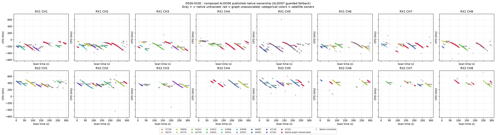
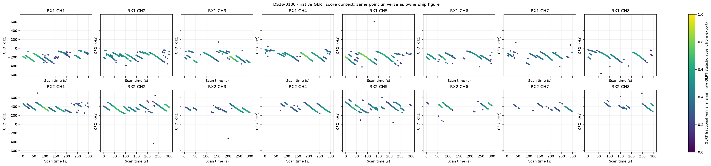
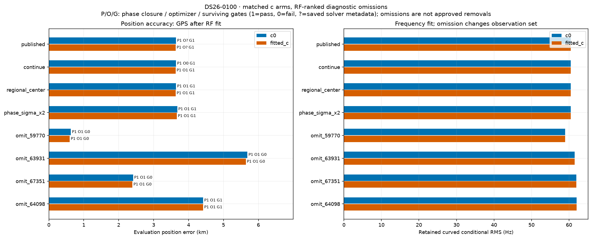
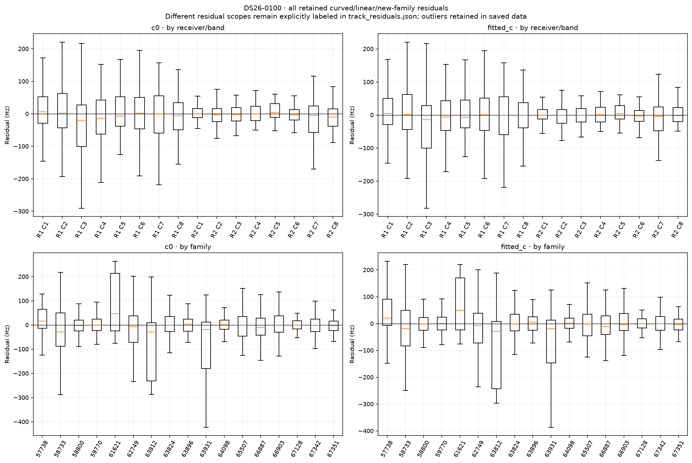
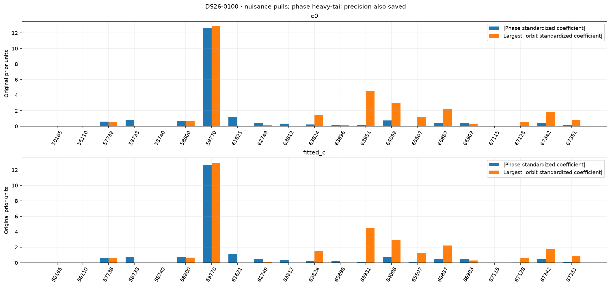
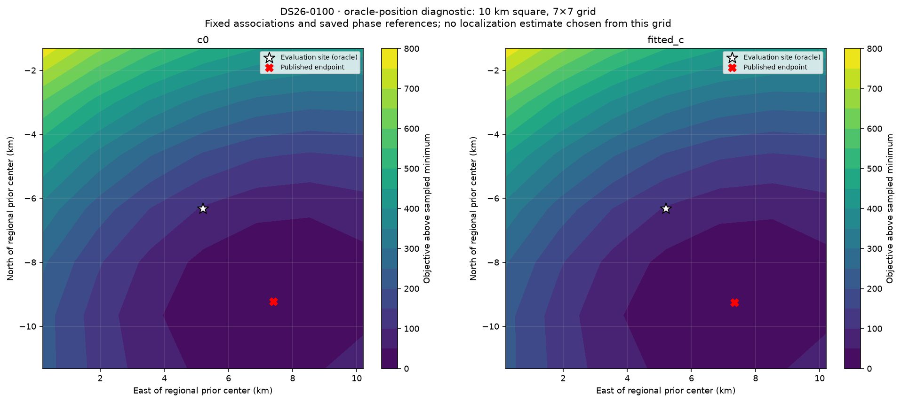

# DS26-0100: composed ALGO06 / ALGO07 fallback diagnostics

These are bounded offline RF diagnostics. Published satellite identities and ownership were not changed. Every family was audited; the four largest summed c-arm local RF omission sensitivities received full position/phase refits. Evaluation GPS was used only after fitting and to draw the explicitly labeled oracle loss grid. Family omission is a diagnostic control, not an approved removal.

| Arm | Published position error (m) | Curved residual RMS (Hz) | Native GLRT associated | Phase-reference movement (s) | Base/exact/mixture gates |
|---|---:|---:|---:|---:|---|
| c0 | 3641.8 | 60.46 | 2763/4443 (62.19%) | 0.00069 | True |
| fitted_c | 3629.1 | 60.44 | 2763/4443 (62.19%) | 0.00071 | True |

Matched tests use the same regional bounds, candidate identities, other priors and 15-round / 140 objective-evaluation-per-round budgets in both c arms. Each arm starts at its own saved endpoint; the regional-center test starts both at (0, 0). The phase-SD test doubles the shared prior multiplier. Omission objectives/RMS use reduced observations, so their raw likelihoods are not comparable evidence for deleting a family.

| Diagnostic (own published RF start unless center) | c0 error (m) | fitted-c error (m) | c0 / fitted-c RMS (Hz) | Phase closed | Optimizer success | All gates pass |
|---|---:|---:|---|---|---|---|
| continue | 3641.8 | 3629.1 | 60.46 / 60.44 | True / True | False / True | True / True |
| regional_center | 3641.9 | 3629.2 | 60.46 / 60.44 | True / True | True / True | True / True |
| phase_sigma_x2 | 3676.5 | 3663.2 | 60.46 / 60.45 | True / True | True / True | True / True |
| omit_59770 | 631.1 | 597.4 | 58.96 / 59.01 | True / True | True / True | False / False |
| omit_63931 | 5686.1 | 5639.7 | 61.51 / 61.50 | True / True | True / True | False / False |
| omit_67351 | 2412.7 | 2392.9 | 61.99 / 61.94 | True / True | True / True | False / False |
| omit_64098 | 4418.5 | 4417.9 | 62.01 / 62.01 | True / True | True / True | True / True |

Only the frozen fitted IDs enter each RMS/objective. The post-fit membership helper also screens graph extensions; those proposals are never adopted in these diagnostics or counted as published coverage. Delta references are the exact composed published incumbent, including accepted ALGO06 additions.

| Trial / arm | Fixed fitted native IDs | Intentional omitted family IDs | Proposed unrelated losses | Proposed additions | Proposed non-omitted reassignments |
|---|---:|---:|---:|---:|---:|
| continue / c0 | 2763 | 0 | 0 | 0 | 0 |
| continue / fitted_c | 2763 | 0 | 0 | 0 | 0 |
| regional_center / c0 | 2763 | 0 | 0 | 0 | 0 |
| regional_center / fitted_c | 2763 | 0 | 0 | 0 | 0 |
| phase_sigma_x2 / c0 | 2763 | 0 | 0 | 0 | 0 |
| phase_sigma_x2 / fitted_c | 2763 | 0 | 0 | 0 | 0 |
| omit_59770 / c0 | 2359 | 404 | 114 | 0 | 0 |
| omit_59770 / fitted_c | 2359 | 404 | 114 | 0 | 0 |
| omit_63931 / c0 | 2640 | 123 | 56 | 0 | 0 |
| omit_63931 / fitted_c | 2640 | 123 | 56 | 0 | 0 |
| omit_67351 / c0 | 2639 | 124 | 56 | 23 | 0 |
| omit_67351 / fitted_c | 2639 | 124 | 56 | 23 | 0 |
| omit_64098 / c0 | 2577 | 186 | 0 | 0 | 0 |
| omit_64098 / fitted_c | 2577 | 186 | 0 | 0 | 0 |

A separate paired control starts both arms at the same published fitted-c RF position and phase reference. Continuation is checked for all ten cases; only three predeclared headline omissions receive this extra start control. This is one shared RF start, not an independent random-start study.

| Shared-start diagnostic | c0 / fitted-c error (m) | c0 / fitted-c RMS (Hz) | Phase closed | Optimizer success | Surviving gates pass |
|---|---|---|---|---|---|
| matched_continue | 3641.8 / 3629.1 | 60.46 / 60.44 | True / True | True / True | True / True |

RF influence is local position sensitivity at the saved solution. It does not establish a wrong satellite identity. Full omission refits provide a nonlinear control; any apparent position gain with failed phase closure, optimizer or gates remains unqualified.

| Family | c0 local displacement (km) | fitted-c local displacement (km) | Native associated points (fitted-c) |
|---|---:|---:|---:|
| 59770 | 2.150 | 2.185 | 404 |
| 63931 | 1.629 | 1.626 | 123 |
| 67351 | 0.994 | 1.018 | 124 |
| 64098 | 0.678 | 0.695 | 186 |
| 66887 | 0.514 | 0.557 | 247 |
| 67342 | 0.421 | 0.445 | 292 |
| 65507 | 0.395 | 0.406 | 67 |
| 57738 | 0.251 | 0.250 | 153 |
| 66903 | 0.188 | 0.175 | 163 |
| 58800 | 0.154 | 0.150 | 342 |
| 67128 | 0.136 | 0.141 | 46 |
| 58733 | 0.109 | 0.123 | 66 |
| 62749 | 0.123 | 0.096 | 347 |
| 63812 | 0.113 | 0.103 | 24 |
| 61621 | 0.102 | 0.090 | 50 |
| 63896 | 0.096 | 0.095 | 71 |
| 63824 | 0.034 | 0.029 | 58 |

c0: the largest phase standardized coefficient is family 59770 (-12.652 in original prior units; adaptive precision 0.0248). The largest orbital coefficient magnitude is family 59770 (12.855). The highest-RMS retained track is SCAN-RX2-CH8-T003-RF12459687500.000000 (linear_raw_prediction, 405.46 Hz, mean -405.02 Hz, slope 2.84 Hz/s). These fitted nuisance quantities are not independent orbit-error measurements.

fitted_c: the largest phase standardized coefficient is family 59770 (-12.666 in original prior units; adaptive precision 0.0248). The largest orbital coefficient magnitude is family 59770 (12.932). The highest-RMS retained track is SCAN-RX2-CH8-T003-RF12459687500.000000 (linear_raw_prediction, 332.05 Hz, mean -331.49 Hz, slope 2.92 Hz/s). These fitted nuisance quantities are not independent orbit-error measurements.

Longest native graph unassociated source after splitting gaps >5 s: SCAN-RX1-CH4-T000-RF11459687500.000000, RX1 CH4, 77 unique points spanning 54.58 s. This duration rank is independent of fit-error ranking.

Receiver/band residual structure is tabulated numerically in summary.json and visualized below. Attribution to receiver calibration versus satellite orbit remains unresolved by these same-data diagnostics; independent family/receiver transfer and causal-versus-later TLE comparisons are required. Candidate search and identity conclusions are reported separately by the orbit investigation.

Exact per-gate dimensionless margins, exact-orbit linearization differences, native owner changes and mixture gate witnesses are saved in published_gates_*.json and each trial arm JSON. Track residual arrays and native observation IDs are saved in track_residuals.json. No identities, priors or model complexity were selected using the evaluation site.
