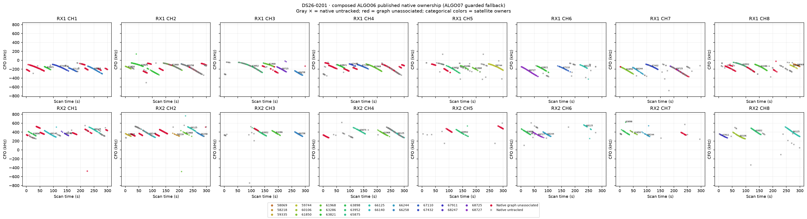
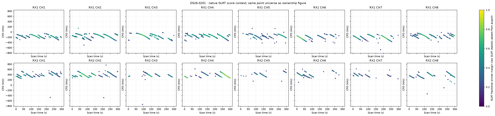
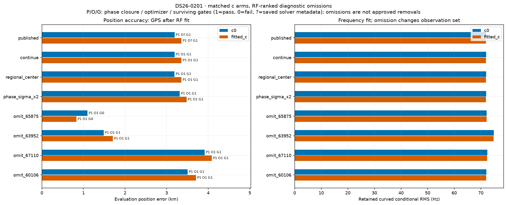
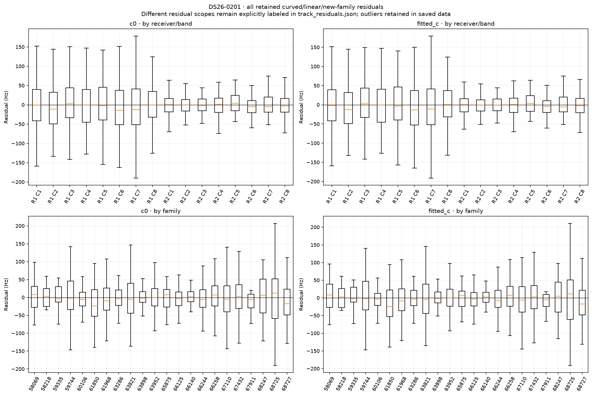
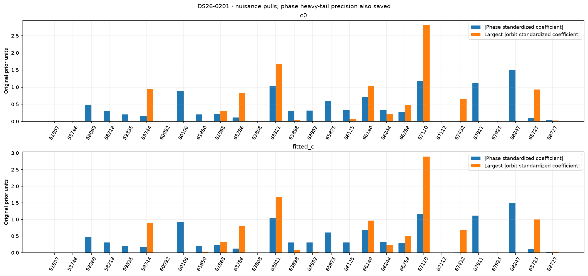
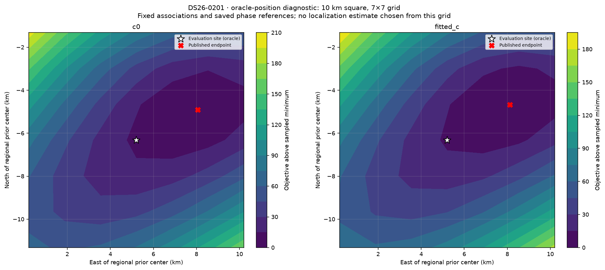

# DS26-0201: composed ALGO06 / ALGO07 fallback diagnostics

These are bounded offline RF diagnostics. Published satellite identities and ownership were not changed. Every family was audited; the four largest summed c-arm local RF omission sensitivities received full position/phase refits. Evaluation GPS was used only after fitting and to draw the explicitly labeled oracle loss grid. Family omission is a diagnostic control, not an approved removal.

| Arm | Published position error (m) | Curved residual RMS (Hz) | Native GLRT associated | Phase-reference movement (s) | Base/exact/mixture gates |
|---|---:|---:|---:|---:|---|
| c0 | 3191.2 | 71.99 | 2514/4027 (62.43%) | 0.00004 | True |
| fitted_c | 3355.7 | 71.91 | 2514/4027 (62.43%) | 0.00005 | True |

Matched tests use the same regional bounds, candidate identities, other priors and 15-round / 140 objective-evaluation-per-round budgets in both c arms. Each arm starts at its own saved endpoint; the regional-center test starts both at (0, 0). The phase-SD test doubles the shared prior multiplier. Omission objectives/RMS use reduced observations, so their raw likelihoods are not comparable evidence for deleting a family.

| Diagnostic (own published RF start unless center) | c0 error (m) | fitted-c error (m) | c0 / fitted-c RMS (Hz) | Phase closed | Optimizer success | All gates pass |
|---|---:|---:|---|---|---|---|
| continue | 3191.2 | 3355.7 | 71.99 / 71.91 | True / True | True / True | True / True |
| regional_center | 3190.3 | 3354.7 | 71.99 / 71.92 | True / True | True / True | True / True |
| phase_sigma_x2 | 3316.9 | 3479.8 | 71.98 / 71.90 | True / True | True / True | True / True |
| omit_65875 | 1095.9 | 830.5 | 72.18 / 72.17 | True / True | True / True | False / False |
| omit_63952 | 1487.5 | 1706.9 | 74.87 / 74.79 | True / True | True / True | True / True |
| omit_67110 | 3914.0 | 4086.2 | 72.43 / 72.35 | True / True | True / True | True / True |
| omit_60106 | 3504.9 | 3705.1 | 72.14 / 72.05 | True / True | True / True | True / True |

Only the frozen fitted IDs enter each RMS/objective. The post-fit membership helper also screens graph extensions; those proposals are never adopted in these diagnostics or counted as published coverage. Delta references are the exact composed published incumbent, including accepted ALGO06 additions.

| Trial / arm | Fixed fitted native IDs | Intentional omitted family IDs | Proposed unrelated losses | Proposed additions | Proposed non-omitted reassignments |
|---|---:|---:|---:|---:|---:|
| continue / c0 | 2514 | 0 | 0 | 417 | 0 |
| continue / fitted_c | 2514 | 0 | 0 | 403 | 0 |
| regional_center / c0 | 2514 | 0 | 0 | 417 | 0 |
| regional_center / fitted_c | 2514 | 0 | 0 | 403 | 0 |
| phase_sigma_x2 / c0 | 2514 | 0 | 0 | 417 | 0 |
| phase_sigma_x2 / fitted_c | 2514 | 0 | 0 | 403 | 0 |
| omit_65875 / c0 | 2464 | 50 | 12 | 338 | 0 |
| omit_65875 / fitted_c | 2464 | 50 | 12 | 338 | 0 |
| omit_63952 / c0 | 2166 | 348 | 0 | 393 | 0 |
| omit_63952 / fitted_c | 2166 | 348 | 0 | 393 | 0 |
| omit_67110 / c0 | 2387 | 127 | 0 | 408 | 0 |
| omit_67110 / fitted_c | 2387 | 127 | 0 | 394 | 0 |
| omit_60106 / c0 | 2460 | 54 | 0 | 403 | 0 |
| omit_60106 / fitted_c | 2460 | 54 | 0 | 389 | 0 |

A separate paired control starts both arms at the same published fitted-c RF position and phase reference. Continuation is checked for all ten cases; only three predeclared headline omissions receive this extra start control. This is one shared RF start, not an independent random-start study.

| Shared-start diagnostic | c0 / fitted-c error (m) | c0 / fitted-c RMS (Hz) | Phase closed | Optimizer success | Surviving gates pass |
|---|---|---|---|---|---|
| matched_continue | 3191.6 / 3355.7 | 71.99 / 71.91 | True / True | True / True | True / True |

RF influence is local position sensitivity at the saved solution. It does not establish a wrong satellite identity. Full omission refits provide a nonlinear control; any apparent position gain with failed phase closure, optimizer or gates remains unqualified.

| Family | c0 local displacement (km) | fitted-c local displacement (km) | Native associated points (fitted-c) |
|---|---:|---:|---:|
| 65875 | 1.305 | 1.267 | 50 |
| 63952 | 1.191 | 1.094 | 348 |
| 67110 | 0.682 | 0.679 | 127 |
| 60106 | 0.320 | 0.361 | 54 |
| 63821 | 0.319 | 0.354 | 206 |
| 68725 | 0.271 | 0.292 | 81 |
| 59335 | 0.285 | 0.255 | 27 |
| 61968 | 0.185 | 0.185 | 248 |
| 63286 | 0.149 | 0.133 | 103 |
| 67432 | 0.112 | 0.116 | 158 |
| 66140 | 0.110 | 0.115 | 100 |
| 68727 | 0.107 | 0.118 | 117 |
| 66258 | 0.110 | 0.112 | 196 |
| 58069 | 0.082 | 0.093 | 27 |
| 66244 | 0.082 | 0.078 | 84 |
| 67911 | 0.068 | 0.052 | 24 |
| 63898 | 0.028 | 0.065 | 93 |
| 59744 | 0.035 | 0.047 | 95 |
| 58218 | 0.038 | 0.041 | 12 |
| 68247 | 0.039 | 0.038 | 19 |
| 66125 | 0.024 | 0.040 | 239 |
| 61850 | 0.007 | 0.022 | 106 |

c0: the largest phase standardized coefficient is family 68247 (-1.502 in original prior units; adaptive precision 1.23). The largest orbital coefficient magnitude is family 67110 (2.804). The highest-RMS retained track is SCAN-RX1-CH6-T004-RF11959687500.000000 (curved_conditional, 318.98 Hz, mean 25.29 Hz, slope 8.65 Hz/s). These fitted nuisance quantities are not independent orbit-error measurements.

fitted_c: the largest phase standardized coefficient is family 68247 (-1.495 in original prior units; adaptive precision 1.24). The largest orbital coefficient magnitude is family 67110 (2.894). The highest-RMS retained track is SCAN-RX1-CH6-T004-RF11959687500.000000 (curved_conditional, 318.61 Hz, mean 24.65 Hz, slope 8.42 Hz/s). These fitted nuisance quantities are not independent orbit-error measurements.

Longest native graph unassociated source after splitting gaps >5 s: SCAN-RX1-CH1-T001-RF10709687500.000000, RX1 CH1, 70 unique points spanning 58.83 s. This duration rank is independent of fit-error ranking.

Receiver/band residual structure is tabulated numerically in summary.json and visualized below. Attribution to receiver calibration versus satellite orbit remains unresolved by these same-data diagnostics; independent family/receiver transfer and causal-versus-later TLE comparisons are required. Candidate search and identity conclusions are reported separately by the orbit investigation.

Exact per-gate dimensionless margins, exact-orbit linearization differences, native owner changes and mixture gate witnesses are saved in published_gates_*.json and each trial arm JSON. Track residual arrays and native observation IDs are saved in track_residuals.json. No identities, priors or model complexity were selected using the evaluation site.
